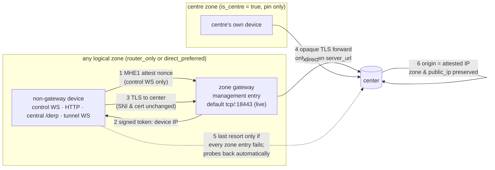
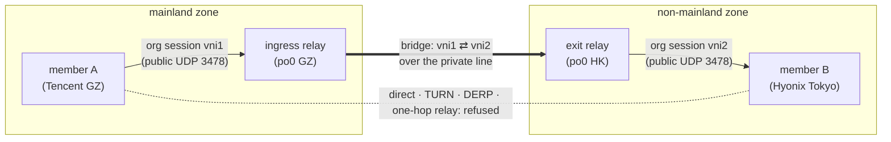
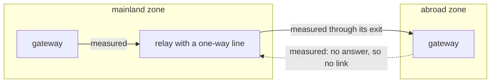
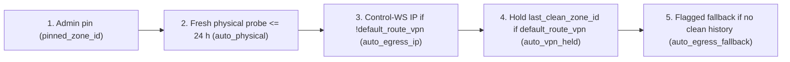

# Business isolation — mainland and non-mainland never meet (MeshHarbor #21)

The rule: a mainland node discovers and connects only to mainland nodes, and a
non-mainland node only to non-mainland nodes. No ACL, share, relay grant, NAT trick or
server hop overrides it, and a node whose zone is unknown, untrusted or expired is
treated as being in neither zone. Management traffic (`www.itachi.fans`) is not
business traffic and never passes through this gate.

## Servers: the topology decides, not the zones

Two devices whose central role is **Server** (approved by the central owner, never
self-declared) are judged by the tenant's **server topology** instead of their zones:
an enabled link between them connects them, whatever their zones; no link, or a
disabled one, separates them, even inside one zone. So the topology view shows every
server connection there is. A pair with any other device (a client, or a device with
no current role) keeps the zone rule above.

| pair | rule |
|---|---|
| server and server | connected exactly when an enabled link names them; then every carrier (direct, DERP, an org relay in either server's zone, TURN, center tunnels, forwards) and every port, both ways, bypassing the ACL |
| anything else | one known shared zone (or an approved cross-border line), then the ACL |

Links live on the tenant's overlay network (`server_links`, at most 4096) and are
edited through `GET/PUT /api/tenant/{tid}/server-link` and
`DELETE /api/tenant/{tid}/server-link/{a}/{b}` (agent ids; editing needs
`ADMINISTRATOR`, since a link can join the two zones; both ends must be current
servers). An edit re-fans both servers, rebuilds the DERP allow table and ends the
sessions it no longer allows (`server_link_changed`). The rule follows
`app.business_isolation`: `enforce` applies it, `warn` only logs the server pairs a
missing link would separate (put the links in place, then switch), `off` ignores it.
One permission check (`business_isolation::permit_refs`) serves every gate.

The admin page **Network → Server topology** draws this on a world map: each server
at its country (the country of its last observed connection, so GeoIP precision:
several servers in one country share a small ring), coloured by zone, each link as
the great circle between its two servers (solid on, dashed off). Click one server,
then another, to add a link; click a link to switch it or remove it. The same links
are listed under the map as rows.

## A device that roams (GEO-05)

A zone holds for one connection, so a device that moves into the other zone
reconnects from there, and its rejoin reshapes everything: its full netmap and every
peer's delta are shaped on the new zone, the `/derp` table is rebuilt, and (new) every
org-relay session it takes part in, as a member or as a relay, is re-read once its new
observation is in (`org_relay::recheck_zones`, after `JOIN_ZONE_WAIT`). A session
whose members and relay no longer share one known zone is revoked at once under
`enforce`, audited `zone_changed`, and only logged under `warn`; before, an explicitly
granted session survived the roam until its hourly expiry. A reconnect from the same
zone keeps it. A party that does not come back is rechecked once more after
`LINE_RECONNECT_GRACE` and, with no live connection, no longer fits. Detection is the
reconnect itself: a roam that keeps the old TCP connection alive (one NAT egress for
both networks) is not a roam this observation can see.

## Management is exempt, business over the center is not (#22)

A device's own connection to the center (`www.itachi.fans`: enrollment, login, the
agent WebSocket's hello, heartbeat, configuration and policy pushes, forward
control) is management traffic. No gate here ever refuses it, whatever the zones:
it is the connection the zone is observed on, and a mainland device must stay
manageable. Its *path* does follow the zone since FR-128 and for **every** zone and
message since FR-134: any non-gateway device in any zone reaches the center through its
zone's gateway ([below](#management-through-a-zones-entry-fr-128--fr-134)). What the center *brokers between two devices* is business traffic, even
though it starts on the same WebSocket: a tunnel whose bytes cross the center's TURN
relay or `/derp` is gated like any overlay carrier. There is no line exception for
it: a line is an overlay org-relay session, which a tunnel never rides.

## Management through a zone's entry (FR-128 / FR-134)

The center is a zone of its own (`NetworkZone.is_centre = true`). Once an organization defines
zones, **every zone must name at least one gateway router**, and **every non-gateway device in
every zone** reaches the center only through its own zone's gateways — for its control
WebSocket, every native HTTP client (enrollment refresh, logs, crash reports, preflight,
device view, remote config, exec/SSH service claims, updater manifest and downloads), central
`/derp`, and tunnel-client WebSockets. Only a zone's approved gateways and devices explicitly
pinned to the center zone (`is_centre = true`) dial the center directly — gateway to gateway,
just like cross-zone traffic. Gateways forward the device's TLS unread and attest which
address the device came from.



| | Rule | Where |
|---|---|---|
| centre zone & required gateways | `NetworkZone.is_centre` marks the centre's own zone (at most one; no `auto_countries`, never `is_default`; geography never places a device there — pin only). `PUT /network-zones` refuses any zone with empty `gateway_relay_ids`; legacy stored zones warn at startup without failing boot | `NetworkZone::is_centre`, `first_zone_without_gateway`, `resolve_device_zone` in [`models.rs`](../crates/remote_control/src/models.rs) (:7134, :7314, :7326); `set_zones` in [`network_zones.rs`](../crates/modules/network/src/routes/network_zones.rs) |
| who is an entry | any approved gateway of a zone (`gateway_relay_ids`, `peer_relay_policy.serve`) serves by default on TCP `18443` (`management_entry_port` unset = `18443`, custom `1..=65535`, `0` = owner opt-out; refused while `protected`). Non-gateways never bind the port: the listener starts live on non-empty `rc:agent.management_entry` and stops live on empty key (or demotion / shutdown) | `is_gateway`, `entry_key` in [`management_path.rs`](../crates/modules/fleet/src/management_path.rs) (:49, :61); `management_entry_port_allowed` in [`config.rs`](../crates/agent-core/src/config.rs) (:2713); `ensure_started_with_key`, `stop` in [`mgmt_entry.rs`](../agents/meshharbord/src/mgmt_entry.rs) (:106, :161) |
| may a device dial the center directly | inside a zone, **only** `is_own_gateway || zone.is_centre`; every other device in a zone gets `direct = false` regardless of `cross_zone_mode` (`router_only` or `direct_preferred`). An org without zones, an unresolved device, or `app.management_entries = false` keeps `direct = true, entries = []` | `path_for`, `sync_tenant_management_paths` in [`management_path.rs`](../crates/modules/fleet/src/management_path.rs) (:130, :196) |
| what the device is told | `rc:agent.management_path {direct, entries}` on every connect and pushed live (local + cross-pod `rc ctrl`) when zones, pins, relay policies, or gateway entry ports change; `entries` are the zone gateways' public addresses (static endpoints, node endpoints, then `public_ip`) with their bound entry port, at most 8 | `socket.rs` (search `management path pushed`), `sync_tenant_management_paths` (:196) |
| the device's order & never stranded | direct first when allowed, then owner's `management_entries`, then pushed entries; when direct is disallowed, entries first and direct only as a last resort (logged and surfaced in `mh status` via `NodeStatus.management_path`), with automatic re-probing (`entry_retry_after` and immediate probe when a fresh push brings entries online). A live socket moves when policy switches between direct and entries or drops its current entry | `plan`, `should_move` in [`agent-core management_path.rs`](../crates/agent-core/src/management_path.rs) (:70, :413); `dial_centre` in [`signaling.rs`](../agents/meshharbord/src/signaling.rs) (:1648); `ManagementPathStatus` in [`localapi`](../crates/localapi/src/lib.rs) (:448) |
| every native HTTP & WS client | `http_client::builder()` installs `ManagementPathResolver` (dynamic live route in the daemon; kept `management-path.json` + local entries with direct last-resort fallback in `mh`, companion, setup, and SYSTEM services); central `/derp` dials via `ws_connect::connect_centre` and reconnects on route change; tunnel-client / shared-SSH WS dials via `connect_ws_via_management_path`. Source guards lock both HTTP and WS | `builder_with` in [`http_client.rs`](../crates/agent-core/src/http_client.rs) (:49); `ManagementPathResolver`, `candidates_for_url` in [`agent-core management_path.rs`](../crates/agent-core/src/management_path.rs) (:354, :495); `connect_centre` in [`ws_connect.rs`](../agents/meshharbord/src/ws_connect.rs) (:102); `connect_ws_via_management_path` in [`forward.rs`](../agents/meshharbor-cli/src/forward.rs) (:46); guards [`fr134_path_guard.rs`](../crates/agent-core/tests/fr134_path_guard.rs) & [`fr135_proxy_guard.rs`](../crates/agent-core/tests/fr135_proxy_guard.rs) |
| the device's address | the token names the address the entry saw; the center takes it only from a live entry of the **same org**, signed under that entry's key (derived from the server secret and its credential generation), at most 120 s old, on a connection that comes from that entry's own address | `resolve_origin`, `check_token` (:339, :424); `ConnectionOrigin::through_management_entry` in [`client_ip.rs`](../crates/core/src/client_ip.rs) (:238) |
| a device on the entry's private network | its attested address is private: the entry's address is the true one, and stays | `resolve_origin` |
| no token from an entry's address | when the address is that of one of the **org's current entries** (an approved relay, a zone gateway, with a bound port), the connection gets **no** address (`unattested_entry`, :247): an entry must not lend its zone. Only current entries count: an unapproved device or another org's must not strip addresses behind a shared egress. A pin still applies. An approved relay is exempt: it may share a provider's egress with a gateway | `resolve_origin` |

> ⚠️ **A device behind the same NAT as an entry, connecting directly, gets no zone**: the center
> cannot tell it from a connection the entry forwarded. Give an entry an address of its own, or
> pin its neighbours (`app.business_zone_pins`).

> ⚠️ An entry is trusted with its key, as a gateway is trusted with its zone's relaying: a
> compromised entry can attest a wrong address for the devices that come through it. It cannot
> read or forge their TLS, and it forwards only to the host of its own `server_url`.

Kill switches: `MESHHARBORD_MANAGEMENT_ENTRIES=0` on a device (direct only, stops advertising
`management-path` and `management-entry`); `management_entry_port = 0` on a gateway (owner
opt-out — never binds the entry port); `app.management_entries = false` on the center (every
device is told direct with no entries, no keys delivered, and tokens ignored). The token format:
[`management_entry.rs`](../crates/remote_control/src/management_entry.rs).

## Where a node's zone comes from

The zone is the one observed on the node's **live connection** when that connection
opened. It is the same evidence the `auto` relay mode already uses (see
[peer-relays.md](peer-relays.md#auto--a-central-server-role-inside-one-business-zone-meshharbor)):
the trusted-proxy chain gives the client address, and the GeoIP dataset (inside its
120-day freshness rule) gives the country. `org_relay::node_zone` reads it through the
per-connection binding, for agents (bound at `hello`) and tunnel clients (bound when
the tunnel connection is created, unbound at teardown). A connection cannot change its
source address, so the zone holds for its life. A reconnect re-joins, and that join
reshapes everything below.

No trusted proxy chain, no GeoIP database, a stale dataset, or no live connection on
this pod all mean **no zone**, and no zone matches nothing, not even another node
with no zone.

**Conflicting evidence is no zone either (GEO-04).** The control connection is one
egress; a node's data plane may leave through another. Every public address the node
advertised for its traffic (its STUN-observed srflx candidates and its NIC's global
addresses, IPv4 and IPv6) is geolocated under the same dataset rule
(`business_authority::address_zone`), and if any lands in the other zone the node has
no zone (`org_relay::addresses_agree`): a control path proxied out of one zone while
traffic leaves the other, or a dual-stack host whose IPv6 exits elsewhere, is refused
rather than trusted. An address with no known zone is not a conflict. These addresses
are the node's own claims, so they can only withdraw a zone, never grant one. A
trickle that brings a conflict reshapes the node's peers at once and, under
`enforce`, ends its sessions (`zone_conflict`). Relays are judged the same way.

## The setting

`app.business_isolation` (`MESHHARBOR__APP__BUSINESS_ISOLATION`):

| value | effect |
|---|---|
| `off` | the rule is not consulted; no zone lookups are made |
| `warn` (default) | every gate below computes its verdict and **logs** what it would refuse, but refuses nothing |
| `enforce` | every gate refuses |

Any other value reads as `enforce`, so a mistyped value cannot quietly switch off a
security setting. The default is `warn` because a server without zone evidence (no
GeoIP database, no trusted proxy configured) would otherwise cut every business mesh
the moment it is deployed. Switch to `enforce` once the `[warn]` lines show only the
refusals you expect.

## Remote-desktop relay locality: a separate setting

The STUN and TURN servers handed out for a remote-desktop session are hops the
device itself connects to. `app.rc_ice_zone_mode`
(`MESHHARBOR__APP__RC_ICE_ZONE_MODE`) keeps them to the device's own zone. It is
**deliberately not tied to `app.business_isolation`**: withholding every server
outside a device's zone removes that device's srflx and relay candidates. A device
whose zone differs from the deployment's relays then has only host candidates, so
cross-network remote desktop to it breaks. Field case: home devices classified
mainland against a non-mainland test-center STUN/TURN. Turning that on is a product
decision, not a side effect of enforcing isolation.

The default `warn` is consistent with the person↔device decision below: TURN for a
browser is not gated by default. `enforce` is an opt-in for strict deployments, for
example a host under a "never connect outside the mainland" rule, where a
remote-desktop relay hop in the other zone is not acceptable either.

| value | effect |
|---|---|
| `off` | no gate is installed; no zone lookups are made |
| `warn` (default) | the verdict is computed and **logged**, one line per device while it stays the same (deduplicated for 10 min), with the device zone, the kept and withheld URL counts and the reason (`device_zone_unknown`, `outside_device_zone`, `server_zone_unknown`); nothing changes |
| `enforce` | every STUN/TURN URL outside the device's zone is withheld; a device with no zone gets none (host candidates still connect a direct path) |

Unlike `business_isolation`, any other value reads as **`warn`**, logged loudly: a
typo must never switch on something that can cut the operator's own remote access.
Read the `rc ice zone (warn)` lines before choosing `enforce`.

- **Where it applies:** the hub's per-session lists (`Ready`, `SdpOffer`,
  `SdpAnswer`, `FileSdpAnswer`), and `/api/turn/credentials`, which is the list the
  viewer builds its peer connection from. That route uses the named device's zone,
  read only after the org-charge checks pass. The loopback overlay relay is added
  after the filter.
- **A server's zone:** its hostname is resolved at boot and every 10 min, and every
  address must geolocate to the same zone. Unresolved or mixed means no zone.
- **A device's zone:** what its current control connection was observed in.
- **Code:** [`ice_zones.rs`](../crates/core/src/ice_zones.rs), `Hub::zone_local_ice`
  in [`hub.rs`](../crates/modules/fleet/src/hub.rs).

## The gates

| carrier | gate | under `enforce` |
|---|---|---|
| netmap (full and every delta) and the device's own listing | `overlay::shape_peer`, checked before the ACL | the peer is withheld; a delta sends it as `removes`, which tears down an installed carrier |
| org relay mint, discovery, fallback, backbone | `org_relay::plan_mint_candidates_reusing` | the pair must share a zone (`zone_denied`, audited), and each candidate relay must be in that zone, explicit grants included; the one exception is an approved cross-border line (below) |
| TURN grant and forced-DERP escalation | `overlay::handle_overlay_relay_request`, after the org offer | no grant is sent |
| `/derp` forwarding | `derp_acl` table: each node's zone beside the ACL allow set; built before a node may register (`derp_acl::ensure_built`) | a frame passes only between two nodes with the same known zone, whatever the ACL mode; a network with no table drops every frame |
| regional PoP `derp-relay` | the ticket's `zone` claim, minted by the API with the node's zone (`agent_arms::handle_derp_ticket_request`) | a frame passes only between equal ticket zones; a node with no zone gets no ticket and keeps the central `/derp` |
| center-brokered tunnel (`rc:tunnel.open`, from a tunnel client or an agent) | `tunnel::handle_tunnel_open`, step 3d, before any TURN credential or QUIC token is minted | `rc:error` `business_isolation`; no session (#22) |
| managed forward (#20) | `managed_forward::plan`: `region` over ingress and destination, and `source region` over every overlay node its sources admit (GEO-03), whatever the overlay ACL's mode | the plan fails and nothing is pushed; an applied forward whose gate later fails is withheld at the next push. A source in the other zone would otherwise reach the destination behind the ingress's address |
| subnet route and exit node | ride their router peer (the netmap row above) | a router in the other zone is withheld, so its LAN and `0.0.0.0/0` are never offered (`a_subnet_route_stays_in_its_routers_zone`) |
| subnet-route approval (GEO-06) | `routes::overlay_route::set_approved_routes` binds the approval to the router's zone (`OverlayNode::routes_zone`); `overlay::shape_peer` offers the routes only while the router is observed in that zone | two routers in different known zones may hold the same private CIDR (one per zone; an unknown zone keeps the one-router 409). A router seen outside its bound zone keeps its peer row but offers no route, so it never claims the other zone's site (`identical_private_prefixes_in_two_zones_stay_distinct`) |

The netmap is the first line: an honest client never learns a withheld peer's key or
endpoints. The others close the paths a stale or modified client could take with
a key or node id it already holds.

A joiner under `enforce` waits up to `JOIN_ZONE_WAIT` (2 s) for its own observation to
land before its netmap is shaped; otherwise a joiner whose evidence arrived a moment
late would be shown nobody until its next rejoin.

## The one exception: an approved cross-border line

The user's rule (2026-10-26, "允许，走 po0 专线"): a mainland and a non-mainland node
may reach each other **only** over an administrator-approved private line between two
of the tenant's own relays, such as the po0 interconnect between Guangzhou and Hong
Kong. Nothing else crosses: no direct path, no one-hop relay, no TURN, no DERP.

| # | rule | where it holds |
|---|---|---|
| 1 | an administrator flags a backbone edge `cross_border` | `PeerRelayBackboneEdge.cross_border`; `decide_approval` refuses anyone without `ADMINISTRATOR` who opens one ([`peer_relay.rs:72`](../crates/modules/network/src/routes/peer_relay.rs#L72)) |
| 2 | a cross-zone pair rides only that line, each member on the relay in its own zone | `plan_line` ([`org_relay.rs:1116`](../crates/modules/network/src/org_relay.rs#L1116)) |
| 3 | direct, one-hop org relay, TURN and DERP stay refused | the gates above, unchanged; the client also refuses them for such a peer (below) |
| 4 | only a client that rides line-only peers sees the other side; an old client still sees nothing | join flag `supports_backbone_only_v1`; `Zones::line_only` ([`business_isolation.rs:103`](../crates/modules/network/src/business_isolation.rs#L103)) |
| 5 | every crossing is audited | two `mint` rows per line, one per relay, reason `cross_border_line` (`audit_line`, [`org_relay.rs:1386`](../crates/modules/network/src/org_relay.rs#L1386)) |



### What each side is shown

Under `enforce`, a cross-zone peer is shaped like any other (the ACL still decides),
then **stripped to the line** (`line_only`, [`overlay.rs:3046`](../crates/modules/network/src/overlay.rs#L3046)):
`backbone_only: true`, and no endpoints, LAN or srflx candidates, relay home, warm
relay, DERP, forced-DERP or floor capability, and no relay strategy. It is shown so
only to a recipient that joined with `supports_backbone_only_v1`, and only while a line
connects the two zones (`Lines::connects`). Everyone else still has it withheld.

### How the line is minted

The line is an ordinary org-relay session **on each side**, not a path trial. A path
trial starts from a working direct carrier and promotes the relay path only when it
measures faster, and a cross-zone pair has no direct carrier by rule. The relays'
two-leg bridge (`OverlayRelayBridgeServe`, `orgrelay/backbone.rs`) is reused as is.

```mermaid
sequenceDiagram
    participant A as member A (mainland)
    participant S as server
    participant G as ingress relay (mainland)
    participant H as exit relay (non-mainland)
    participant B as member B (non-mainland)

    Note over A: B is backbone_only: no endpoint to dial,<br/>so the ladder sends a relay request
    A->>S: rc:overlay.relay_request {peer B}
    Note over S: enforce · both zones known and different ·<br/>an approved relay in each zone with a cross_border edge ·<br/>both granted to both members · ingress backbone-ready ·<br/>both members advertise supports_backbone_only_v1
    S->>G: relay_serve {vni1: A, bridge}
    S->>H: relay_serve {vni2: bridge, B}
    S->>G: relay_bridge_serve {vni1 ⇄ private endpoint, vni2}
    S->>A: relay_session {relay G, vni1, A's secret}
    S->>B: relay_session {relay H, vni2, B's secret}
    S->>S: audit: mint × 2, reason cross_border_line
    Note over S: no TURN grant: refuses_pair
    A->>G: bind (vni1)
    G->>H: bridge binds both legs (private line)
    B->>H: bind (vni2)
    Note over A,B: WireGuard end to end; the relays see ciphertext and VNIs
```

- **Whoever asks, the sides stay put.** The edge's source holds the bridge (it dials
  the private endpoint), so the member in the source's zone binds there, whichever
  member sent the request (`LinePlan::flipped`).
- **Explicit grants only.** Each relay must be approved and granted to **both**
  members by an overlay policy; the `auto` mode's implicit grant rests on one shared
  zone and never applies across the line.
- ⚠️ **Members are never told the private endpoint.** Each is pushed only its own
  relay's public endpoints; the private `ip:port` goes only to the ingress relay, and
  its native backbone policy (`MESHHARBORD_RELAY_BACKBONE_ENABLED`, an explicit interface
  and CIDR allowlist) must permit it too.
- **The MTU cap.** The bridge carries at most `BACKBONE_MAX_CIPHERTEXT`; a network
  whose MTU exceeds `BACKBONE_MAX_OVERLAY_MTU` (1360) gets no line.
- **A re-request is a re-push, or a re-mint.** A member asks only while it has no
  working carrier. Within the bind window the live line is re-pushed to it; past it,
  the line is revoked (`org-line-rebind`) and minted afresh (`maybe_mint_line`,
  [`org_relay.rs:1198`](../crates/modules/network/src/org_relay.rs#L1198)).
- **A lossy line is kept.** A loss report on a line never moves the pair to DERP or
  to a one-hop relay (`handle_org_relay_loss`, [`overlay.rs:1737`](../crates/modules/network/src/overlay.rs#L1737)).

### What ends a line

Every end is a push to all four parties, each told its own leg's VNI, plus a bridge
revoke to the ingress relay, and one `revoke` row (`revoke_matching_sync`,
[`org_relay.rs:2139`](../crates/modules/network/src/org_relay.rs#L2139)):

| trigger | reason |
|---|---|
| the edge is removed, or loses its `cross_border` flag | `backbone_edge_revoked` |
| either relay's approval is cleared | `policy_revoked` |
| a policy edit no longer grants a member either relay | `acl_revoked` |
| a member stops advertising `supports_backbone_only_v1`, or the ingress stops being backbone-ready | `backbone_capability_withdrawn` |
| a party goes offline (its control connection closes and the hub marks it offline) | `device_left` |
| a party's connection closes or is displaced, and `LINE_RECONNECT_GRACE` (20 s) later its parties' zones no longer fit the line (`line_zones_fit`: every party connected, `members[0]` in the ingress relay's zone, `members[1]` in the exit relay's, the two zones different) | `connection_closed` / `connection_displaced` |

A line needs no control plane to carry traffic, so the connection triggers wait out the
grace instead of revoking at once (`connection_ended`,
[`org_relay.rs`](../crates/modules/network/src/org_relay.rs)): a reconnect from the same
zone keeps the line, and a center restart, whose pending checks die with the process,
leaves every line running. Revoking at once used to tear a line down on one relay only
while a restarting center closed its connections, and the members kept the dead half.
| a party is removed, or the org switches peer relays off | `device_removed` / `mode_off` |

### The client's half

A client that advertises the flag (org relay on, primary org, MTU within the cap;
`OVERLAY_BACKBONE_ONLY=0` opts out, [`runtime.rs:2420`](../crates/tunnel-core/src/overlay/runtime.rs#L2420))
holds such a peer as `PeerConfig::backbone_only`, and:

- dials it on no direct tier, whatever a candidate list says (`resolve_direct_candidates`,
  [`establish.rs:158`](../crates/tunnel-core/src/overlay/runtime/establish.rs#L158));
- never answers a direct handshake from it ([`inbound.rs:81`](../crates/tunnel-core/src/overlay/runtime/inbound.rs#L81));
- ignores a server DERP pin for it ([`runtime.rs:4826`](../crates/tunnel-core/src/overlay/runtime.rs#L4826));
- builds no DERP floor toward it, whatever its flags say (`build_floor`, [`relay_link.rs`](../crates/tunnel-core/src/overlay/relay_link.rs));
- asks the server for its line again when the line's carrier dies, rather than
  re-binding the dead session it holds (the death handler in
  [`establish.rs`](../crates/tunnel-core/src/overlay/runtime/establish.rs) sends
  `request_org_fallback`; the server re-mints a line past its bind window);
- renews a line `LINE_RENEW_AHEAD` (60 s) before its session ends, riding the live one
  meanwhile (`renew_expiring_lines`, [`relay_link.rs`](../crates/tunnel-core/src/overlay/relay_link.rs)):
  the server revokes a line past its bind window and mints the next in one step;
- asks for the line of a line peer it holds no carrier for, every fallback gap
  (`request_org_fallbacks`, [`runtime.rs`](../crates/tunnel-core/src/overlay/runtime.rs)):
  DERP never carries such a peer, so nothing else would.

The server never stamps a relay tier on a line peer (`stamp_verdict`,
[`overlay.rs`](../crates/modules/network/src/overlay.rs)); a D0 re-stamp used to tell a
member DERP toward its line peer, which `/derp` then dropped.

The rest is the existing ladder: a peer with no endpoint falls through to a relay
request, and the org session the server mints is bound like any other.

### Field-verified (2026-10-26)

A TEST rig: center on Isvoro with `enforce` and peer relays `on`; every node a real
`meshharbord` in netstack mode (`46ee8946`). The mainland member is a workstation in
Henan, the ingress relay po0 GZ, the line the po0 private interconnect to po0 HK
(`10.42.2.114`), the exit relay po0 HK, and the non-mainland member Hyonix Tokyo.

| step | result |
|---|---|
| no `cross_border` edge | the cross-zone peer is withheld; overlay SSH from the mainland member to Tokyo: no answer in 12 s |
| the edge flagged | each member is shown the other `backbone_only`; the line is minted with two `cross_border_line` rows; the mainland member binds po0 GZ, Tokyo binds po0 HK; overlay SSH answers across the line; 2 MB each way at 11.0 / 10.7 Mbit/s, SSH setup 0.95 s |
| a member and the far side's relay | refused `zone_denied` (no line carries that pair) |
| the flag cleared | all four parties revoked within one second, audited `backbone_edge_revoked`; overlay SSH: no answer, and no fallback to DERP, TURN or direct |

Restarting a member re-minted the line twice within seconds (`connection_closed`), as
designed: a line rests on each party's live connection. The rig changed no firewall or
route on any host and sent only a few MB through the po0 hosts.

**Resilience** (rig `2c364a4f481c`, the same hosts; a one-second probe of the
overlay SSH banner from the mainland member to Tokyo):

| event | before (`46ee8946`) | after (`569e2c7d`) |
|---|---|---|
| the center restarts | dark until the line's hourly expiry (1194 s observed, then healed by a member restart) | 0 s dark, twice |
| a member restarts | 3.2 s | not re-measured |
| a member's control connection drops | — | `device_left` ends the line at once; it is minted again about 1 s after the member is back, with no DERP attempt |
| the session's hourly end | 5.1 s (4 s to notice the expiry, 110 ms to mint and bind the next) | no outage on the probe (`b4aea968`): a member renews 60 s ahead, the old line is revoked and the next one is ready 98 ms later |

## Under Logical Network Zones a measured crossing needs no approval (FR-125)

Everything above is legacy business isolation (`app.business_isolation = enforce`), where the
only way across is a line an administrator approved. Under Logical Network Zones with
`enforce` off, relays link across zones by measurement instead
([peer-relays.md](peer-relays.md#relays-link-by-measurement-the-zone-is-the-only-rule-fr-125)):

| | Legacy `enforce` | Logical Network Zones (`off` / `warn`) |
|---|---|---|
| a cross-zone relay link | an approved `cross_border` edge only | any relay pair, where the source measured the target reachable, on a public address |
| which zones it may join | the edge's two | the requesting pair's two, and no other |
| path ends | the line's two relays | the two zones' gateways |
| a strict (`router_only`) zone | unchanged | unchanged: its devices still cross only through its gateways, and FR-124's boundary holds |
| who decides it is up | the administrator | the measurements, re-taken at once when a bridge's remote leg fails |



> [!IMPORTANT]
> `enforce` keeps its own rules exactly: the switch every consumer reads,
> `AppSettings::relay_auto_links_effective`, is false under it, so no relay is even offered
> another zone's relays to measure.

## VPN-resistant automatic zones (FR-138)

An Auto device (`pinned_zone_id == None`) must stay in its physical Logical Network Zone even when
a TUN-mode VPN or proxy captures its OS default route. Every server surface calls one pure function
`resolve_device_zone_with_source` (`crates/remote_control/src/models.rs:7454-7525`):



- **Physical-path probe.** On connect and major network changes, `meshharbord` sends a non-blocking
  no-proxy (FR-135) `POST /api/agent/self/egress-probe` bound to a physical non-VPN uplink
  (`IP_UNICAST_IF` on Windows, `IP_BOUND_IF` on macOS, `SO_BINDTODEVICE` on privileged Linux;
  unprivileged Linux skips silently). When zoned under FR-134, the probe traverses the zone's
  management entry with an `MHE1` attestation fetched over the same physical-bound socket. The
  server records only the observed `canonical_public_ip` (`physical_public_ip` + `physical_seen_at`).
- **Hold invariant & hysteresis.** `AgentCaps::default_route_vpn` can only hold an existing
  `last_clean_zone_id` (step 4) and can never move a device into another zone. Within a single
  control-WS connection, an Auto device moves to a new country only after two physical probes at
  least 10 minutes apart agree (or immediately on reconnect with a clean physical probe).

## Known limits

- **A line outlives the center instance that minted it.** Like every org-relay
  session, a line lives on the relays until its hourly expiry; a restarted center does
  not know it, so revoking its edge in that window does not reach it. The members ask
  the new center for a line once the old one expires or dies.
- **A member that goes offline darkens its line** until it reconnects: no other carrier
  may carry a cross-zone pair.

- **The DERP restart window is closed (2026-11-11).** A missing `/derp` table used to
  permit frames until a network's first join after a restart. Now an ungated network
  carries an open table, a missing one drops, and a registration builds its network's
  table first (bounded; on failure it is refused and the client retries).
- **Regional PoP DERP relays** (`derp-relay`) now carry the zone in the ticket
  (2026-11-11). A ticket minted before that has no zone and meets only other unzoned
  tickets. A zone claim is fixed for the ticket's 24 h life; the netmap stays the
  first line for a node that moves.
- **Direct paths** need both endpoints, which only the netmap hands out. A client that
  learned a peer's address some other way can still send to it, and the server cannot
  see that traffic. The handshake still fails: a node configures WireGuard peers only
  from its own netmap, which under `enforce` holds no cross-zone key, except a
  line-only peer's, and the client never answers a direct handshake from that peer.

- **Sessions with a person on one end are not gated, by product decision
  (2026-10-26, reaffirmed 2026-11-11).** Remote desktop (`rc:session.request`), the
  hive viewer and shared SSH (a device-share recipient's CLI, bridged by the center)
  pair a person with a device. They are a person operating a device, treated like
  management, not business traffic between devices, so a person in one zone may
  operate a device in the other. Remote desktop's STUN/TURN locality is the separate,
  opt-in `app.rc_ice_zone_mode` above (default `warn`: nothing is withheld).
- **Hive replica streams** (member device ↔ source device, `hive/src/stream.rs`) pair
  two zoned devices but live in the hive module, outside these gates.

## Code and tests

| piece | where |
|---|---|
| mode, `Zones`, `pair_zone`, `refuses_pair` | [`business_isolation.rs`](../crates/modules/network/src/business_isolation.rs) |
| a node's zone | `node_zone` in [`org_relay.rs`](../crates/modules/network/src/org_relay.rs) |
| netmap shaping | `shape_peer`, `shape_full_netmap`, `fan_upsert_shaped` in [`overlay.rs`](../crates/modules/network/src/overlay.rs) |
| DERP table | [`derp_acl.rs`](../crates/modules/network/src/derp_acl.rs); load-before-serve test in [`derp_load_before_serve_tests.rs`](../crates/tests/src/derp_load_before_serve_tests.rs) |
| PoP zone | `DerpTicketClaims::zone` in [`derp_ticket.rs`](../crates/remote_control/src/derp_ticket.rs); `forward_frame` in [`derp-relay`](../crates/derp-relay/src/main.rs) |
| RC relay locality | [`ice_zones.rs`](../crates/core/src/ice_zones.rs); tests `rc_ice_servers_stay_in_the_devices_zone`, `rc_ice_zone_warn_and_off_change_nothing_even_under_enforced_isolation` in [`business_isolation_tests.rs`](../crates/tests/src/business_isolation_tests.rs) |
| netmap TestApp tests | [`business_isolation_tests.rs`](../crates/tests/src/business_isolation_tests.rs) |
| the cross-border line: planner, mint, audit, revocation | `plan_line`, `maybe_mint_line`, `mint_line`, `audit_line`, `revoke_line_node_sync` in [`org_relay.rs`](../crates/modules/network/src/org_relay.rs) |
| the line's netmap shaping | `Lines`, `rides_lines`, `Zones::line_only` in [`business_isolation.rs`](../crates/modules/network/src/business_isolation.rs); `line_only` in [`overlay.rs`](../crates/modules/network/src/overlay.rs) |
| the line's resilience, and roaming (GEO-05) | `connection_ended`, `recheck_zones`, `session_zones_fit`, `line_zones_fit` in [`org_relay.rs`](../crates/modules/network/src/org_relay.rs); `stamp_verdict` in [`overlay.rs`](../crates/modules/network/src/overlay.rs) |
| the line's TestApp tests | `a_cross_border_pair_rides_only_its_approved_line`, `a_line_ends_with_its_edge_and_with_either_relay`, `a_line_outlives_a_reconnect_from_its_zone_only` in [`business_isolation_tests.rs`](../crates/tests/src/business_isolation_tests.rs) |
| relay and TURN TestApp tests | `isolation_*` in [`peer_relay_auto_tests.rs`](../crates/tests/src/peer_relay_auto_tests.rs) |
| management through an entry (FR-128) | [`management_path.rs`](../crates/modules/fleet/src/management_path.rs), [`mgmt_entry.rs`](../agents/meshharbord/src/mgmt_entry.rs), [`agent-core management_path.rs`](../crates/agent-core/src/management_path.rs); TestApp tests in [`management_entry_tests.rs`](../crates/tests/src/management_entry_tests.rs) |
| VPN-resistant automatic zones (FR-138) | `resolve_device_zone_with_source` & `evaluate_probe_hysteresis` in [`models.rs`](../crates/remote_control/src/models.rs), `egress_probe` in [`agent_self.rs`](../crates/api/src/routes/agent_self.rs), [`egress_probe.rs`](../agents/meshharbord/src/egress_probe.rs), `connect_tcp_bound` & `default_route_is_vpn` in [`direct.rs`](../crates/tunnel-core/src/overlay/direct.rs); TestApp tests in [`vpn_zone_tests.rs`](../crates/tests/src/vpn_zone_tests.rs) |
| tunnel gate (#22) | `refuses_parties` in [`business_isolation.rs`](../crates/modules/network/src/business_isolation.rs), step 3d of `handle_tunnel_open` in [`tunnel.rs`](../crates/modules/network/src/tunnel.rs); test `a_center_brokered_tunnel_stays_in_one_zone` in [`business_isolation_tests.rs`](../crates/tests/src/business_isolation_tests.rs) |
