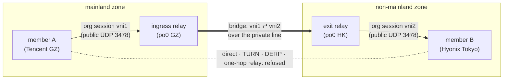

# Business isolation — mainland and non-mainland never meet (MeshHarbor #21)

The rule: a mainland node discovers and connects only to mainland nodes, and a
non-mainland node only to non-mainland nodes. No ACL, share, relay grant, NAT trick or
server hop overrides it, and a node whose zone is unknown, untrusted or expired is
treated as being in neither zone. Management traffic (`www.itachi.fans`) is not
business traffic and never passes through this gate.

## Where a node's zone comes from

The zone is the one observed on the node's **live connection** when that connection
opened. It is the same evidence the `auto` relay mode already uses (see
[peer-relays.md](peer-relays.md#auto--a-central-server-role-inside-one-business-zone-meshharbor)):
the trusted-proxy chain gives the client address, and the GeoIP dataset (inside its
120-day freshness rule) gives the country. `org_relay::node_zone` reads it through the
per-connection binding, for agents (bound at `hello`) and tunnel clients (bound when
the tunnel connection is created, unbound at teardown). A connection cannot change its
source address, so the zone holds for its life. A reconnect re-joins, and that join
reshapes everything below.

No trusted proxy chain, no GeoIP database, a stale dataset, or no live connection on
this pod all mean **no zone**, and no zone matches nothing, not even another node
with no zone.

## The setting

`app.business_isolation` (`ROOMLER__APP__BUSINESS_ISOLATION`):

| value | effect |
|---|---|
| `off` | the rule is not consulted; no zone lookups are made |
| `warn` (default) | every gate below computes its verdict and **logs** what it would refuse, but refuses nothing |
| `enforce` | every gate refuses |

Any other value reads as `enforce`, so a mistyped value cannot quietly switch off a
security setting. The default is `warn` because a server without zone evidence (no
GeoIP database, no trusted proxy configured) would otherwise cut every business mesh
the moment it is deployed. Switch to `enforce` once the `[warn]` lines show only the
refusals you expect.

## The gates

| carrier | gate | under `enforce` |
|---|---|---|
| netmap (full and every delta) and the device's own listing | `overlay::shape_peer`, checked before the ACL | the peer is withheld; a delta sends it as `removes`, which tears down an installed carrier |
| org relay mint, discovery, fallback, backbone | `org_relay::plan_mint_candidates_reusing` | the pair must share a zone (`zone_denied`, audited), and each candidate relay must be in that zone, explicit grants included; the one exception is an approved cross-border line (below) |
| TURN grant and forced-DERP escalation | `overlay::handle_overlay_relay_request`, after the org offer | no grant is sent |
| `/derp` forwarding | `derp_acl` table: each node's zone beside the ACL allow set | a frame passes only between two nodes with the same known zone, whatever the ACL mode |

The netmap is the first line: an honest client never learns a withheld peer's key or
endpoints. The other three close the paths a stale or modified client could take with
a key or node id it already holds.

A joiner under `enforce` waits up to `JOIN_ZONE_WAIT` (2 s) for its own observation to
land before its netmap is shaped; otherwise a joiner whose evidence arrived a moment
late would be shown nobody until its next rejoin.

## The one exception: an approved cross-border line

The user's rule (2026-10-26, "允许，走 po0 专线"): a mainland and a non-mainland node
may reach each other **only** over an administrator-approved private line between two
of the tenant's own relays, such as the po0 interconnect between Guangzhou and Hong
Kong. Nothing else crosses: no direct path, no one-hop relay, no TURN, no DERP.

| # | rule | where it holds |
|---|---|---|
| 1 | an administrator flags a backbone edge `cross_border` | `PeerRelayBackboneEdge.cross_border`; `decide_approval` refuses anyone without `ADMINISTRATOR` who opens one ([`peer_relay.rs:72`](../crates/modules/network/src/routes/peer_relay.rs#L72)) |
| 2 | a cross-zone pair rides only that line, each member on the relay in its own zone | `plan_line` ([`org_relay.rs:1116`](../crates/modules/network/src/org_relay.rs#L1116)) |
| 3 | direct, one-hop org relay, TURN and DERP stay refused | the gates above, unchanged; the client also refuses them for such a peer (below) |
| 4 | only a client that rides line-only peers sees the other side; an old client still sees nothing | join flag `supports_backbone_only_v1`; `Zones::line_only` ([`business_isolation.rs:103`](../crates/modules/network/src/business_isolation.rs#L103)) |
| 5 | every crossing is audited | two `mint` rows per line, one per relay, reason `cross_border_line` (`audit_line`, [`org_relay.rs:1386`](../crates/modules/network/src/org_relay.rs#L1386)) |



### What each side is shown

Under `enforce`, a cross-zone peer is shaped like any other (the ACL still decides),
then **stripped to the line** (`line_only`, [`overlay.rs:3046`](../crates/modules/network/src/overlay.rs#L3046)):
`backbone_only: true`, and no endpoints, LAN or srflx candidates, relay home, warm
relay, DERP, forced-DERP or floor capability, and no relay strategy. It is shown so
only to a recipient that joined with `supports_backbone_only_v1`, and only while a line
connects the two zones (`Lines::connects`). Everyone else still has it withheld.

### How the line is minted

The line is an ordinary org-relay session **on each side**, not a path trial. A path
trial starts from a working direct carrier and promotes the relay path only when it
measures faster, and a cross-zone pair has no direct carrier by rule. The relays'
two-leg bridge (`OverlayRelayBridgeServe`, `orgrelay/backbone.rs`) is reused as is.

```mermaid
sequenceDiagram
    participant A as member A (mainland)
    participant S as server
    participant G as ingress relay (mainland)
    participant H as exit relay (non-mainland)
    participant B as member B (non-mainland)

    Note over A: B is backbone_only: no endpoint to dial,<br/>so the ladder sends a relay request
    A->>S: rc:overlay.relay_request {peer B}
    Note over S: enforce · both zones known and different ·<br/>an approved relay in each zone with a cross_border edge ·<br/>both granted to both members · ingress backbone-ready ·<br/>both members advertise supports_backbone_only_v1
    S->>G: relay_serve {vni1: A, bridge}
    S->>H: relay_serve {vni2: bridge, B}
    S->>G: relay_bridge_serve {vni1 ⇄ private endpoint, vni2}
    S->>A: relay_session {relay G, vni1, A's secret}
    S->>B: relay_session {relay H, vni2, B's secret}
    S->>S: audit: mint × 2, reason cross_border_line
    Note over S: no TURN grant: refuses_pair
    A->>G: bind (vni1)
    G->>H: bridge binds both legs (private line)
    B->>H: bind (vni2)
    Note over A,B: WireGuard end to end; the relays see ciphertext and VNIs
```

- **Whoever asks, the sides stay put.** The edge's source holds the bridge (it dials
  the private endpoint), so the member in the source's zone binds there, whichever
  member sent the request (`LinePlan::flipped`).
- **Explicit grants only.** Each relay must be approved and granted to **both**
  members by an overlay policy; the `auto` mode's implicit grant rests on one shared
  zone and never applies across the line.
- ⚠️ **Members are never told the private endpoint.** Each is pushed only its own
  relay's public endpoints; the private `ip:port` goes only to the ingress relay, and
  its native backbone policy (`ROOMLERD_RELAY_BACKBONE_ENABLED`, an explicit interface
  and CIDR allowlist) must permit it too.
- **The MTU cap.** The bridge carries at most `BACKBONE_MAX_CIPHERTEXT`; a network
  whose MTU exceeds `BACKBONE_MAX_OVERLAY_MTU` (1360) gets no line.
- **A re-request is a re-push, or a re-mint.** A member asks only while it has no
  working carrier. Within the bind window the live line is re-pushed to it; past it,
  the line is revoked (`org-line-rebind`) and minted afresh (`maybe_mint_line`,
  [`org_relay.rs:1198`](../crates/modules/network/src/org_relay.rs#L1198)).
- **A lossy line is kept.** A loss report on a line never moves the pair to DERP or
  to a one-hop relay (`handle_org_relay_loss`, [`overlay.rs:1737`](../crates/modules/network/src/overlay.rs#L1737)).

### What ends a line

Every end is a push to all four parties, each told its own leg's VNI, plus a bridge
revoke to the ingress relay, and one `revoke` row (`revoke_matching_sync`,
[`org_relay.rs:2139`](../crates/modules/network/src/org_relay.rs#L2139)):

| trigger | reason |
|---|---|
| the edge is removed, or loses its `cross_border` flag | `backbone_edge_revoked` |
| either relay's approval is cleared | `policy_revoked` |
| a policy edit no longer grants a member either relay | `acl_revoked` |
| a member stops advertising `supports_backbone_only_v1`, or the ingress stops being backbone-ready | `backbone_capability_withdrawn` |
| any party's live connection closes or is displaced (its zone evidence) | `connection_closed` / `connection_displaced` |
| a party is removed, or the org switches peer relays off | `device_removed` / `mode_off` |

### The client's half

A client that advertises the flag (org relay on, primary org, MTU within the cap;
`OVERLAY_BACKBONE_ONLY=0` opts out, [`runtime.rs:2420`](../crates/tunnel-core/src/overlay/runtime.rs#L2420))
holds such a peer as `PeerConfig::backbone_only`, and:

- dials it on no direct tier, whatever a candidate list says (`resolve_direct_candidates`,
  [`establish.rs:158`](../crates/tunnel-core/src/overlay/runtime/establish.rs#L158));
- never answers a direct handshake from it ([`inbound.rs:81`](../crates/tunnel-core/src/overlay/runtime/inbound.rs#L81));
- ignores a server DERP pin for it ([`runtime.rs:4826`](../crates/tunnel-core/src/overlay/runtime.rs#L4826));
- builds no DERP floor toward it, whatever its flags say (`build_floor`, [`relay_link.rs`](../crates/tunnel-core/src/overlay/relay_link.rs)).

The rest is the existing ladder: a peer with no endpoint falls through to a relay
request, and the org session the server mints is bound like any other.

### Field-verified (2026-10-26)

A TEST rig: center on Isvoro with `enforce` and peer relays `on`; every node a real
`roomlerd` in netstack mode (`46ee8946`). The mainland member is a workstation in
Henan, the ingress relay po0 GZ, the line the po0 private interconnect to po0 HK
(`10.42.2.114`), the exit relay po0 HK, and the non-mainland member Hyonix Tokyo.

| step | result |
|---|---|
| no `cross_border` edge | the cross-zone peer is withheld; overlay SSH from the mainland member to Tokyo: no answer in 12 s |
| the edge flagged | each member is shown the other `backbone_only`; the line is minted with two `cross_border_line` rows; the mainland member binds po0 GZ, Tokyo binds po0 HK; overlay SSH answers across the line; 2 MB each way at 11.0 / 10.7 Mbit/s, SSH setup 0.95 s |
| a member and the far side's relay | refused `zone_denied` (no line carries that pair) |
| the flag cleared | all four parties revoked within one second, audited `backbone_edge_revoked`; overlay SSH: no answer, and no fallback to DERP, TURN or direct |

Restarting a member re-minted the line twice within seconds (`connection_closed`), as
designed: a line rests on each party's live connection. The rig changed no firewall or
route on any host and sent only a few MB through the po0 hosts.

## Known limits

- **The DERP restart window.** The `/derp` table is rebuilt on every join and policy
  change. After a server restart, a network has no table until its first join, and a
  missing table permits frames (the ACL's fail-open posture). Every node re-joins on
  reconnect, so the window is short, and the netmap has already withheld the cross-zone
  key from honest clients.
- **Regional PoP DERP relays** (`derp-relay`) forward by ticket and see no zones. A
  pair pinned to a regional relay is gated only where the grant is issued (the TURN and
  forced-DERP gate above).
- **Direct paths** need both endpoints, which only the netmap hands out. A client that
  learned a peer's address some other way can still send to it, and the server cannot
  see that traffic. The handshake still fails: a node configures WireGuard peers only
  from its own netmap, which under `enforce` holds no cross-zone key, except a
  line-only peer's, and the client never answers a direct handshake from that peer.

## Code and tests

| piece | where |
|---|---|
| mode, `Zones`, `pair_zone`, `refuses_pair` | [`business_isolation.rs`](../crates/modules/network/src/business_isolation.rs) |
| a node's zone | `node_zone` in [`org_relay.rs`](../crates/modules/network/src/org_relay.rs) |
| netmap shaping | `shape_peer`, `shape_full_netmap`, `fan_upsert_shaped` in [`overlay.rs`](../crates/modules/network/src/overlay.rs) |
| DERP table | [`derp_acl.rs`](../crates/modules/network/src/derp_acl.rs) |
| netmap TestApp tests | [`business_isolation_tests.rs`](../crates/tests/src/business_isolation_tests.rs) |
| the cross-border line: planner, mint, audit, revocation | `plan_line`, `maybe_mint_line`, `mint_line`, `audit_line`, `revoke_line_node_sync` in [`org_relay.rs`](../crates/modules/network/src/org_relay.rs) |
| the line's netmap shaping | `Lines`, `rides_lines`, `Zones::line_only` in [`business_isolation.rs`](../crates/modules/network/src/business_isolation.rs); `line_only` in [`overlay.rs`](../crates/modules/network/src/overlay.rs) |
| the line's TestApp tests | `a_cross_border_pair_rides_only_its_approved_line`, `a_line_ends_with_its_edge_and_with_either_relay` in [`business_isolation_tests.rs`](../crates/tests/src/business_isolation_tests.rs) |
| relay and TURN TestApp tests | `isolation_*` in [`peer_relay_auto_tests.rs`](../crates/tests/src/peer_relay_auto_tests.rs) |
