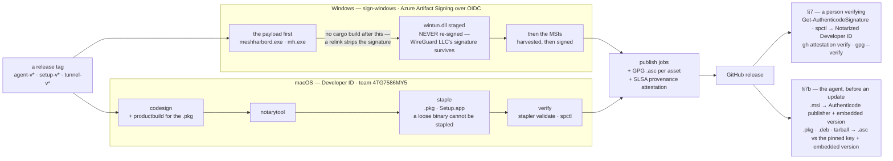
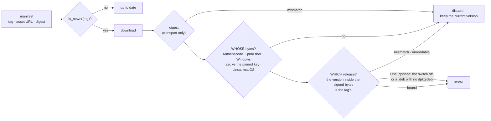

<!-- RETIRED-NAME-ANCHOR-BEGIN
     Every retired name in this runbook names a PUBLISHED release asset. Filenames are fixed by what is already on GitHub Releases (FR-21 D6). The commands here are meant to
     be pasted against a real downloaded artifact, so the filenames must match
     what is actually published. -->
# Code signing

Historical signed-distribution requirements, updater trust checks and credential
setup reference. **For the current owner-directed local artifacts, Windows and
Linux are unsigned; only macOS is signed.** The Windows/GPG provisioning and
signing steps below are not prerequisites for those local builds. Existing updater
verification remains unchanged; unsigned local output is not claimed compatible
with the signed auto-update path. See [current local policy](local-build.md#packaging-and-signing).

Publisher of record: **G ROX LTD** (Plovdivska 110, 4400 Pazardzhik, Bulgaria
— UIC/EIK `205174895`, VAT `BG205174895`). The Windows "Verified publisher"
string, the MSI `Manufacturer`, the `.deb` maintainer and the EXE
`CompanyName` all carry this name; if any of them drifts, sweep them back
together (see [Identity alignment](#identity-alignment)). ⚠️ The one exception
is the **macOS Developer ID team name, `G ROX EOOD`** — the same company under
its Bulgarian legal form, and not something a sweep can change (§9).

---

## 1. The two facts that shaped the design

**A PFX-based public code-signing certificate can no longer be bought.**
Since June 2023 the CA/Browser Forum requires every publicly-trusted
code-signing private key to live in FIPS 140-2 Level 2 hardware. The
`WIN_CODESIGN_PFX_BASE64` secret the workflows historically gated on was a
secret that could never be filled — which is why every release up to and
including `agent-v0.3.0-rc.361` shipped `-unsigned`. Signing therefore runs
against a cloud HSM.

**Signing does not clear SmartScreen on day one.** Microsoft removed
instant-reputation-for-EV in 2024; OV, EV and Azure Artifact Signing all build
SmartScreen reputation organically from download volume. What signing buys
*immediately*:

| Outcome | Effect |
|---|---|
| UAC shows **Verified publisher: G ROX LTD** instead of "Unknown publisher" | immediate |
| AppLocker / WDAC **publisher** rules become possible (IT allow-lists the publisher once, not per-release hashes) | immediate — the big corporate-deployment win |
| ESET / Defender heuristic false positives drop (the rc.28 "downloader trojan" quarantine class) | immediate-ish |
| macOS Gatekeeper accepts the `.pkg` / wizard | immediate |
| SmartScreen prompt disappears | accrues with downloads — but now accrues *per publisher across releases* instead of restarting from zero every release |

## 2. Provider: Azure Artifact Signing (formerly "Trusted Signing")

- ~$10/month Basic tier (5 000 signatures/month; a full agent release signs
  ~7 files).
- Certificates chain to the **Microsoft Identity Verification Root CA 2020**
  (in the Windows root program back to Win7 SP1 with automatic root updates).
- Leaf certificates auto-rotate on a ~3-day lifetime — which is why **RFC3161
  timestamping is mandatory**, and why the CI verify step hard-fails on a
  signature with no countersignature. A timestamped signature stays valid
  after the leaf expires; an untimestamped one dies in days.
- **Zero key material exists in GitHub.** CI authenticates with GitHub OIDC
  (`azure/login` + a federated credential on an Entra app registration); the
  key never leaves Microsoft's HSM. The six `AZURE_*` values in repo
  configuration are **variables**, not secrets — none are confidential.
- EU **organizations** are eligible (G ROX LTD is Bulgarian — qualifies).
  EU *individuals* are not (US/Canada only), which is why signing runs under
  the company identity.

## 2b. Historical signing status (Azure 2026-08-22, Apple 2026-09-08)

- Identity validation **Completed** for G ROX LTD (id
  `2390bcea-a3d5-4919-a624-cb209c875bf7`, valid to 2028-11-21).
- Account `meshharborsigning` (Basic) in **polandcentral**; profile
  `meshharbor-public-trust`; subscription `cb6a5135-9bee-4a35-890f-a3f38f867e88`
  under goran.jovanov@meshharbor.itachi.fans.
- Field-proven: a meshharbor binary signed from the dev box verifies with
  `signtool verify /pa` as `CN=G ROX LTD, O=G ROX LTD, L=Pazardzhik, C=BG`.
- GitHub OIDC wired: app `meshharbor-github-signing`
  (`9a452e59-1312-49d8-bc4a-8f443be19c5f`), signer role scoped to the
  profile, all seven repo variables set.
- **Federated-credential caveat**: this tenant rejects wildcard
  (`refs/tags/*`) subjects — Graph's GitHub-issuer rules refused the
  flexible expression. The working credentials are exact-subject
  `ref:refs/heads/master` (dispatch rehearsals) and
  **`environment:release`** — which is why every job that calls
  `sign-windows` in azure mode carries `environment: release`. Removing
  that line breaks the OIDC exchange for tag builds.
- **GPG is LIVE** (re-checked 2026-08-24 — this line previously said "pending"
  and was stale). `agent-v0.3.0-rc.458` publishes 9 `.asc` sidecars plus
  `meshharbor-release-pubkey.asc`: ed25519 primary `[C]` certify-only
  `D654B016256FD92A81634A0E2AD1E9F025973A7F` + ed25519 `[S]` subkey
  `5DB8221F546288DE780C10D3A2C53E5FE6FA485A`, both to 2028-08-22. Signatures
  verify; a flipped byte gives `BAD signature`. **The agent checks them too**
  (this line said "does not check them yet" long after that stopped being
  true): a `.deb`/`.pkg` update is refused unless its `.asc` verifies against
  the signing subkey pinned in the binary — see §7b.
- **Apple is LIVE and field-verified** (2026-09-08; this line said "still
  pending" for two weeks after that and was stale — FR-7, #778). Enrolment
  `5XS5WN8R99` completed for **G ROX EOOD**, team `4TG7586MY5` — the same
  company as G ROX LTD, under the name its D-U-N-S record holds (§9). Developer ID
  **Application** and **Installer** certificates are issued on the **G2**
  Sub-CA, valid to 2031-09-09; the notarytool key is an App Store Connect team
  key. `60-apple-setup.sh` produced the six `APPLE_*` secrets.
- The first run with real credentials was refused: notarisation returned
  `Invalid` for a self-signed bundle inside a signed `.pkg` (#1521, fixed).
  Nothing before real credentials could have exercised that path.
- Field proof, on a real Mac, of the **published** `.pkg` with quarantine set —
  the path an end user's download actually takes:
  `spctl -a -vvv -t install` → `source=Notarized Developer ID`,
  `origin=Developer ID Installer: G ROX EOOD (4TG7586MY5)`
  ([result](https://github.com/jk-zhang-meta/MeshHarbor/issues/778#issuecomment-5589571740),
  [on the published artifact](https://github.com/jk-zhang-meta/MeshHarbor/issues/778#issuecomment-5589756486)).
  That line is the only check that tells *signed* from *signed AND notarised*.
- ⚠️ What a *release* carries and what the *machine installing an update*
  checks are different questions — §7b. The agent's own check of a `.pkg`
  update is the GPG `.asc` against its pinned key, not the Apple signature, and
  since FR-97 P6a the version inside the `.pkg` must be the release it was
  offered as.

## 3. Credential setup — `scripts/signing/`

Idempotent operator scripts, in order. State (public identifiers only) is
shared through `scripts/signing/.meshharbor-signing.json` so each value is typed
once. Full per-script docs in `scripts/signing/README.md`.

```text
00-preflight.ps1              tooling, subscription, region, billing type, country
10-azure-provision.ps1        Artifact Signing account + operator roles
                              -> then submit identity validation IN THE PORTAL
                                 (portal-only; 1 to 20 business days; the script
                                 prints a filled-in field sheet for G ROX LTD)
15-azure-identity-status.ps1  status guide; -SetId <guid> records the portal result
                              (validation status is PORTAL-ONLY -- no ARM/CLI surface)
20-azure-cert-profile.ps1     PublicTrust certificate profile
30-github-oidc.ps1            app registration + federated credentials
                              + "Artifact Signing Certificate Profile Signer"
                              scoped to the PROFILE + the six repo variables
40-smoke-sign.ps1             sign a throwaway PE from the dev box (proves
                              profile + RBAC before any CI run)
```

Repository variables written by `30-github-oidc.ps1`:

```text
AZURE_SIGNING_ENDPOINT        https://plc.codesigning.azure.net (polandcentral —
                              westeurope refused new-subscription resources)
AZURE_SIGNING_ACCOUNT         Artifact Signing account name
AZURE_SIGNING_PROFILE         certificate profile name
AZURE_CLIENT_ID               app registration (federated, secret-less)
AZURE_TENANT_ID               Entra tenant
AZURE_SUBSCRIPTION_ID         subscription
AZURE_SIGNING_EXPECT_SUBJECT  expected CN — locks the publisher; a profile swap
                              that changes the subject fails CI verification
```

Apple (`60-apple-setup.sh csr|p12|secrets|check`): Developer ID Application +
Installer certs and the notarytool API key → six `APPLE_*` secrets. Org
enrolment needs a **D-U-N-S number** for G ROX LTD (free, ~1–2 weeks — start
it the same day as Azure identity validation; both run in parallel with all CI
work). GPG (`70-gpg-release-key.sh create|export`): ed25519 signing subkey →
`GPG_PRIVATE_KEY` / `GPG_PASSPHRASE` / `GPG_KEY_ID`; the primary key stays
offline.

## 4. Historical signed distribution: what was signed, where



The diagram is the chain; the table is every artifact on it. The setup,
desktop and tunnel executables go through the same `sign-windows` step as the
MSI payload. At the right edge, every update is authenticated by the machine
installing it, and is also bound to the release it claims to be: the Windows
**MSI** from the start, the `.deb`, `.pkg` and tarball since FR-97 P6a (§7b).

| Artifact | Workflow | Mechanism |
|---|---|---|
| `meshharbord.exe`, `mh.exe` **inside** both MSIs | release-agent | sign-windows, *before* `cargo wix` harvests |
| perUser + perMachine `.msi` | release-agent | sign-windows, before the size-budget/sha256 steps |
| `meshharbor-desktop-<v>….exe` | release-agent | sign-windows |
| `meshharbor-agent-<v>-aarch64-apple-darwin.pkg` | release-agent | inline codesign → productbuild → notarytool → staple → **verify** |
| `meshharbor-setup.exe` (in the zip) | release-setup | sign-windows, before zipping |
| `MeshHarbor Setup.app` (in the macOS tarball) | release-setup | sign-macos: bundle → notarise → **staple** (ticket survives tar) |
| `mh.exe` (tunnel zip) | release-tunnel | sign-windows (was never signed before) |
| `mh` (macOS universal, tunnel tarball) | release-tunnel | sign-macos: bare binary → notarise, **no staple** (Apple can't staple a loose Mach-O; curl\|tar installs never set quarantine, so unaffected) |
| every published asset | all three publish jobs | GPG `.asc` (when key configured) + SLSA provenance attestation (always) |
| `wintun.dll` | — | **never re-signed** — WireGuard LLC's Authenticode signature must survive; CI asserts it still says WireGuard |
| `.deb` contents | — | not signed (dpkg doesn't verify; apt-repo signing deferred until an apt channel exists) |

Payload-before-wrapper ordering matters: the on-disk `meshharbord.exe` is what AV
scans, what Task Manager attributes, and what an AppLocker/WDAC publisher rule
evaluates — an MSI-only signature covers none of that. The payload signing
step sits after `encoder-smoke` (fail before spending a signature) and before
the wintun staging (so a folder sweep structurally *cannot* touch the
third-party DLL). **Invariant: no step after payload signing may run
`cargo build` in that job** — a relink silently strips the signatures.

## 5. Retired composite actions: retained signing requirements

This project uses no CI. The following describes the former implementation;
its trust, timestamp, publisher and notarization requirements still apply to
manual releases. See [local packaging and signing](local-build.md#packaging-and-signing)
and the [historical signing sources](local-build.md#historical-workflow-sources).


### Windows signing requirements

Modes: `auto` (azure if the six variables are set, else local PFX, else none)
· `azure` · `local` · `off`. After signing it **verifies**: `signtool verify
/pa /all` on every file, RFC3161 countersignature present,
`expect-subject-contains` match. `require` (default: true on tag pushes)
turns "unsigned" into a job failure — a release tag can no longer silently
publish unsigned artifacts, which is also why the `-unsigned` filename suffix
is gone (it was computed from *secret presence*, before signtool even ran).
Every asset-name consumer (`agent_release.rs`, `updater.rs`,
`tunnel_release.rs`, `setup_release.rs`, `install.sh`, `install.ps1`) is
suffix-agnostic in both directions, so old published releases keep resolving.

`local` mode is the same code path with a different key: it imports the
self-signed test cert into the runner's `Root` + `TrustedPublisher` stores so
the identical strict verification runs. `azure/login` and
`azure/artifact-signing-action` are pinned to commit SHAs — they are the
closest thing to a signing key in this pipeline.

### macOS signing requirements

All-or-nothing on the six Apple secrets (a partial set is a hard error —
half-configured used to be able to publish a signed-but-unnotarised `.pkg`
with **no warning**, which Gatekeeper rejects just as hard as unsigned).
`bundle-path` → sign + notarise + staple; `binary-path` → sign + notarise
(stapling a loose executable is unsupported by Apple). Verification includes
`xcrun stapler validate` and `spctl -a` asserting
`source=Notarized Developer ID` — the exact Gatekeeper path an end user hits.
release-setup additionally re-extracts its own tarball and re-validates, so
"the ticket didn't survive tar" can never ship.

## 6. Local rehearsal

Read `scripts/signing/README.md` and the native recipes before using a test
certificate on an explicitly authorized host. `40-smoke-sign.ps1` and
`90-verify-release.ps1`/`.sh` are existing entrypoints; inspect their parameters
and effects first. Missing required signatures must fail verification. No workflow
dispatch or tag creates an artifact. Local test certificates must not be published.

The following incident is historical evidence from the retired release system.

> ⚠️ **A green `publish_release=false` dispatch proves the BUILD, not the
> PUBLISH path.** Several gates only arm on a release run and are deliberately
> a tolerated warning on a dispatch — the Apple-credentials check is one. On
> 2026-08-23 an `azure`/`require_signing=true` dispatch went green on all five
> platforms; the tag cut minutes later **died in 10 s** on the Apple gate, and
> because `Publish GitHub Release` needs every build job, four healthy
> artifacts (both `.deb`, the `.msi`, the companion EXE) were built, signed,
> and published nowhere.
>
> So a dispatch cannot answer "will the tag publish?". Either accept that the
> tag is the first real test of the gates, or read the workflow for
> `github.ref_type == 'tag'` conditions and check each one by hand first.
> Corollary for anyone adding a gate: **make it observable on a dispatch**
> (warn with the same message it would fail with) so the rehearsal can see it.

Do **not** rehearse with throwaway `agent-v*` tags: a tag push publishes a
non-prerelease Release that the field fleet's 6-hourly `/releases/latest`
poll picks up immediately. `installer-smoke.yml` additionally runs the
payload-signing step in `local` mode on every master push once the
`WIN_TEST_PFX_*` secrets exist — free permanent regression coverage.

## 7. Verifying a release

```powershell
pwsh scripts/signing/90-verify-release.ps1 -Tag agent-v<version>   # Windows half
```
```bash
./scripts/signing/90-verify-release.sh --tag agent-v<version>      # macOS/Linux half
```

The PowerShell verifier also does an administrative extract of each MSI
(`msiexec /a`) and Authenticode-checks the **payload**, and asserts
`wintun.dll` still says WireGuard LLC. Manual user-level checks:

```powershell
Get-AuthenticodeSignature "$env:ProgramFiles\MeshHarbor\meshharbord.exe"   # Valid, G ROX LTD
```
```bash
spctl -a -vvv -t install meshharbor-agent-<v>-aarch64-apple-darwin.pkg  # source=Notarized Developer ID
gh attestation verify meshharbor-agent-<v>-x86_64-unknown-linux-gnu.deb --repo jk-zhang-meta/MeshHarbor
curl -fsSL https://github.com/jk-zhang-meta/MeshHarbor/releases/latest/download/meshharbor-release-pubkey.asc | gpg --import
gpg --verify <asset>.asc <asset>
```

## 7b. What the AGENT verifies before installing an update

§7 is a human checking a release. This is the machine refusing one. The gates
live in `updater::download_asset`, each fails closed where it applies, and
every failure is the same benign outcome: the file is discarded and the agent
keeps the version it is already running.

| Gate | Module | Answers | Enforced on |
|---|---|---|---|
| Authenticode + publisher name | `code_signature::verify_publisher` | *Whose* bytes are these? | Windows |
| Detached `.asc` vs the signing subkey **pinned in the binary** | `pgp_verify::verify_release_artifact` | *Whose* bytes are these? | Linux, macOS (`.deb`, `.pkg`, tarball) — the `.asc` is **required**. Since FR-97 P6b it lives in tunnel-core, and the tunnel CLI's `mh self-update` requires it too, on every OS |
| Embedded version vs manifest claim | `artifact_version::verify_artifact_version` | *Which release* are they? | every installable: the `.msi`, and since FR-97 P6a the `.deb`, `.pkg` and tarball |

**Neither is sufficient alone, and the second is the less obvious one.**
`is_newer` decides to upgrade by reading the **manifest's** tag, while the
signature verifies the **artifact** — so before the version binding existed,
a tampered manifest could advertise `agent-v0.3.0-rc.999` and point
`browser_download_url` at a genuinely-signed **older** MSI. Signature: valid,
it really is ours. `is_newer`: 999 beats everything in the field. Result: the
whole fleet downgrades into a version whose exploit is public, with nothing
untrue said about the bytes at any point.

The binding works because the MSI's `ProductVersion` sits **inside the signed
envelope** — editing it invalidates the Authenticode signature the first gate
already enforces. Equally, the signature is what makes the embedded version
unforgeable. Neither gate means much without the other.

**On Linux and macOS the bytes are authenticated by a detached `.asc`.** A
`.deb`, `.pkg` or tarball update is refused unless its detached `.asc`
verifies against the signing key **pinned in the binary** — a key fetched from
the release alongside the artifact would be the same-channel trust failure as
the SHA256. The sidecar is *required*: it is fetched from `<asset-url>.asc`
over the same channel as the artifact, which is sound precisely because of the
pin — a channel can withhold a signature but cannot mint one, and withholding
is a refusal. Live-proven on the rc.481 and rc.482 macOS updates, which logged
`installer .asc verified against the pinned release signing key` (FR-7).

**Since FR-97 P6a the release is bound there too.** Until then
`verify_artifact_version` had no reader for a version inside a `.deb`, `.pkg`
or tarball, reported `Unsupported`, and the update proceeded — so a
genuinely-signed *older* package offered under a newer manifest claim
installed. Measured on 0.4.143 before the fix: a feed offering `agent-v0.4.999`
with the signed 0.4.142 `.deb` passed the `.asc` gate and was staged for
install (FR-97 §8). Each format now states its own version inside the signed
bytes, and the updater refuses when it disagrees with the tag
(`updater.rs:1690`):

| Format | Where the artifact states its version | Read by | Anchor |
|---|---|---|---|
| `.msi` | `ProductVersion` in the `Property` table | the Windows Installer database API | `artifact_version.rs:482` |
| `.deb` | `Version` in its control file, `0.4.142-1` — the Debian revision (cargo-deb's `-1`) and any epoch dropped, a `~` read back as `-` | `dpkg-deb --field`, from the dpkg the updater requires before it picks a `.deb` | `artifact_version.rs:288` |
| `.pkg` | `version` on the component `PackageInfo`'s `<pkg-info identifier="fans.itachi.meshharbor.agent">` | `pkgutil --expand` into a fresh directory | `artifact_version.rs:429` |
| tarball | its one top directory, `meshharbord-<version>-<target>` | `tar -tzf`, which the tarball install runs anyway | `artifact_version.rs:386` |



⚠️ **`Unsupported` is not a refusal.** It means nothing was proved either way:
a `.deb` on a host with no `dpkg-deb` (whose install would fail anyway), or
`MESHHARBORD_ARTIFACT_VERSION_CHECK=0`. Logged at INFO and the install proceeds.
An **unreadable** artifact *is* a refusal — it is about to run as root, and
nobody can say what it is.

⚠️ **A wrong reader refuses every update, fleet-wide.** So the three new
readers sit behind `MESHHARBORD_ARTIFACT_VERSION_CHECK=0` (the MSI's, older and
proven, does not), and each was read against the real artifacts of the last
three releases before it shipped: 12 Linux artifacts × {their own release,
a neighbour, a fabricated `0.4.999`} gave 12 binds and 24 refusals, and the
three `.pkg`s on a Mac 3 binds and 6 refusals (FR-97 §8).
Re-check after any change to a reader, or to how the release workflow names
and versions its artifacts:

```bash
gh release download agent-v<version> --repo jk-zhang-meta/MeshHarbor --pattern 'meshharbord-*' --dir /tmp/rel
for f in /tmp/rel/meshharbord-*.deb /tmp/rel/meshharbord-*.tar.gz; do   # the .pkg on a Mac
  meshharbord artifact-version "$f" agent-v<version>                 # hidden: bound / refused / unsupported
done
```

The `.deb`'s `Package` field is deliberately **not** bound (every published
daemon `.deb` says `meshharbord`). A feed that swapped in the companion's `.deb` at
the same version would gain a freeze, which withholding the update gives it
anyway, while a name check would be one more way to refuse every update. The
`.pkg` reader names `fans.itachi.meshharbor.agent` for a different reason: a product
archive can carry several components, and it must read the right one.

The key, verified 2026-08-24 against `agent-v0.3.0-rc.458`: an ed25519 primary
`[C]` (certify-only, offline, `D654B016256FD92A81634A0E2AD1E9F025973A7F`)
with an ed25519 `[S]` signing subkey
(`5DB8221F546288DE780C10D3A2C53E5FE6FA485A`), both valid to 2028-08-22; a
flipped byte yields `BAD signature`.

⚠️ **What is pinned is the SUBKEY's raw ed25519 point**
(`pgp_verify::PINNED_RELEASE_SIGNING_KEY`), not the offline primary. This
section once weighed exactly that choice on **revocability**: pinning the
primary would let a compromised subkey be revoked and replaced without touching
the fleet, whereas a pinned raw key can only be rotated by a fleet-wide update
signed with the very key being rotated. The raw pin is what shipped, so a new
signing subkey reaches the fleet only inside an update signed by the one it
replaces. Keep the primary offline and treat the subkey as the fleet's root of
update trust on these platforms.

⚠️ **A release without its `.asc` freezes Linux and macOS updates.** The
release workflow skips GPG signing gracefully when its secret is absent; with
the sidecar required, that grace becomes a refusal on every Linux and macOS
agent — loud (a refusal plus the sentinel), which is intended, but a freeze
all the same.

⚠️ **The `MAJOR.MINOR.RC` mapping has two copies.** Windows Installer's version
is three numeric fields, so `0.3.0-rc.458` cannot be stored literally;
`release-agent.yml`'s "Derive the MSI ProductVersion" step maps it to `0.3.458`
and `artifact_version::msi_product_version_for` reproduces that mapping. If
they diverge, **every agent refuses every update** — a silent fleet-wide
freeze, not an error. Re-check the Rust side against a real artifact after any
change to either:

```bash
gh release download agent-v<version> --repo jk-zhang-meta/MeshHarbor \
  --pattern '*perMachine*.msi' --dir /tmp
MESHHARBOR_TEST_MSI=/tmp/meshharbor-agent-<version>-perMachine-x86_64-pc-windows-msvc.msi \
MESHHARBOR_TEST_MSI_TAG=agent-v<version> \
  cargo test -p meshharbord --lib -- --ignored real_published_msi
```

The same freeze risk applies to the signing gate: a release that ships an
unsigned or mis-signed Windows artifact does not error, it just stops updating
the fleet. The historical signed-distribution contract rejected missing/invalid signatures.
That is not a signing prerequisite for the current unsigned Windows/Linux local
artifacts; their build policy does not alter updater verification.

## 8. Enterprise pilot path (before/without the public cert)

`50-selfsigned-dev-cert.ps1` + `51-trust-dev-cert.ps1` produce a self-signed
cert and the GPO / Intune recipes to trust it on a managed fleet — import the
`.cer` into **both** *Trusted Root Certification Authorities* and *Trusted
Publishers* (Intune needs a Custom OMA-URI profile for the TrustedPublisher
store; the built-in template only targets Root). This unblocks
AppLocker/WDAC-gated pilots (CORP1/CORP3-style) today. Remove the trust entries
when the pilot ends; artifacts signed with the dev cert must never be
published.

## 9. Identity alignment

The cert subject and every packaging surface must agree, or Windows shows one
name in the UAC prompt and another in Add/Remove Programs. Current sweep
(all `G ROX LTD`):

- `agents/meshharbord/wix/main.wxs` + `wix-perMachine/main.wxs` — `Manufacturer` (2× each)
- `agents/meshharbord/build.rs` + `agents/meshharbor-cli/build.rs` — `CompanyName`, `LegalCopyright`
- `agents/meshharbor-desktop/tauri.conf.json` + `agents/meshharbor-setup/tauri.conf.json` — `bundle.publisher`, `bundle.copyright`
- both `[package.metadata.deb]` blocks — `maintainer`, `copyright`

The `AZURE_SIGNING_EXPECT_SUBJECT` variable enforces the cert side: if the
issued subject ever stops containing the expected CN, every signing call fails
verification instead of quietly shipping a different publisher.

⚠️ **macOS is the exception, and no sweep here can fix it.** The Developer ID
team is **`G ROX EOOD`** (`4TG7586MY5`). Apple enrols against the company's
D-U-N-S record, and D&B holds it under the Latin form of the registered
Bulgarian name — EOOD is the Bulgarian legal form, LTD its English rendering:
one company, UIC `205174895`. So Gatekeeper and the macOS installer name
`G ROX EOOD` while every Windows and Linux surface names `G ROX LTD`. Aligning
them means changing the D&B record, not a file in this repository.

`LICENSE` deliberately still names Goran Jovanov — transferring the MIT
copyright grant to the company is a legal decision, not a packaging one.

## 10. Version info

`meshharbord.exe` and `mh.exe` embed a full `VS_VERSION_INFO` via
`build.rs` + `embed-resource` (`compile_for` → per-binary
`rustc-link-arg-bin`, chosen because `winres`/`winresource` link-lib
directives would propagate a *second* version resource into the Tauri EXEs
that depend on these crates). `FILEVERSION` uses the same `MAJOR.MINOR.RC`
remap as the MSI ProductVersion (`0.3.0-rc.238` → `0.3.238.0`), so file
version and installer version always agree. The Tauri configs inherit the
workspace version (the hardcoded `rc.30`/`rc.197` pins are gone).

## 11. Renewal / rotation

- **Azure**: nothing to renew — leaves rotate automatically every ~3 days;
  the *identity validation* itself expires per CA policy and the profile
  stops issuing when it does. If signing starts failing with a validation
  error, re-run the portal validation (`15-azure-identity-status.ps1` to
  watch) — account, profile name, OIDC wiring and repo variables all stay.
- **Apple**: Developer ID certs live 5 years; the ASC API key doesn't expire
  but can be revoked. Re-run `60-apple-setup.sh` for either.
- **GPG**: subkey expires per `GPG_EXPIRE` (default 2y); extend or mint a new
  subkey with the offline primary, then re-run `70-gpg-release-key.sh export
  --push`.
- If the Azure *subject* ever changes (rename, re-registration), update
  `AZURE_SIGNING_EXPECT_SUBJECT` **and** do the §9 sweep in the same PR.
<!-- RETIRED-NAME-ANCHOR-END -->
