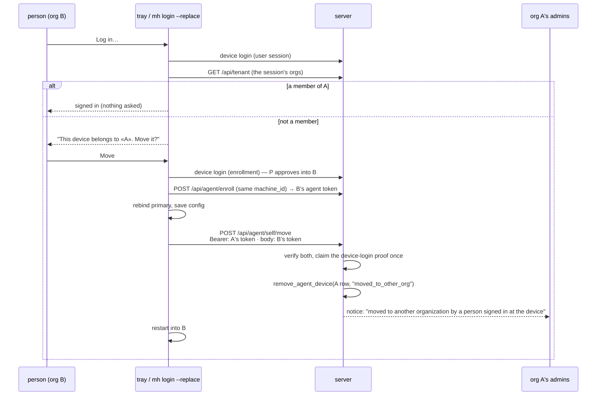

# A device changes hands

> **FR-133** ([spec](fr/FR-133-a-device-changes-hands.md)). Status: built (server, device, tray);
> not yet released or field-verified.

A person hands a computer on. The next person signs out of the tray, signs in with their own
account, and believes the device is now theirs. Before FR-133 it was not: the account switch ended
only the user session, the device stayed in the old organization (online there, controllable by its
admins) and never appeared in the new person's list.

Now, when the person who signs in is **not a member of the device's primary organization**, the
tray asks:

> **This device belongs to «A». Move it to your organization?**

| Answer | What happens |
|---|---|
| **Move** | A second browser approval enrolls the device into one of the person's organizations (their `MANAGE_AGENTS` there), the device rebinds its **primary** enrollment (as `mh login --replace` does), and the old organization's row is removed by the one removal sequence, with an audit row and a notice to its admins |
| **Keep** | Exactly today's behaviour: an account session only; the device stays where it is |
| *(a member of «A» signs in)* | Nothing is asked |

## Why a separate route

`POST /api/agent/self/unenroll` refuses a permanent device with 403 on purpose
(`crates/modules/fleet/src/agent.rs:796`): a compromised host must not erase its own fleet record.
That refusal stays. `POST /api/agent/self/move` (`crates/modules/fleet/src/device_move.rs:208`) is
narrower: it removes the old row only when the request carries **both** credentials and the server
can confirm the new one from rows it wrote itself.

## The proof

| Link | Checked | Written by |
|---|---|---|
| The bearer is the OLD row's agent token | `AuthAgent`: live row, generation, owner admitted | — |
| The body's token is the NEW row's agent token | `verify_agent_token` + `accepted_agent` (`device_move.rs:232`) | `/api/agent/enroll` |
| Old row: permanent, personal (`personal_access_owner_id`), not temporary, no two-factor | `pair_refusal` (`device_move.rs:69`) | the personal enrollment |
| New row: another tenant, the SAME `machine_id`, not ephemeral | `pair_refusal` | the new enrollment |
| New row's `enrolled_with_jti` names a device-login decision: `state: consumed`, the new tenant, approved by the new row's owner, `decided_at` under 10 min ago | `claim_proof` (`device_move.rs:179`) | the exchange that minted the token (`crates/modules/fleet/src/device_login.rs:720`) |
| That decision has not moved a row before | the same compare-and-set stamps `moved_agent_id` | this route |

Why it cannot be **replayed**: the proof is claimed once (a second use matches nothing), the old
row's token dies with the row (a repeat answers 401), and the decision is at most ten minutes old
(the request row's TTL deletes it soon after). Why it cannot be **forged**: the device asserts
nothing but two server-signed credentials; the jti and the decision are server-written rows, and a
user token, a dashboard-minted enrollment, another machine's enrollment or one into the same org
each refuse. An admin-enrolled (non-personal) device is never the person's to move.

> ⚠️ What the proof cannot establish is a human at the keyboard: anyone holding the old device's
> credential and an account that may approve devices into *some* organization could move it.
> That is why the route is limited to personal devices, why every move and refusal is audited in
> the old tenant, why the old admins are told, why the row is **tombstoned**, never deleted, and why
> the route has a kill switch.

## What the old organization sees

- The device disappears from its device list; its overlay lease is released by the normal order
  (`crates/modules/fleet/src/removal.rs:43`: holders → lease → tombstone → kick). The kick sends no
  `rc:goodbye`: the device asked for the removal and restarts into its new organization
  (`removal.rs:114`).
- A `device_moved` notification for every member holding `MANAGE_AGENTS`, linking the device list:
  *"“laptop” was moved to another organization by a person signed in at the device."*
- A `device_move_audit` row (`decision: moved | refused`, `reason`, the device), in its own tenant.

⚠️ Nothing the old organization records or is told names the new organization, its people or its
device; the new side appears only in the server's own log line. A cross-tenant leak here is a
security bug.

## The device's half

`crates/agent-core/src/device_move.rs` is shared by the three paths that rebind a primary:
`enroll_cmd` (`mh login --replace` in user mode, `meshharbord enroll --replace`), the elevated
`enroll-personal-system` (`agents/meshharbord/src/personal_system_exec.rs`), and the desktop's own
enrollment (`agents/meshharbor-desktop/src/commands.rs`).

1. Before the token is spent: a cross-org replace on a **protected** (FR-127) or **two-factor**
   (FR-129) device is refused (`move_refusal`, `crates/agent-core/src/device_move.rs:209`). The tray
   also refuses both upfront from `config_entries` (`protected`) and `NodeStatus.two_factor`
   (`offer_for`, `crates/agent-core/src/device_move.rs:127`). A move changes who controls the
   machine, and no local-confirmation hook exists for it; the owner switches the protection off
   first.
2. The new enrollment is saved **before** the old row is removed, so the worst failure is an old row
   an admin must remove (today's behaviour), never a device with no enrollment.
3. The answer is mapped by `outcome_for` (`crates/agent-core/src/device_move.rs:309`): 2xx removed;
   404/405 (an older server) or 403 (switched off, refused) keep the row, and the person is told
   the old organization's admin must remove it. The elevated helper hands that notice back through
   its status file, marked `notice: `.

Secondary `[[orgs]]` enrollments are untouched; a temporary (invitation) primary is not moved (it
leaves with `mh leave`); a primary on another server is not moved (the proof is checked where both
rows live).

## Kill switch

`auth.native_device_move_enabled` (`MESHHARBOR__AUTH__NATIVE_DEVICE_MOVE_ENABLED`), default on. Off
answers `self/move` with exactly the 403 `self/unenroll` gives a permanent device; the device still
moves (that is an ordinary `--replace`) and says the old admin must remove it.

## Tests

| Test | Proves |
|---|---|
| `crates/tests/src/device_move_tests.rs` (6 tests) | the move, the tombstone, the lease release, the audit and notice without leaks, the replay; each forged, foreign, same-org, spent or stale proof; admin-enrolled, two-factor, temporary and ephemeral refusals; the kill switch; `self/devices` `org_name` for permanent vs temporary devices; cross-org `--replace` preserving secondary `[[orgs]]` and handling 200 / 403 / 404 older-server fallback |
| `crates/modules/fleet/src/device_move.rs` (unit, 3 tests) | `pair_refusal`, the notice text |
| `crates/agent-core/src/device_move.rs` (unit, 5 tests) | member vs non-member / ephemeral / protected / two-factor offer logic (`offer_for`), cross-org replace detection, leaving primary selection, older-server answers, protected / two-factor refusal (`move_refusal`) |
| `agents/meshharbor-desktop/src/commands.rs` `a_move_is_offered_only_to_someone_outside_the_devices_org` | `NodeStatus` adapter for member vs non-member, ephemeral, protected, and two-factor offers |
