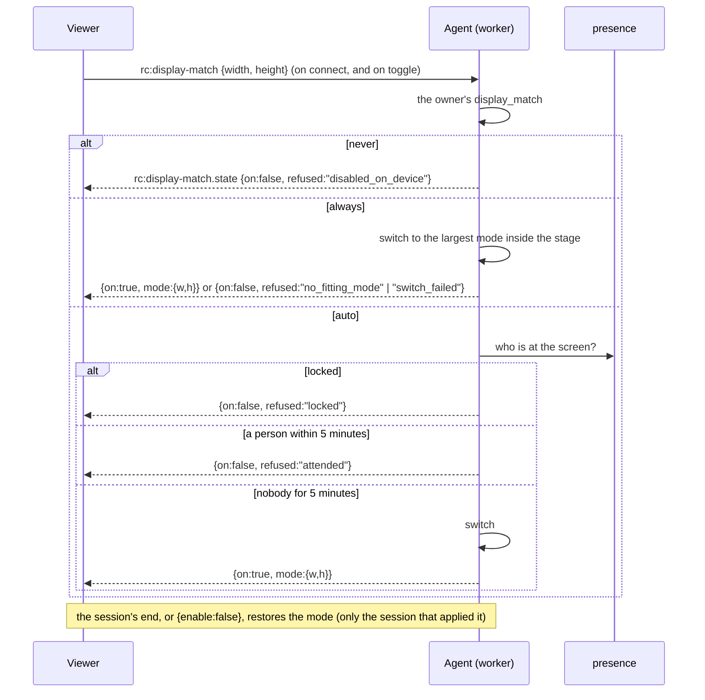
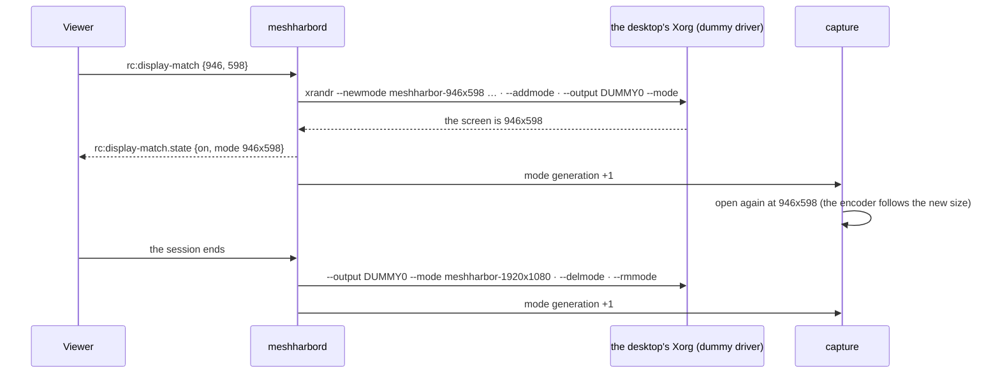
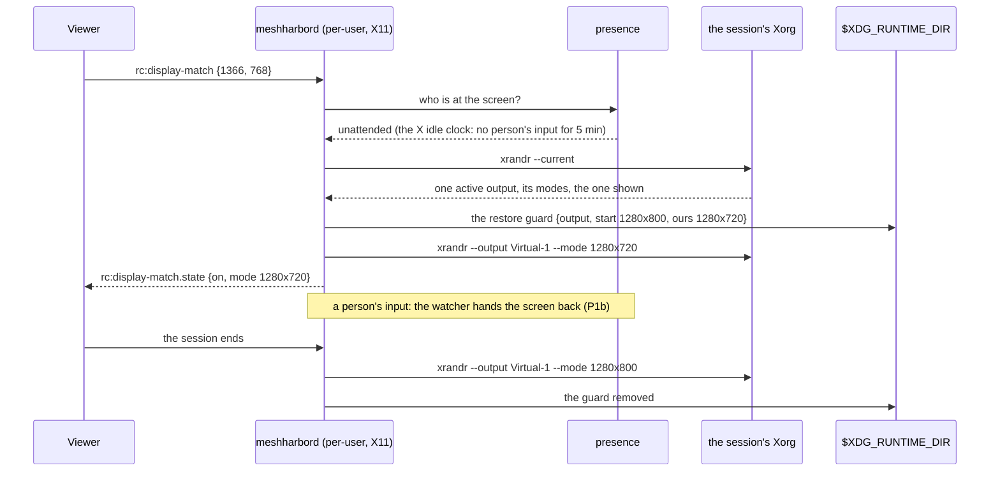

# Display match — the host's display follows the viewer, never on a screen someone is using

> **Status** (FR-108, [#2322](https://github.com/jk-zhang-meta/MeshHarbor/issues/2322); spec:
> [`docs/fr/FR-108-display-follows-the-viewer.md`](fr/FR-108-display-follows-the-viewer.md))
>
> | Phase | What | State |
> |---|---|---|
> | rc.191 | the viewer asks; the agent switches the primary display to the largest mode inside the viewer's stage, and restores it when the session ends | shipped |
> | P1 | the device decides: its owner's `display_match`, and under `auto` whether someone is using the screen; every request answered | shipped (0.4.140); field-verified on Windows |
> | P1b | a locked host switches once unlocked with nobody at it; a person coming back gets their mode back | shipped (0.4.140); field-verified on Windows |
> | P2 | Linux virtual desktops: the desktop runs on Xorg with the dummy driver, which takes any mode, so the viewer's stage size becomes the mode exactly; restored at the end | shipped in 0.4.143 and field-verified on its released binary (FR-108 §8 row 14; the operator settled decision 4 on 2026-10-17) |
> | FR-97 P3e-2 | a person's own X11 display (a per-user install in an X11 session): the one active output switched to a mode it lists, presence from the X idle clock, a restore guard a crash cannot strand | shipped in 0.4.148 (#2623); its release check's pointer-clamp hand-back fixed (#2644) |
> | P3–P4 | modes no monitor offers, several displays | not built |

## Why it exists, and what went wrong with it

Remote text is only crisp when the pixels run 1:1 end to end: the host renders at the size the viewer
shows it, the stream carries those pixels untouched, and the viewer paints them unscaled. RDP gets there by
changing the session's resolution. Display match is MeshHarbor's equivalent: the viewer sends its stage size,
and the agent switches the host's primary display to the largest mode that fits inside it
([`display_match.rs:50`](../agents/meshharbord/src/display_match.rs#L50) `pick_display_mode`). The change is
temporary (`CDS_FULLSCREEN`), so even a crash gives the mode back.

The toggle has been **on by default** since 2026-08-02, and until FR-108 nothing asked who was sitting at the
screen. On 2026-10-16 a vmtest guest with its person at the console was switched from 1280×800 to
**640×480** for a whole session: a 1280×720 browser reports a 946×598 stage, and 800×600 is 2 px too tall
(FR-108 §8 row 2). On a machine someone is using, that takes their screen.

## The decision



[`display_match.rs:923`](../agents/meshharbord/src/display_match.rs#L923) `may_switch` is the decision, pure and
unit-tested. [`display_match.rs:948`](../agents/meshharbord/src/display_match.rs#L948) `request_for` runs it,
switches, and logs rc.191's lines ("switched host display mode", "could not switch mode") as before. The
control-channel arm sends the answer ([`peer.rs:10308`](../agents/meshharbord/src/peer.rs#L10308)).

### The answers

Every request gets exactly one `rc:display-match.state`
([`display_match.rs:1086`](../agents/meshharbord/src/display_match.rs#L1086) `state_json`):

| `refused` | It means | The viewer says |
|---|---|---|
| — (`on: true`, `mode: {w, h}`) | the host runs at that mode for this session | "the host runs at W×H for this session" |
| `attended` | someone touched the keyboard or mouse in the last 5 minutes | "someone is using this computer" |
| `locked` | the secure desktop is up (locked, or the logon screen) | "the computer is locked; it switches once unlocked" (P1b) |
| `disabled_on_device` | the owner set `display_match = never` | "this device's owner turned display match off" |
| `no_fitting_mode` | no mode the display offers fits inside the stage | "no display mode fits this window" |
| `switch_failed` | `ChangeDisplaySettingsExW` refused, or on Linux `xrandr` did | "the display could not be switched" |
| `unsupported` | neither a Windows host, a Linux virtual desktop on Xorg with the dummy driver (P2), nor a person's X11 display with one active output (FR-97 P3e-2) | "this device can't switch its display" |

⚠️ An agent from before FR-108 answers nothing, and the viewer then shows the toggle as it always did. A word
this viewer does not know, from a newer agent, is shown as it came and never read as success
([`displayMatch.ts:39`](../ui/src/composables/displayMatch.ts#L39) `describeDisplayMatchRefusal`). The viewer
puts the answer under the toggle ([`RemoteControl.vue:4015`](../ui/src/views/remote/RemoteControl.vue#L4015)
`displayMatchSaid`).

⚠️ `attended` and `disabled_on_device` hand the screen back: a mode this session applied earlier is restored
([`display_match.rs:941`](../agents/meshharbord/src/display_match.rs#L941) `hands_the_screen_back`). `locked`
does not, because the worker cannot touch the secure desktop (below).

## The owner's key

```sh
meshharbor config set display_match auto     # auto (default) | always | never
```

| Value | Display match switches |
|---|---|
| `auto` | only while nobody is using the screen |
| `always` | whenever a controller asks (rc.191's behaviour), for a machine its owner never sits at |
| `never` | never |

- **Device-owned:** set over the LocalAPI only by the person at the console
  ([`lib.rs:3357`](../crates/localapi/src/lib.rs#L3357)), and absent from `DesiredConfig`, so a server cannot
  push it ([`models.rs:9293`](../crates/remote_control/src/models.rs#L9293)). A server that could set it could
  take every screen it reaches.
- **Read live** at every request ([`display_match.rs:853`](../agents/meshharbord/src/display_match.rs#L853)
  `set_device_policy`).
- ⚠️ A value this build does not know reads as `never`, the strictest, and never fails the config file
  ([`config.rs:2558`](../crates/agent-core/src/config.rs#L2558) `DisplayMatchPolicy`).

## Who is at the screen

"Nobody" means what FR-99's `lock_on_end = auto` means by it: no local input for **5 minutes**
(`lock_on_end::UNATTENDED_AFTER`). It is read FR-92's way, with no hook, no raw input and no key polling:
the session's idle clock, `GetLastInputInfo`.

That clock moves for every input, and FR-108's P0 measured both kinds moving it: the person's
(QMP on a vmtest guest) and the controller's injected moves. So
[`presence.rs:116`](../agents/meshharbord/src/presence.rs#L116) `observe` follows it and keeps the last move
**the machine does not explain**:

| Input | Noted by | On the clock as |
|---|---|---|
| the controller's injected events | the input arbiter ([`keep_busy/mod.rs:92`](../agents/meshharbord/src/keep_busy/mod.rs#L92) `note_remote_input`) | the machine's |
| keep busy's own pointer moves | keep busy's mover ([`keep_busy/mod.rs:103`](../agents/meshharbord/src/keep_busy/mod.rs#L103) `note_own_move`) | the machine's |
| the X server clamping the pointer into a smaller mode, during our own switch (FR-97) | each mode set's run ([`display_match.rs:561`](../agents/meshharbord/src/display_match.rs#L561) `own_switch_explains`) | the machine's |
| anything else | — | **a person's** |

A move within 250 ms of a machine input is that input
([`presence.rs:48`](../agents/meshharbord/src/presence.rs#L48) `MACHINE_SLACK_MS`). A sampler reads the clock
every 500 ms from the worker's start ([`presence.rs:360`](../agents/meshharbord/src/presence.rs#L360) `start`),
so a request mid-session still tells the controller's input from a person's.

- **Before the first reading nothing is known**, and an unknown is never read as an empty chair: the first
  reading counts as a person's.
- **The decision** ([`presence.rs:77`](../agents/meshharbord/src/presence.rs#L77) `decide`): locked wins over
  everything; a lock after the person's last input means away (P1b, below); otherwise a person's input
  inside the window is `attended`.
- **The source scan** ([`presence.rs:658`](../agents/meshharbord/src/presence.rs#L658)) fails the build on a
  hook, raw input or a keyboard poll in `presence.rs` or `display_match.rs`, FR-92's rule.

### Locked waits for the unlock (P1b)

P0 tried it: on the lock screen the worker's `ChangeDisplaySettingsExW` returns `-1`, and the screen stays as
it was. So a locked host answers `locked`, and the request waits
([`display_match.rs:948`](../agents/meshharbord/src/display_match.rs#L948) `request_for` keeps it per session).
An unattended office PC is usually locked, so this is the main path, not an edge.

At the session's unlock the device decides again
([`display_match.rs:1030`](../agents/meshharbord/src/display_match.rs#L1030) `on_unlock`, called from the
session's lock watcher, [`peer.rs:1411`](../agents/meshharbord/src/peer.rs#L1411)):

| Who unlocked it | What the clock shows | The answer |
|---|---|---|
| the controller, typing the password through the session | machine input only since the lock | **switched** (`on: true`): the person left by locking |
| the person, at the keyboard | a person's input after the lock | `attended` |

⚠️ The rule that makes the first row work: **a lock after the person's last input means they are away**,
however recent that input was ([`presence.rs:148`](../agents/meshharbord/src/presence.rs#L148)
`away_since_lock`). Without it, someone who locked their screen and walked off a minute ago would still
read as `attended` for four more minutes, and the request would be refused for nothing.

## The person comes back (P1b)

While a session holds a mode it applied, a watcher checks four times a second
([`peer.rs:1510`](../agents/meshharbord/src/peer.rs#L1510), Windows only). It hands the screen back at once
and tells the viewer ([`display_match.rs:1063`](../agents/meshharbord/src/display_match.rs#L1063)
`on_tick`):

| What changed | The answer | Restored |
|---|---|---|
| a person's input (under `auto`) | `refused: attended` | yes |
| the owner set `display_match = never` | `refused: disabled_on_device` | yes |
| the screen locked | — | no: nobody came back, and the secure desktop cannot be switched anyway |

The mode is not re-applied until the viewer asks again (toggle off and on): a returning person never fights a
timer for their own screen ([`display_match.rs:1044`](../agents/meshharbord/src/display_match.rs#L1044)
`hand_back`).

## A Linux virtual desktop (P2)

A daemon started with `MESHHARBORD_VIRTUAL_DESKTOP=1` runs a desktop of its own: an X server, a window manager
and the startup apps. Nobody sits at that screen, since it is the daemon's own, so display match switches it
without asking who is there ([`display_match.rs:962`](../agents/meshharbord/src/display_match.rs#L962)). The
owner's `never` still holds.



- **The server is Xorg with the dummy driver** wherever `xserver-xorg-video-dummy` and `xrandr` are installed
  ([`virtual_desktop.rs:110`](../agents/meshharbord/src/virtual_desktop.rs#L110) `xorg_dummy`). Xvfb has one
  mode, its start size, and cannot switch at all (the spec's §8 row 5), so a desktop on Xvfb still answers
  `unsupported`.
- The real Xorg binary runs **unprivileged**, never the console-only wrapper. It gets a config of its own
  and an **empty** config directory, so no `xorg.conf.d` snippet of the host's (a GPU's, an input device's)
  leaks in, and no input device at all: input arrives through XTest, as on Xvfb
  ([`virtual_desktop.rs:182`](../agents/meshharbord/src/virtual_desktop.rs#L182) `xorg_args`). It starts at the
  configured size exactly, as a `meshharbor-WxH` modeline
  ([`virtual_desktop.rs:138`](../agents/meshharbord/src/virtual_desktop.rs#L138) `xorg_conf`).
- ⚠️ **The config declares `ReducedBlanking`.** The modelines carry reduced blanking, and without the option
  Xorg drops the start mode ("monitor doesn't support reduced blanking") and starts at the dummy driver's
  2048×1536, leaving no named mode to restore to. Found in the build's own probe.
- **A request becomes a mode of exactly that size**, even on both axes for the encoders: the dummy driver
  takes any size, so a 946×598 stage gets 946×598, not the nearest standard mode (`cvt` would have rounded it
  to 952) ([`display_match.rs:104`](../agents/meshharbord/src/display_match.rs#L104) `virtual_mode_for`,
  [`display_match.rs:80`](../agents/meshharbord/src/display_match.rs#L80) `modeline`). Below 640×480 the display is
  left alone, as on Windows. Above the framebuffer (`VideoRam`, room for 8K) the request is scaled down.
- **The switch** adds the mode and makes it current
  ([`display_match.rs:192`](../agents/meshharbord/src/display_match.rs#L192) `lin::apply_mode`). **The restore**
  makes the start mode current again, then removes the modes the session added, in that order, because X
  refuses to delete the mode in use ([`display_match.rs:232`](../agents/meshharbord/src/display_match.rs#L232)).
- **The capture opens again at the new size.** X11's capturer takes its size when it opens, so every switch
  and restore bumps a counter the capture worker watches
  ([`scrap_backend.rs:245`](../agents/meshharbord/src/capture/scrap_backend.rs#L245)). The encoder already
  rebuilds when the frame size changes.
- **A failing Xorg costs the switch, never the desktop:** if it does not come up, the desktop runs on Xvfb
  ([`virtual_desktop.rs:747`](../agents/meshharbord/src/virtual_desktop.rs#L747) `spawn_x_server`).
- Kill switches: `MESHHARBORD_VIRTUAL_DESKTOP_SERVER=xvfb` keeps the desktop on Xvfb; `display_match = never`
  stops the switching.

## A person's own X11 display (FR-97 P3e-2)

A per-user install in an X11 session switches the person's own display: the daemon has the session's
`DISPLAY` and no `WAYLAND_DISPLAY`, and runs no virtual desktop of its own
([`display_match.rs:262`](../agents/meshharbord/src/display_match.rs#L262) `x11_offered`).
The decision is Windows': the owner's `display_match`, and under `auto` whether someone is at the screen.



| | Windows | A person's X11 display |
|---|---|---|
| Who is at the screen | `GetLastInputInfo`, and the secure desktop | the X server's idle clock (MIT-SCREEN-SAVER), which XTest input moves as injected input moves Windows' clock, and logind's `LockedHint` ([`presence.rs:200`](../agents/meshharbord/src/presence.rs#L200)) |
| The modes | the display's own list | the one active output's list in `xrandr --current`; none is added, this is someone's monitor ([`display_match.rs:285`](../agents/meshharbord/src/display_match.rs#L285) `parse_xrandr_outputs`) |
| Several displays | the primary only | more than one active output answers `unsupported` |
| After a crash | `CDS_FULLSCREEN`: Windows reverts the mode itself | a restore guard in `$XDG_RUNTIME_DIR`, written before the switch; the next start puts the start mode back, only while the screen still shows the mode display match set ([`display_match.rs:340`](../agents/meshharbord/src/display_match.rs#L340) `guard_undoes`, [`display_match.rs:520`](../agents/meshharbord/src/display_match.rs#L520) `recover`) |
| A locked screen | answers `locked`, decided again at the unlock | the same, the unlock read from logind's hint ([`peer.rs:1457`](../agents/meshharbord/src/peer.rs#L1457)) |
| The person comes back | the session's watcher, every quarter second | the same watcher ([`peer.rs:1497`](../agents/meshharbord/src/peer.rs#L1497)) |
| Kill switch | `display_match = never` | `MESHHARBORD_X11_DISPLAY_MATCH=0`, and `display_match = never` |

- ⚠️ **The X server says how long ago, not when.** "Now minus the idle time" moves by each read's latency,
  and the tracker would take every such move for a new input, a person's, so nobody would ever read as away.
  A reading within 50 ms of the last names the same input
  ([`presence.rs:189`](../agents/meshharbord/src/presence.rs#L189) `steady`).
- ⚠️ **No hook, no raw input.** The X idle clock is the Linux twin of `GetLastInputInfo`; the source scan that
  fails the build on a Windows hook now fails it on XRecord, an XInput2 event stream and an input device node
  as well.
- **GNOME and XFCE keep a mode set from outside it.** Measured on GNOME 46 and on XFCE 4.18, both on Xorg
  (FR-97 §8): an `xrandr` mode change stayed. On XFCE the agent's own switch held through a 25 s session and was
  put back when the session closed. GNOME does put back an outside XKB group lock, which is why the layout
  picker is not offered there (`docs/remote-control.md` §18.3.2); XFCE keeps that too.
- ⚠️ **Our own switch is not a person.** A switch to a mode smaller than where the pointer sits makes the X server
  clamp the pointer into the new screen, and the clamp resets the X idle clock as an input would. Each mode set
  records its run, and presence counts an idle-clock move inside it, give or take `MACHINE_SLACK_MS`, as the
  machine's ([`display_match.rs:561`](../agents/meshharbord/src/display_match.rs#L561) `own_switch_explains`). Until
  #2644, presence read the clamp as a person and handed the screen back 0.2 s after every such switch
  (FR-97 §8, 0.4.148's release check).
- **The guard needs somewhere to live.** No `$XDG_RUNTIME_DIR`, no switch: an X11 mode outlives the process
  that set it, and a mode a crash stranded would be the person's screen until they fixed it themselves.

## What it does not do

- macOS and Wayland hosts, and a Linux system install: display match runs on Windows, on a Linux virtual
  desktop, and on a person's own X11 display with one active output (FR-97 P3e-2).
- DPI and scaling are never changed.
- One primary display; several displays at once are P4.

## Related

- [FR-108](fr/FR-108-display-follows-the-viewer.md): the spec, the field log, the phases.
- [FR-92](fr/FR-92-keep-busy.md): the idle clock and the no-hooks rule.
- [Privacy mode](privacy-mode.md): the other thing a session does to the screen of the person at the host.
- [`remote-control.md` §18.6.1](remote-control.md): the zoom pill that shows whether the pixels run 1:1.
