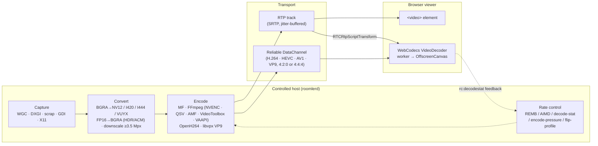
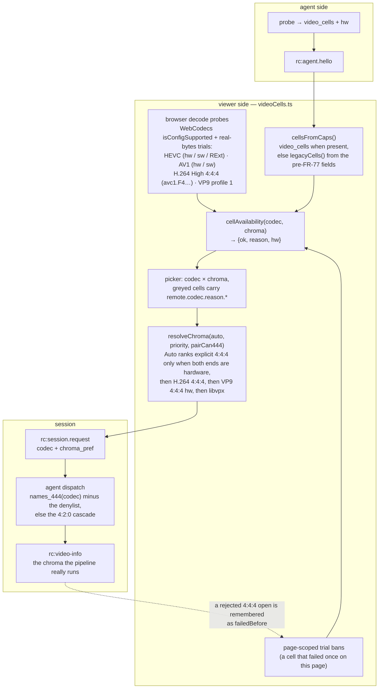
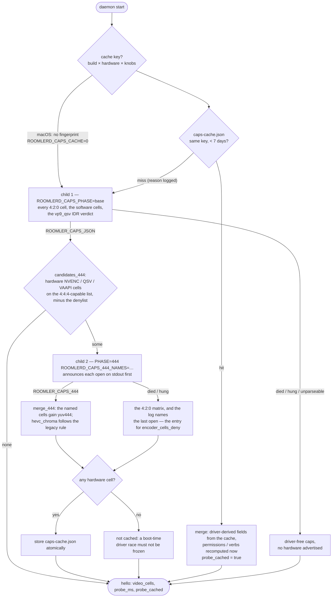
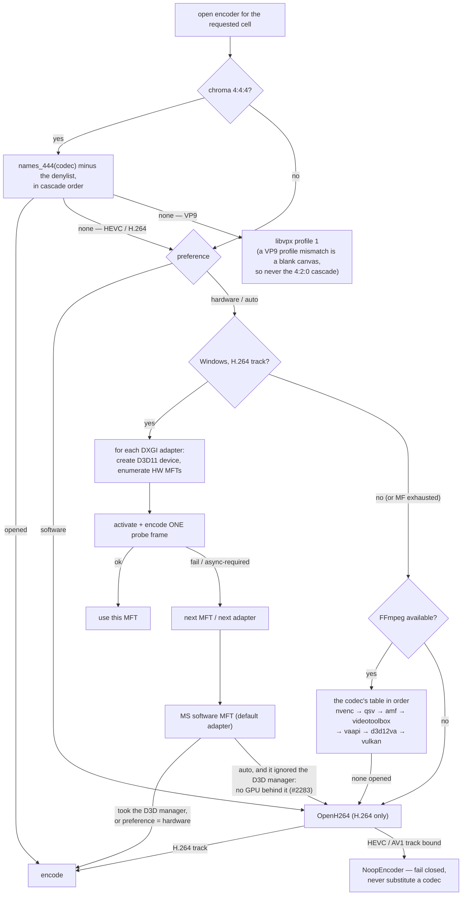
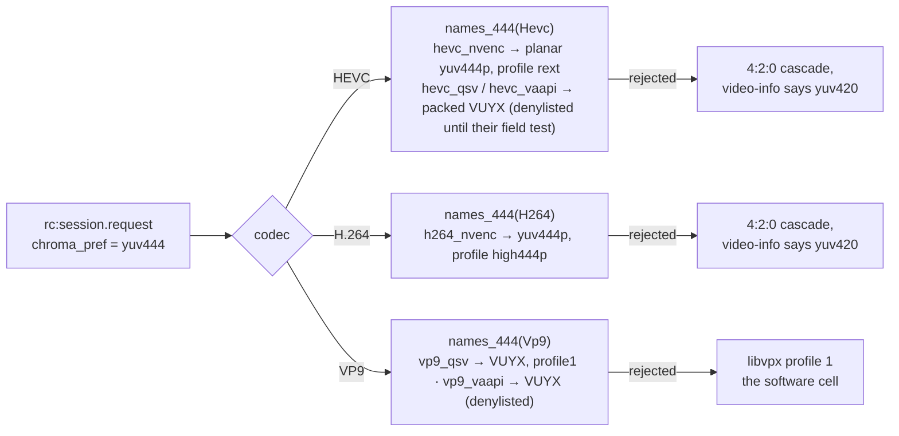
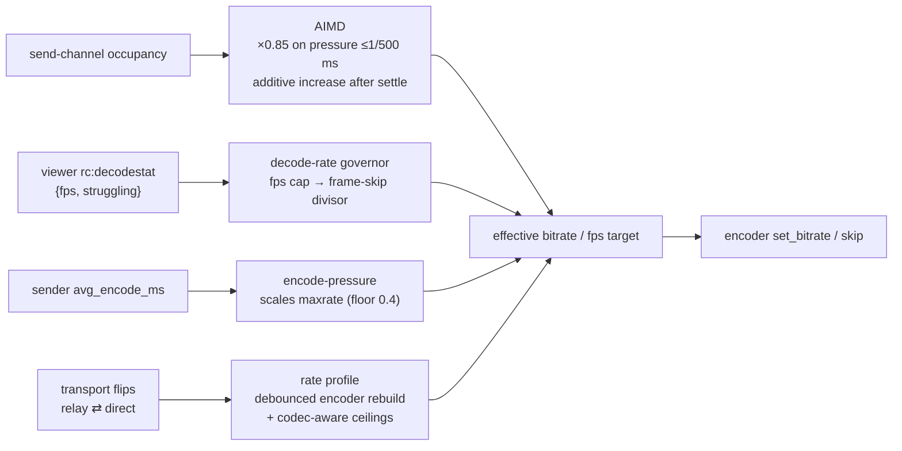
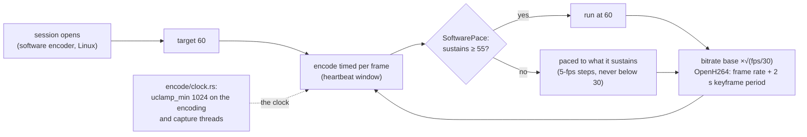

# Encoders & the Video Pipeline

Everything between the remote host's framebuffer and the viewer's canvas: capture
backends, the **cell matrix** a host advertises and how the viewer resolves it, the
probe that discovers it, the encoder cascade per platform, rate control, and the
browser decode paths. Agent side lives in `agents/meshharbord/src/{capture,encode}/`;
viewer side in `ui/src/composables/{useRemoteControl,videoCells}.ts` + `ui/src/workers/`.
*As of 0.4.87 (FR-77 P0–P4, 2026-09-08).* The design record with every decision's
pros and cons is [`docs/fr/FR-77-encoder-chroma-matrix.md`](fr/FR-77-encoder-chroma-matrix.md);
the words below are the glossary's ([`CONTEXT.md`](../CONTEXT.md)).

| Word | Meaning | Example |
|---|---|---|
| **codec** | the bitstream family | H.264 · HEVC · AV1 · VP9 |
| **backend** | what produces it | NVENC · QSV · AMF · VideoToolbox · VAAPI · D3D12 · Vulkan · Media Foundation · openh264 · libvpx |
| **encoder** | codec × backend, an FFmpeg name | `hevc_nvenc`, `vp9_vaapi` |
| **chroma format** | how much colour the bitstream keeps | 4:2:0 (`yuv420`) · 4:4:4 (`yuv444`, "crisp text") |
| **cell** | codec × chroma format — what a session actually asks for | HEVC 4:4:4 |
| **probe** | the real-bytes trial that proves a cell on a host | `roomlerd caps-probe` |
| **probe cache** | the remembered answer of the last probe, kept only under the build, hardware, drivers and settings that produced it | `caps-cache.json` |
| **denylist** | cells a device must not open or advertise — the kill switch | `hevc_qsv:yuv444` |

## The pipeline



Two transport families with different latency behaviour:

- **RTP track** — standard WebRTC video. Simple and universal, but every frame
  passes the browser's jitter buffer. Up to 0.4.138, Chrome held damage-driven
  frames for 193 ms on average. Since 0.4.139 two fixes take that back:
  - the agent offers `playout-delay` 0/0 by default (FR-98 C6), so Chrome holds
    a frame for 0.1 ms;
  - each frame carries its own capture time, not the previous frame's (#2284),
    so a browser that never negotiates the extension holds frames for a few ms.

  Measured on a release, the RTP track's L4 (input to photon) is p50 37 ms with
  C6 and 52 ms without it. The cells, and the third fault found on this track
  (#2283), are in [FR-98 §9](fr/FR-98-input-to-photon-budget.md#9-field-verification-log).
- **Reliable DataChannel bitstream** — the agent sends encoded access units over
  an ordered DC; a worker feeds WebCodecs and paints an OffscreenCanvas. This
  bypasses the jitter buffer entirely and is how HEVC, AV1, VP9 and low-latency
  H.264 ship, in either chroma format.

## Codec × backend × platform

One build per OS and architecture carries **every** hardware backend FFmpeg offers
for that platform; the probe below discovers at runtime which ones the host can
open. That was decided by a measurement, not a preference — every wrapper is under
1 MB against a 35 MiB `meshharbord.exe` (ADR
[0001](adr/0001-encoder-backends-compiled-in-discovered-at-runtime.md)).

| Codec | Windows | Linux x86_64 | macOS arm64 | Notes |
|---|---|---|---|---|
| **H.264** | MF HW MFTs → MF SW MFT · FFmpeg `h264_nvenc → h264_qsv → h264_amf → h264_d3d12va → h264_vulkan` · OpenH264 | FFmpeg `h264_nvenc → h264_qsv → h264_amf → h264_vaapi → h264_vulkan` · OpenH264 | FFmpeg `h264_videotoolbox` · OpenH264 | the universal baseline; RTP or DC; 4:4:4 on NVENC (`high444p`) |
| **HEVC** | FFmpeg `hevc_nvenc → hevc_qsv → hevc_amf → hevc_d3d12va → hevc_vulkan` · MF HEVC | FFmpeg `… → hevc_vaapi → hevc_vulkan` | FFmpeg `hevc_videotoolbox` | DC-only; 4:4:4 on NVENC (RExt), on QSV/VAAPI/Vulkan behind the denylist |
| **AV1** | FFmpeg `av1_nvenc → av1_qsv → av1_amf → av1_d3d12va → av1_vulkan` · MF AV1 | FFmpeg `… → av1_vaapi → av1_vulkan` | — (`av1_videotoolbox` is not in the registry on current SDKs) | DC-only; 4:2:0 only, every backend; fail-closed; every packet leaves with a temporal-delimiter OBU (`av1_vulkan` omits it — §Hardware frames) |
| **VP9** | FFmpeg `vp9_qsv` · libvpx | FFmpeg `vp9_qsv → vp9_vaapi` · libvpx | libvpx | 4:4:4 on QSV/VAAPI (profile 1, packed VUYX) behind the denylist; libvpx profile 1 is the software 4:4:4 cell everywhere |
| **Opus (audio)** | WASAPI loopback → Opus | PulseAudio monitor → Opus | not implemented | opt-in per session; 48 kHz stereo, 20 ms |

The cascade order is one table per codec in `encode/ffmpeg/encoder.rs`
(`HEVC_ENCODER_NAMES` …): the vendor SDKs first, then `*_videotoolbox`, then
the vendor-neutral rungs `*_vaapi → *_d3d12va → *_vulkan` (FR-78) — a name that
is not in the platform's FFmpeg registry, or whose device is absent, fails in
one line and the next rung is tried. Locked by tests
(`hw_frame_names_close_every_cascade`,
`videotoolbox_and_the_hw_frame_rungs_are_appended_never_prepended`).

| Platform | The vendored FFmpeg 9.0.1 (LGPL, `--disable-everything` + exactly the encoders the tables name; since FR-85 P4c also the software `h264` decoder and the `aac` encoder the screen recorder needs, and never an `hevc` decoder) | Linkage |
|---|---|---|
| Windows x86_64 | the ten vendor encoders (`h264/hevc/av1 × nvenc/qsv/amf` + `vp9_qsv`) + `h264/hevc/av1_d3d12va` + `h264/hevc/av1_vulkan` (sixteen), plus the `h264` decoder and the `aac` encoder, an overlay port over the pinned vcpkg baseline; D3D12 and Vulkan are dlopen'd by FFmpeg (`d3d12.dll`, `vulkan-1.dll`), so the static tree carries no import for either | static (`x64-windows-static-md`) — see [`lgpl-relink.md`](lgpl-relink.md) |
| Linux x86_64 | the same ten + `h264/hevc/av1/vp9_vaapi` + `h264/hevc/av1_vulkan` (seventeen), plus the `h264` decoder and the `aac` encoder, from source; **libva + libdrm built into the tree** and bundled with the libav* in the `.deb` (no `Depends` on the system's libva — why is under *Hardware frames*); `libvulkan.so.1` is dlopen'd, never a DT_NEEDED | shared, the agent's private lib dir via RPATH; the VA driver and the Vulkan ICD are the host's |
| macOS arm64 | `h264/hevc/av1_videotoolbox`, plus the `h264` decoder and the `aac` encoder (~3.0 MB of dylibs), built with `--disable-autodetect` so nothing Homebrew is baked in | shared dylibs in the app bundle |
| Linux arm64 | no FFmpeg — OpenH264 + libvpx | — |

## The cell matrix a host advertises (FR-77 P1)

The probe opens **every encoder** in cascade order, not the first that works,
and for the names FFmpeg can open in 4:4:4 (`h264_nvenc`, `hevc_nvenc`,
`hevc_qsv`, `vp9_qsv`, `hevc_vaapi`, `vp9_vaapi`) the 4:4:4 form too. What
opened is the host's cell matrix, advertised in the hello as
`AgentCaps.video_cells` — `{codec, backend, chroma[], hw}` per encoder, wire
strings from `models::{VideoCodec, VideoBackend, ChromaFormat}`
(`crates/remote_control/src/models.rs`), unknown names ignored by older readers —
plus `probe_ms` and `probe_cached`.

| Rule | Why |
|---|---|
| The legacy fields (`hw_encoders`, `codecs`, `transports`, `hevc_chroma`, `vp9_chroma`) keep their exact pre-FR-77 meaning — the FIRST backend in cascade order that opens | a session still cascades in that order, and a viewer older than FR-77 reads nothing else; `data-channel-vp9-444` stays on the wire although it carries both chroma formats |
| `hw` is verified, never assumed | NVENC / AMF / VideoToolbox / VAAPI are hardware by construction; a QSV open proves hardware only on the oneVPL build (FFmpeg's internal MFX session filters `MFX_IMPL_TYPE_HARDWARE`), which `qsv_is_hardware_by_construction` detects by `av1_qsv` being registered (libvpl-only); the native MF cell reports what its cascade landed on |
| A 4:4:4 cell is **opened**, never asserted by name | the pre-FR-77 code advertised `hevc_chroma: yuv444` for any `hevc_nvenc`; now the legacy field says 4:4:4 only when that open succeeded |
| `h264_nvenc` 4:4:4 sets `profile=high444p` | `rext` is HEVC's profile and h264_nvenc rejects it at open, which would read as "cannot do 4:4:4" |
| **The denylist** = the kill switch, both chroma forms: a `name:chroma` cell on it is never opened nor advertised — by the probe AND by a session (`cells::names_420` / `names_444` are the cascade minus the list; the probe and every session constructor read them). Built-in: `hevc_qsv:yuv444, hevc_vaapi:yuv444, vp9_qsv:yuv444, vp9_vaapi:yuv444, hevc_vulkan:yuv444`, and one 4:2:0 cell, `av1_vulkan:yuv420` — its frames do not decode (dav1d fails every frame header, libaom aborts, Chrome paints garbage), reproduced with the FFmpeg CLI's own `av1_vulkan` on the same NVIDIA GPU: an FFmpeg 9.0.1 / driver defect, §Hardware frames | each unproven 4:4:4 cell leaves the list on a field pass; CORPLAP-3's Intel runtime died on the first VUYX open. `encoder_cells_deny` (config, env `ROOMLERD_ENCODER_CELLS_DENY`, pushable through remote config; a change takes effect at the next daemon start) **replaces** the default; `none` denies nothing. Until 0.4.87 it gated only the 4:4:4 open; until 0.4.90 only the probe and the 4:4:4 list read it at all — a 4:2:0 session cascade opened a denied `hevc_vaapi` on jupiter while the hello advertised only the Vulkan cells (FR-78 P3) |
| AV1, AMF, VideoToolbox and Media Foundation are never asked for 4:4:4 | `av1_nvenc` hard-errors on it and every other AV1 backend lists 4:2:0 only; AMF has no 4:4:4 surface; VideoToolbox HEVC has only Main / Main10 / Main42210; `*_mf` takes NV12 — locked by a test against the vocabulary |

What the fleet advertised on 0.4.88 (server records, 2026-09-08; the D3D12 and
Vulkan cells are FR-78's):

| Host | Cells | Probe |
|---|---|---|
| dev box (RTX 5090 Laptop + Radeon 610M, Windows) | `h264/openh264` · `h264/mf` · `hevc/nvenc` 4:2:0+**4:4:4** · `hevc/amf` · `hevc/d3d12` · `hevc/vulkan` · `av1/nvenc` · `av1/vulkan` · `h264/nvenc` 4:2:0+**4:4:4** · `h264/amf` · `h264/d3d12` · `h264/vulkan` · `vp9/libvpx` 4:2:0+4:4:4 | 6.1 s |
| CORPLAP-3 (Intel Meteor Lake iGPU, Windows) | `h264/openh264` · `h264/mf` · `vp9/qsv` · `hevc/d3d12` · `av1/qsv` · `h264/qsv` · `vp9/libvpx` — the Intel driver refuses FFmpeg's D3D12 H.264/AV1 configuration and has no Vulkan encode queue | 6.8 s |
| MacBook (M-series) | `h264/openh264` · `hevc/videotoolbox` · `h264/videotoolbox` · `vp9/libvpx` | 0.1 s |
| jupiter (AMD Raphael / VCN 3.1, Linux, `RADV_PERFTEST=video_encode` in the daemon's environment) | `h264/openh264` · `hevc/vaapi` · `hevc/vulkan` · `h264/vaapi` · `h264/vulkan` · `vp9/libvpx` — RADV refuses AV1 (VCN 3.1 has no AV1 encode) | 0.15 s |
| zeus (the same silicon, without the flag) | `h264/openh264` · `hevc/vaapi` · `h264/vaapi` · `vp9/libvpx` — RADV exposes Vulkan encode only under `RADV_PERFTEST=video_encode` | 0.2 s |
| the WSL sibling (RTX through WSL's libcuda) | `h264/openh264` · `hevc/nvenc` 4:2:0+4:4:4 · `av1/nvenc` · `h264/nvenc` 4:2:0+4:4:4 · `vp9/libvpx` — its four software Vulkan ICDs open and refuse | 5.9 s |
| mars (no GPU, Linux) | `h264/openh264` · `vp9/libvpx` | 0.5 s |

The probe's cost grew with the device walk (the dev box 4.3 → 6.1 s, WSL 2.5 →
5.9 s); the cache pays it once per build, driver and hardware.

## The cell resolution — from the matrix to a session

The picker offers two independent dropdowns, **codec** and **chroma format**, and
greys every cell that cannot work with the reason. A cell is offered only when the
agent proved it, the browser can decode it, and this page has not already seen it
fail. Everything the viewer knows about cells goes through ONE derivation,
`ui/src/composables/videoCells.ts` — the codec picker and the admin codec chips
read the same functions.



| Reason (`remote.codec.reason.*`) | What it means |
|---|---|
| `agentNo…` / `agentNoH264_444` … | the host's matrix has no such cell (the probe did not open it, or the denylist removed it) |
| `browserNo…` / `browserNoH264High444` … | WebCodecs cannot decode that codec string here (Chromium keeps one `HEVCPROFILE_REXT` for every RExt chroma form, so HEVC 4:4:4 is proven by real bytes, never by `isConfigSupported`) |
| `chroma420` | the codec has no 4:4:4 form on either end (AV1 everywhere) |
| `failedBefore` | this page already saw the cell fail — the page-scoped trial ban is the real proof a cell works |
| `av1NoHw444` | AV1 4:4:4 does not exist as a session cell |

Auto-rank, explicit 4:4:4 first: **HEVC 4:4:4** (hardware on both ends — NVIDIA and
Intel on Chrome ≥ 137) → **H.264 4:4:4** (NVENC `high444p`, software decode) →
**VP9 4:4:4 hardware** (QSV / VAAPI, behind the denylist) → **VP9 4:4:4 libvpx**,
the only rung *Sharper-on-Auto* upgrades to. A session never shares a pipeline
with the other chroma form of the same codec (`FfmpegDcCodec::pipeline_label`:
`HEVC-444`, `H264-444`, `VP9-444`), and `rc:video-info` reports the chroma the
pipeline really runs, so a rejected 4:4:4 open that fell back to 4:2:0 is never
mistaken for the cell that was asked for.

## The probe lifecycle

A capability probe is untrusted third-party code by definition — vendor drivers
and, through them, GPU firmware — so it does not run in the daemon's address
space. `encode::caps::detect()` (`agents/meshharbord/src/encode/caps.rs`) answers
from the cache when it can, and otherwise spawns `roomlerd caps-probe` twice:



| Outcome of a child | Verdict |
|---|---|
| non-zero exit, or killed by a signal | phase base: no hardware advertised (logged at ERROR with the status) · phase 444: the 4:2:0 matrix, the last announced open named |
| still running after 60 s | killed; as above |
| could not spawn / output unparseable | as above |
| clean exit with a marked line | those caps, as reported |

Why two children (P3c): on the 0.4.84 roll CORPLAP-3's Intel media runtime died
with `0xc0000005` on the first `vp9_qsv` 4:4:4 open over VUYX, and with ONE child
that cost the daemon every hardware cell — `av1_qsv`, `h264_qsv`, `vp9_qsv` 4:2:0
gone for a cell no session needed. A faulting 4:4:4 open now costs only the
4:4:4 forms. The second child announces every open on stdout first
(`ROOMLER_CAPS_PROGRESS:`, line-buffered so it survives the crash) because on a
service host its stderr reaches no log.

Why a cache (P3a): the matrix probe costs 4–6 s on a Windows host with two GPUs,
paid on every daemon start for an answer that changes only when the GPU, its
driver, the OS build or the roomlerd build changes. The key:

| Key part | What it is | Why |
|---|---|---|
| **build** | crate version + the executable's length and mtime | a dev build with the same version number is a different build |
| **hardware** (`encode/hwid.rs`) | Windows: every display-class driver instance's `DriverDesc` / `DriverVersion` / `MatchingDeviceId` from the registry + the OS build and UBR. Linux: sysfs DRM ids + kernel driver per card, the NVIDIA module version, the kernel release, size + mtime of the userspace driver libraries the backends dlopen. macOS: none | NVENC, the Intel media runtime and AMF all ship inside the display driver; Media Foundation's codec set is the OS build's. macOS's probe is ~100 ms and VideoToolbox is the OS — no key, no cache |
| **knobs** | SHA-256 of every `ROOMLERD_*` knob (env + the config fallbacks the child receives) | a denylist edit or `ROOMLERD_DC_H264=0` changes the answer; hashed because an env block can carry a token |

Rules that are load-bearing: only a result with a **hardware** cell is cached (a
no-hardware answer is the cheap case, and the one a service starting before the
display driver produces); a hit takes **only** the driver-derived fields
(`hw_encoders`, `codecs`, `transports`, `hevc_chroma`, `vp9_chroma`,
`video_cells`, the vp9_qsv IDR verdict) and recomputes permissions, the
GUI-session state and every verb list; the hello then says `probe_cached: true`
with `probe_ms` = the cached probe's duration. Every miss logs its reason. On a
Windows service host the WORKER (console session) runs the probe and owns the
cache file. Measured: a hit answers 0.5 s after `agent starting` where the probe
took 3.6 s.

⚠️ **The knob half of the key makes every `ROOMLERD_*` variable a probe
trigger, including ones that have nothing to do with encoding.** Flipping a
capture flag (`ROOMLERD_PORTAL_CAPTURE`, `ROOMLERD_VIRTUAL_DESKTOP`, …) misses
the single-entry cache (`a ROOMLERD_* knob changed`) and the next start runs
the full probe — and restoring the old value is a *second* miss. Measured on
the WSL2 dev host (2026-09-25, FR-45 AC2): a fresh NVENC probe **hung** while a
software-rendering compositor rig loaded the box — `caps probe: the probe child
hung` after the 60 s bound, `env -i roomlerd caps` reproducing a 75 s stall
where the same command from a login shell took ~5 s — and the pumps then
missed the watchdog's 90 s window, so the daemon forced `exit(2)` and systemd
restarted it into the same probe. With the load stopped the identical probe
took 4.6 s. So: change knobs on an **unloaded** host, wait for `rc:agent.hello
sent`, and only then load it; tear the load down before restoring them. The
sequence is written out in [`linux-capture.md` §7](linux-capture.md#7-configuration).

Implementation notes that keep the child honest:

- The child sets `ROOMLERD_CAPS_CHILD=1`; `detect()` seeing it computes
  in-process, so nothing can recurse into an endless spawn.
- stdout is **marker-parsed, not last-line-parsed** — the daemon logs to stdout,
  so "the last line" would have been a log line on the very first run.
- The child's **stderr is inherited on purpose**: its per-codec probe lines are
  the record of *which* codec died, and they belong in the daemon log directly
  above the verdict.
- The child does not inherit the config-fallback registry, so `child::probe()`
  exports every registered knob as a real `ROOMLERD_*` variable (precedence
  preserved), and the parent recomputes `caps.rpc` — a verb derived from CONFIG
  belongs to the parent, never the probe.
- The child prints a `ProbeReport` envelope (`{caps, vp9_qsv_idr}`); the
  vp9_qsv runtime-IDR verdict lived in the child from rc.433 to 0.4.84 and never
  reached a session.
- `ROOMLERD_HW_AUTO=0` and `ROOMLERD_ENCODER=software` do **not** skip the probe.
  Those select an encoder; the probe enumerates what to *advertise*.

## Selection at session time

Preference resolution: **CLI `--encoder` > env `ROOMLERD_ENCODER` >
`encoder_preference` in config.toml > `auto`**. Values: `auto` | `hardware`
(`hw`/`mf`) | `software` (`sw`/`openh264`).



Key properties:

- **Probe, don't trust**: every candidate encoder must actually open (and, for
  the MF path, encode a frame) before it is selected — the same trial the
  startup probe runs at 480×270, so the browser is never offered a codec the
  host cannot produce.
- **Fail closed**: once a session's track is bound to `video/HEVC` or
  `video/AV1`, an encoder failure yields a null encoder rather than silently
  switching bitstreams.
- **Escape hatch**: `ROOMLERD_HW_AUTO=0` reverts `auto` to software-first
  without a rebuild; `ROOMLERD_USE_FFMPEG=0` removes the FFmpeg backends.
- **Auto does not keep the GPU-less software MFT** (#2283). When the
  default-adapter fallback also ignores the D3D manager, the session gets
  OpenH264 instead (`keeps_mf`), and the log says so. On a VM whose only
  adapter is the Basic Render Driver, that MFT held frames for ~850 ms of
  input to photon on the RTP track, with a quarter of FR-16's L4 probes never
  answered; OpenH264 on the same host measured 37 ms. The same CLSID inside
  the hardware loop, or a fallback that took the manager, may hand frames to a
  GPU and is kept, as it is under an explicit `hardware` preference. Its
  pipeline reports `backend="sw-pure"`.
- Advertised labels look like `mf-h264-hw`, `ffmpeg-hevc_nvenc`,
  `ffmpeg-hevc_vaapi`, `openh264-sw`, `libvpx-vp9-444-sw`; transports like
  `data-channel-hevc`, `data-channel-h264`.
- **Never flush an encoder that never took a frame.** `FfmpegEncoder::drop`
  sends EOF and drains only when `frame_count > 0` (reset on every rebuild, so
  it counts frames sent to *this* inner encoder). A `hevc_vaapi` that had no
  picture issued SEGVs inside `avcodec_send_frame(NULL)` on radeonsi — the probe
  child (open, then drop) died on every start of 0.4.86 on jupiter, and in a
  session the same drop runs in the daemon.

### Hardware quirks the cascade routes around

| Hardware | Behaviour |
|---|---|
| NVIDIA RTX 5090 (Blackwell) | `ActivateObject` returns `0x8000FFFF` for the MF H.264/HEVC/AV1 MFTs — FFmpeg NVENC works, MF does not; the cascade lands there. AV1 has no MF alternative and is filtered from caps by the probe |
| Intel Iris Xe | MF HW MFT is async-only; the async-unlock path handles it. FFmpeg QSV (`hevc_qsv`, `vp9_qsv`, `av1_qsv`, `h264_qsv`) proven in the field; the **packed 4:4:4 (VUYX) open kills the media runtime** (`0xc0000005`, 0.4.84) — `hevc_qsv:yuv444` and `vp9_qsv:yuv444` stay denied until a driver survives it |
| AMD Raphael iGPU (VCN 3.1, `radeonsi`) | H.264 + HEVC encode through VAAPI, 4:2:0; **no VP9 or AV1 encode** — `No usable encoding entrypoint found for profile …` is the driver saying so, and the cascade falls through; the unfed-encoder flush above was found here |
| NVIDIA idle P-states | First seconds of a session encode at ~20 ms/frame until clocks ramp — `gpu_clock.rs` pins graphics clocks via NVML for exactly the session's lifetime |
| Windows 11 ACM / HDR desktops | Desktop Duplication hands out FP16 scRGB frames; `fp16.rs` converts scRGB→BGRA8 sRGB so capture doesn't fall back or ship corrupt stripes |
| WSL2 | `libcuda.so.1` is a stub: `hevc_nvenc` **dlopens successfully** and then SEGVs when `cuInit(0)` fails on a box without the NVIDIA driver — contained by the child process. With the driver, NVENC works. There is no VAAPI: no `/dev/dri`, and libva refuses `/dev/dxg` |
| Apple silicon | `h264/hevc_videotoolbox` open; `av1_videotoolbox` is in the table but not in the registry on current SDKs — measured, not assumed |

## The new cells (FR-77 P3b)



| Cell | Backend input | Browser decode | Auto-rank (explicit 4:4:4 only) |
|---|---|---|---|
| HEVC 4:4:4 | NVENC planar `yuv444p`, profile `rext`; QSV / VAAPI packed **VUYX**, profile `rext` — behind the denylist | hardware (Chrome ≥137 + NVIDIA, Intel Gen11+) | first: hardware on both ends |
| H.264 4:4:4 | NVENC planar `yuv444p`, profile `high444p` | software (`avc1.F4xxxx`, High 4:4:4 Predictive) | second |
| VP9 4:4:4 (hardware) | QSV / VAAPI packed **VUYX**, profile `profile1` — behind the denylist | software (`vp09.01`) | third |
| VP9 4:4:4 (software) | libvpx profile 1 | software | last — the only rung Sharper-on-Auto upgrades to |

**VUYX** is why the P1 probe's 4:4:4 open of `vp9_qsv` failed: FFmpeg n9's QSV
and VAAPI encoders list packed VUYX/XV30 and never planar 4:4:4. The pump keeps
dcv's BT.601 I444 planes and interleaves them into one packed plane (V, U, Y,
0xFF per pixel), so the packed path renders exactly as the planar one. The QSV
profile is set explicitly in the `base` option tier; a driver that rejects the
key falls to the defaults tier. **VP9 has no 4:2:0 fallback on a rejected 4:4:4
open** — the viewer configured its decoder for profile 1 and a VP9 profile
mismatch is a blank canvas, so the session dispatch probes the exact cell first
and runs libvpx when it cannot open. HEVC and H.264 fall back to 4:2:0 and report
the truth (`rc:video-info chroma`). The ceiling table has a chroma column:
`rate_factor_{h264,hevc,vp9}_444` (built-in 150 % on top of the codec factor for
a 4:4:4 cell; 4:2:0 is always 100).

## Hardware frames: VAAPI, D3D12, Vulkan (FR-77 P4, FR-78 P1)

NVENC, QSV and AMF open their own device behind the encoder and take software
frames. The three vendor-neutral backends take **hardware frames** from a pool
bound to a device, and `encode/ffmpeg/hwframes.rs` is the one module that owns
that for all of them — one `HwKind` per name suffix, the kind's candidate
devices opened lazily and kept for the process, one `Frames` shape, one upload.
**The open decides the device**: the encoder's whole configure-and-open runs
against the preferred device first and then the rest until one succeeds, and
the winner is remembered. Which device can run a codec is a per-codec,
per-driver fact — on the dev box Vulkan device 0 (the iGPU) has no
`VK_KHR_video_encode_queue` while the RTX does, and an RDNA2 iGPU opens HEVC
but not AV1 — so only the encoder's own open can answer it:

```mermaid
flowchart LR
    subgraph once["per kind — candidate devices, opened lazily and kept"]
        K{HwKind::of(name)} -- "_vaapi (Linux)" --> V["pinned vaapi_device,<br/>then /dev/dri/renderD128 … 135"]
        K -- "_d3d12va (Windows)" --> D["pinned d3d12_adapter,<br/>then DXGI adapters 0 … 3"]
        K -- "_vulkan (both)" --> W["pinned vulkan_device (index or name),<br/>then physical devices 0 … 3"]
        V & D & W --> O["open_on_some_device: preferred first,<br/>then the rest, until the encoder opens"]
    end
    subgraph enc["per encoder open — build_encoder"]
        F["hwframes::Frames — av_hwframe_ctx_alloc<br/>format = the kind's (VAAPI / D3D12 / VULKAN)<br/>sw_format NV12, or VUYX (VAAPI 4:4:4) / yuv444p (Vulkan 4:4:4)"] --> C[codec context: pix_fmt = the kind's,<br/>hw_frames_ctx = a ref to the pool]
    end
    subgraph frame["per frame — encode_sync"]
        S[software frame: dcv BGRA→NV12/VUYX/I444] --> U[av_hwframe_get_buffer + transfer_data<br/>+ copy_props (pts, forced I)] --> E[send_frame]
    end
    O --> F
```

D3D12 and Vulkan cost the host nothing it does not already have: FFmpeg
dlopens `d3d12.dll` / `vulkan-1.dll` / `libvulkan.so.1` itself, so a box without
a Vulkan loader or a D3D12 video driver loses those cells in one line per name
and keeps the daemon. D3D12 video encode is 4:2:0 only (NV12 / P010), so it is
never asked for 4:4:4; Vulkan HEVC lists 4:4:4 as runtime-decided and its cell
sits on the built-in denylist until a driver proves it. FFmpeg's d3d12va
encoders default to two B-frames — the pump sets `bf=0` on both new backends,
as a remote desktop cannot carry reordering delay — and the Vulkan tuning hints
(`tune=ull`, `usage=stream`) ride the tier-protected option group so a driver
that rejects them costs the knob, never the open.

### VAAPI on Linux (FR-77 P4)

| Piece | Where | Note |
|---|---|---|
| FFmpeg | the Linux vendor asset `…-minimal-vaapi.tar.xz` | `--enable-vaapi` + `h264/hevc/av1/vp9_vaapi` (14 encoders verified); a new asset NAME because the tree's load-time needs changed |
| libva + libdrm | **bundled** — built into the vendor tree (libva 2.24.1, libdrm 2.4.134, both MIT), carried by the `.deb`'s ldd-fixpoint bundler; no `Depends` | `--enable-vaapi` makes `libva.so.2` a DT_NEEDED of libavutil, a LOAD-time need of the daemon; a `Depends: libva2` holds only where apt reaches a mirror, and the updater's offline `dpkg --install` replaces the binary before the dependency failure — a daemon that cannot start on its next restart. The bundled loader looks for drivers in the distros' `dri` dirs (`driverdir`, `LIBVA_DRIVERS_PATH` overrides) |
| the VA driver | the host's (`Suggests: mesa-va-drivers, intel-media-va-driver` — suggests, because Mesa's drags LLVM onto headless servers) | libva's one coupling to a driver is the `__vaDriverInit_1_<minor>` lookup, which walks DOWN from the loader's minor: the newest libva loads every older driver; a driver newer than the bundle fails to load (no VAAPI cells, not a crash) until the next re-vendor |
| the device | `vaapi::device()` — a `OnceLock` | pinned `vaapi_device` → `/dev/dri/renderD128`…`135` that exist; every encoder, probe and rebuild in the process uses the same node |
| options | `rc_mode=VBR` on `b:v` = the cap, HRD window, `profile=rext` for HEVC 4:4:4, `async_depth=1` (tier-protected) | no `qp`/`quality` on top of the driver's VBR; a forced I picture is an IDR in `vaapi_encode` |
| cells | `*_vaapi` after the vendor names, `hw: true` by construction | `hevc_vaapi:yuv444` and `vp9_vaapi:yuv444` on the built-in denylist until a driver proves the packed 4:4:4 open |

**The positive cell is AMD.** jupiter and zeus (Raphael iGPU, VCN 3.1, Mesa's
`radeonsi` from `mesa-va-drivers` 25.2.8, Ubuntu 24.04) advertise `hevc/vaapi` +
`h264/vaapi` in a 100 ms probe, and `roomlerd encoder-smoke --codec hevc` puts real
HEVC bytes through the pump (`vaapi: device opened /dev/dri/renderD128`). Intel
(iHD) has no fleet host yet, so its VAAPI cells are exactly as probe-gated as any
other unproven backend.

**WSL2 has no VAAPI for a daemon, measured.** A WSL2 distro has no `/dev/dri`
(kernel 6.6.87, FR-45 recorded the same on 2026-08-31); its GPU device is
`/dev/dxg`, a misc-major node (10:125), and libva's DRM display refuses it
with nothing but an `fstat` — `vainfo --display drm --device /dev/dxg` says
"Failed to a DRM display for the given device" even with
`LIBVA_DRIVER_NAME=d3d12` and Mesa's `d3d12_drv_video.so` installed. The
D3D12 VA driver is reachable only through a Wayland/X11 display, which a root
daemon on a headless host does not have. So the WSL sibling is the NEGATIVE
cell: the opener logs `no render node on this host` once and the NVENC cells
stay (WSL's libcuda is real).

**Never flush an encoder that never took a frame.** The 0.4.86 roll to jupiter
opened `hevc_vaapi` in the probe and the child died with SIGSEGV on every
start, so the host advertised no hardware at all. gdb: `FfmpegEncoder::drop` →
`send_eof` → `avcodec_send_frame(NULL)` → a NULL field load inside libavcodec's
VAAPI encoder, because no picture had ever been issued (the probe opens a cell
and drops it; `encoder-smoke`, which encodes ten frames first, passed on the
same host). The flush on drop is cosmetic — the drained packets go nowhere —
so it now runs only when `frame_count > 0`. Validated on jupiter before the
release by breaking on `send_eof` under gdb and returning without it: the child
then advertised `hevc/vaapi` and `h264/vaapi` and exited normally.

**A probe proves an open; only a session proves a cell.** FR-78 P3 ran one viewer
session per new cell (CORPLAP-3, jupiter, the dev box — the denylist steering each
session onto the cell under test). Six decoded cleanly; the dev box's `av1_vulkan`
opened, encoded, reported nothing wrong, and painted garbage under Chrome's
hardware AV1 decoder — under dav1d (`localStorage roomler-rc-decode-pref=software`)
it stalled outright. `encoder-smoke --name av1_vulkan --dump <file>` and the FFmpeg
CLI's decoders attributed it in one run: the stream is `SeqHdr · 240 B of padding ·
Frame · Frame …` with **no temporal-delimiter OBU**, which the AV1 spec puts at the
start of every temporal unit, every other AV1 encoder we ship writes (`av1_nvenc`:
`TD · SeqHdr · Frame · TD · Frame …`) and Chrome's decoders require; the same bytes
with `12 00` inserted before each unit decode 10/10. `FfmpegEncoder::drain_packets`
therefore prepends the delimiter to any AV1 packet whose first OBU is not one
(`with_av1_temporal_delimiter`, for every AV1 backend). That was necessary and not
sufficient: on the repaired build the session's keyframes decode and every changed
region smears — correct keyframes, corrupt inter frames — and the FFmpeg CLI's own
`av1_vulkan` on the same GPU (testsrc2, the `ivf` muxer inserting the delimiters
itself) produces frames dav1d refuses at the header (`Error parsing frame header`,
29 of 29) and libaom aborts on. An FFmpeg 9.0.1 / NVIDIA driver defect with no
roomler code in the loop, so the cell sits on the built-in denylist
(`av1_vulkan:yuv420`) until a driver or FFmpeg release decodes. The `--dump` flag
stays: a cell whose session looks wrong is attributed offline before anyone touches
the denylist, and the raw dump of a healthy build decodes as-is.

## Configuration

| Key (config.toml / `roomler config set`) | Env | Default | What |
|---|---|---|---|
| `encoder_preference` | `ROOMLERD_ENCODER` (CLI `--encoder` wins) | `auto` | `auto` · `hardware` · `software` |
| `encoder_cells_deny` | `ROOMLERD_ENCODER_CELLS_DENY` | the built-in list | `name:chroma` cells never opened nor advertised; `none` = deny nothing; pushable through remote config (`MANAGE_AGENTS`), `needs_restart` |
| `caps_cache` | `ROOMLERD_CAPS_CACHE` | on | the probe cache (read and write) |
| `vaapi_device` | `ROOMLERD_VAAPI_DEVICE` | unset | pin the render node; unset = `/dev/dri/renderD128`…`135` in order |
| `d3d12_adapter` | `ROOMLERD_D3D12_ADAPTER` | unset | pin the DXGI adapter index for D3D12 video encode (Windows); unset = adapters `0`…`3` in order |
| `vulkan_device` | `ROOMLERD_VULKAN_DEVICE` | unset | pin the Vulkan physical device by index or name; unset = the loader's default |
| `rate_factor_{h264,hevc,vp9}_444` | `ROOMLERD_RATE_FACTOR_<CODEC>_444` | 150 | the 4:4:4 ceiling factor (%), 50–400 |
| — | `ROOMLERD_HW_AUTO=0` | — | `auto` becomes software-first |
| — | `ROOMLERD_USE_FFMPEG=0` | — | no FFmpeg backends at all |
| — | `ROOMLERD_DC_H264=0` | — | no H.264-over-DataChannel advertisement (its cells are then not probed either) |
| — | `LIBVA_DRIVERS_PATH` | the distros' `dri` dirs | where the bundled libva looks for the host's VA driver |

## Capture backends

Cascade (first that works wins): synthetic (CI, env-gated) → **SystemContext**
(service worker on Windows — adapter-bound DXGI that picks the adapter *owning the
primary output*, fixing Optimus hybrid GPUs, with a GDI `BitBlt` fallback after
three consecutive hard errors) → **Windows.Graphics.Capture** (hardware cursor,
dirty regions on Win11) → **DRM/KMS** (Linux, opt-in `ROOMLERD_DRM_CAPTURE=1` —
the scanout plane below the compositor, FR-36) → **the desktop portal** (Linux,
opt-in `ROOMLERD_PORTAL_CAPTURE=1` — a privilege-dropped `portal-helper` in the
user's session feeding PipeWire frames over a pipe, FR-45; with
`ROOMLERD_MUTTER_CAPTURE=1` the same helper takes them from
`org.gnome.Mutter.ScreenCast` instead, unattended; a per-user install in its own
Wayland session with no key set switches mutter, else the portal, on by itself,
FR-93 P2) → **scrap** (DXGI duplication
/ X11 XShm + XDamage / CoreGraphics) → noop carrying the reason (FR-80). The
Linux arms, their selection order and the **attended-only** rule of the portal
are [`linux-capture.md`](linux-capture.md). A `DownscalePolicy` box-filters very
large desktops (>~3.5 Mpx) before encode. Cursor shapes ride a dedicated channel
and render viewer-side.

With multiple concurrent viewers of one host, DC sessions with an identical
profile (transport × codec × chroma) **share one capture + one encoder**
(`media_share.rs`) — followers tap the owner's stream instead of doubling GPU
cost and DXGI duplication seats.

## Rate control

Two independent regimes:

**RTP track** — standard congestion feedback: RTCP **REMB** × 0.85 safety factor
with ±15 % hysteresis, floored at the minimum bitrate.

**DataChannel paths** — no REMB exists, so four cooperating controllers
(`encode/{aimd,viewer_rate,encode_pressure,rate_profile}.rs`):



- Bitrate clamps: 1.5–40 Mbps; initial target ≈ `w·h·fps·0.20` bits.
- Relayed (TURN) sessions are capped (~3 Mbps, 1280 px long edge) **unless** the
  relay is loopback/mesh-local — the agent hosts its own loopback TURN server, so
  "relayed" via localhost stays uncapped.
- The viewer's priority dial (balanced / sharper / smoother) trades resolution
  caps against fluidity; H.264 gets a ~150 % bitrate ceiling relative to
  HEVC/AV1 plus a sharper CQ bias to compensate for the older codec; a 4:4:4
  cell gets its chroma factor on top.
- A confirmed relay⇄direct transport flip rebuilds capture+encoder on a debounce
  (2 consecutive confirmations, 60 s cooldown) so the profile matches the path.
  The full picture is [`rate-control.md`](rate-control.md).
- How a backend takes a bitrate move (`resolve_rate_mode`): NVENC in place
  (the FR-62 patch removes the IDR it used to force), QSV in place behind the
  `inplace_rate` flag, everything else — AMF, VideoToolbox, VAAPI, D3D12,
  Vulkan — **rebuilds** the encoder on a coarsened ladder. D3D12 and Vulkan are
  measured (FR-78 P2, the A0 ladder on the dev box): every rung forced an IDR,
  42–77 ms per apply. `encoder-smoke --reconfigure-sweep --name <encoder>` is
  the read for any host.

## Software encoders: the clock and 60 fps (FR-112)

A host with no hardware encoder (an Asahi Mac, a Linux box without VAAPI) encodes in software: libvpx for VP9
4:4:4 on the DataChannel, OpenH264 on the RTP track. Until FR-112 both were pinned at 30 fps, and on Apple
Silicon even 30 was out of reach. The constant was not the limit. **The scheduler was**: Linux's energy-aware
scheduling gives a thread that works a third of every frame period a low clock on an efficiency core, until its
work fills the period.

| Live, the Asahi M2 Pro (2048×1080) | 0.4.141 | with the clock (P1) | + the tier (P2) |
|---|---|---|---|
| OpenH264 encode, 30 fps target | 16.1 ms | **5.2 ms** | — |
| VP9-444 over the DataChannel | 27 fps, 3.5 cores | — | **56.3 fps**, 1.6 cores |
| H.264 over RTP | 28.7 fps | — | **56.2 fps** |
| a still screen, VP9-444 | 44 % of a core | 13 % | 13 % |

The same OpenH264 frame costs 6 ms back to back and 16–20 ms at a 30 fps cadence, even pinned to the
performance cores: per-frame time tracks the idle gap. A clocked-down core is slow, not idle, so the clock also
**lowers** the CPU time a session costs.



- **The encoder asks for its clock** (P1, `encode/clock.rs:58`). On Linux the encoder thread, OpenH264's worker
  and the DRM capture worker each set their own utilisation clamp (`sched_setattr`, `SCHED_FLAG_UTIL_CLAMP_MIN`,
  `uclamp_min` 1024, `encode/clock.rs:36`), keeping their policy and priority. A clamp counts only while the
  thread is runnable, and threads it starts afterwards inherit it: libvpx's workers, and Mesa's shader-cache
  thread from the capture worker's EGL. Kill switch: `ROOMLERD_ENCODER_CLOCK=0`.
  - ⚠️ **Not the async runtime.** Clamping every daemon thread was measured and added nothing (56.3 fps either
    way), and a clamped runtime would clock up every timer the daemon wakes for, with no session open.
  - Elsewhere it is a no-op. macOS (a QoS class) and Windows (power throttling) are P3, each to be measured on
    its own hardware first.
- **Software paths target 60, paced to what they sustain** (P2). `SoftwarePace` (`encode/encode_pressure.rs:242`)
  runs FR-1's `FpsPace` over its own encode EWMA. It is its own EWMA so that `ROOMLERD_ENCODE_PRESSURE=0`, the
  hardware path's switch, cannot turn the software pace off as a side effect. The pace is never below 30
  (`SW_PACE_FLOOR_FPS`, `encode/mod.rs:741`), so a host that cannot sustain 30 runs exactly as it did before.
  The RTP pump starts at 60 under the tier (`target_fps_with_tier`, `peer.rs:123`). The auto-fps-cap that drops
  a software encoder to 30 applies only where the tier is off: Windows and macOS by default, where the WGC
  readback it was written for lives.
  - ⚠️ **On by default on Linux only** (`sw_fps_60_enabled`, `encode/mod.rs:734`). On a host whose clock was
    never the limit, 60 frames cost twice the CPU of 30, and an attended desktop pays for it, so Windows and
    macOS opt in with `ROOMLERD_SW_FPS_60=1` until P3. `ROOMLERD_SW_FPS_60=0` gives back 30 everywhere.
  - ⚠️ **A step up waits for headroom** (P2d, `SW_PACE_UP_MARGIN_FPS`, `encode/encode_pressure.rs:255`).
    `FpsPace` was meant to hold an engaged pace until the estimate moved a full step, but it compared two 5-fps
    steps, which always differ by at least a whole step, so on 0.4.142 a pace on a step boundary moved every
    window the estimate crossed it. The software pace steps down at once and up only when the encoder clears the higher step by
    2.5 fps; `ROOMLERD_SW_PACE_UP_MARGIN=0` gives back 0.4.142's pace. A unit test replays the field trace that
    found it, window for window. The hardware pace keeps margin 0 until it is measured on hardware
    ([#2432](https://github.com/gjovanov/roomler-ai/issues/2432)).
- **The bitrate base follows the rate the pump runs at**, by √(fps/30) (`bitrate_base_for_fps`,
  `encode/mod.rs:719`): exactly the old figure at 30, ×1.41 at 60. A linear ×2 bought nothing when it was
  measured.

### OpenH264's runtime settings (FR-112 P2b)

Three facts about OpenH264 that the RTP pump now respects, the first two older than FR-112 and true of every
release before it:

| Fact | What went wrong | Now |
|---|---|---|
| The `openh264` crate creates the C encoder's state at the **first encode**, and `SetOption` before that answers `cmInitExpected` (4) | every session's first `set_bitrate` (the quality-derived target) was refused, recorded as applied, and never retried | early settings wait for the first frame (`Settings`, `encode/openh264_backend.rs:311`) |
| The crate sets layer 0's **max** bitrate to the construction bitrate, and OpenH264 refuses a target above the max (`cmInitParaError`) | no runtime raise past the construction figure ever took: not Quality=High, not REMB recovering | the max moves with the target: raised first, lowered after (`apply_runtime_bitrate`, `:216`) |
| OpenH264 budgets each frame's bits from its **frame rate**, and its keyframe period is counted in frames | at 60 fps a 30 fps budget per frame, and the 60-frame period put a keyframe every second | `set_frame_rate` hands it the rate the pump runs at, and the period follows to keep 2 s (`IDR_EVERY_S`, `:59`) |

The keyframe period was caught by CI: `tests/l4_latency.rs`'s replay cell assumes nothing but a replayed PLI cuts
a keyframe inside its answer window, and a keyframe a second did.

⚠️ **One slice stays.** Size-limited slices with threads measured 1.7× faster on an x86-64 laptop and **2.2×
slower** on the Asahi host, where openh264-sys2 builds no assembly either (it ships NASM for x86 only). Measure on
the host before changing it (FR-112 §2).

## Building the FFmpeg backend locally on Windows (FR-77 P0)

The `ffmpeg-encoder` feature links the **vendored** FFmpeg (static-md, LGPL,
minimal) — the same zip `release-agent.yml` fetches — so a local build must stage
that tree, not a system FFmpeg. `scripts/dev-ffmpeg-windows.ps1` does what the
workflow's "Fetch vendored FFmpeg" step does, on a dev box:

```powershell
pwsh scripts/dev-ffmpeg-windows.ps1          # download + verify + stage under C:\ffmpeg-pin, once
# in a vcvars64 / "x64 Native Tools" shell (bindgen wants MSVC's stdint.h):
Invoke-Expression (pwsh scripts/dev-ffmpeg-windows.ps1 -Env | Out-String)
cargo build -p meshharbord --release --features "full-hw,vp9-444,system-context,ffmpeg-encoder,overlay-l3,overlay-netstack,ssh-server"
.\target\release\meshharbord.exe encoder-smoke --encoder hardware --codec hevc
```

It stages FFmpeg under `C:\ffmpeg-pin\installed\x64-windows-static-md` and libvpx
next to it, rewrites the `.pc` prefixes, and provides `pkg-config.exe` (vcpkg's
`pkgconf` **with its `pkgconf-N.dll`**, renamed — what CI does). Three things the
first run on the dev box taught, all encoded in the script: the env must carry
`CMAKE_POLICY_VERSION_MINIMUM=3.5` (audiopus_sys' bundled libopus under CMake ≥ 3.31)
and `LIBCLANG_PATH` (bindgen); and **`FFMPEG_DIR` must stay unset** — with it,
`ffmpeg-sys-next` skips pkg-config and the `.pc`'s `-lvpl -ladvapi32 -lole32` never
reach the linker (LNK1120 with every `MFX*` symbol unresolved). The recipe needs
`ffmpeg-next ≥ 9.0`: the 8.1 crate does not link `vpl.lib` from the static tree on
native Windows at all, which is why the WSL route used to be the only proven one.
Measured on the dev box (RTX 5090 Laptop + Radeon 610M, 2026-09-07): incremental
build 3 min, `encoder-smoke --codec hevc` → `hevc_nvenc` PASS, the probe advertises the
same set as the shipped build. `-FfmpegRelease` / `-FfmpegAsset` pin any
published vendored build, which is also the rollback recipe. The FFmpeg **command
line** for experiments is a different thing: `winget install Gyan.FFmpeg` (a GPL full
build, never shipped) gives `ffmpeg -encoders` for a quick look at what a box's
drivers expose.

On Linux the same recipe is the release lane's: extract the `-minimal-vaapi-vulkan-h264dec-aac`
asset, rewrite the `.pc` prefixes, set `FFMPEG_DIR` / `PKG_CONFIG_PATH` /
`LD_LIBRARY_PATH` at the tree, and build with `--features ffmpeg-encoder,vp9-444`.
To drive one backend past the cascade on any host — a cell the vendor SDK
outranks there — `roomlerd encoder-smoke --name hevc_vulkan` (real bytes) and
`--reconfigure-sweep --name hevc_vulkan --codec hevc` (the FR-62 ladder) open
exactly that encoder, the same open the capability probe runs.
The Linux-only code (`encode/ffmpeg/vaapi.rs`) is linted by nothing on Windows —
run `cargo clippy … --all-targets -- -D warnings` under WSL before pushing it.

## Viewer decode paths

The browser probes per-codec **software and hardware** decode support and exposes
the render paths documented in [ui.md](ui.md#the-remote-desktop-viewer-useremotecontrolts):
classic `<video>`, WebCodecs-over-RTP (`RTCRtpScriptTransform`), and the DC worker
paths (`rc-webcodecs-worker`, `rc-hevc-worker`, `rc-vp9-444-worker`). Per-hop
timings (forward / decode / paint) are instrumented by `rc-hop-stats` and shown in
the opt-in diagnostics HUD. Decoder stats flow back to the agent and close the
rate-control loop.

## Input & audio (the non-video channels)

- **Input injection**: enigo (SendInput / XTest+uinput / CGEventPost) for the
  interactive session; a dedicated SystemContext backend injects from a
  `SetThreadDesktop`-bound thread for lock screen / UAC / pre-logon on Windows;
  keyboard-layout auto-switch matches the viewer's layout.
- **Audio**: opt-in per session — WASAPI loopback (Windows) or PulseAudio monitor
  (Linux) → Opus 48 kHz stereo in 20 ms packets on a sendonly track. macOS capture
  is not implemented.

## Appendix — why VP9 4:4:4 uses raw libvpx FFI

The `vpx-encode 0.6` wrapper hardcoded I420 (profile 0 = 4:2:0) and exposed
neither `g_profile` nor runtime bitrate — profile-1 bytes were unreachable, and
the default `g_lag_in_frames` (~25 buffered frames) meant no packets emerged on
first encode. `encode/libvpx.rs` therefore binds `env-libvpx-sys` directly:

- `vpx_codec_enc_config_default` then override `g_profile=1`,
  `g_lag_in_frames=0` (zero-latency), 8-bit depth, CBR, `kf_max_dist=240`;
- controls tuned for screen content: `VP8E_SET_CPUUSED` (speed),
  `VP9E_SET_TUNE_CONTENT=SCREEN`, `AQ_MODE=0`, `TILE_COLUMNS=2`,
  `FRAME_PARALLEL_DECODING=1`, `STATIC_THRESHOLD=100`, `NOISE_SENSITIVITY=0`;
- per-frame `vpx_image_t` built manually with three plane pointers
  (`VPX_IMG_FMT_I444`, zero chroma shift), `VPX_EFLAG_FORCE_KF` on the first
  frame and on keyframe requests, drained via `vpx_codec_get_cx_data`;
- runtime bitrate by mutating `rc_target_bitrate` +
  `vpx_codec_enc_config_set` (a no-op in the old wrapper);
- **FR-74 P3 — a worst-quality cap on direct transports**: `rc_max_quantizer`
  16 (q-index 64) via `Vp9Encoder::set_max_quantizer`, applied at encoder open
  and re-applied on every transport flip (relay keeps libvpx's 63). libvpx's
  one-pass CBR + screen tune treats every mouse-wheel notch of a text scroll as
  a scene change, resets q to 255 and walks it back ~7 q-index per frame, so a
  choppy scroll was rendered at the worst quality while spending a fifth of its
  target (measured offline against the real encoder, four rounds; spec §P3).
  The cap holds the notch frames at q 64; the steady scroll still refines to
  q 0 inside the budget and idle stays lossless. Env
  `ROOMLERD_VP9_DIRECT_MAX_Q` (63 = pre-P3).

Bindgen (`vp9-444-bindgen` feature) generates bindings against system headers on
Linux/macOS; Windows links the vendored prebuilt libvpx.
