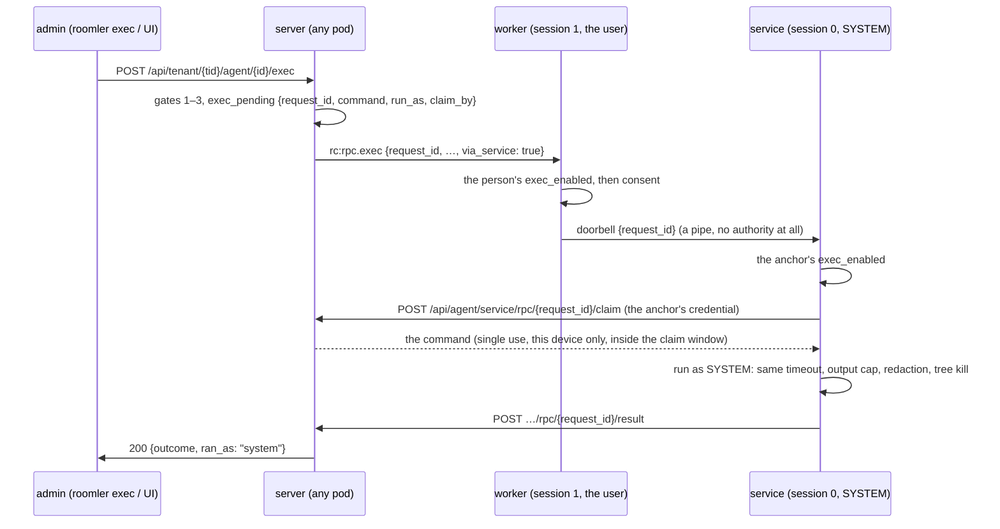
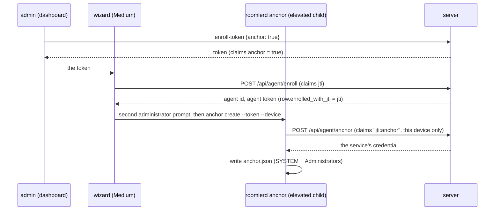
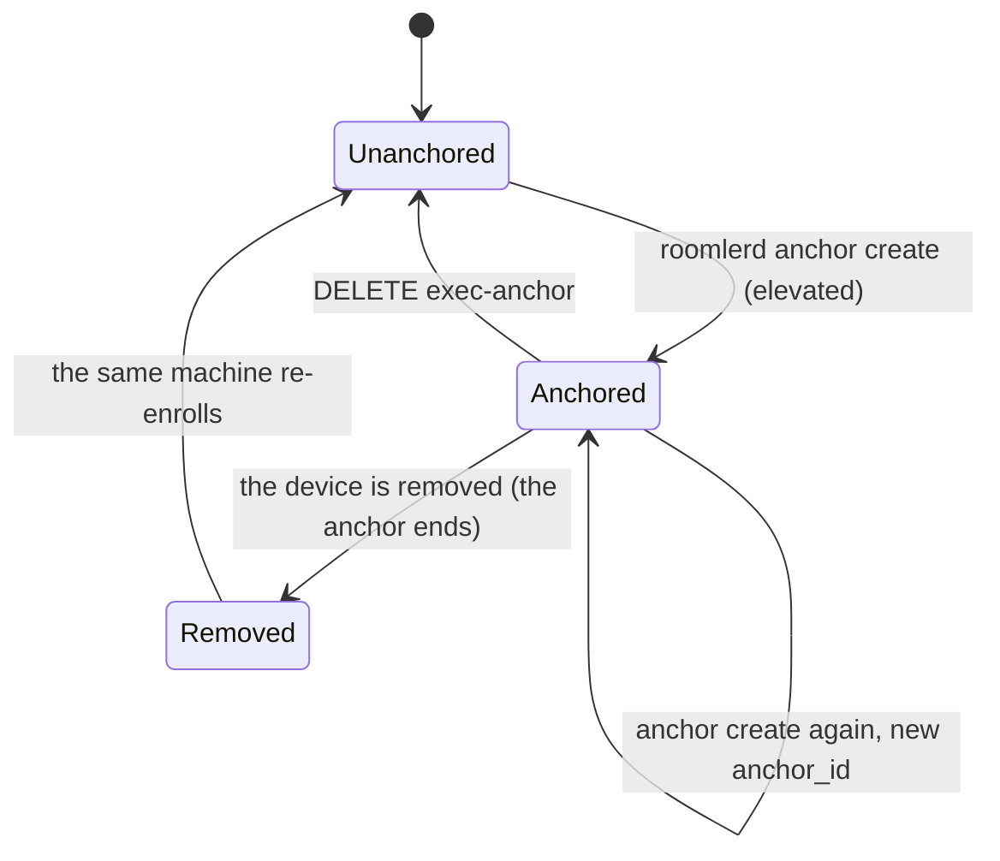
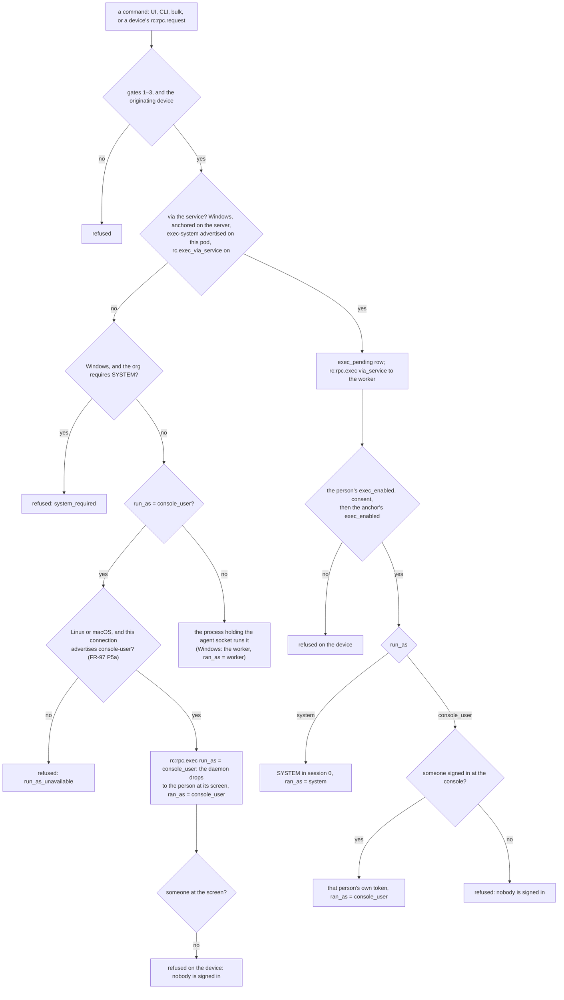

# Fleet RPC — remote command execution

Run a command on a trusted device from the CLI or the web UI, get its output
back, and leave an audit trail. Built for the case where a device is
misbehaving and the person who can diagnose it is somewhere else.

## Why it exists

The daemon already answers a rich diagnostic protocol — `status`, `peers` with
per-carrier debug, netstack `ping`, `config`, `tail-log` — but only to a caller
on the same host (`tunnel_core::localapi`, an ACL-gated named pipe / unix
socket). Everything needed to explain a bad overlay carrier is one pipe away
from someone standing at the machine and unreachable from anywhere else.

That made every hypothesis in a remote investigation cost a human round trip:
"please run this in an elevated pwsh and paste the output." Fleet RPC removes
that loop.

**Reading a remote log: always `roomler exec <host> -- roomler logs`** (with
`--grep <pat>` / `-n <lines>` / `--source daemon|service|panic`), never a path
guess. The daemon resolves its OWN log file — the path depends on the service
role, the running user, and a UTC-dated suffix, and a Windows host carries
two decoy `roomlerd.log*` files (the SCM supervisor's and the updater's).
Path archaeology has produced a false "the agent's logging is dead" verdict
twice (2026-08-07 and 2026-08-09); the verb existed both times.

## Transport

Commands ride the agent's **existing control WebSocket**, not the overlay.

That is deliberate: the diagnostics this exists for are most needed exactly
when the mesh is broken, so a transport that depends on the mesh would be
unavailable in the case that motivated the feature. An overlay-direct path
(lower latency, works when the *server* is unreachable) is a later phase, and
selection will prefer it only when a carrier is actually up.

```
CLI:  roomler → local daemon (LocalAPI) → rc:rpc.request → API pod
                                                             │
UI:   browser → POST …/agent/{id}/exec ──────────────────────┤
                                                             ▼
                                   [gates 1–3 + audit + mint request_id]
                                                             │
                                            PodBus (if the agent is elsewhere)
                                                             ▼
                                   hub.send_to_agent(rc:rpc.exec) → device
                                                             │
                                   rc:rpc.result ────────────┘
```

Wire variants live in `crates/remote_control/src/signaling.rs`:

| Tag | Direction | Purpose |
|-----|-----------|---------|
| `rc:rpc.exec` | server → agent | run one bounded command |
| `rc:rpc.cancel` | server → agent | kill it and its process tree |
| `rc:rpc.result` | agent → server | the answer (always sent) |
| `rc:rpc.request` | agent → server | the `roomler exec` leg |
| `rc:rpc.response` | server → agent | its answer |

**Capability gate.** An agent that predates the feature drops an unknown
`ServerMsg` tag in its `Err(e) => debug!` branch. For `Goodbye`/`UpdateNow`
that is harmless; here a caller is *blocked on the answer*, so silence reads as
a hung device. `AgentCaps.rpc` must contain `exec`, and the server answers
`412` when it doesn't. **This is the rule for any new `ServerMsg` a caller
awaits.**

## The four gates

A command runs only if all four allow it. Each is owned by a different party,
so no single compromise is sufficient.

| # | Gate | Owner | Default |
|---|------|-------|---------|
| 1 | `TenantSettings.remote_exec_enabled` | org owner (`MANAGE_TENANT`) | **off** |
| 2 | `permissions::EXEC_DEVICE` (`1 << 27`) | role admin (`MANAGE_ROLES`) | not in `DEFAULT_ADMIN` |
| 3 | `Agent.exec_policy` (`ExecMode::Off`) | fleet admin (`MANAGE_AGENTS`) | **off** |
| 4 | agent-local `exec_enabled` config key | whoever holds the machine | **off** |

Gates 1–3 are evaluated by `routes::agent_exec::authorize`. Gate 4 is enforced
on the device and comes back as an `error` on the result, which is why a
refusal is a `200` with an error body rather than a transport failure.

Design notes worth keeping:

- **`ExecPolicy` is separate from `AccessPolicy`.** That one grants
  screen-view. "May watch your screen" must never be the same checkbox as
  "may run a root shell".
- **`EXEC_DEVICE` is not in `DEFAULT_ADMIN`**, though `VIEW_EXEC_AUDIT` is: an
  admin should see every command the fleet ran without silently gaining the
  power to run one. `REMOTE_CONTROL` is not equivalent — it is consent-gated,
  visible to whoever is at the machine, and runs as the interactive user.
- **Gate 4 is the one that survives a compromised server.** Everything else
  lives on the control plane. Clearing the key resets it to `false`, so
  `roomler config set exec_enabled` with no value can never turn it on.
- **`can_originate`** must be set on a device before its CLI may drive commands
  at *other* devices. Without it, compromising any enrolled laptop would
  inherit its owner's exec rights fleet-wide.

## Privilege

Commands run privileged on purpose: the diagnostics that matter
(`Get-NetFirewallRule`, `netsh`, route tables, service state) need it, and the
admin UI says so in those words on both the console and the policy dialog.
**Root** under systemd, and on Windows **SYSTEM through the device's
service** once an administrator has anchored the device (FR-94,
`docs/fr/FR-94-fleet-rpc-system-on-windows.md`).

### Who runs the command

| Device | Without an anchor | Anchored (FR-94) |
|---|---|---|
| Linux (systemd), supervised Mac | root | n/a: already root |
| Windows, SystemContext mode | SYSTEM, in the console session (the worker is SYSTEM) | SYSTEM in session 0, through the service |
| Windows, attended install, an admin signed in | **that user**, elevated, session 1 (#2021) | SYSTEM in session 0, through the service |
| Windows, attended install, a standard user signed in | **that user**, Medium integrity: no admin rights | SYSTEM in session 0, through the service |
| Windows, nobody signed in | offline: no worker holds the socket | offline, the same (D3, the service owning the socket, is out of scope) |

Before FR-94, Fleet RPC ran in whatever process held the agent socket, and on
an attended Windows install that is the **worker in the console session**,
running as the signed-in user. A corporate laptop's commands then acted as the
employee (their Kerberos/NTLM identity on every share), and a standard user's
had no admin rights at all.

### The SYSTEM path



⚠️ **The invariant: nothing the signed-in user can write may decide what
SYSTEM runs.** The worker is the user's process and its config is the user's
file, so the service takes nothing from it but a request id. The command comes
from the server, fetched with a credential the user cannot read, from an
origin the user cannot change, and the output goes back to the server, never
to a local pipe. What each attempt to get around that meets:

| Attempt | What stops it |
|---|---|
| Ring the doorbell with a made-up or stale request id | the claim: the server has nothing pending under it for this device (404, audited `claim_refused`) |
| Point the user's config at another server | the service never reads it: its origin is in the anchor |
| Plant an anchor before an admin makes one (`%ProgramData%` lets users create folders) | the service trusts the file only if it and its directory are owned by SYSTEM or Administrators and grant nobody else write (`exec_service.rs` `check_private`) |
| Squat the doorbell's pipe name | the worker refuses a pipe SYSTEM does not own; the service's `first_pipe_instance` refuses to share the name |
| Read SYSTEM's output | it is posted from the service to the server over HTTPS |
| An http origin, to rewrite the claim on the path | the anchor accepts https only (loopback excepted, for tests) |

### Anchoring a device

From an **elevated** prompt on the device:

```
roomlerd anchor create --server https://roomler.ai --token <enrollment-token> --device <device id> [--ssh system]
roomlerd anchor status            # what is anchored (never the credential)
roomlerd anchor exec on|off       # the anchor's half of gate 4
roomlerd anchor ssh off|console_user|system   # FR-105: roomler SSH through this service too
roomlerd anchor remove            # this machine stops offering SYSTEM exec
```

- **The anchor's SSH ceiling** (FR-105, from 0.4.136) is **off** by default, so
  no anchor gains SYSTEM SSH by updating. `system` lets roomler SSH sessions run
  through the same service as SYSTEM (session 0) or as the signed-in user;
  `console_user` allows only the latter. `anchor status` then prints the
  service's own SSH host key fingerprint. How the session gets there, and why
  nothing the signed-in user writes can widen it:
  [`roomler-ssh.md`](roomler-ssh.md) § Through the device's SYSTEM service.

- The device is **named**, not derived: on an attended install the enrollment
  belongs to the user who made it, and `machine_id` hashes that user's config
  path, so "re-enroll this machine" from another account mints another device.
- The enrollment token is single use and burned only once every check passes
  (live device, same org, Windows, host name matches the device unless
  `--force`).
- The anchor lives in `%ProgramData%\roomler\roomler\exec-service\anchor.json`
  (Administrators-only). The worker learns from the service, every 30 s,
  which device it is anchored for, and offers the `exec-system` capability on
  that connection only. No restart is needed either way.

#### The wizard anchors, with the token it installs with (FR-104)

Roomler Setup anchors a machine-wide install (**Daemon — system** or **Daemon —
machine**) itself, so nobody needs to open an elevated prompt afterwards:

- **The token says so.** In the enrollment dialog, on the Windows tab for a
  machine-wide scope, an administrator ticks *Also let administrators run
  commands as SYSTEM on this device*. The server mints the token with an
  `anchor` claim (`POST …/agent/enroll-token {"anchor": true}`,
  `MANAGE_AGENTS`) and logs that choice with the token's `jti`.
- **One token, two uses, one device.** Enrolling records the token's `jti` on the
  device row (`enrolled_with_jti`). `POST /api/agent/anchor` then accepts an
  `anchor` token a second time, for exactly that device, once: it claims
  `"{jti}:anchor"` in `used_tokens` (`exec_service.rs` anchor route). Any other
  device, and a second anchor, is refused. A token without the claim is single
  use across both purposes, as before.
- **The wizard never holds the service's credential.** After the enrollment it
  runs `roomlerd anchor create --server … --token <the same token> --device
  <the id it just enrolled> --force` in an **elevated child**
  (`updater::spawn_elevated`, a second administrator prompt). That child posts,
  receives and writes the credential, as an administrator running it by hand
  would. `--force` because the wizard enrolled this very host a moment before.
- **A declined prompt or a failure leaves the install complete** and unanchored.
  The Done page names why and carries the command to anchor later.
- **The script and manual paths** take the same token. The dialog then shows the
  anchor command to run from the same Administrator PowerShell.



⚠️ **Whoever holds an anchor-capable token can anchor the device it enrolls,**
and so speak for that device's SYSTEM service (fake "ran as SYSTEM" results, on
that one device). That is FR-94's delegation for every enrollment token, made
narrower. The dialog says to give such a token only to the person installing as
an administrator; for a managed fleet, IT installs the Background service.

**One live anchor per device.** The service's credential carries the anchor's
id, and the server accepts it only while that is the device row's current
anchor. Anchoring again revokes the earlier one; so does
`DELETE /api/tenant/{tid}/agent/{id}/exec-anchor` (`MANAGE_AGENTS`), without
removing the device. The service renews its credential under the same anchor
well before its year runs out.



| Event | The service's credential | Where a command goes |
|---|---|---|
| `roomlerd anchor create` | minted, carrying a new `anchor_id` | the service, once the device advertises `exec-system` (within about 75 s, no restart) |
| renewal | minted again under the same `anchor_id` | unchanged |
| `roomlerd anchor create` again | every earlier `anchor_id`'s credential refused (401) | the service holding the new anchor |
| `DELETE …/exec-anchor` | refused (401) | the worker, or refused where the org requires SYSTEM |
| `roomlerd anchor remove` on the device | the file is gone; the server's record stays | the worker once the device stops advertising `exec-system`, or refused where the org requires SYSTEM |
| the device is removed | ended: the removal clears the anchor (401, "deleted", meanwhile) | nowhere: the device is gone |
| the same machine re-enrolls | **still refused** (401): the revived row has no anchor | the worker, until an administrator anchors it again |

⚠️ **Removing a device ends its anchor** (#2133). Re-enrolling the same machine
(the same `machine_id`) revives the removed row in place (`AgentDao::rehydrate`),
but not the anchor: `AgentDao::soft_delete` clears `exec_anchor` in the same
update that tombstones the row. The anchor file still on the machine is then
useless, since its credential names an anchor the server no longer records. The
device's commands go to the worker until an administrator runs
`roomlerd anchor create` again. Re-enrolling a device that was **never
removed** (a re-run wizard, `roomlerd re-enroll`) keeps its anchor. An
ephemeral enrollment's row is deleted outright (FR-51), so nothing of it can
come back either.

**Routing needs both halves:** the server's record of the anchor, and the
device's `exec-system` word. Either alone sends the command to the worker, as
before. `rc.exec_via_service = false` on the server turns the SYSTEM path off
everywhere; `ROOMLERD_EXEC_VIA_SERVICE=0` on a device withdraws its word.

The whole decision, in the order the code takes it (`agent_exec.rs`
`authorize`, then the dispatch; `exec_service.rs` `routes_via_service`). Every
refusal is audited:



**Gate 4 has two halves on this path**, and both must say yes: the person's
`exec_enabled` (the worker checks it before it rings, exactly as before) and the
anchor's (the service checks it before it claims).

**The account.** A Windows device's execution policy chooses who the service
runs a command as: **SYSTEM** (the default) or **the signed-in user**
(`run_as: console_user`), whom only SYSTEM can reach (`WTSQueryUserToken`), and
which is refused when nobody is signed in. Both need the service, so
`console_user` on a device that cannot take that path is refused
(`run_as_unavailable`) rather than run as the worker, which in SystemContext
mode is SYSTEM, the opposite of the policy. A policy `PUT` that does not name
`run_as` keeps the stored one: a stale client saving the policy must not turn
the signed-in user back into SYSTEM.

**Off Windows (FR-97 P5a)** the same policy means the person at the device's
screen: logind's seat0 on Linux, the owner of `/dev/console` on macOS. No
service is involved: the root daemon drops to them itself, by the drop a `named`
SSH account takes, and refuses when nobody is at the screen
([`roomler-ssh.md`](roomler-ssh.md) § `console_user` on Linux and macOS). The
server says so in the frame (`rc:rpc.exec`'s `run_as`), and it is the one frame
field an older agent must never be sent, because it would ignore the field and
run the command as root:

| Where | What is checked | Source |
|---|---|---|
| The policy `PUT` | `console_user` off Windows needs the agent's stored `console-user` word | [`agent_exec.rs:960`](../crates/modules/fleet/src/agent_exec.rs#L960) |
| Every command (`authorize`) | the connection on this pod advertises `console-user`, else `run_as_unavailable` | [`agent_exec.rs:359`](../crates/modules/fleet/src/agent_exec.rs#L359) |
| The push itself | the hub refuses a frame carrying `run_as` to a connection without the word, whoever the caller | [`hub.rs:3454`](../crates/modules/fleet/src/hub.rs#L3454) |
| The device | `run_as` is honoured through `exec_service::run_as_of`; an unknown word is refused before the consent prompt | [`signaling.rs:4920`](../agents/meshharbord/src/signaling.rs#L4920) |

The word is kept per connection, never read from the stored row, for the reason
`ssh-grant-ack` is: after a rollback the row still promises what the running
agent does not do.

**An org can require SYSTEM.** With `exec_require_system` on (workspace
Settings, `PUT /api/tenant/{tid}/exec-settings`), a Windows command that cannot
take the SYSTEM path is refused as `system_required` instead of running as the
signed-in user.

Every `exec_audit` row that ran records the server's own routing decision as
`ran_as`: `system` or `console_user` through the service, `console_user` for a
Linux or macOS daemon told to drop to the person at its screen (FR-97 P5a),
`worker` otherwise.
That is what the audit view shows. The result the caller gets carries the
device's claim instead, and only the service makes one: a worker's answer has
no `ran_as`. The audit row is authoritative.

There is no command blocklist. A blocklist on a root shell is false security
and trivially bypassed; the real mitigations are the four gates, the audit
trail, and the existing watchdog + SCM auto-restart if someone stops the
service out from under themselves.

## Bounds

Server-clamped, then re-enforced agent-side so a forged frame can't ask for an
unbounded run (`models::exec_limits`):

- timeout: 30 s default, 300 s max — the agent answers its own timeout
- output: 256 KiB default, 1 MiB max, **combined** across both streams, with an
  explicit `truncated` flag
- 4 concurrent commands per device; beyond that it refuses rather than queues
  (a caller on a deadline wants a fast "busy", not a slow timeout)
- no stdin, no interactivity, no streaming — **on this wire**. The engine has a
  streaming entry point beside `run_fed`, `ExecEngine::run_streamed` (FR-89),
  with no ceiling and no wall clock; Roomler SSH's `ssh <node> 'cmd'` uses it
  ([`roomler-ssh.md`](roomler-ssh.md) §3). `rc:rpc.exec` keeps every bound
  above, because its answer is one persisted `exec_audit` row, and the two
  paths share the identity model, the permit, the redactor and the tree kill —
  only the shape of the output differs.

Output is swept for the agent token(s), `Bearer …` headers and JWT-shaped
strings **before it leaves the host** — results are persisted in `exec_audit`
for 90 days, so a secret a command happens to echo would otherwise long outlive
the session.

## Audit

`exec_audit`, 90-day TTL, one row per **attempt** — including refusals. A
denied exec is the interesting one: without the row, someone probing which
devices will run things for them leaves no trace. Rows carry the caller, the
device, the origin device (CLI leg), the full command, the deny reason if any,
a capped output sample, and a SHA-256 of the full redacted output so a
truncated sample still ties to what ran.

## Using it

### CLI

```bash
roomler exec winhost-a -- Get-NetRoute -AddressFamily IPv4
roomler exec devbox --shell pwsh --timeout 60 -- Get-NetAdapter
roomler exec winhost-a --json -- ipconfig /all
roomler exec "Office PC" -- hostname      # a dashboard display name works too

# canned evidence bundles
roomler diag host winhost-a
roomler diag pair DEVBOX winhost-a
```

Exit status mirrors the remote command's, so `roomler exec` composes in a
script: a refusal or failure is non-zero here too, never a silent 0.

The target is a device name or a hex agent id, resolved by the server within
the caller's org (`crates/modules/fleet/src/socket.rs:1115` `resolve_exec_target`:
hex id → exact name → case-insensitive name). A dashboard **display name** is
turned into the hex id by the CLI before the request leaves — only when no
device name matches it, and refused when two devices share it
(`docs/device-naming.md` § Display names on the command line). The server never
sees a display name and gates the hex id exactly as it would a typed one.

The diagnostic bundles live in the **CLI**, not the agent, so a new probe is a
CLI release rather than a fleet-wide agent rollout. That inversion is the whole
argument for shipping free-form exec before a typed verb catalog.

### Web UI

- **Device console** — device menu → Diagnostics → *Device console*
- **Execution policy** — device menu → Access → *Execution policy*
- **Org switch + audit** — workspace Settings

### Turning it on for a device

```
1. org owner:   Settings → allow remote command execution
2. fleet admin: device → Execution policy → accept remote commands
3. on the box:  roomler config set exec_enabled true
                (then restart the Roomler service)
4. role admin:  grant EXEC_DEVICE to whoever should be able to run things
```

Steps 1–2 and 4 are server-side; step 3 must be done by someone with access to
the machine, on purpose.

## Deferred

- **Overlay-direct transport.** `serve_connection` over `NsTcpStream` on a
  netstack port, with server-minted grants pushed to the target (the
  `OverlayRelayGrant` pattern), so there is no key distribution. Adds P2P
  latency and server-independence.
- **Typed verb catalog.** Native cross-platform `NetDiag` / `LogGrep` /
  `FirewallRules` verbs promoted from whichever shell bundles prove themselves,
  plus exposing the existing `status` / `peers` / `ping` / `config` /
  `tail-log` LocalAPI verbs remotely.
- Output streaming **on the RPC wire** (the engine
  itself streams for Roomler SSH since FR-89; the `rc:rpc.result` row and its
  audit sample would need a different shape), scheduled probes, and an
  `exec_policies` selector collection shaped like `overlay_policies`.
