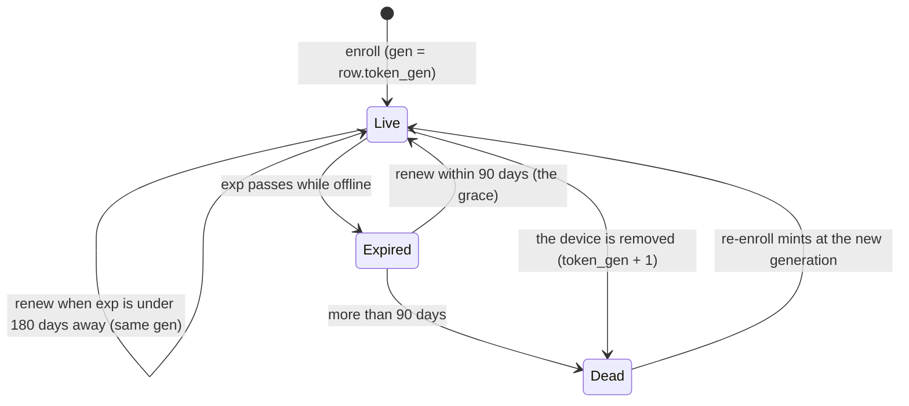

# FR-103: Device credentials renew themselves — an agent or tunnel-client token never expires out from under a running device

**Issue:** [#2134](https://github.com/gjovanov/roomler-ai/issues/2134) · **Status:** **closed 2026-10-15**: all
seven criteria verified (§5); released in 0.4.135; the fleet's first natural renewals fall due from 2026-11-27 (§8) · **Owner:** fleet (the agent token, removal), network (the tunnel-client token), the agent
(the renew loop) · **Anchors:** master `94a2032c6` · **Builds on:** FR-94 (its service credential already
renews itself), FR-40 (key rotation, the in-memory adoption pattern), FR-51 (removal), #2133

## 1. Goal

A device that keeps running keeps its credentials. Agent and tunnel-client tokens renew themselves well
before they expire. A device that slept through its anniversary recovers by itself after it updates.
Removing a device ends every token it was ever given, so a revived row never accepts an old one.

## 2. Evidence (master `94a2032c6`)

**Issuance.**
- `issue_agent_token` (`crates/services/src/auth/mod.rs` L462–480) uses a TTL of `unwrap_or(365 * 24 * 60 * 60)`. `issue_tunnel_client_token` (L573–593) does the same.
- Both are minted **only at enrollment**: `crates/modules/fleet/src/agent.rs` L228 (standard), L350 (ephemeral), and `crates/modules/network/src/routes/tunnel.rs` L165–167.
- No route re-issues either token, no `ServerMsg` carries one, and the agent never writes `agent_token` outside enrollment.

**Verification.**
- `Validation::default()` (`auth/mod.rs` L356–360) enforces `exp`.
- Agent token sites:
  - `AuthAgent` (`crates/modules/fleet/src/auth_agent.rs` L113–134, `accepted_agent` L201–248);
  - the agent socket (`crates/modules/fleet/src/socket.rs` L1282–1380);
  - DERP (`crates/modules/network/src/derp.rs` L318–417).
- Tunnel-client token sites:
  - the tunnel-client socket (`crates/modules/network/src/tunnel.rs` ~L1969–2060);
  - `GET /api/tunnel-client/agents` (`routes/tunnel.rs` L196–231), which has **no row check**.

**When it bites.**
- Agent tokens arrived on **2026-04-17** (`10cc0452a`), so the first possible expiry is **2027-04-17**, for a device enrolled that day and never re-enrolled.
- The server cannot list who is close: no row field records issuance. `agent_token_hash` is always `""` (`agent.rs` L219).

**On expiry.**
- The socket answers a fixed `401 "Unauthorized (agent)"`, the same as a revocation.
- The agent backs off 30 s, 60 s, 5 min, then 1 h forever (`agents/meshharbord/src/signaling.rs` L1007), and raises "re-enrollment required" at the third failure (L778).
- Recovery is `roomlerd re-enroll --token <fresh>`, run **on the machine**, and the running daemon picks it up only at the next restart.

**The token is copied at start.**
- `signaling::run` keeps the snapshot every reconnect uses (L586, `connect_once` L1134).
- The DERP dial closure captures it once per overlay start (`agents/meshharbord/src/overlay.rs` ~L351).
- The log uploader (`main.rs` ~L3569), the crash uploader and `OrgHttpRegistry` (`self_view.rs` L86–113) each hold a copy.
- The redactor registers it (`signaling.rs` L1234).

**The pattern to copy.**
- FR-94's service credential renews itself: `agents/meshharbord/src/exec_service.rs` `renew_if_due` L901–943, server `crates/modules/fleet/src/exec_service.rs` `renew` L226–244. "A lost response costs nothing … what ends a credential is the anchor, never the calendar."
- The persist pattern is `RemoteConfigServices::rotate_overlay_key` (`agents/meshharbord/src/remote_config.rs` L213–245): the daemon's `WriteLock`, a fresh load, the scalar or `[[orgs]]` slot, then adopt in memory.

**Removal revives old tokens.** `soft_delete` sets only `deleted_at`, and enrollment **revives** a tombstone in place for the same `(tenant_id, machine_id)` (`agent.rs` L143–208 → `AgentDao::rehydrate`). Tunnel clients do the same (`routes/tunnel.rs` L116–128, `TunnelClientDao::soft_delete` L292). A revived row therefore accepts every token it ever issued (#2133's "same shape").

## 3. Design

### 3a. Renewal

- `POST /api/agent/self/renew`, authenticated like `AuthAgent`: status-checked, deletion wins, a lookup failure is 500. It returns `{agent_token, expires_at}` for the same `sub` and tenant, at the row's current generation (§3c).
- The tunnel-client twin is `POST /api/tunnel-client/renew`, with the row check the roster route lacks.
- **Idempotent.** A lost response costs nothing: the old token stays valid until its own `exp`, and the device asks again.
- **Grace.** The renew routes alone accept a token up to **90 days past `exp`**. This is a renew-only verifier with `validate_exp = false` and an explicit bound; every other route keeps `Validation::default()`. The release routes are unauthenticated, so a device that slept through its anniversary updates, renews and reconnects by itself. The row must still be live and not quarantined.
- Kill switch: `rc.token_renewal = false` makes both renew routes answer 404, and the device keeps today's behaviour.

### 3b. The device

- **One renew check per enrollment**: the primary and every `[[orgs]]` entry, each against its own `server_url`.
  - It runs at start, after every successful connect, and every 12 h.
  - It renews when `exp − now < 180 days`, reading `exp` with `jwt_introspect::parse_unverified` (`agents/meshharbord/src/jwt_introspect.rs` L59).
- **On an auth-rejected connect**, before the backoff:
  1. Adopt a newer token from disk if another process re-enrolled. This makes `roomlerd re-enroll` work without a restart.
  2. Try a renewal: the old token is in its grace, and a revoked device is refused anyway.
- **Persist** exactly like `rotate_overlay_key`, then adopt through a **live `TokenSlot`** per enrollment that replaces every String copy. Each consumer reads it when it uses it: the socket per connect, DERP per dial, the uploaders and the HTTP registry per request. The new token is registered with the redactor.
- The tunnel CLI renews at start when due, and its `config::save` becomes atomic and `0600`.
- Kill switch: `ROOMLERD_TOKEN_RENEWAL=0`.
- ⚠️ The companion's `cmd_re_enroll` (`agents/meshharbor-desktop/src/commands.rs` L447–470) saves the fresh config **wholesale**, dropping `[[orgs]]` and every operator setting. It is fixed here (through `apply_enrollment`), and renewal never goes that way.

### 3c. A removal ends every earlier token

- `AgentClaims.gen` (serde default 0) and `Agent.token_gen` (serde default 0), with the same pair for tunnel clients.
- A token is accepted iff `claims.gen == row.token_gen`, at all five sites. Each already loads the row: no extra read, no hot-path write.
- `soft_delete` increments `token_gen` in the same atomic update that #2133 adds `$unset: exec_anchor` to. Enrollment, renewal and re-enrollment mint at the current generation.
- **Order at each site:** the deleted/quarantined check first, so a removed device still gets its typed `Goodbye AgentDeleted` and exits 7 (`socket.rs` L1348). The generation check runs only on a live row. On the socket it is decided before the upgrade, answering 401 like an expired token.
- **Renewal does not rotate the generation (decided 2026-10-14).** Rotation would cut off any copy minted before it, such as a long-lived DERP dial. It waits until §3b's `TokenSlot` is field-proven (§6).
- Kill switch: `rc.token_generation_check = false`.

### 3d. Visibility

- The socket upgrade has the claims, so `update_hello` stamps `token_exp` on the row.
- `AgentResponse.token_expires_at` drives an "expires" chip in `ui/src/components/admin/AgentsSection.vue`, amber under 60 days.
- `OrgStatus.token_expires_at` shows in `roomler status` and the companion.
- A test knob, `rc.agent_token_ttl_secs` (default one year), serves the integration lane and a throwaway stack. Prod is never shortened.

## 4. Phases

| P | Scope | Kill switch | Status |
|---|---|---|---|
| P0 | This spec, the issue (#2134 retitled) and the registry row | docs only | #2149 |
| P1 | Server: both renew routes and the grace verifier; `token_gen`, its check at five sites, the removal bump in both DAOs; `token_exp` stamping and the DTO; the TTL knob; tests. Every `Agent { … }` literal gains the fields (`dao/agent.rs` L153, `tunnel-core/src/policy.rs` L968) | `rc.token_renewal`, `rc.token_generation_check` | #2158, on prod since `hosted-20261014-fbc8f22` |
| P2 | Agent: `TokenSlot` through every consumer; the renew check (its horizon overridable by `ROOMLERD_TOKEN_RENEW_BEFORE_DAYS`, the field knob for AC1); persist; renew-on-401; `OrgStatus`; the `cmd_re_enroll` fix | `ROOMLERD_TOKEN_RENEWAL=0` | #2160, released in 0.4.135 |

P2 as built (`agents/meshharbord/src/token_renewal.rs`):
- **When "due".** By default, with 180 days left or at half the token's lifetime, whichever comes first. A 365-day token renews at 185 days old. A token minted short by `rc.agent_token_ttl_secs` renews at half-life rather than on every look. `ROOMLERD_TOKEN_RENEW_BEFORE_DAYS` is an *exact* override. Under the default rule a horizon above the lifetime would be capped at half-life and change nothing, so the override is what makes AC1's fresh token due at once (and at every look after: a testing knob).
- **When it looks.** After every connect the server accepted, and on the schedule that look returns: at most 12 h, at least 1 min, and 1 h after a failure that may pass. The first look waits for a connect, so a device that cannot reach its server asks it nothing. A random 0–60 s delay spreads a fleet that reconnected at once.
- **On a 401.** First a newer token in the config file (matched by server, tenant *and* device id), then a renewal, which the grace covers. Either earns one prompt retry. A refusal straight after a recovery waits out the normal ladder, so a server that renews a token its socket then refuses cannot spin the loop.
- **Saving.** A compare-and-swap under the daemon's config lock (`RemoteConfigServices::persist_agent_token`). A file already holding a different token for the device was re-enrolled meanwhile, and that token wins. A save that fails still puts the renewed token in use: nothing is rotated, so the file's token stays valid, and the daemon keeps working until a restart reads the file again.
- **One slot per enrollment** (`meshharbor-node-core::token_slot`), minted once in `run_cmd` and shared by the loop, its LocalAPI status row, its device-list HTTP identity, the DERP dialer (read per dial: the overlay runtime outlives the connection that built it), and, for the primary, the log and crash uploaders.
| P3 | Tunnel CLI renewal (before `forward` and `socks5` dial; the due rule moved to `meshharbor_cli::credential::renew_at`, which `roomlerd` now calls); atomic `0600` save, compare-and-swap for a renewal | — | #2167, released in 0.4.135 |
| P4 | UI chip; docs (§5 AC7); field | — | #2168 (docs + chip), #2182 (a renewal stamps the expiry at once); AC4's last two tests #2263; field §8 |

Rollout:
1. The server first. It is inert until an agent renews: every existing token and row is at generation 0.
2. Then the agent.
3. A new agent on an old server gets a 404 from the renew route and keeps its token, which is today's behaviour.

## 5. Acceptance criteria

- [x] **AC1:** a device renews by itself, field-checked on a vmtest candidate, red first. On the released agent with `ROOMLERD_TOKEN_RENEW_BEFORE_DAYS=400`, nothing renews. On the candidate, the token renews within a minute and the row's `token_exp` moves. The next socket and DERP connections use the new token. *(§8 rows 1–3. RED on 0.4.134. GREEN on the 0.4.135 candidate: renewed 34 s after the install; the next socket presented the renewed token from disk. The row moves at the renewal itself since #2182, row 4. DERP was not dialled in the field: the DERP dialer reads the same `TokenSlot` on every dial, and `token_slot::tests::every_clone_sees_a_new_token` covers that.)*
- [x] **AC2:** a device whose token is past `exp`, but by less than 90 days, renews and reconnects with no hands on the machine. A device more than 90 days past, or removed, or quarantined, is refused. Integration lane with the TTL knob, plus once on a throwaway local stack. *(Integration: `an_expired_token_renews_within_the_grace_only` (inside the grace it renews; past it, and on every other route, refused), `a_quarantined_or_removed_device_cannot_renew`, and `a_lapsed_device_renews_in_the_grace_and_comes_back` (the real `roomlerd` loop). Throwaway stack, §8 row 4: off across its expiry, the device renewed 64 ms after its first connect attempt and was online again 2 s later. Removed, its token was refused at the renew route and at every HTTP route.)*
- [x] **AC3:** removing a device ends every token it held. After the same machine re-enrolls, the old token is refused at all five sites and the new one is accepted (integration). Red first on master. *(`a_removal_ends_every_earlier_token`: an `AuthAgent` route, the agent socket, DERP and the renew route. `a_tunnel_client_renews_and_a_removal_ends_its_tokens`: the tunnel-client socket and HTTP routes. The red: `the_kill_switches` with `rc.token_generation_check` off is the behaviour before FR-103, and there the revived row accepts its old token again.)*
- [x] **AC4:** never self-wedge.
  - A lost renewal response, a crash between save and adopt, and a cross-process re-enroll each leave the device online (integration plus unit). *(`a_device_renews_its_own_token`: renewal does not rotate, so the old token keeps working. `a_device_renews_before_its_token_expires`: the new token is saved before it is used, so a crash leaves a valid token either way. `a_token_re_enrolled_on_disk_is_used_without_a_restart`, plus the unit tests `a_refused_token_switches_to_a_newer_one_on_disk` and `a_token_on_disk_for_another_device_is_not_adopted`.)*
  - A secondary org renews against its own server. *(`a_secondary_org_renews_against_its_own_server`, #2263: two servers. The renewal goes to the secondary's server and lands in its own `[[orgs]]` entry; the primary's token is untouched. The control: the primary's server refuses to renew the secondary's token.)*
  - An old server answering 404 changes nothing. *(`an_old_server_answering_404_changes_nothing`, #2263: the token is kept, nothing is written, there is no failure backoff, and the token is still accepted. The server half: `the_kill_switches`.)*
- [x] **AC5:** the tunnel CLI renews when due, and its config save is atomic and `0600`. *(`a_tunnel_client_renews_and_a_removal_ends_its_tokens`. Unit tests `credential::tests` for the due rule, and `config::tests::save_is_atomic_and_private` and `a_renewed_token_never_overwrites_a_re_enrollment`.)*
- [x] **AC6:** the device list shows when each credential expires, and `roomler status` shows it too. *(`the_device_list_shows_when_a_credential_expires`; `a_renewal_shows_in_the_device_list_without_a_reconnect` (#2182). In the field, `roomler status` on a vmtest Ubuntu device printed `credential  expires in 364 days` (2026-10-14), and the throwaway stack's device list moved `token_expires_at` at the renewal (row 4).)*
- [x] **AC7:** docs: *(`docs/device-credentials.md` (#2168, two mermaid diagrams), `docs/security-baseline.md` § 4 The device plane, the stale `remote-control.md` row corrected (now "1 year; renewed by the device 180 days early, never rotated"), the `issue_agent_token` comment rewritten, and the `docs/README.md` row.)*
  - a credential-lifecycle section with mermaid (`docs/security-baseline.md` § device plane, and a new `docs/device-credentials.md`);
  - the stale "1 year, rotates on use … argon2-hashed … OS keychain" row in `docs/remote-control.md` L691 corrected;
  - the stale comment at `auth/mod.rs` L460 fixed;
  - linked from `docs/README.md`.

## 6. Open decisions

1. **Rotation: decided, no** (operator, 2026-10-14). A later phase revisits it once `TokenSlot` is field-proven: monthly rotation with a two-generation window, so a passively stolen copy dies within about two months.
2. **The grace: 90 days.** It is long enough for a laptop in a drawer over a holiday quarter, and short enough that a year-old stolen token cannot be revived.
3. **Rows tombstoned before P1 deploys keep generation 0**, so their old tokens can still revive. Recommended: accept it; no migration.

## 7. Out of scope

- Rotation (§6.1).
- Binding a token to a device-held key (proof of possession).
- User session tokens (`docs/security-baseline.md` §1 tracks those).
- FR-94's service credential, which already renews.

## 8. Field-verification log

| # | Cell | Host | Result |
|---|---|---|---|
| 1 | AC1 RED: the released agent (0.4.134), an attended per-Machine install enrolled by a standard user, the knob `ROOMLERD_TOKEN_RENEW_BEFORE_DAYS=400` set as a Machine env var, then a reboot | vmtest Win11 guest | 2026-10-14 02:06–02:16Z: the device list's `token_expires_at` stayed `2027-10-14T00:24:54Z` (the enrollment's) for 5 min after the device came back, and neither prod pod logged an `fr-103: agent token renewed` line for it in 6 h. As expected: 0.4.134 has no renewal. |
| 2 | AC1 GREEN: the 0.4.135 candidate's per-Machine MSI over the row-1 install (`msiexec /i … ENABLE_SYSTEM_CONTEXT=0`), knob still set | the same guest | 2026-10-14: installed 06:40:33Z, connected 06:41:06Z. At 06:41:07Z the server logged `fr-103: agent token renewed … expires_at=2027-10-14T06:41:07Z`, **34 s after the install, on its first connect**. |
| 3 | AC1: the next socket uses the renewed token (`Restart-Service Roomler` at 06:45:07Z) | the same guest | From 06:45:56Z the device list read the renewed token's `token_expires_at`: the worker saved it, and the next connect presented it from disk. A second renewal at 06:45:44Z, on that connect, is the knob keeping a 365-day token due: one renewal per connect, no storm. (Before #2182 the row moved only at that reconnect; since #2182 it moves at the renewal, row 4.) |
| 4 | **AC2 on a throwaway local stack**. The hosted image `hosted-20261014-b4e2263`, minting agent tokens that live 180 s (`rc.agent_token_ttl_secs`), on a private docker network. The released `roomlerd` 0.4.137 runs in a container that shares the server's network namespace, so the server is its loopback | a lab host, nothing of prod's | 2026-10-15. Enrolled 17:54:56Z, online, `token_expires_at` 17:57:56Z. **Switched off** at 17:55:19Z, before its 90 s renewal. **Switched on** at 17:58:59Z, 63 s past `exp`: its connect attempt at 17:59:00.203Z, then `agent token renewed` at 17:59:00.267Z (the server: `POST /api/agent/self/renew`, `fr-103: agent token renewed`), then connected at 17:59:01.27Z, online, with `token_expires_at` at 18:02:00Z. **Removed** at 17:59:02Z: its log uploads and its own renewal (18:00:43Z) were refused (`agent has been deleted`), and a renewal with its token answered 401. Found on the way: the removed device's control WebSocket stayed open (#2267, filed separately). |
| 5 | The fleet: when do natural renewals begin? Read-only, from the server's rows | prod | 2026-10-15: **no live device is due before 2026-11-27**. The earliest `token_exp` among the 33 of 41 live devices stamped since P1 is 2027-05-26, so it renews from 2026-11-27. The other 8 have not connected since P1, so their expiries are unknown. No connected device still holds one of the 2027-04-17 tokens #2134 started from. |

## 9. Related

- #2133 (A: a removal ends the anchor), which shares §3c's atomic update.
- FR-94 (`docs/fleet-rpc.md` § Anchoring a device).
- #2078: a clean-shutdown save erases unknown keys. The persist holds the daemon's lock against it.
