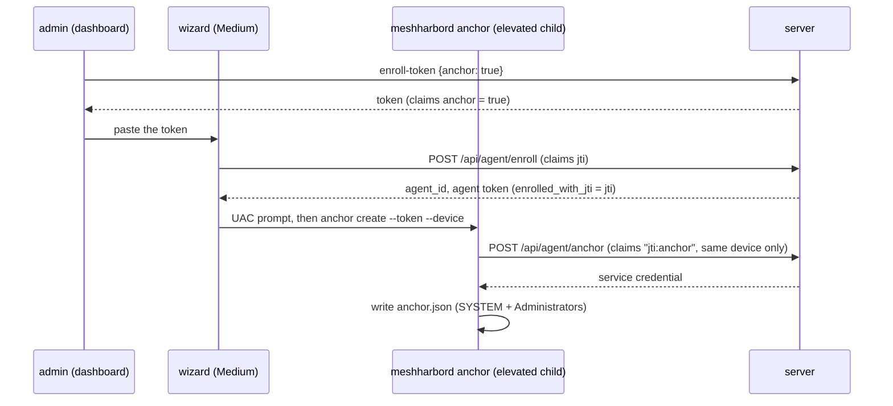

# FR-104: The wizard anchors a Windows device — SYSTEM exec set up at install, with one token and the administrator's prompt

**Issue:** [#2147](https://github.com/jk-zhang-meta/MeshHarbor/issues/2147) · **Status:** **closed 2026-10-14**: all five criteria field-verified on the released 0.4.135 wizard (§8) · **Owner:**
fleet (the anchor route, enrollment tokens), the wizard (`agents/meshharbor-setup`, `crates/meshharbor-setup-core`),
the admin UI · **Anchors:** master `94a2032c6` · **Builds on:** FR-94 (the anchor; its P1 second half,
"the wizard writing the anchor", was not built), FR-84 (the wizard)

## 1. Goal

An administrator installing MeshHarbor on a Windows machine can anchor it for SYSTEM exec in the same pass:
- one token pasted into the wizard;
- one more administrator prompt;
- no separate elevated `meshharbord anchor create` afterwards.

FR-94's invariant still holds: the anchoring happens inside an elevated process, and the SYSTEM service's
credential never passes through a process the signed-in user controls.

## 2. Evidence (master `94a2032c6`)

**The wizard does not elevate itself.**
- It runs at **Medium integrity**: `asInvoker`, no `requestedExecutionLevel` (`agents/meshharbor-setup/build.rs` L48–52). `crates/meshharbor-setup-core/src/msi_runner.rs` L139–156 measured it.
- The only elevated step is the `msiexec` child (`agents/meshharbor-setup/src/orchestrator_agent.rs` L355 → `agents/meshharbord/src/updater.rs` L2346 `spawn_msiexec_elevated`, `ShellExecuteExW` `"runas"`, file hard-coded to `msiexec.exe`).

**It enrolls in-process.** `meshharbord::enrollment::enroll` (`orchestrator_agent.rs` L488–503) runs with **one pasted token** (`src/front/index.html` L166–172). The wizard holds no user session, so it cannot mint another.

**One token cannot both enroll and anchor.**
- `/api/agent/enroll` claims the token's `jti` (`crates/modules/fleet/src/agent.rs` L187–198), and `/api/agent/anchor` claims it again (`crates/modules/fleet/src/exec_service.rs` L172–183).
- `used_tokens` is keyed by the bare `jti` (`crates/services/src/dao/used_token.rs` L66–78), whatever the purpose.

**Anchoring needs elevation, and only machine roles have the service.**
- `meshharbord anchor create` requires elevation (`agents/meshharbord/src/exec_service.rs` `require_elevated` ~L1532) and writes the anchor under a SYSTEM + Administrators DACL.
- Only the `DaemonSystem` and `DaemonMachine` roles (`src/role.rs` L35–55) install the SYSTEM service the anchor is for.

## 3. Design

### 3a. A token that may also anchor the device it enrolls

- `POST /api/tenant/{tid}/agent/enroll-token` takes an optional body `{ "anchor": true }` (`MANAGE_AGENTS`, as today).
  - It mints `EnrollmentClaims.anchor = true` (serde default false, so every existing token is unchanged).
  - The admin's choice is logged with the `jti`.
- `enroll_agent` records `enrolled_with_jti` on the row it creates or revives.
- `POST /api/agent/anchor` accepts an `anchor: true` token a **second** time, only for the device that token enrolled (`agent.enrolled_with_jti == claims.jti`). It claims `"{jti}:anchor"` in `used_tokens`, so the token anchors that device once. Any other device, and any second anchor, is refused.
- A token without the claim behaves exactly as today: one use, across both purposes.

### 3b. The admin UI

`ui/src/components/enroll/EnrollmentDialog.vue` (the scope toggle at L47–62) gets a checkbox, for the Windows Background and Attended scopes: "Also let administrators run commands as SYSTEM on this device". It explains that:
- the wizard will show a second administrator prompt;
- the token should go only to the person installing it as an administrator.

### 3c. The wizard

- **Offer.** The token peek (`agents/meshharbor-setup/src/commands.rs` L198–221) reads the `anchor` claim. The anchor step is offered only for `DaemonSystem` / `DaemonMachine` on Windows.
- **The step.** After `EnrollOk`, a new best-effort step (shaped like the companion step, `orchestrator_agent.rs` L513–519) runs `meshharbord.exe anchor create --server <origin> --token <the same token> --device <agent_id> --force`.
  - It runs **elevated** through a generalised `spawn_elevated(file, argv)` in `meshharbor-setup-core`, beside `msi_runner.rs`; `spawn_msiexec_elevated` becomes a call to it.
  - It is awaited with `MsiRunner::attach(pid).wait_for_exit()`, and success is the exit code.
  - `--force` because the wizard enrolled this very host by id a moment earlier.
- **Progress.**
  - Events: `ProgressEvent::{AnchorStarted, AnchorOk, AnchorSkipped{reason}}` (`crates/meshharbor-setup-core/src/progress.rs`).
  - The checklist labels, and `DoneReport.anchored`.
  - A declined prompt or a failure leaves a Done-page note carrying the manual command (the text `ExecPolicyDialog.vue` L57–60 uses).
- The origin is normalised to pass `exec_service::origin_ok` (https only).

### 3d. Why not return the credential from `/api/agent/enroll`

The Medium wizard would then hold the SYSTEM service's credential, and the server cannot verify elevation. Whoever held it could pose as the service. The POST stays inside the elevated child (FR-94 §4).

## 4. Phases

| P | Scope | Kill switch | Status |
|---|---|---|---|
| P0 | This spec, the issue and the registry row | docs only | #2149 |
| P1 | Server: the `anchor` claim, `enrolled_with_jti`, the second-purpose claim; tests | tokens carry `anchor` only when asked | #2164, on prod since `hosted-20261014-cc63c4d`. The token route reads its body leniently: only a non-empty JSON body is parsed, so the body-less, `curl -d ''` and empty-JSON calls every script made before still mint a plain token |
| P2 | Admin UI checkbox and copy. The box sits on the Windows tab for the two machine-wide scopes and shows what the token CARRIES (the server's `anchor`), never a wish: ticking it mints a new token (`AgentsSection.vue` `reissueEnrollToken`). An anchoring token adds a fourth Windows block, the elevated `meshharbord anchor create` with the same token, for the script and manual paths (`enrollCommands.ts`). The request carries a body only when asked, so the plain token stays the body-less request every server answers | — | #2174, merged once the wizard with P3 was released (`setup-v0.4.135`): before that the copy would have promised a wizard step the released wizard did not have. On prod with the next promote |
| P3 | Wizard: `spawn_elevated`, the anchor step, progress, Done note | the step runs only for an `anchor: true` token | #2171, released in `agent-v0.4.135` / `setup-v0.4.135` |
| P4 | Docs; field | — | docs this PR; field rows 1–5 (§8) |

## 5. Acceptance criteria

- [x] **AC1:** an `anchor: true` token enrolls a device and then anchors **that** device, once. It is refused for any other device and for a second anchor; a plain token behaves exactly as today (integration, red first on master). *(#2164: `exec_service_tests` — the second use, no other device, never twice, a plain token, MANAGE_AGENTS, and the body shapes; each red first.)*
- [x] **AC2:** a `DaemonSystem` and a `DaemonMachine` wizard install on vmtest, given an anchor token, each end anchored. Each device advertises `exec-system`, and `whoami` through exec is `NT AUTHORITY\SYSTEM`, session 0. Red first: the released wizard, given the same token, ends unanchored. *(§8 rows 1–3.)*
- [x] **AC3:** a declined or failed anchor step leaves the install complete and unanchored, and the Done page carries the manual command. *(The paths are unit-tested in #2171. §8 row 5 declines a real second prompt: the wizard at Medium integrity, both UAC prompts answered from the hypervisor's console. The install is complete and enrolled; the device is `anchored=false` with no `exec-system`; the Done page names why and carries the command.)*
- [x] **AC4:** the token is never printed, and the service credential never exists outside the elevated child and the anchor file. *(§8 row 4.)*
- [x] **AC5:** docs:
  - `docs/installation.md`'s Windows section;
  - `docs/fleet-rpc.md` § Anchoring a device, with this FR's sequence diagram;
  - the FR-94 spec's §9 entry updated;
  - linked from `docs/README.md`.

## 6. Open decisions

1. **Who may get an anchor-capable token.** Recommended: the admin ticks it per token (default off), for Windows Background and Attended scopes only.
   - The holder can anchor the device the token enrolled, and so pose as that device's service: faked "ran as SYSTEM" results, on that one device.
   - That is FR-94's existing delegation for plain tokens, made narrower (one device).
2. **One UAC prompt instead of two**, by relaunching the wizard elevated for `DaemonSystem`. It is cleaner for SystemContext installs. But it changes where the wizard writes its per-user state, and it breaks `DaemonMachine`, whose config belongs to the signed-in user. Recommended: not in v1.

## 7. Out of scope

- Anchoring from the scripts (`scripts/install.ps1`). An admin can run `meshharbord anchor create` after them.
- macOS and Linux, which have no anchor (their daemons are root).
- Pre-existing: the Medium wizard writes the SystemContext config under `%ProgramData%` and hardens it best-effort (`orchestrator_agent.rs` L467–486). Noted, not changed here.

## 8. Field-verification log

Bare vmtest Win11 guests booted from the golden (no MeshHarbor installed), the wizard launched in the console session **elevated** (`schtasks /IT /RL HIGHEST`, so no prompt blocks the walk) and walked over WebView2 CDP. Each token was minted by the vmtest org's admin with `{"anchor": true}` on prod running P1.

| # | Cell | Host | Result |
|---|---|---|---|
| 1 | **RED**: the released wizard `0.4.134`, *Background service* (`daemon-system`), an anchor token | vmtest Win11 guest | 2026-10-14 07:40Z: the Token step offered nothing (the old wizard has no anchor UI); the install reached Done; the server read the device `anchored=false`, with no `exec-system`. |
| 2 | **GREEN**: the released wizard `0.4.135` on the same guest (a re-run over the row-1 install), *Background service*, a fresh anchor token | same guest | 10:55Z: the Token step said it would anchor; the checklist read "Anchoring for SYSTEM exec (administrator prompt)" → "Anchored for SYSTEM exec"; the server read `anchored=true`, `exec-system` advertised, 0.4.135. With the person's `exec_enabled` and a `run_as: system` policy, `whoami` through exec: **`NT AUTHORITY\SYSTEM`, session 0, System integrity**, `ran_as=system` in the result and the audit. |
| 3 | **GREEN**: the released wizard `0.4.135` on a fresh guest, *Attended service* (`daemon-machine`), an anchor token | another vmtest Win11 guest | 11:31Z: the same offer and checklist; `anchored=true`, `exec-system`; `whoami` through exec **`NT AUTHORITY\SYSTEM`, session 0**, `ran_as=system`, while the worker there is the signed-in user. |
| 4 | **AC4**: every log, temp and state file under the profile, `%ProgramData%\meshharbor` and the temp dirs (`.log`/`.txt`/`.json`/`.jsonl`, 67 files) scanned for JWT-shaped strings, counted, never printed | the row-3 guest | Exactly one: `exec-service\anchor.json`, the service credential, by design; owned by Administrators, access SYSTEM and Administrators only. No token in any wizard or daemon log. |
| 5 | **AC3**: the released wizard `0.4.135` launched the way a double-click launches it, at **Medium** (`schtasks /IT /RL LIMITED`); *Attended service*; an anchor token. Each UAC prompt was answered from the hypervisor's console (`virsh send-key`), and identified first by the wizard's running checklist row (a `consent.exe` poll over SSH saw it appear) | a fresh vmtest Win11 guest, renamed before anything enrolled | 12:58:13Z, prompt 1 during the MSI step: Yes (`Alt+Y`). "MSI installer finished (exit 0)", "Enrolled". 12:58:22Z, prompt 2, the running row "Anchoring for SYSTEM exec (administrator prompt)": No (`Esc`). The checklist then read "Not anchored: the administrator prompt was declined (UAC)" → "Done". The Done page: the reason, and `meshharbord anchor create --server https://meshharbor.itachi.fans --token <fresh token> --device <the new id>`. The server: the device online on 0.4.135, `anchored=false`, no `exec-system`; no `anchor.json` on the guest. |

Notes from the cells:
- An **elevated** WebView2 ignores `WEBVIEW2_ADDITIONAL_BROWSER_ARGUMENTS`, so the walker's CDP port never opened. The per-executable policy key `…\Policies\Microsoft\Edge\WebView2\AdditionalBrowserArguments` (value `meshharbor-setup.exe`) works. Test guests only.
- The vmtest golden's `vmtest` password expired on 2026-10-14, which stopped its autologon (Winlogon result 1327). The guests for rows 1–3 were fixed one by one. The golden itself is fixed in meshharbor-deploy#31; row 5's guest booted from it.
- Every vmtest Win11 clone was named `VMTEST-WIN`, and `machine_id` hashes the host name, so same-type clones in one org shared a device row. meshharbor-deploy#32 renames each clone first; row 5's guest was renamed by hand before enrolling.

## 9. Related

- FR-94 (`docs/fr/FR-94-fleet-rpc-system-on-windows.md` §5c P1, §9).
- `docs/fleet-rpc.md`.
- FR-84 (the wizard).
- FR-105, whose anchor gains an SSH ceiling the wizard's checkbox may also set.
