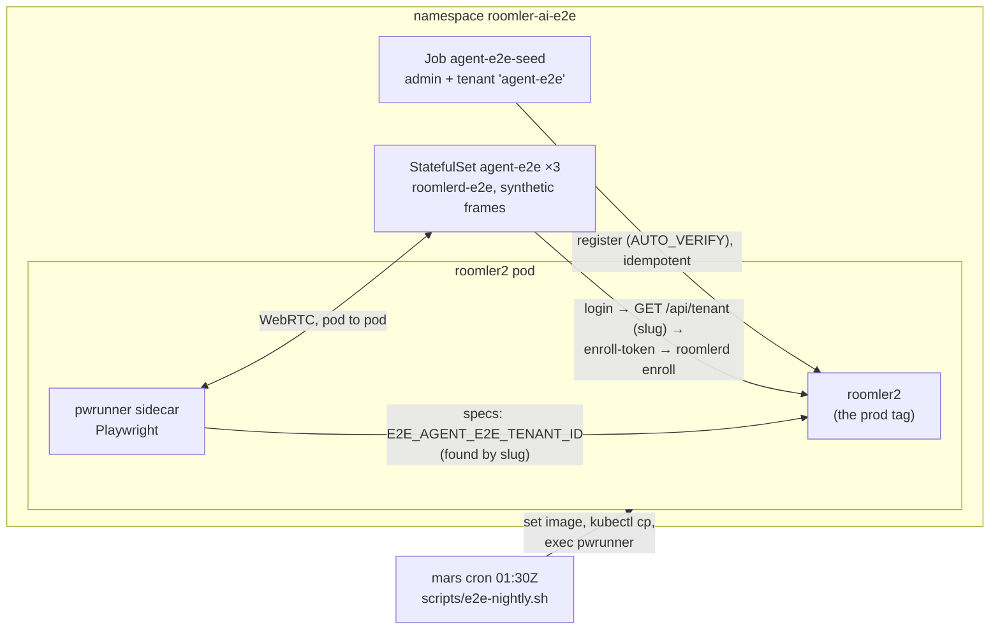

# FR-114: The agent-e2e lane runs every night — remote-session specs against a real agent in the e2e namespace

**Issue:** [#2524](https://github.com/gjovanov/roomler-ai/issues/2524) · **Status:** ✅ **closed 2026-10-20**, every
criterion ticked. P1 + P2 shipped 2026-10-19 (#2534 `65d819898`; deploy #45 `225cbb9cc`); the first nightly (2026-10-20
01:30Z) ran all seven agent-e2e tests and passed them. Proposed 2026-10-19 on the operator's go-ahead (*"do the test based on your best judgement … proceed"*) · **Owner:** testing (the
e2e pod lane) · **Anchors:** master `34f0958df` · **Builds on:** `scripts/e2e-k8s/AGENT-E2E.md` (the harness as it
was first written), [FR-102](FR-102-growth-observability.md) AC19 (whose pod-lane run this owes)

## 1. Goal

Every remote-desktop spec in `ui/e2e/` that needs an agent runs in the nightly pod lane, against three synthetic-frame
agents enrolled in the e2e server (one per recording state, §6.2), and fails the night when it fails. Today all six are listed and skipped: the lane
reads like coverage and is none.

## 2. Evidence (2026-10-17 … 10-19)

| What | Measured |
|---|---|
| The nightly (mars, 01:30Z, against the prod tag) | lists the agent-e2e specs and skips them: 15 skipped on 2026-10-19 (`hosted-20261018-368ac01`), the six agent-e2e specs among them |
| Why it skips | the lane passes only `E2E_BASE_URL`, `E2E_API_URL`, `E2E_MAILPIT_URL` (`scripts/e2e-nightly.sh:133`); every agent-e2e spec skips on `!E2E_AGENT_E2E_TENANT_ID` (e.g. `ui/e2e/remote-session-smoke.spec.ts:92`) |
| The namespace | `roomler-ai-e2e` holds mailpit, minio, mongodb, redis and roomler2 (with its `pwrunner` sidecar), and **no `agent-e2e` StatefulSet**. The deploy repo's `k8s/overlays/e2e` has none of the template's four agent-e2e files |
| The image | no workflow builds `roomlerd-e2e`, and no copy exists on the build host. `Dockerfile.agent-e2e:30` builds with `rust:1.88-bookworm`, while the workspace is edition 2024 and the main `Dockerfile` builds with `rust:1.95-bookworm` |
| The seed | `job-agent-e2e-seed.yaml:77` reads `tenant_id` out of `GET /api/auth/me`, which no longer carries one, so the seed cannot finish. The agents then need a hand-rebaked Secret (`secret-agent-e2e-bootstrap.yaml`, `tenant_id: 000…0`) |
| The specs | 4 of the 6 seed `access_token` / `refresh_token` into `localStorage` (`remote-session-smoke.spec.ts:116`, `remote-file-upload-smoke.spec.ts:124`, `remote-recording-smoke.spec.ts:55`, `remote-recording-refused.spec.ts:104`). That has granted nothing since sessions became cookie-only (#691), so even a live harness would fail them at the login form. `remote-session-rating.spec.ts` was fixed by FR-102 (#2366, `signedInContext` at `:96`) and passed on production against a vmtest guest on 2026-10-17 |

## 3. Key design

1. **The tenant is found by its slug, never pasted into a Secret.** The seed registers the admin and its tenant
   (`tenant_slug: agent-e2e`, idempotent on 409; `register` takes the tenant fields, `crates/api/src/routes/auth.rs:22`;
   the e2e server auto-verifies, `configmap-roomler2-config.yaml:43`). Then it, the agent bootstrap and the nightly
   each read the id from `GET /api/tenant` (`crates/api/src/routes/tenant.rs:32`, flat rows with `slug`). The
   "rebake the Secret" step and its stale-id failure mode go away, and the Secret keeps only the admin's documented
   test credentials.
2. **The image builds on the workspace's toolchain** (`rust:1.95-bookworm`, as the main `Dockerfile`), from master,
   and is pushed to the cluster's registry (`registry.roomler.ai/roomlerd-e2e`) under a dated tag. The overlay pins
   that tag, never `latest`, so a night's agent is a known build.
3. **The four specs sign in the way the rating spec does**: `context.request.post('/api/auth/login')`, so the HttpOnly
   cookie lands in that context's jar; the `roomler-signed-in` hint by `addInitScript`; purestat aborted. They keep the
   admin's bearer token for their own API calls, which the server still accepts.
4. **The nightly passes the tenant only when the harness is there.** If `statefulset/agent-e2e` exists and the tenant
   resolves, `E2E_AGENT_E2E_TENANT_ID` goes into the run. Otherwise the run is today's, and the log says why.
   ⚠️ The nightly prints test **starts**, not outcomes: the proof is the skip count compared night over night.

## 4. Phases

| Phase | What | Kill switch | Status |
|---|---|---|---|
| P1 | the four specs' cookie sign-in; `Dockerfile.agent-e2e` on rust 1.95, with the bootstrap finding the tenant by slug; the seed reading the tenant from `GET /api/tenant`; the template's registry; the nightly's tenant discovery; `AGENT-E2E.md` and `docs/testing.md` | revert the PR | **merged** #2534 `65d819898` |
| P2 | build and push `roomlerd-e2e`; install the overlay into the deploy repo (`k8s/overlays/e2e`, manual apply, never ArgoCD-synced); apply; the seed; all three agents online | `kubectl -n roomler-ai-e2e delete statefulset agent-e2e` (the nightly then skips as today) | **done**: `agent-e2e-20261019-2a8a8c5`, deploy #45 `225cbb9cc`, applied |
| P3 | an on-demand run of the six specs in the `pwrunner`; then the next nightly | as P2 | **done**: on-demand 7/7 (four runs); the first nightly 7/7, skips 15 → 8 |

## 5. Acceptance criteria

- [x] **AC1 (P1):** no spec in `ui/e2e/` seeds `access_token` or `refresh_token` into `localStorage`
  (`grep -rn "setItem('access_token'" ui/e2e` finds nothing), and the four sign in through the context's cookie jar.
- [x] **AC2 (P2):** `roomlerd-e2e` builds from master with the workspace's toolchain and is pushed to
  `registry.roomler.ai` under a dated tag that the overlay pins.
- [x] **AC3 (P2):** after a fresh apply, with no hand edit to any Secret, all three `agent-e2e` pods are Ready with no
  restarts and all three agents are online in the e2e server's `agent-e2e` tenant, each advertising its recording
  state (§6.2). Red first: today's seed fails at the `/me` read.
- [x] **AC4 (P3):** an on-demand run in the `pwrunner` sidecar runs all six agent-e2e specs: none skips. Each passes,
  or its failure is diagnosed and either fixed or entered in `scripts/e2e-expected-failures.txt` with the reason.
  `remote-session-rating.spec.ts` passes, which is FR-102 AC19's pod-lane run.
- [x] **AC5 (P3):** the first nightly after P2 skips seven fewer tests than the night before (the six specs hold
  seven tests; the reporter counts tests). The lane's verdict holds, or names what newly failed.
- [x] **AC6 (docs):** `docs/testing.md` documents the agent-e2e lane in the house style (a mermaid diagram, a table,
  `file:line` anchors), `scripts/e2e-k8s/AGENT-E2E.md` matches what was run, and `docs/README.md`'s index row for
  `testing.md` names the lane.

## 6. Open decisions (defaults in bold)

1. **Which agent build the lane tests.** **The image built from master at P2, re-built by hand when an agent change
   needs it.** Option: re-build it per agent release so the lane always tests the released agent.
2. **How many agents.** ~~Two (the template's)~~ → **three, decided 2026-10-19**: one per recording state the recording
   specs need, by pod ordinal: `agent-e2e-0` records but its owner has not opted in (`remote-recording-refused`),
   `agent-e2e-1` has opted in (`record_remote_enabled`, `remote-recording-smoke`), `agent-e2e-2` has no recorder
   (`MESHHARBORD_RECORDING=0`, `remote-recording-refused` P3c-2). The switch-device spec still has somewhere to switch to.
   Measured: on two agents, neither opted in, the rehearsal skipped two of the seven tests. The opt-in is device-owned
   (the server cannot push it), so the agent's bootstrap writes it as the owner would.

## 7. Out of scope

- Input round-trips: the image has no `enigo-input` (no X server), as `AGENT-E2E.md` already says.
- Tunnel and SSH specs against the harness, and any Windows or macOS agent in the lane.
- Running the lane on every PR: it needs the cluster, and stays nightly.

## 8. Field-verification log

| Date | Build | What was checked | Result |
|---|---|---|---|
| 2026-10-19 01:30Z | the nightly, e2e server `hosted-20261018-368ac01`, no harness | the night before P2 (AC5's baseline) | **15 skipped**, the six agent-e2e specs (seven tests) among them: no `E2E_AGENT_E2E_TENANT_ID` |
| 2026-10-19 14:41:24Z | master's template (`34f0958df`) applied to `roomler-ai-e2e` | AC3's red: the seed as it was | **Red.** `register` → 201, then `could not extract tenant_id from /me`: the seed cannot finish, so nothing could enroll without a hand-rebaked Secret |
| 2026-10-19 ~14:30–14:46Z | candidate `roomlerd-e2e:agent-e2e-20261019-adada12-p1` (the P1 branch) | P2 rehearsal: two agents | First apply: both agents **crash-looped**. `roomlerd enroll` promoted `http://roomler2` to `https://` (`normalize_server_url`, `crates/agent-core/src/enrollment.rs`; FR-101 P1b, no plaintext escape) and timed out. Fixed by the `server-proxy` sidecar (socat, `127.0.0.1:18080 → roomler2:80`; loopback is exempt). Then both 2/2 with 0 restarts, the tenant found by slug, `rc:agent.hello sent` |
| 2026-10-19 ~14:50–15:00Z | same candidate, two agents | P3 rehearsal | Run 1: the upload spec **failed**. The agent logged `files: complete` 160 ms after `begin`, while the spec polled a page-wide status for 2 min with the Transfers popover closed. The spec now opens the popover and reads its own row. Run 2: **5 passed, 2 skipped**; the skips were the recording states no device had (an opt-in, no recorder) |
| 2026-10-19 15:10–15:14Z | candidate `agent-e2e-20261019-cc74490-p1`, three agents | the recording states by ordinal | `agent-e2e-1` (opted in) **crash-looped**, 6 restarts in 3 min: `TOML parse error at line 31 … record_remote_enabled = false`. `roomlerd enroll` already writes the key at the root, so the prepended `= true` was a duplicate key and the daemon refused the whole config. The bootstrap now replaces the root table's line and checks one `= true` is left (`582d7ec`). An OrderedReady StatefulSet will not roll past a pod that is not Ready, so recovery was the P2 kill switch plus a fresh apply |
| 2026-10-19 15:25–15:29Z | candidate `agent-e2e-20261019-582d7ec-p1` (digest `sha256:cb799c89…a818`); e2e server `hosted-20261018-368ac01` | AC3 and AC4, fresh apply | **Green.** 3/3 Ready, 0 restarts, no Secret edited. `record`: `-0` `["available"]`, `-1` `["available","remote"]`, `-2` none. The six specs: **7 passed, 0 skipped** (2.2 min), the rating spec (FR-102 AC19) among them. The recording smoke accepts a worded refusal too, so the agent's log is the oracle: `remote recording started … ended reason=requested bytes=2404` |
| 2026-10-19 16:20–16:23Z | the same agents; the e2e server moved to `hosted-20261019-dd59ede`, the image prod had run since 16:16:59Z | the suite on the new prod image (also that roll's RC check: FR-100 #2517 changed the hub's offer/answer relay) | **7 passed, 0 skipped**; REC again (4207 bytes) |
| 2026-10-19 16:27Z | deploy branch `fr114-agent-e2e` vs the live namespace | `kubectl diff -k k8s/overlays/e2e` before the apply | Five objects. Two are P2's: the agent image and the seed Job. Three are **drift that predates P2**, not applied: `StatefulSet/minio` (deploy #27/#28's pin, never applied to e2e; harmless to this lane, as measured later that day: the e2e server runs with `s3.enabled` false, `crates/config/src/settings.rs:1484`, so it never uses that minio, which holds no buckets; corrected on #2034 and deploy #45), `Deployment/roomler2` (the `pwrunner` container's position only, which restarts the server), `ConfigMap/roomler2-config` (labels). Recorded on deploy #45 |
| 2026-10-19 16:28–16:32Z | **master** `65d819898` → `agent-e2e-20261019-2a8a8c5`: the **same digest** as the candidate (the agent's sources did not change between the two, so the binary rebuilt bit-for-bit). Deploy #45 `225cbb9cc` | AC2 and AC3 on the final tag, then AC4 | Applied: the four objects alone, byte-identical to deploy #45's files, a fresh apply. 3/3 Ready, 0 restarts; `record` as above. **7 passed, 0 skipped** (2.2 min) |
| 2026-10-19 22:12–22:15Z | the same agents; the e2e server moved to `hosted-20261019-e46da07`, which prod has run since 21:57Z (#2131's consent-ordered offers; FR-100 P2a, P2b and P1c's server half) | the suite on prod's next image, before the nightly | **7 passed, 0 skipped.** Every session on all three agents logged `peer-auth: answer signed with this enrollment's device key`: FR-100 P2a's viewer asked for a signature, the 0.4.145 agents signed, and the viewer verified before applying it. REC on `agent-e2e-1` (2404 bytes) |
| 2026-10-20 01:30–01:47Z | **the nightly** `20261020-0130`: the e2e server `hosted-20261019-e46da07`, the specs at master `ca7c23bdc` | AC5: the first nightly after P2 | **Green for this FR.** The log reads `agent-e2e harness: tenant 6ad62c14…, 3 agent(s) ready — its specs run`. **8 skipped** against 15 the night before. The seven fewer are this lane's tests, each run once, none retried, all passed. REC on `agent-e2e-1` (3256 bytes); the agents had run 9 h with 0 restarts. The night's verdict is **REGRESSION** (9 failed, 173 passed), and it names what newly failed. Two are the expected `rc-vp9-444` pair. Seven are `billing.spec.ts`: FR-115's #2565 merged nine minutes before the run, and its specs tested an image that predates it (#2573, attributed there). The totals reconcile: 168 passed − 3 billing tests #2565 updated + 7 agent tests + the previous night's flake = 173 |
