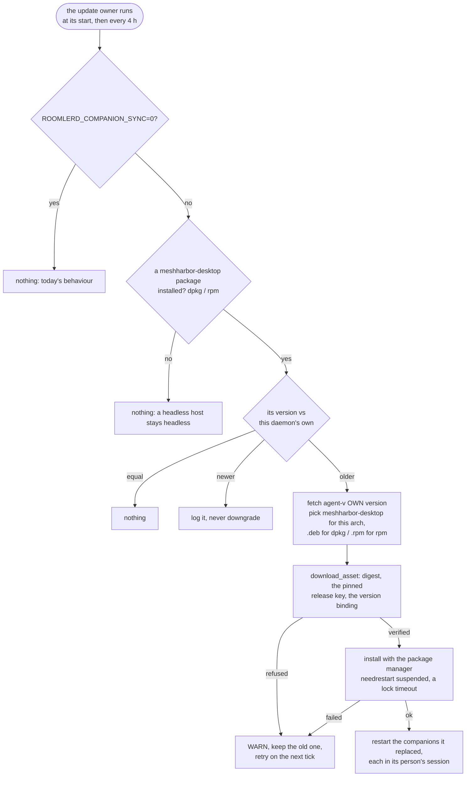

# FR-117: One version on every device — an update moves roomlerd, roomler and meshharbor-desktop together

**Issue:** [#2625](https://github.com/gjovanov/roomler-ai/issues/2625) · **Status:** ✅ **closed 2026-10-21, every
criterion field-verified on the released 0.4.148** (§8). Proposed 2026-10-20, spec and claim, on the operator's report
(*"also noted that asahi has diff daemon and desktop version. we need to fix the update … so that all are on the same
version: roomlerd, roomler, meshharbor-desktop across all os"*). **P1, P2 and P4 released in 0.4.148** (#2631, published
2026-10-20 22:24Z); the candidate proved the decision and the safe failure; the release moved every companion in the
field, the Asahi box's from 0.4.139 by its own timer, and the fleet census went from one skew to none. P3 stays a
proposal · **Owner:** the updater (agent) · **Anchors:** master
`ca853c840`, the pre-fix tree §2–§3 describe · **Builds on:** [FR-27](FR-27-consent-surfaces-and-desktop-companion.md)
(the companion, `companion_version` on the wire), [FR-84](FR-84-companion-and-installer-polish.md) (the companion's
launch), [FR-96](FR-96-per-user-linux-installs-update-themselves.md) (the root update helper),
[FR-67](FR-67-update-outcome-observability.md) (update outcomes)

## 1. Goal

After an update, a device runs **one version**: the daemon (`roomlerd`), the CLI (`roomler`) and the desktop companion
(`meshharbor-desktop`), on every OS. A device where they still differ says why.

## 2. Evidence (2026-10-20, after **Update all** moved the fleet to 0.4.147)

The operator's dashboard: `asahi-m2pro · v0.4.147 · desktop v0.4.139`. The census below covers every agent row that
reports a companion (`agents.companion_version`, read on mars, 18:20Z):

| Platform | Skew | Why |
|---|---|---|
| **Linux**, `.rpm` | `asahi-m2pro` (Fedora Asahi Remix 42, aarch64, online): daemon 0.4.147, companion 0.4.139. `rpm -q` → `meshharbor-desktop-0.4.139-1.aarch64`; `/usr/bin/roomlerd` and `/usr/bin/roomler` (0.4.147) are owned by no package: a tarball install | nothing upgrades the companion package |
| **Linux**, `.deb` | a3's Ubuntu cell (online): 0.4.147 / 0.4.146; offline lab hosts 0.4.142 / 0.4.129, 0.4.141 / 0.4.140 | the same |
| **Windows** | none online (9 of 9 at 0.4.147 / 0.4.147, the companion refreshed by the service host, e.g. `17:58:53Z installer signature verified asset=meshharbor-desktop-0.4.147-…exe`); the corp laptop CORPLAP-1 (offline, 2 rows): 0.4.146 / 0.4.145, with no uploaded log line saying why | the refresh runs only at the service's start; a failure waits for the next restart and says nothing |
| **macOS** | none: both Macs 0.4.147 / 0.4.147; the MacBook's `roomler`, `roomlerd` and `Roomler.app` all 0.4.147 from one package (`com.roomler.agent`) | the `.pkg` carries `Roomler.app` |

**The CLI is in sync by construction.** It ships inside every daemon package: the MSI's `roomler.exe` shim, the
`.pkg`, the `.deb`'s asset map, and the tarball, where `usr/bin/roomler` is a required member (`TARBALL_REQUIRED`,
`agents/meshharbord/src/updater.rs:2320`). Measured 2026-10-20: `roomler 0.4.147` on Windows, on the MacBook and on the
Asahi tarball install.

**Root cause.** `companion::refresh_if_stale` (`agents/meshharbord/src/companion.rs:881`) is Windows-only "by design".
Its premise (`companion.rs:888-899`) is that on Linux "the companion is its own `meshharbor-desktop` .deb that apt
upgrades". That is false: there is no apt or dnf repository. `install.sh` installs the companion once, from a release
asset (`desktop_install`, `scripts/install.sh:804`), and the daemon's updater picks only the daemon's own asset
(`is_daemon_asset`, `updater.rs:978`, on purpose: FR-27's companion-as-daemon freeze). So the companion package moves
only when a person re-runs the installer. The dashboard has shown the skew since FR-27 (`companion_version`), and
until today the fleet had none to show.

## 3. Key design

- **Linux: the companion tracks the daemon**, the invariant Windows has had since S1a (`companion.rs:3-29`). The one
  process that installs updates as root on the host also moves an installed `meshharbor-desktop` package to its **own**
  version (`CARGO_PKG_VERSION`), never "latest": the companion follows the daemon, not the feed.
  - **Who:** the owner `decide_update_owner` already names (`updater.rs:3518`, FR-96). That is a system install's root
    daemon, or `roomlerd update-helper` (`updater.rs:3723`) for a per-user install. A per-user daemon that sees the
    skew touches the helper's wake file (`/var/tmp/roomler-update-check`): a wake, never an instruction. A non-root
    daemon with no helper skips, with one log line, never a password prompt (D3).
  - **What:** the package database that owns the companion picks the format (`installed_version_inner`,
    `companion.rs:299`, reads dpkg then rpm). The asset is `meshharbor-desktop-<own>-<arch>-unknown-linux-gnu.<deb|rpm>`
    from release `agent-v<own>` (`fetch_release_by_tag`, `updater.rs:1745`). The 0.4.147 release carries all four, each
    with `.asc` and `.sha256`.
  - **Trust:** the same `download_asset` (`updater.rs:1545`) as the daemon's own update: the digest, the `.asc` against
    the key pinned in the binary, and the version binding. FR-97 P6a reads a `.deb`'s version, and P1 adds the `.rpm`
    reader (`rpm -qp --qf %{VERSION}`); `artifact_version.rs:139` has none today. A fresh private staging dir, as for
    the daemon (#2055).
  - **Install:** the host's own package manager, so it stays the source of truth. `apt-get install -y` (then
    `dpkg --install`) for a `.deb`; `dnf`, `zypper` or `yum` for an `.rpm`, in `install.sh`'s order
    (`desktop_rpm_tool`, `scripts/install.sh:793`). `NEEDRESTART_SUSPEND=1`: Ubuntu's needrestart hook otherwise
    restarts services, roomlerd among them, after an apt run (a vmtest trap, seen 2026-10-19). Then `DEBIAN_FRONTEND=noninteractive`
    and a dpkg lock timeout, so unattended-upgrades holding the lock costs one tick, not a hang.
  - **Restart:** a companion that was running is stopped and started again in its person's graphical session, through
    the path FR-27 already uses (`systemd_run_command`, `companion.rs:622`). One that was not running stays stopped.
  - **Never** installs a companion where none is installed, and **never** downgrades one (D1).
  - **The heartbeat:** `installed_version`'s 10-minute cache (`companion.rs:249`, `VERSION_TTL` `:264`) is dropped
    after a sync, so the dashboard's skew clears at the next heartbeat.
- **When:** at the owner's start, and again on a 4 h tick, so a failed sync no longer waits for the next restart.
- **Windows: the same retry.** `refresh_if_stale` runs once, at the start of whichever process owns the refresh (#1686:
  the SCM host, `win_service/mod.rs:471`, or the worker, `main.rs:3817`). It now runs on the same 4 h tick in that
  process. It costs one file read when the version marker matches.
- **Kill switch:** `ROOMLERD_COMPANION_SYNC=0` on both platforms gives back today's behaviour.

## 4. Phases

| Phase | What | Kill switch | Proven on | Size |
|---|---|---|---|---|
| **P0** | spec, claim, the census in §2 | — | ✅ 2026-10-20 | S |
| **P1** | Linux: the companion package tracks the daemon (root daemon + update helper; the per-user wake), the `.rpm` version binding | `ROOMLERD_COMPANION_SYNC=0` | ✅ merged #2631 (`a1a47b54d`), released **0.4.148**; the candidate: the plan and the safe failure on an unpublished tag; ✅ **the release**: a system install's update, the Asahi box's `.rpm` by its own timer, a per-user helper, the 4 h retry, the kill switch (§8) | M |
| **P2** | Windows: `refresh_if_stale` on the 4 h tick in the process that owns it | `ROOMLERD_COMPANION_SYNC=0` | ✅ merged #2631, released **0.4.148**; ✅ the retry on the release: 4 h after a 404 at the service's start, the same SCM host refreshed and respawned the companion (§8) | S |
| **P3** | the sync outcome on the heartbeat, and the grid's skew says why (D4) | — | | M |
| **P4** | docs: `docs/linux-self-update.md`, `docs/desktop-companion.md` §13, the `docs/README.md` index rows | — | ✅ in #2631; the anchors it moved elsewhere followed in its own PR | S |

## 5. Acceptance criteria

- [x] **AC1** — On a Debian-family system install, a companion older than the daemon is at the daemon's version after
  the update, and one that was running runs the new binary. Red first, on the release before. *(§8, 2026-10-20 22:42Z.)*
- [x] **AC2** — The same on an RPM host: the Asahi box (Fedora, aarch64). Red: 0.4.147 / 0.4.139 today. *(§8, 23:00Z,
  by its own timer.)*
- [x] **AC3** — A per-user install with its root helper: the helper moves the companion. *(§8, 23:06Z.)*
- [x] **AC4** — A failed sync is retried on the next tick, not at the next restart, on Linux and on Windows. *(§8,
  2026-10-21 01:28Z and 01:38Z.)*
- [x] **AC5** — A host with no companion gets none. A newer companion is never downgraded. `ROOMLERD_COMPANION_SYNC=0`
  gives back today's behaviour. *(§8, 23:09–23:14Z.)*
- [x] **AC6** — Only a verified package is installed: a bad digest, a missing or foreign `.asc`, or a version other
  than the tag is refused, and the companion keeps its version. *(§8: the `.asc` and the version binding ran on both
  formats in the field, the new `.rpm` reader included; a refusal was not field-run, since it needs a tampered
  production asset. It rests on the shared `download_asset`, whose refusals are field-proven for the daemon (FR-7,
  FR-97 P6a), and on the unit decoys.)*
- [x] **AC7** — After the release that carries it, the fleet census (§2's query) shows zero skew among online devices.
  *(§8: roomler-ai-c7's census, 1 → 0 by 23:32Z.)*
- [x] **AC8** — Docs: `docs/linux-self-update.md` and `docs/desktop-companion.md` updated in the house style, and the
  `docs/README.md` index row. *(#2631: `desktop-companion.md` §13 with its mermaid, §10.1's picker note,
  `linux-self-update.md`'s FR-117 section, both index rows.)*

## 6. Open decisions

| | Decision | Status |
|---|---|---|
| **D1** | A companion newer than the daemon | *(Recommended: leave it and log it. That is a person's deliberate install, or a lab, and the next daemon update catches up. Lockstep both ways would fight whoever installed it.)* **P1 implements the recommendation** (`plan` → `Newer`, logged once per process). |
| **D2** | A running companion after its package is upgraded | *(Recommended: restart it in its person's session, as the Windows swap does (#1686). Otherwise the person runs the old binary until they log out, and FR-27's consent prompt talks to it.)* **P1 implements the recommendation** (`restart_replaced`). |
| **D3** | A non-root daemon with no root helper | *(Recommended: skip, with one log line. Never a `pkexec` prompt for a background sync.)* **P1 implements the recommendation**, and found a fourth rule while doing it: no `dpkg --install` fallback, since dpkg with an unmet dependency half-configures the package and breaks apt for the host. |
| **D4** | The sync outcome on the wire | *(Recommended: P3, after P1/P2 ship: `companion_sync` on the heartbeat, so the grid's skew carries its reason. FR-67's point: an outcome nobody reads is not an outcome.)* |

## 7. Out of scope

- A tunnel-only host's standalone `roomler`: a different role with its own `self-update` (the LOW known issue in
  `CLAUDE.md`).
- An apt or dnf repository.
- Installing a companion on a host that never had one: `install.sh` and the wizard decide that.

## 8. Field-verification log

| Date | Host | Build | What | Result |
|---|---|---|---|---|
| 2026-10-20 18:18Z | `asahi-m2pro` (Fedora Asahi Remix 42, aarch64) | the released 0.4.147 | the red | 🔴 `roomlerd 0.4.147`, `roomler 0.4.147`, `meshharbor-desktop` 0.4.139 (`rpm -q` → `meshharbor-desktop-0.4.139-1.aarch64`) |
| 2026-10-20 21:28Z | a vmtest Ubuntu system install (`r148a`), two orgs, needrestart on its default config | the 0.4.148 candidate (run 39498665680, `.deb` `4cf805d6`), companion 0.4.147 | the plan + the safe failure | ✅ at the first check after the restart: `WARN companion: could not move the desktop companion package to this daemon's version; it keeps its version, and the next update check retries reason=fetching release agent-v0.4.148: GitHub returned 404 Not Found` (the tag was not published yet). `ii meshharbor-desktop 0.4.147-1` unchanged, its process untouched, the daemon healthy; the row read 0.4.148 / 0.4.147 |
| 2026-10-20 22:24Z | — | **0.4.148 published** (`c6586424c`, the `.deb` bit-identical to the candidate) | — | — |
| 2026-10-20 22:42Z | a vmtest Ubuntu system install (`r148b`), both packages put back to 0.4.147, a companion running, needrestart on its default config | the released 0.4.148 | **AC1** | ✅ `auto_update` on → the 0.4.147 daemon updated itself (`package installed bin="apt-get"`) → 22:42:59Z the 0.4.148 daemon → 22:43:02Z `companion: the desktop companion package now matches this daemon from=0.4.147 to=0.4.148 restarted=1`; the companion a new process; the daemon's pid unchanged (needrestart suspended); the `.asc` and the version binding logged for the companion's `.deb` (AC6) |
| 2026-10-20 23:00Z | the Asahi box (Fedora Asahi Remix 42, aarch64; a tarball daemon, an `.rpm` companion) | the released 0.4.148, by its own 4 h timer | **AC2** | ✅ `tarball installed` → 23:00:11Z the 0.4.148 daemon → 23:00:13Z `companion: package installed tool="dnf"` → `… from=0.4.139 to=0.4.148 restarted=1`; `meshharbor-desktop-0.4.148-1.aarch64`; the `.rpm` reader logged `artifact_version=0.4.148` (AC6) |
| 2026-10-20 23:06Z | a vmtest Ubuntu per-user install (`r148c`), its root helper enabled, the companion put back to 0.4.147 | the released 0.4.148 | **AC3** | ✅ the person touched the wake file → 3 s later the helper (root): `companion: package installed tool="apt-get"` → `… from=0.4.147 to=0.4.148 restarted=1` → `update-helper: up to date` |
| 2026-10-20 23:09–23:14Z | `r148b`; mars (headless, no companion) | the released 0.4.148 | **AC5** | ✅ with `ROOMLERD_COMPANION_SYNC=0` (live in the daemon's environment) a lagging companion stayed 0.4.147 through a restart; without it the next start moved it. mars updated itself 23:00Z and has no `meshharbor-desktop`, nor a `companion:` line. A stand-in `meshharbor-desktop 0.4.200-1` → `the installed desktop companion is NEWER than this daemon; leaving it (never a downgrade)` |
| 2026-10-20 23:32Z | the fleet, the server's census across all four orgs (roomler-ai-c7) | the released 0.4.148 | **AC7** | ✅ online 18 of 32, all daemon 0.4.148; the 10 with a companion all on 0.4.148; daemon/companion skew **1 → 0** |
| 2026-10-21 01:28Z / 01:38Z | `r148a` (Linux, left since the candidate) and a vmtest Windows perMachine install (`r148w`), both untouched since their 404 | the 0.4.148 candidate's bits, the tag now published | **AC4** | ✅ Linux: the same daemon process since 21:28:46Z, 01:28:54Z `… from=0.4.147 to=0.4.148 restarted=1`. Windows: the same SCM host since ≈21:38:53Z, 01:38:54Z `desktop companion refreshed version="0.4.148" respawned=true` |
