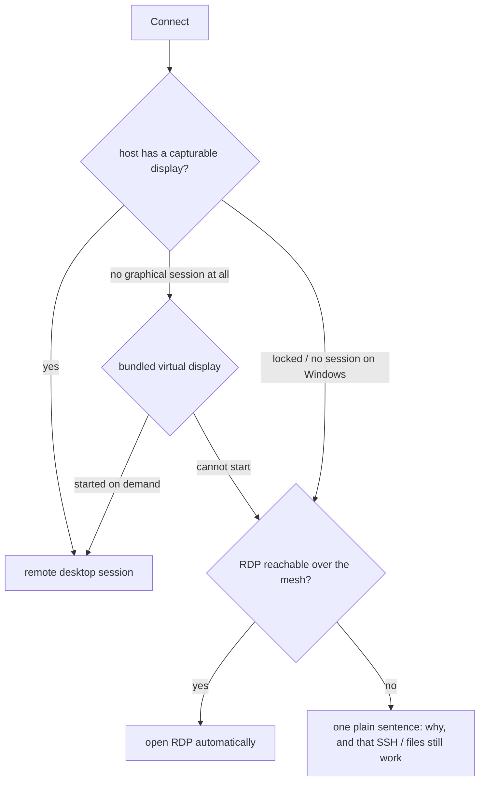

# FR-120: Connect just works — no setup step, no chooser, a screen even on a headless host

> **Status:** in progress — claimed 2026-11-18. Tracking issue: none (GitHub Issues are
> disabled on `jk-zhang-meta/MeshHarbor`); this spec and its registry row are the record.

## Goal

Clicking **Connect** on a device opens a working session. The viewer never asks which
transport to use, the device never asks for configuration, and a host that has no screen of
its own still gives one. The everyday surface is **SSH and remote desktop**; anything else on
that path is a cost, and a chooser is read as "it does not work".

Operator, 2026-11-18: "对于 headless machine 应当自动转对应的方法 比如 rdp 啥的 软件都带的 不要让我选";
"我点击 connect 不要出现什么准备 config 这都要默认弄好的 我不要那么多选择 这个软件现在的功能还是太多了";
"事实上我们用到的最多的还是 ssh remote desktop".

## Field evidence (2026-11-18)

| # | What the operator saw | Cause | State |
|---|---|---|---|
| E1 | Connect on a promoted Windows device answered "reading config … Access is denied" | the promotion locks `%ProgramData%\meshharbor\meshharbor` to SYSTEM + Administrators; the desktop app reads it directly (`agents/meshharbor-desktop/src/commands.rs` `cmd_open_remote`, `server_origin_blocking`, `active_account_probe`) | fixed in 0.4.172 (`5f49bd48a`): the promoting user's SID gets READ |
| E2 | "This device cannot capture its screen" (`x11_not_enabled`) on siat45, with an RDP/retry card | siat45 (Ubuntu 22.04) runs no X server, no display manager, has no Xvfb, and its account cannot install packages; the daemon still claimed "logind shows an X11 session on this seat" | open — P2/P3 |
| E3 | The card's "用 RDP 连接" / "重试远控" did nothing | the stage's pointer handlers captured presses on the overlay and forwarded them to the host | fixed in UI `f19f0bb46` |
| E4 | A chooser at all | `RdpFallbackCard` asks; "自动改用 RDP" is an opt-in per device, default off (`ui/src/utils/rdpFallback.ts` `getDeviceAutoRdpFallback`) | open — P1 |
| E5 | Virtual-desktop mode exists but never engages by itself | `MESHHARBORD_VIRTUAL_DESKTOP=1` only (`agents/meshharbord/src/main.rs` `maybe_start_virtual_desktop`), and it runs the HOST's Xvfb + openbox (`agents/meshharbord/src/virtual_desktop.rs`) — nothing is bundled | open — P2/P3 |

## Design

1. **The viewer decides, the person does not (P1).** When the host reports a media-unavailable
   reason and an automatic path exists, the viewer takes it without rendering a card. RDP fallback
   becomes default-on where it is reachable over the mesh and the desktop bridge exists; the
   per-device opt-in checkbox and its confirm dialog are removed (the screen-lock fact is stated
   once, in the status line). The card remains only as the terminal message when nothing automatic
   exists, without buttons that cannot work.
2. **A headless host gets a screen by itself (P2).** The daemon classifies "no graphical session at
   all" (logind seat0 has no session, no X or Wayland socket) as its own reason, instead of the
   current misread `x11_not_enabled`, and starts the virtual desktop on demand for the session,
   stopping it when the last viewer leaves. `MESHHARBORD_VIRTUAL_DESKTOP=0` is the kill switch.
3. **Bundled, not borrowed (P3).** The Linux packages (deb / tar, x86_64 + aarch64) carry the
   virtual display and a minimal window manager under `lib/meshharbor/`, so P2 needs nothing from
   the host and works for a per-user install on an account that cannot install packages.
4. **Fewer options on the connect path (P4).** Audit every prompt, setting and chooser on Connect
   and SSH; each either becomes a default or is removed. New ones need a field reason.

## Phases

| Phase | What | Kill switch | Status |
|---|---|---|---|
| P0 | Field evidence E1–E5; E1 and E3 fixed and shipped | — | ✅ 2026-11-18 |
| P1 | Viewer auto-switch; no chooser when an automatic path exists | viewer `localStorage` `meshharbor:rdp-auto-fallback:v1:<device>` = `0` | planned |
| P2 | Headless classification + on-demand virtual desktop | `MESHHARBORD_VIRTUAL_DESKTOP=0` | planned |
| P3 | Bundled virtual display + WM in the Linux packages | packages without the bundle fall back to P1's message | planned |
| P4 | Connect / SSH option audit | — | planned |
| P5 | Docs: `docs/remote-control.md` section, `docs/README.md` row | — | planned |

## Acceptance criteria

- [ ] Connect to siat45 (no X, no packages) opens a live desktop with no prompt, on the released agent.
- [ ] Connect to a Windows host whose console is locked or has no session opens RDP with no chooser, where RDP is reachable.
- [ ] Where no automatic path exists, the viewer shows one sentence and no non-working buttons.
- [ ] No step on Connect reads configuration the user cannot read, on any OS, after a promotion.
- [ ] `docs/remote-control.md` describes the decision, with a mermaid diagram, and `docs/README.md` indexes it.

## Open decisions

- Whether the virtual desktop persists between sessions (resume apps) or is per-session.
- Which window manager to bundle (openbox is today's default; size vs. usability).

## Out of scope

- Wayland-native virtual sessions (FR-93's open item).
- RDP *server* bundling on Linux (xrdp); the virtual display is the Linux answer.

## Field-verification log

| Date | Version | Result |
|---|---|---|
| 2026-11-18 | 0.4.172 + UI f19f0bb46 | E1 fixed (asus-win and surface hand-granted, then shipped); E3 fixed and deployed; E2/E4/E5 reproduced on siat45 |
