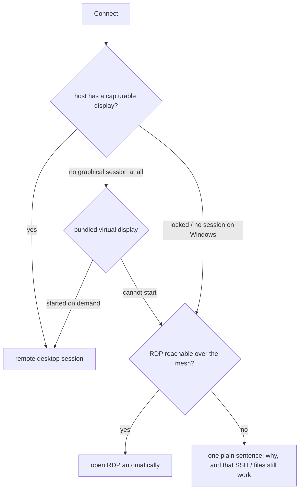

# FR-120: Connect just works — no setup step, no chooser, a screen even on a headless host

> **Status:** in progress — claimed 2026-11-18. Tracking issue: none (GitHub Issues are
> disabled on `jk-zhang-meta/MeshHarbor`); this spec and its registry row are the record.

## Goal

Clicking **Connect** on a device opens a working session. The viewer never asks which
transport to use, the device never asks for configuration, and a host that has no screen of
its own still gives one. The everyday surface is **SSH and remote desktop**; anything else on
that path is a cost, and a chooser is read as "it does not work".

Operator, 2026-11-18: "对于 headless machine 应当自动转对应的方法 比如 rdp 啥的 软件都带的 不要让我选";
"我点击 connect 不要出现什么准备 config 这都要默认弄好的 我不要那么多选择 这个软件现在的功能还是太多了";
"事实上我们用到的最多的还是 ssh remote desktop".

## Field evidence (2026-11-18)

| # | What the operator saw | Cause | State |
|---|---|---|---|
| E1 | Connect on a promoted Windows device answered "reading config … Access is denied" | the promotion locks `%ProgramData%\meshharbor\meshharbor` to SYSTEM + Administrators; the desktop app reads it directly (`agents/meshharbor-desktop/src/commands.rs` `cmd_open_remote`, `server_origin_blocking`, `active_account_probe`) | fixed in 0.4.172 (`5f49bd48a`): the promoting user's SID gets READ |
| E2 | "This device cannot capture its screen" on a headless arm64 server, with an RDP/retry card | the host (Ubuntu 22.04) runs no X server, no display manager, has no Xvfb, and its account cannot install packages; logind shows only `tty` sessions. Correction (11-18): the daemon's own log reports `code="no_display"` for every session (`capture unavailable … no primary display: connection refused`), which is right — the earlier note that it claimed an X11 session was a misreading | P2/P3 |
| E3 | The card's "用 RDP 连接" / "重试远控" did nothing | the stage's pointer handlers captured presses on the overlay and forwarded them to the host | fixed in UI `f19f0bb46` |
| E4 | A chooser at all | `RdpFallbackCard` asks; "自动改用 RDP" is an opt-in per device, default off (`ui/src/utils/rdpFallback.ts` `getDeviceAutoRdpFallback`) | fixed — P1 (`8123cc10d`) |
| E5 | Virtual-desktop mode exists but never engages by itself | `MESHHARBORD_VIRTUAL_DESKTOP=1` only (`agents/meshharbord/src/main.rs` `maybe_start_virtual_desktop`), and it runs the HOST's Xvfb + openbox (`agents/meshharbord/src/virtual_desktop.rs`) — nothing is bundled | fixed in 0.4.173 (P2/P3) |

## Design

1. **The viewer decides, the person does not (P1).** When the host reports a media-unavailable
   reason and an automatic path exists, the viewer takes it without rendering a card. RDP fallback
   becomes default-on where it is reachable over the mesh and the desktop bridge exists; the
   per-device opt-in checkbox and its confirm dialog are removed (the screen-lock fact is stated
   once, in the status line). The card remains only as the terminal message when nothing automatic
   exists, without buttons that cannot work.
2. **A headless host gets a screen by itself (P2).** At startup a per-user daemon on a host with no
   screen — no display manager enabled, no graphical logind session, no live X server, no
   `DISPLAY`/`WAYLAND_DISPLAY` — starts its virtual desktop with nobody asking
   (`virtual_desktop::auto_decision`, `main.rs` `maybe_start_automatic_virtual_desktop`), guarded
   by a private MIT cookie instead of `-ac`. `MESHHARBORD_VIRTUAL_DESKTOP=0` is the kill switch; a
   failure leaves `no_display`, never a daemon that does not start. Design and rules:
   `docs/remote-control.md` §5.1f.
3. **Bundled, not borrowed (P3).** The Linux packages carry the X server, `xkbcomp`, twm and xterm
   as ONE file, `usr/lib/meshharbor/meshharbor-vd.so.tar.xz` (built by
   `scripts/build-vd-bundle.py` from Ubuntu 20.04 debs, glibc ≥ 2.31), which the daemon unpacks
   beside itself. One file because the per-user update transaction copies only regular `*.so*`
   files from that directory and refuses a subdirectory.
4. **Fewer options on the connect path (P4).** Audit every prompt, setting and chooser on Connect
   and SSH; each either becomes a default or is removed. New ones need a field reason.

## Phases

| Phase | What | Kill switch | Status |
|---|---|---|---|
| P0 | Field evidence E1–E5; E1 and E3 fixed and shipped | — | ✅ 2026-11-18 |
| P1 | Viewer auto-switch; no chooser when an automatic path exists | viewer `localStorage` `meshharbor:rdp-auto-fallback:v1:<device>` = `0` | ✅ shipped `8123cc10d`, deployed 2026-11-18 (server UI) |
| P1b | RDP only where remote control cannot serve, and the Windows logon asked for once: a Windows worker names what its lock screen does with input (`passes` / `blocked`), the viewer switches to RDP on `blocked`, a failed attempt retries remote control once before RDP, and the desktop app keeps the logon per device in the controlling computer's credential store (`docs/remote-control.md` §5.1g) | `MESHHARBOR_RDP_PASSWORDLESS_DISABLED=1` on the controller (the RDP client asks, as before); the viewer opt-out of P1 | on branch `feat/rdp-passwordless`, not merged or released; unit-tested, the dialog and the silent sign-in not yet done by a person |
| P2 | Automatic virtual desktop on a screenless host (per-user daemons) | `MESHHARBORD_VIRTUAL_DESKTOP=0` | ✅ released in 0.4.173 (2026-11-18); browser session not yet field-verified |
| P3 | Bundled X server + WM + terminal in the Linux packages | a package without the archive keeps `no_display` | ✅ released in 0.4.173: tar.gz + daemon .deb, amd64 + arm64 |
| P4 | A full desktop: the best installed session (Xfce first); a host with none, root or per-user, runs the package's own Xfce 4.20 on its own glibc (`scripts/desktop-bundle/`), replacing 0.4.175's apt install (never released) | a package without the archive keeps `no_display` | ✅ 0.4.177 on master + fleet (0.4.176 refused the desktop, see log); operator Connect pending |
| P4b | Connect / SSH option audit | — | planned |
| P5 | Docs: `docs/remote-control.md` §5.1f, `docs/README.md` row | — | ✅ with P2/P3 |

## Acceptance criteria

- [x] Connect to a headless per-user Linux host (no X, no packages) opens a live desktop with no prompt, on the released agent. — 0.4.184: the per-user arm64 host (no X packages, no root), from a browser in another zone: the bundled Xfce desktop, first frame 4.1 s, no prompt.
- [ ] Connect to a Windows host whose console is locked or has no session opens RDP with no chooser, where RDP is reachable.
  - 2026-11-19 (P1b): as written this was true of no Windows host. A SystemContext worker serves its own lock and sign-in screen, which is better than RDP and stays that way. A worker that runs as the signed-in person showed the "Host locked" picture with no way on; P1b gives it the RDP switch. To tick this, a person has to see both on released builds: remote control on a locked SystemContext host with the chip reading "Your input reaches it", and RDP opening by itself, with the Windows account asked for once and never again, on a locked host whose worker runs as the person.
- [x] Where no automatic path exists, the viewer shows one sentence and no non-working buttons. — a cross-zone browser on no mesh node: one sentence within 2 s, Disconnect the only button (0.4.182); a desktop that keeps dying: a terminal and one sentence naming its log (0.4.182, a minimal host with the session made to crash); a host that cannot capture: the overlay alone, no longer stacked with the input-reach banner (UI 0.4.184).
- [x] No step on Connect reads configuration the user cannot read, on any OS, after a promotion. — Windows: the promoted test host's config directory grants the signed-in user read (checked on 0.4.182). macOS / Linux system install: the companion reads the root-only file only as a probe and takes the server and tenant from the device service's `Status` on the person socket (`enrollment_sources`), which answered with its org rows on the promoted MacBook; the three decisions are unit-tested. The tray click itself was not driven (no GUI input on the operator's machines).
- [x] `docs/remote-control.md` describes the decision, with a mermaid diagram, and `docs/README.md` indexes it. — §5.1f (mermaid, table, the bundled runtime) and §5.1g (RDP only where remote control cannot serve), both in the index row.

## Decisions (2026-11-18)

- **Started at daemon startup, not per session.** `DISPLAY` and `XAUTHORITY` are read all over the
  daemon (capture, input, clipboard, the indicator), and changing a process's environment after
  its threads run is unsound; the configured mode has always set them at startup. The desktop
  persists for the daemon's lifetime, so apps survive a reconnect. Cost: one idle Xvfb + twm +
  xterm (tens of MB) on each qualifying host.
- ~~Root daemons are excluded~~ — reversed 2026-11-19 by the operator ("我要求拥有root权限的 headless机器 自动安装rdp 使得我们的远控可以使用"): root daemons get the automatic desktop too (0.4.174). A remote-control grant on such a host is a root desktop. The bundled desktop is used instead of installing xrdp: an xrdp install would open 3389 on every server (public relays included) and log in with system passwords, while the bundle needs no package, no port and no password.
- 2026-11-19, operator: "那就让我们的软件自动下载桌面环境吧 要做好的 SOTA的 我不要只看到一个终端，没有root权限的我们不管" — a root host with no desktop installs Xfce itself (P4); per-user hosts keep the bundle.
- **twm + xterm** are bundled (small, few libraries); openbox stays the configured mode's default
  and is preferred where the host has it.

## Open decisions

- Whether a root daemon's desktop should run as an unprivileged account instead of root.

## Out of scope

- Wayland-native virtual sessions (FR-93's open item).
- RDP *server* bundling on Linux (xrdp); the virtual display is the Linux answer.

## Field-verification log

| Date | Version | Result |
|---|---|---|
| 2026-11-18 | 0.4.172 + UI f19f0bb46 | E1 fixed (two Windows hosts hand-granted, then shipped); E3 fixed and deployed; E2/E4/E5 reproduced on a headless arm64 host |
| 2026-11-18 | bundle only (arm64), by hand | on the headless arm64 host (no X packages): the bundled Xvfb starts, a client holding the cookie connects, one without it is refused (`Cannot open display`), twm and xterm stay up. twm first died for lack of fonts (`unable to open fontset`); the generated config names `fixed` and the bundle carries libX11's locale data |
| 2026-11-18 | branch build (0.4.172 version string), by hand on the headless arm64 host | the daemon started its desktop by itself at startup (`virtual-desktop: this host has no screen, so it got one by itself`), unpacked from the bundled archive; the desktop brief turned from `no_display` to `capture_arm=x11 input_reach=full`; `capture-smoke` returned a 1920x1080 frame showing twm and the terminal; without the cookie a client is refused (`No protocol specified`). First frame showed the terminal in X's 6x13 `fixed` font — unreadable — hence the bundled DejaVu Sans Mono and X resources (cbf96455a), checked by hand. Wrong turn: the bundle as a `vd/` directory would have failed every per-user update (1f2bf1b11) |
| 2026-11-18 | 0.4.173 published, 16 Linux root nodes rolled | all back online on 0.4.173; mesh 9 direct / 10 org relay. The field host lost its TCP path to the server (`connect to <server>:443 timed out`, from 14:22Z — an outage of its uplink, logged by the daemon itself, not by this change) and has not yet updated; a browser Connect on it is the open check |
| 2026-11-18 | 0.4.173 by the field host's own per-user update (15:55Z) | transaction `activated`; the bundle archive arrived through the transaction (its SHA-256 equals the release bundle's) and replaced the branch build's unpacked copy; the desktop came up by itself 4 s after the restart; `capture-smoke` frame shows the terminal with a legible prompt. Open: a browser Connect session on the released agent |
| 2026-11-19 | 0.4.173, root host with xrdp running | Connect showed `x11_not_enabled`: the root daemon read xrdp's seatless session (`:10`, `Remote=yes`, no seat) as a desktop it may not capture, and 0.4.173 excluded root daemons. The RDP fallback then failed with `os error 10061` — on the CONTROLLER: its netstack SOCKS front (127.0.0.1:19086) had lost its one bind attempt to the old process during the 0.4.172 auto-update (`os error 10048`) and was never retried, so every mesh TCP connection from it was refused. Fixed in 0.4.174: root included, remote seatless sessions ignored, the SOCKS bind retried |
| 2026-11-19 | 0.4.174 rolled (16 Linux root nodes + the per-user host + the Windows controller) | the root host running xrdp started the bundled desktop on `:99` beside xrdp's `:10`; desktop brief `capture_arm=x11 input_reach=full`; a captured frame shows a root terminal. A public relay runs it in 41 MB RSS. The controller's SOCKS front came up on the first try after its update and a SOCKS connect to the root host's 3389 succeeds (reply 0), so the RDP fallback path works again. Open: a browser Connect on the released agent, confirmed by the operator |
| 2026-11-19 | P4 bundle (Debian 13 Xfce 4.20, 63 / 59 MiB), by hand on a clean amd64 host (no desktop packages, no `xz`; account `nobody`) and on the headless arm64 host (per-user) | FAILED first, three ways a host with Xfce installed had hidden: `tar -xJf` (no `xz` on the host); the HOST's `dbus-daemon` ran (dbus-launch uses `execl`, outside the shim) and could not activate `xfconfd`, so no window manager, panel or desktop; xfwm4 exited on a missing `/usr/share/xfwm4/defaults`. Also: `/usr/lib/meshharbor` was `0700` on the clean host (a bootstrap copy), unreadable to the desktop's user. Fixed: in-process unpack (`lzma-rs`), the shim covers `execl*`, `system`/`popen`, `sh -c` command positions and read-only opens / stat checks, the builder relativises absolute symlinks and runs autostart programs directly, a root daemon opens the package directory. Then on both hosts: bundle's own bus, `xfconfd`, xfwm4, panel, xfdesktop, thunar, notifyd up; a program started from the terminal sees no `MHVD_*` variable; `capture-smoke` frames show the full Xfce desktop (panel, menu, icons, dock) |
| 2026-11-19 | 0.4.176 released and rolled (15 Linux root nodes, the per-user arm64 host, this build host) | FAILED on the clean amd64 host and on the per-user arm64 host: the daemon unpacked the bundle (and opened the 0700 package directory), then refused the desktop with `missing required binaries … openbox` — preflight still required a fallback window manager although a full session was configured, and the P4 bundle carries no twm. The hand checks had started the session directly and never passed preflight. Fixed (6ca3f66dc): the window manager is required only for the bare desktop; fallback = the bundle's xfwm4. The fixed daemon, installed by hand on the clean host: `virtual-desktop ready … session=Some("meshharbor:bundled-xfce")`, desktop brief `capture_arm=x11 input_reach=full`, a 1920x1080 frame of the full Xfce desktop; `mh --version` as `nobody` works again (was `libavutil.so.61: cannot open shared object file`) |
| 2026-11-19 | 0.4.177 released and rolled (14 Linux root nodes, the per-user arm64 host, this build host; one root host offline) | the clean amd64 host (root): `virtual-desktop ready … wm=…/vd/bin/xfwm4 session=Some("meshharbor:bundled-xfce")`, brief `capture_arm=x11 input_reach=full`. The per-user arm64 host (no root): the daemon's own Xfce on `:99`, xfwm4 / xfdesktop / panel up, the first-start preseed hides removable volumes, a 1920x1080 frame of the full desktop. Open: a browser Connect on both, confirmed by the operator |
| 2026-11-19 | 0.4.179 on the fleet; a sweep of every Linux node | FAILED on all five hosts of one provider (minimal Debian 13, no `shared-mime-info`): the bundled session restarted five times and the daemon gave up — a black screen. The bundle carried the MIME database's source, never its `mime.cache` (dpkg's trigger never runs on it); GLib could not tell an SVG from text, every icon failed, and xfce4-panel aborted on a GTK assertion (`default_icon_at_size: assertion failed`). The five hosts that worked had the host's own MIME cache. Fixed in the bundle build (every trigger cache, a self-check that decodes an SVG with the bundle alone); verified on one of the five with the rebuilt bundle: the session stays up, the full desktop on screen, first frame 0.68 s |
| 2026-11-19 | 0.4.180 rolled (20 nodes); server + UI `0e2ba9bb5`; the capacity build on the one-core host | The five minimal hosts: the panel up, no crash loop. The one-core host (a sixth of a desktop core, scrolling terminal): VP9 4:4:4 at 1920 cost 167 ms a frame (6 fps); the software tier stepped to 1024 within 6 s (45-60 ms, 11-12 fps delivered); libvpx `cpu-used` 9 changed nothing (44-50 ms). With the capacity verdict: after five motion windows at 1024 the pump recorded 11 fps, the viewer on its automatic pick reconnected on H.264 (first frame 0.89 s), and a fresh page picked H.264 straight from the re-announced caps (0.80 s); H.264 encoded every change at 26-29 ms a frame, paced 35, the CPU no longer saturated |
| 2026-11-19 | branch `feat/rdp-passwordless` (not released); the test Windows host on 0.4.181 | The host is Windows 11 Pro with RDP on and a SystemContext install (`worker role probed role=SystemContext`); its one remote-control session in the log reads `SystemContext worker — lock overlay disabled (real Winlogon frames will stream)`, and its logs of 11-18 and 11-19 hold no `capture unavailable`, so P1's switch has nothing to fire on there: its lock screen is remote control's. `mh rdp <host> --check` from a Linux controller: X.224 + TLS pass, `pinned_verified=true`, protocol `0x2` (NLA), so RDP is reachable over the mesh. The credential store, on the host as SYSTEM, with `cmdkey /list` as the witness (`the_real_credential_manager_serves_a_desktop_session_and_is_left_clean`): asked once, `MeshHarbor:rdp:<org>:<device>` listed, `TERMSRV/<loopback>` listed for the session on the device's own address and on a fallback one and gone after it, the saved logon forgotten on request, nothing left behind. NOT done: a Connect from a viewer with the console locked, the credential dialog, and `mstsc` signing in with the saved logon. Those need a signed-in viewer and a person at a Windows controller; the host's console was left signed in and unlocked, as found |
| 2026-11-19 | 0.4.182 rolled (20 nodes); a browser sweep of every Linux node | 10 of 15 Linux hosts showed their desktop (first frame 0.5–3.7 s; one only on a re-run, its first attempt having met the plan's one-session limit held by a concurrent test). FAILED on two kinds of host: a server running a service under `xvfb-run` (an application's private Xvfb on `:99`) and all four WSL distros (WSLg's display on `:0`) read as "an X server is already running", so no desktop and `no_display`; the reason was logged only at DEBUG. Where capture was unavailable the viewer stacked two notices (input reach and no screen) |
| 2026-11-19 | 0.4.183 by hand on the `xvfb-run` server and one WSL distro (not released) | the server: its own desktop on `:100` beside the service's `:99`, first frame 0.79 s. The WSL distro: FAILED again, "X server display :99 did not become ready": WSLg mounts `/tmp/.X11-unix` read-only, so Xvfb could not create its socket and exited |
| 2026-11-19 | 0.4.184 released and rolled (20 nodes) | the WSL distros: the X server on the abstract socket only (`-nolisten unix`), desktop on `:100`, first frame 0.64–0.76 s. A full sweep: all 11 non-WSL Linux hosts show their desktop (0.5–2.8 s). FAILED on the four WSL distros whenever the session took the WebRTC transport (Connect before the caps loaded): the track was pinned to AV1, which a Linux track cannot encode (`NoopEncoder`); with AV1 hidden from the browser the same host pinned H.264 and showed its desktop in 1.5 s |
| 2026-11-19 | 0.4.185 (`41e6bea6a`, agent only) released and rolled (20 nodes) | PASSED: the four WSL distros over the WebRTC transport with AV1 offered by the browser: the track pinned H.264, first frame 1.2–1.7 s, no stall. A last sweep: all 11 non-WSL Linux hosts and the WSL distros show their desktop (0.5–2.6 s; two WSL distros only on a re-run, the sweep's fifteen back-to-back sessions having met the API rate limit) |
| 2026-11-20 | The download page's one-line Linux install, run on a fresh Ubuntu 24.04.5 WSL image beside the enrolled WSL distros | FAILED twice, neither seen on the fleet (every enrolled host already had its libraries and a desktop of its own): (1) apt resolved the virtual `libasound2` to the OSS shim `liboss4-salsa-asound2` and the daemon died at start (`undefined symbol: snd_pcm_get_params`) — the installer now names the real library and the package's Depends reads `libasound2t64 \| libasound2`; (2) once installed, the desktop took `:99`, whose abstract socket a sibling distro's desktop held, so session and capture reached that server (`Invalid MIT-MAGIC-COOKIE-1 key`). The same collision blacked out an ENROLLED distro whose sibling held its display (shown before the fix). Fixed in 0.4.186: the picker skips a display whose abstract socket answers |
| 2026-11-20 | 0.4.186 (`3d3365434`) released and rolled (all online nodes); the download page carries its installers | PASSED: the one-line install on a second fresh Ubuntu 24.04.5 WSL image as a sudo user (stale package lists refreshed, `libasound2t64` installed, sign-in approved, service up, mesh joined), and its first remote session showed the Xfce desktop in 1.4 s on `:103`, the four sibling distros holding `:99`–`:102`. The four enrolled WSL distros, each on its own display, show their desktops (0.6–1.5 s; the one shown black before the fix included), and three non-WSL servers still do (0.8–3.6 s) |
