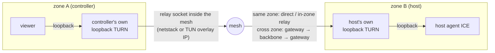

# FR-121: Remote desktop follows the zone routes

> **Status:** in progress — claimed 2026-11-19. Tracking issue: none (GitHub Issues are
> disabled on `jk-zhang-meta/MeshHarbor`); this spec and its registry row are the record.

## Goal

A remote-desktop session obeys the logical network zones exactly as the mesh does. Zones are
the LANs behind a router's ports and the zone gateways are the router: **same zone → any path,
direct first; different zones where either is gateway-only → the media rides the mesh, which
carries it gateway to gateway** over the backbone edges the administrator drew. Nothing about a
zone is hard-coded; CN / non-CN is just today's data.

Operator, 2026-11-19: "我们的逻辑分区是 general 的 … 就像一个路由器每个端口连接的一个局域网 … 改造成
gateway 就是参考路由模式"; "我需要直接把功能做实做全 不需要过渡期 直接要最终态".

## Field evidence (2026-11-19, master `b6ce14d10`)

| # | Fact | Where |
|---|---|---|
| E1 | The mesh already routes by zone: same zone may go direct, a cross-zone pair with a `router_only` side is `backbone_only` (gateway relays only, DERP/TURN denied) | `crates/modules/network/src/network_zones.rs` `pair_requires_backbone_only` |
| E2 | Relay / gateway choice is dynamic: per-device RTT probes, reachability class, summed SLA cost + load, a 20 % / 10 ms hysteresis, multi-hop over the backbone graph | `crates/modules/network/src/org_relay.rs` `select_path`, `rank_key`, `clearly_better` |
| E3 | Remote desktop is WebRTC **outside** the mesh. Only the ICE *servers* of a strict-zone device are zone-filtered (`hub.rs` `zone_local_ice`); the viewer's servers (`/api/turn/credentials`) and every controller candidate are not, so a strict-zone host (the headless arm64 field host) can pair directly with a controller in another zone | `crates/modules/fleet/src/hub.rs` `forward_ice`, `crates/modules/remote/src/routes.rs` `turn_credentials` |
| E4 | `app.rc_ice_zone_mode` is unset in production (`warn`): the #21 business gate logs only | live compose |
| E5 | Every zone gateway runs the userspace netstack (no TUN), so a TURN relay socket bound to the overlay IP (today's loopback-TURN, `transport/turn_host.rs`) cannot exist on them | `mh status` on the four gateways |

## Design

1. **Route decision, server side (P3).** For every session the hub knows the host's zone and
   learns the controller's: the controller node (its local agent's descriptor names an overlay
   address of the same tenant) or, for a browser on no mesh node, the zone its public
   candidates' addresses belong to (a device's own public address → that device's zone, else
   GeoIP country → `auto_countries`, else the default zone — the same resolution devices get).
   `needs_mesh = pair_requires_backbone_only(controller zone, host zone)`.
2. **Mesh-routed session (`needs_mesh`).** Both sides take only `typ relay` candidates whose
   address is an overlay address of the session's two nodes; the hub drops every other
   candidate in both directions and tells the host `zone_route = mesh`; the host gathers relay
   only (`RTCIceTransportPolicy::Relay`) through ITS OWN loopback TURN. Media then travels
   relay socket → mesh → relay socket, so the mesh's own path choice (E1, E2) carries it: in-zone
   direct or relay, cross-zone gateway to gateway. A controller on no mesh node gets the session
   refused with `zone_requires_mesh_controller` and one sentence in the viewer.
3. **Same-zone session.** Unchanged P2P, plus: a controller's public candidate whose address
   belongs to another zone is dropped (defence in depth for a strict host), the viewer's ICE
   servers are the host zone's, and the mesh relay path is offered as a fallback candidate.
4. **Loopback TURN inside the mesh (P1).** `LocalTurnHost` gets a relay generator backed by the
   netstack's `NsUdpSocket` (send/recv any overlay address), so every node — TUN or netstack —
   hosts it; peers a relay may reach are limited to overlay addresses.
5. **Viewer (P4).** The viewer always probes its local agent and offers its relay when one
   answers (no per-device opt-in on this path); `rc:ready`/`rc:answer` say which route the hub
   chose, for the status line.

## Phases

| Phase | What | Kill switch | Status |
|---|---|---|---|
| P0 | Evidence E1–E5; this spec | — | ✅ 2026-11-19 |
| P1 | Netstack relay generator for the loopback TURN; hosted on every node | `MESHHARBORD_LOCAL_TURN=0` | planned |
| P2 | Host side: `zone_route = mesh` → relay-only through its own loopback TURN; strict-zone address filter (`RcOverlay` zone state) | an older server never sends `zone_route` | planned |
| P3 | Hub: per-session zone route decision, candidate filtering both ways, viewer ICE servers, `zone_requires_mesh_controller` | `app.rc_zone_routes = off` | planned |
| P4 | Viewer: local relay always offered, route on the status line, the refusal sentence | — | planned |
| P5 | Docs: `docs/remote-control.md` § zone routes (mermaid), `docs/overlay-communication.md` cross-reference, `docs/README.md` row | — | planned |

## Acceptance criteria

- [ ] A controller in zone A and a host in zone B (either gateway-only) connect, and the host's ICE shows only a relay pair on overlay addresses; the mesh carries it over the A↔B gateway edge.
- [ ] The headless arm64 host (strict CN zone) never sends a packet to a non-CN address during a session from a non-CN controller (capture on the host).
- [ ] Same-zone sessions keep their direct pair (p50 unchanged within 10 %).
- [ ] A browser on no mesh node, cross-zone to a gateway-only host, gets the one-sentence refusal, no hang.
- [ ] Works with both ends on the userspace netstack (no TUN).
- [ ] `docs/remote-control.md` describes the zone routes with a mermaid diagram, and `docs/README.md` indexes it.

## Out of scope

- Public TURN on gateways for browsers on no mesh node (the refusal stands until an operator asks).
- Changing how gateways are chosen; the mesh's selection (E2) is used as is.

## Field-verification log

| Date | Version | Result |
|---|---|---|
