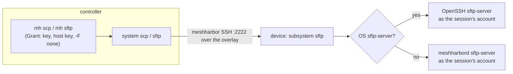

# FR-122: File transfer just works — `mh scp` with no password, and an SFTP server on every device

> **Status:** field-verified on 0.4.188 (2026-11-20) except AC4 — claimed 2026-11-20. Tracking issue: none (GitHub Issues are disabled
> on `jk-zhang-meta/MeshHarbor`); this spec and its registry row are the record.

## Goal

Copying a file to or from any device in the org takes one command and nothing else: no password,
no key to set up, no package to install on the device. `mh scp` and `mh sftp` work the way
`mh ssh` already does, and every device can serve SFTP even when its OS ships no `sftp-server`.

Operator, 2026-11-20: "mh scp或相关命令 要跟ssh一样 不需要任何密码输入的"; on RDP's model (built
in vs installed by command): "ftp可能也要考虑对应的方法" — the answer is the same as FR-120's
Linux desktop: it ships inside the package.

## Field evidence (2026-11-20, agent 0.4.186)

| # | Fact | Where |
|---|---|---|
| E1 | `mh ssh <device>` is passwordless: a single-use key minted in the CLI, a server grant, the host key pinned | `agents/meshharbor-cli/src/sshcmd.rs` (`run`, before this FR) |
| E2 | There was no `mh scp`/`mh sftp`. Stock `scp` worked only through `mh proxy` with a key the user manages in each device's `ssh_authorized_keys` | `mh proxy --help`; `docs/meshharbor-ssh.md` § `mh proxy` |
| E3 | `scp` over `mh proxy`, 32 MiB both ways, SHA-256 equal: a macOS laptop 2.0 s / 0.8 s, a Windows tablet 2.6 s / 1.4 s | field run, 2026-11-20 |
| E4 | `scp` to a Debian WSL distro failed with a bare `Connection closed`; the device logged `refused an unsupported request request=sftp` — no `sftp-server` on the image | that device's daemon log |
| E5 | No `sftp-server` on three of the fleet's four WSL distros (Debian, Ubuntu, Fedora); present on the Arch one, a per-user arm64 host and all 11 servers | `mh exec` probe of the standard paths |
| E6 | `scp -O` (the legacy protocol, which runs `scp -t` through exec) worked on the Debian distro (2.5 s / 1.3 s) | field run, 2026-11-20 |
| E7 | Windows ships `sftp-server.exe` only with the optional OpenSSH Server feature (1 of 3 corporate laptops measured 2026-10-18 lacked it) | `docs/meshharbor-ssh.md` § File transfer |

## Design

| Piece | Where | Key point |
|---|---|---|
| `Grant` — one connection's key, host key, address, SOCKS bridge | `agents/meshharbor-cli/src/sshcmd.rs` (`Grant::obtain`, `client_options`, `launch`) | `mh ssh`, `mh scp`, `mh sftp` share it; adds `PasswordAuthentication=no` and `KbdInteractiveAuthentication=no` so there is never a prompt |
| `mh scp` operand rules | `sshcmd.rs` (`ScpPlan`, `remote_part`, `home_relative`, `screen_options`) | one device per copy; OpenSSH's colon-before-slash test; `user@` refused (the account is the device's policy); options that would replace or route around the grant refused |
| CLI surface | `agents/meshharbor-cli/src/cli.rs` (`Command::Scp`, `Command::Sftp`) | scp's flags pass through clap verbatim (`trailing_var_arg` + `allow_hyphen_values`) |
| The built-in server | `agents/meshharbord/src/sftp_builtin.rs` | SFTP v3 + `expand-path@openssh.com` on stdio; `russh-sftp` =2.1.1 for the protocol (its floors sit inside the workspace lock; 2.4/3.x would move `bytes`, `serde`, `thiserror`, `tokio-util`) |
| Its entry | `agents/meshharbord/src/main.rs` (both `main`s, `sftp_builtin::exit_if_requested`) | first statement: stdout is the protocol, so nothing may print, parse or log before it |
| The fallback | `agents/meshharbord/src/ssh.rs` (`sftp_program`, `own_executable`) | the OS server first; the built-in one only where none exists; the SAME child spawn under the session's account |
| Windows console user | `agents/meshharbord/src/exec.rs` (`build_program_cmdline(program, fixed_arg)`) | the one argument is a `&'static str` constant of the binary, never client input |

## Phases

| Phase | What | Kill switch | Status |
|---|---|---|---|
| P1 | `mh scp`, `mh sftp` on a shared `Grant` | — (new commands; `mh proxy` unchanged) | built 2026-11-20 |
| P2 | Built-in SFTP server as the fallback | `MESHHARBORD_SFTP_BUILTIN=0` restores the refusal | built 2026-11-20 |
| P3 | Release, fleet roll, field verification | — | done — 0.4.187, then 0.4.188 (the `daemon` session's start directory) on every online device; PersonalWeb catalog = 0.4.188 |
| P4 | The viewer: a toolbar file button, "Upload here" on every device, keys typed into the panel stay in it | — (UI) | deployed 2026-11-20 |

## Acceptance criteria

- [x] `mh scp` uploads and downloads a file byte-identical (SHA-256) to a Linux, a Windows and a
      macOS device with no password prompt and no key set up by the user, on the released agent.
      — 0.4.188: four WSL distros, a server, two Windows devices, the macOS laptop and a per-user
      arm64 host, 32 MiB each way, relative and `~/` targets included; the installed `mh` too.
- [x] `mh scp` works on a device whose OS has no `sftp-server` (a WSL distro of E5), served by the
      built-in server — shown FAILING on 0.4.186 first. — `subsystem request failed` on 0.4.186; on
      0.4.187 all three distros, the device logging `serving SFTP with the built-in one`.
- [x] `mh sftp <device>` opens an interactive session; `-b` batch mode lists and transfers. — `-b`
      against the built-in server: mkdir, put, ls, rename, get (identical), rm, rmdir. The interactive
      form is the same command line without `-b`; no person drove one.
- [ ] Files written through the built-in server are owned by the session's account, not by the
      daemon's. — not shown separately: every field device without an OS `sftp-server` runs the
      `daemon` mode, where the two are the same account. The built-in server takes the same spawn
      (`apply_run_as_at_home`) that wrote a per-user host's file as that user through OpenSSH's.
- [x] `docs/meshharbor-ssh.md` describes both (mermaid, tables, anchors) and `docs/README.md`
      indexes this FR.

## Open decisions

- None. `mh rsync` is not part of this FR: `rsync` needs `rsync` on both ends, which is a package,
  and `mh scp -r` covers the copy.

## Out of scope

- Copies between two devices in one command (`scp -3`): copy through the controller in two steps.
- The remote-desktop viewer's file channel (`files.rs`), which already transfers both ways.

## Field-verification log

| When | Build | Result |
|---|---|---|
| 2026-11-20 | 0.4.186 | FAILED as expected: stock `scp` to the Debian WSL distro → `Connection closed` (E4); no `mh scp` (E2) |
| 2026-11-20 | built server (debug), local | real OpenSSH 10.3 `scp -D` / `sftp -D` against `meshharbord sftp-server`: 20 MB up and down SHA-256 equal; `scp -rp` kept mode and mtime; `host:~/x` through `expand-path`; an `sftp -b` batch of mkdir, rename, get, rm, rmdir. The packaged 0.4.187 `.deb`'s binary passed the same `scp -D` round trip |
| 2026-11-20 | `mh scp` 0.4.187 (CLI) → devices still on 0.4.186 | the macOS laptop (OS `sftp-server`): 32 MiB up 1.3 s, down 1.1 s, SHA-256 equal, no prompt. The Debian WSL distro: FAILED — `subsystem request failed on channel 0`, the pre-fix behaviour the built-in server removes |
| 2026-11-20 | 0.4.187 rolled | the three WSL distros with no OS `sftp-server` (FAILED on 0.4.186): `mh scp` 32 MiB up ≈1.0 s, down ≈1.1 s, SHA-256 equal, the device logging `serving SFTP with the built-in one`; the Arch distro used its own `/usr/lib/ssh/sftp-server`. Two Windows devices: up 2.0 s, down 0.8–1.5 s, equal |
| 2026-11-20 | 0.4.187 | FOUND: a `daemon`-mode session (the default) started in the service's directory, so a relative target (`box:x`, and `box:~/x`, which `mh scp` sends as `x`) landed in `C:\Windows\System32` on both Windows devices, failed with `Failure` on macOS (`/` is read-only; `pwd` said `/`, `HOME` empty) and would write into `/` on a Linux root daemon. Fixed for 0.4.188: the daemon account's own home (`start_daemon_in_home`, a test that fails without it), and its profile on Windows |
| 2026-11-20 | 0.4.188 rolled (20 online devices) | a relative and a `~/` target: `/root` on a Linux root daemon (built-in and OS server), `/private/var/root` on macOS (was `Failure`), SYSTEM's `systemprofile` on two Windows devices (was `System32`), the user's home on a per-user host; every copy SHA-256 equal. The installed `mh scp` (0.4.188) to a WSL distro, equal |
| 2026-11-20 | UI (live) | the viewer: the path box sends 0 key messages (an Enter reached a Windows host before the fix; a lone Tab release after the first one); the toolbar file button appears once connected, opens the panel; "Upload here" in a folder uploaded a file, SHA-256 equal on the device |
