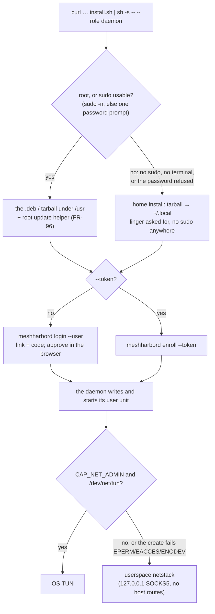

# FR-123: Join from any account — one command, no root, no token, a working mesh

> **Status:** in progress — claimed 2026-11-20. P1–P3 and P5 built; P2b (the download page's installer) prepared. Tracking issue: none (GitHub Issues are
> disabled on `jk-zhang-meta/MeshHarbor`); this spec and its registry row are the record.

## Goal

An ordinary person adds a machine with the download page's one command and a sign-in link,
nothing else, on any account they have:

1. install — with or without administrator rights;
2. sign in — open the link, approve the device;
3. the admin puts the device in a zone (or the zone's GeoIP rule does it).

The device then reaches its peers, and every restriction of its zone applies. Anything beyond
that is a product defect: a flag to look up, a token to mint, a config key to edit, a unit to
write by hand.

Operator, 2026-11-20, after watching a helper onboard a shared GPU server by hand: "正常的操作流程
不应该是，<设备>安装然后登录以后，登录用户在设备管理页将它添加到CN区 所有的限制都启动了不是吗",
"你需要学会从用户的角度思考，用户都是普通的 不懂那么多".

The zone half (every restriction of the zone applies, with no per-device switch) is FR-124. The
macOS pkg's two halves are FR-43 P3c.

## Field evidence (2026-11-20, agent 0.4.189)

The target: Ubuntu 24.04 x86_64, a shared GPU server; the person's account has no usable sudo
(a password they were not given), `systemd --user` with linger, no display, GPU jobs running.

| # | Fact | Where |
|---|---|---|
| E1 | Every `install.sh` path needs sudo: `dpkg -i` or `tar -C /`, the root update helper, the desktop companion | `scripts/install.sh` (`install_daemon_linux`, before this FR) |
| E2 | The release tarball has no home-directory layout of its own, but its binary's `RUNPATH` is `$ORIGIN/../lib/meshharbor`, so `~/.local/{bin,lib/meshharbor}` works as unpacked; the same-user updater already updates exactly that layout | `readelf -d` on the host; `agents/meshharbord/src/updater_linux_user.rs:39`, `scripts/linux-inplace-upgrade.py:176,284` |
| E3 | Without a token, `install.sh` printed `enroll --token <agent-enrollment-jwt>`; the link sign-in (`meshharbord login`) already worked and was what the person used | `scripts/install.sh` (`enroll_daemon`); `agents/meshharbord/src/main.rs` (`login_cmd`) |
| E4 | After sign-in the daemon logged `TUN creation failed … Operation not permitted (os error 1)`, `TUN bring-up failed; aborting runtime`, then a bounded backoff forever; `mh peers` said `(no peers)`, another device showed it `stalled`. The userspace fallback existed only for Windows | `agents/meshharbord/src/overlay.rs` (`build_tun_factory_with_fallback`, branch 2 was `is_windows && …`); `overlay_supervision.rs` (`is_tun_privilege_error_on` returned `false` off Windows; a test locked it) |
| E5 | `netstack_socks_port = 19080` in the config and a restart fixed it at once: 10 mainland peers direct, the rest through the zone's gateway relay | field run, 2026-11-20 |
| E6 | `SystemTun::up` flattens the `tun` crate's error into `io::Error::other(text)`: the EPERM survives only as text | `crates/tunnel-core/src/overlay/tun.rs` (`up_with`, `retry_create`) |
| E7 | A fresh `login` printed `The MeshHarbor user service is active.` only when install or start succeeded, and nothing at all otherwise — and returned success. `enroll` had already printed `Start the daemon: …` just before | `agents/meshharbord/src/main.rs` (`login_cmd`, `enroll_cmd`) |
| E8 | The daemon probes hardware encoders at start in a child process; on a headless GPU server that opens encoder contexts on GPUs busy with other people's jobs. The helper denied every hardware cell by hand | `agents/meshharbord/src/encode/caps.rs` (`cached_or_probed`), `encode/cells.rs` (`denied_cells`) |

## Design

| Piece | Where | Key point |
|---|---|---|
| Linux/macOS privilege check | `agents/meshharbord/src/overlay_supervision.rs` (`process_can_create_os_tun`, `unix_can_create_os_tun`, `cap_eff_has_net_admin`) | Linux: `/dev/net/tun` exists and `CapEff` holds `CAP_NET_ADMIN` (root, an ambient grant, a file capability); macOS: root |
| Reactive classifier | `overlay_supervision.rs` (`is_tun_privilege_error_on`, `is_unix_tun_unavailable_error`) | EPERM, EACCES, ENOENT, ENODEV, ENXIO by kind, raw code or text (E6); EBUSY, EADDRINUSE and the rest keep the bounded backoff |
| One fallback branch for every OS | `agents/meshharbord/src/overlay.rs` (`build_tun_factory_with_fallback`, branch 2) | the Windows latch, now platform-neutral; the rebuilt runtime is netstack, withdraws route offers and DNS steering (FR-97 P0c-3) |
| Home install | `scripts/install.sh` (`sudo_usable`, `install_daemon_linux_home`, `enable_linger_home`) | files land by rename (a running daemon keeps its image); no desktop companion (its package needs root) |
| Link sign-in | `scripts/install.sh` (`sign_in_with_link`; `enroll_daemon` sets `SIGN_IN_WITH_LINK`) | per-user and home installs; after the update helper is on, since the daemon decides at its start who installs its updates (FR-96) |
| Honest sign-in result | `agents/meshharbord/src/main.rs` (`login_cmd`; `EnrollOptions::starts_service_itself`) | a fresh sign-in whose service neither installs nor starts is an error that says how to run it by hand |

## Phases

| Phase | What | Kill switch | Status |
|---|---|---|---|
| P1 | Linux/macOS userspace fallback: proactive (no `CAP_NET_ADMIN`, no `/dev/net/tun`, macOS non-root) and reactive (EPERM/EACCES/no device latches) | `MESHHARBORD_OVERLAY_UNIX_NETSTACK_FALLBACK=0` (pre-FR-123: always try the TUN, back off) | built 2026-11-20 |
| P2 | `install.sh`: home install (`--user`, automatic when sudo is unusable) and link sign-in when there is no token | `--system` / a token keep the old paths; `--user` is never chosen where sudo works | built 2026-11-20 |
| P2b | The download page's own Linux installer (the PersonalWeb catalog's `MeshHarbor-<ver>-Linux-install.sh`, piped to `sudo sh` until now): the same account install when sudo is unusable, sudo asked by the script itself, the page's command `… \| sh` | the machine install is unchanged when root or sudo works | prepared 2026-11-20; ships with the next catalog upload |
| P3 | `login` reports a service that did not start; no "Start the daemon" hint before "running" | — (messages) | built 2026-11-20 |
| P4 | The download page and the install docs lead with Download + Sign in; tokens become the admin's scripted path | — (UI/docs) | — |
| P5 | A screenless Linux host (no display manager, no graphical session on its own seat, no X server, no display in the daemon's environment — read before its own virtual desktop starts) opens no hardware encoder: every hardware cell goes on the `ENCODER_CELLS_DENY` fallback, which the probe child and every session read (`encode/cells.rs` `screenless_hardware_deny`, `main.rs`). Its only picture is the virtual desktop, which software encodes | `MESHHARBORD_HW_ENCODERS_HEADLESS=1`; an operator's own `encoder_cells_deny` / env var wins | built 2026-11-20 |
| P6 | A device whose updates cannot install shows it on its row (who owns its updates, the last outcome) | — | — |
| P7 | Noise: SSH startup warnings that read as "all refused" on a working grant host; the netmap-drop WARN storm after a TUN abort | — | — |
| P8 | Release, field verification on a no-root account, docs | — | — |

## Acceptance criteria

- [ ] On an ordinary Linux account with no usable sudo, the download page's command installs,
      signs in with a link, and the device reaches its peers — shown FAILING on 0.4.189 first
      (E1, E4), with no config edit and no unit written by hand.
- [x] The same account's device updates itself to the next release (the same-user updater).
- [x] A Linux account without `CAP_NET_ADMIN` starts in netstack mode with no failed TUN attempt
      logged; a create that fails EPERM latches netstack without a backoff (unit tests that fail
      without the fix, shown red).
- [ ] With sudo usable, `install.sh` behaves exactly as before (`.deb`, update helper, companion).
- [ ] A sign-in whose service cannot start says so and exits non-zero.
- [ ] The download page offers no token step on the ordinary path (P4).
- [x] A headless GPU host opens no hardware encoder at start (P5).
- [ ] `docs/installation.md` and `docs/overlay-communication.md` describe the home install and the
      Linux/macOS fallback (mermaid, tables, anchors), and `docs/README.md` indexes this FR.

## Open decisions

- None. P5 takes software-only on a screenless host rather than a probe deferred to the first
  session: the hello is sent before any session, and its only picture is a virtual desktop.

## Out of scope

- The zone boundary (FR-124) and the macOS pkg's two halves (FR-43 P3c).
- Host-wide routes, MagicDNS steering and exit nodes on an account without root: the netstack mode
  is reachable through its loopback SOCKS5 front, as on Windows without elevation.

## Field-verification log

| When | Build | Result |
|---|---|---|
| 2026-11-20 | 0.4.189 | FAILED as expected (E1–E5): no install path without sudo; after a hand install, online with no peers until `netstack_socks_port` was set by hand |
| 2026-11-20 | P1 unit tests | `non_windows_tun_permission_error_latches_netstack_and_rebuilds` and `unprivileged_unix_proactively_selects_netstack_without_calling_the_os_tun` fail on the pre-FR-123 branch condition (shown red), pass with P1; the first also fails with the kill switch set |
| 2026-11-20 | P2 fixture test | `scripts/test-install-home.sh`: a home install signs in with a link and calls no sudo; a mutant that prints the token command instead fails it |
| 2026-11-20 | P2b fixture test | the catalog installer piped to `sh` as `nobody` with stub curl/sudo/systemctl/loginctl and a fake `.deb`: with sudo refused it unpacks into `~/.local`, asks for lingering, signs in with `login --user`, never calls `sudo sh`; with sudo usable it fetches itself once more and runs that copy under `sudo`, installing nothing in the account. The 0.4.189 installer FAILS the first case (it dies "pipe it to 'sudo sh'") |
| 2026-11-21 | 0.4.190 | PASSED on the no-sudo GPU server (two RTX A6000, no screen): it updated itself 0.4.189 → 0.4.190 through the same-user updater before any manual roll; with the hand-set `netstack_socks_port` and the unit's `ENCODER_CELLS_DENY` removed it logs `this account cannot create a TUN device … automatically using the userspace network stack` with no failed TUN attempt, and `this host has no screen of its own, so no hardware encoder is probed or opened` |
| 2026-11-21 | 0.4.190 | Open: a fresh install from the download page on a no-sudo account (criterion 1) is not yet run; Windows stays on 0.4.189 this release |
