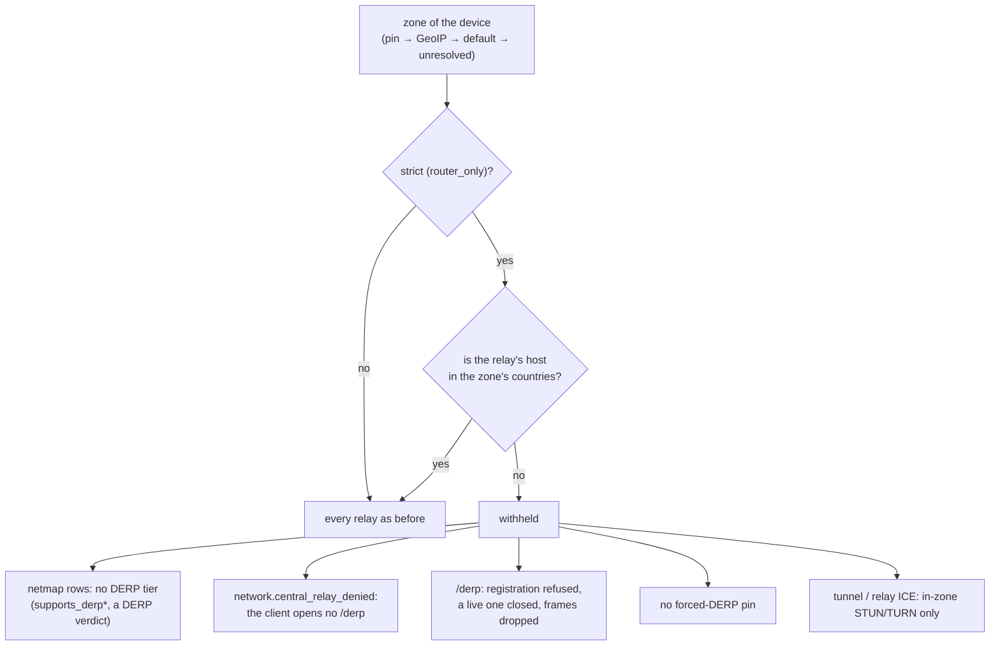

# FR-124: A zone is a boundary — put a device in a zone, and every restriction applies

> **Status:** in progress — claimed 2026-11-20. P1 (the centre's `/derp`), P2 (forced DERP pins), P3 (tunnel
> ICE) and P4 (who may move a device) built. Tracking issue: none (GitHub Issues are disabled on
> `jk-zhang-meta/MeshHarbor`); this spec and its registry row are the record.

## Goal

An admin puts a device in a zone — or the zone's GeoIP rule does — and nothing else is needed:
no per-device switch, no config key, no unit environment. For a strict (`router_only`) zone,
nothing but the device's control connection leaves the zone's countries: no relay, no
STUN/TURN, no tunnel leg outside them.

Operator, 2026-11-20: "正常的操作流程不应该是，<设备>安装然后登录以后，登录用户在设备管理页将它添加到CN区
所有的限制都启动了不是吗 为什么要手动关闭DERP和TURN". On a follow-up: once an org has zones,
every device is in one (pin → GeoIP → the default zone → unresolved-strict); a device's zone may be
changed by an admin, not by the device's owner.

The install half (an ordinary account installs, signs in, and reaches its peers) is FR-123.

## Field evidence (2026-11-20, agent 0.4.189, server master 8a43a07bc)

The org has two zones: `cn` (`auto_countries: ["CN"]`, one mainland gateway relay, `router_only`)
and `non-cn` (the default). The centre is in Hong Kong.

| # | Fact | Where |
|---|---|---|
| E1 | A device resolved into `cn` by GeoIP, default config: `overlay: business traffic unanswered — copying onto /derp ahead of the proof (early standby)`, then `the peer's /derp copies are arriving (standby sink)`; one more TCP connection to the centre than a sibling with `overlay_derp = false` | the device's log, 2026-11-20 |
| E2 | The `/derp` ACL admits a same-zone pair whatever the zone's strictness or the relay's country | `crates/modules/network/src/derp_acl.rs` (`permits`, the `za == zb` arm) |
| E3 | Same-zone netmap rows kept `supports_derp`, `supports_derp_floor`, `supports_forced_derp`; only a cross-zone strict pair was stripped (`line_only`) | `crates/modules/network/src/overlay.rs` (`shape_peer_unprofiled`, `line_only`) |
| E4 | STUN and TURN were already confined: a strict zone's STUN list and TURN grants keep only servers in its declared countries | `network_zones.rs` (`filter_stun_urls_for_node`, `ice_policy_for`), `overlay.rs` (relay grant, `filter_ice_for_allowed_countries`) |
| E5 | Forced-DERP pins (TURN churn, a lossy org carrier, the re-push on join) checked only capabilities, never zones; a regional DERP URL was never judged by its country | `overlay.rs` (`handle_overlay_relay_request`, `handle_org_relay_loss`, `repush_forced_pairs_on_join`, `pair_derp_url`) |
| E6 | A tunnel session handed both ends the deployment's global TURN set | `crates/modules/network/src/tunnel.rs` (`ice_servers_for(…, cfg_for(None))`) |
| E7 | A device's owner could pin it to any zone, including out of a strict one | `crates/modules/network/src/routes/network_zones.rs` (`set_zone_assignment`); `ui/src/components/admin/AgentsSection.vue` (`mayAssignZoneFor`) |
| E8 | Before zones, the institution's devices were configured by hand with `overlay_derp = false`, `overlay_derp_floor = false`, `overlay_turn_relay = false`, a mainland STUN list and unit env vars | fleet configs |

## Design

| Piece | Where | Key point |
|---|---|---|
| The predicate | `crates/modules/network/src/network_zones.rs` (`zone_central_relay_ok`, `central_relay_allowed`, `derp_url_allowed`, `central_relay_url`) | per zone: not strict, or the centre's public origin (`app.frontend_url`) geolocates into the zone's declared countries; unknown is outside (fail closed); unresolved is denied |
| The centre's country | `crates/modules/fleet/src/lib.rs` (the ICE-zone refresh) | the origin's host joins the hosts the refresh resolves every 10 min |
| Rows | `overlay.rs` (`shape_peer`, `without_central_relay`, `stamp_verdict`); `business_isolation.rs` (`Zones::central_relay_denied`) | a pair either of whose ends is denied gets no DERP tier; a DERP verdict is never stamped on a row without one |
| The client | `crates/remote_control/src/signaling.rs` (`OverlayNetworkInfo::central_relay_denied`); `crates/tunnel-core/src/overlay/runtime.rs` | the runtime drops its `/derp` factory; a flip rebuilds the runtime |
| The relay | `crates/modules/network/src/derp_acl.rs` (`central_relay_denied`, `refuses_registration`); `derp.rs` (`handle_derp_socket`) | second line for a client that ignores the row: refused at registration, closed within 5 s of a zone change |
| Pins | `overlay.rs` (`zones_allow_derp` at the three pin sites) | a refused escalation is not even counted, since a standing pin would also refuse the pair its TURN grant |
| Tunnel ICE | `overlay.rs` (`zone_filtered_ice`), `tunnel.rs` | each party judged in its own tenant |
| Who may move a device | `routes/network_zones.rs` (`set_zone_assignment`), `AgentsSection.vue` | `MANAGE_AGENTS` only |

## Phases

| Phase | What | Kill switch | Status |
|---|---|---|---|
| P1 | The centre's `/derp`: rows, client flag, relay refusal | a zone that is not `router_only` | built 2026-11-20 |
| P2 | Forced-DERP pins judged by zone, regional DERP by its own host | — | built 2026-11-20 |
| P3 | Tunnel ICE confined | — | built 2026-11-20 |
| P4 | Only `MANAGE_AGENTS` moves a device between zones | — | built 2026-11-20 |
| P5 | The rest of GPT-6.2's list: file-transfer child offers' inline candidates; shared-SSH and Hive ICE; closing a live carrier a zone change forbids; the applied policy revision on the device row | — | — |
| P6 | Release, field verification (the `cn` device with default config holds one connection to the centre and no `/derp`), docs | — | — |

## Acceptance criteria

- [x] A device in a strict zone whose countries do not hold the centre, with a default config,
      holds no `/derp` socket and copies nothing onto `/derp` — shown FAILING on 0.4.189 first (E1).
- [x] Its rows toward its own zone's peers carry no DERP tier, its network says
      `central_relay_denied`, and the relay refuses its registration (integration test that fails
      without the fix); a non-strict zone and a strict zone that holds the centre keep the floor.
- [ ] No forced-DERP pin is pushed to such a pair.
- [ ] A tunnel session's ICE for such a device holds only in-zone servers.
- [ ] A device's owner without `MANAGE_AGENTS` cannot change its zone (403).
- [ ] The hand-set switches of E8 can be removed from the institution's devices with no change in
      what leaves the zone.
- [ ] `docs/overlay-communication.md` (zones section) describes it (mermaid, tables, anchors), and
      `docs/README.md` indexes this FR.

## Open decisions

- None. A deployment whose centre IS inside a strict zone's countries keeps the floor for that
  zone, by the same rule.

## Out of scope

- The deployment-wide business isolation (`app.business_isolation`, Mainland / NonMainland), which
  stays as it is (`warn` on the hosted deployment).
- The control connection itself, login, renewal, updates and diagnostics to the centre: the
  operator's rule allows exactly that connection to leave the zone.

## Field-verification log

| When | Build | Result |
|---|---|---|
| 2026-11-20 | 0.4.189 | FAILED as expected (E1): a `cn` device copied business traffic onto the centre's `/derp` until `overlay_derp = false` was set by hand |
| 2026-11-21 | 0.4.190 (server and agent) | PASSED on the same `cn` GPU server, with `overlay_derp`, `overlay_derp_floor` and `netstack_socks_port` removed from its config: after a restart the daemon holds exactly one TCP connection, to the centre on 443, logs `this device's zone keeps it on relays inside the zone — not opening /derp`, reaches its own zone's peers `direct` and the rest `relay:org/udp` through the in-zone gateway. The integration test `a_strict_zone_rides_no_relay_outside_it_not_even_the_centres_derp` fails with `central_relay_allowed` forced true (shown red) |
| 2026-11-21 | 0.4.190 | Open: one institution device still runs 0.4.189 (its disk is full), so its hand-set switches stay; the tunnel-ICE and forced-pin criteria have tests but no field run yet |
