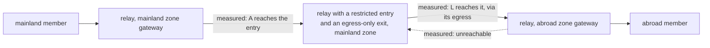

# FR-125: A one-way line carries a cross-zone path

> **Status:** in progress — claimed 2026-11-21. Tracking issue: none (GitHub Issues are disabled on
> `jk-zhang-meta/MeshHarbor`); this spec and its registry row are the record.

## Goal

Relays connect to relays freely. The one rule is the logical zone: a pair's path uses relays
of the two members' zones only, a link that crosses zones joins those two zones and no other,
and the path starts and ends on those zones' gateways. Nothing else is configured per link: no
approved edge, no declared endpoint, no direction.

That must hold for the machines real networks have. A machine may have several addresses, and
each has its own rules:

| Address kind | Inbound | Outbound |
|---|---|---|
| ordinary public | anyone | yes |
| restricted entry (a line's ingress that admits some sources only, or anyone) | the sources it admits | replies on the flows it accepted |
| egress-only (a line's exit NAT) | nobody | every flow the machine opens leaves here |
| private / LAN | its subnet | — |

The code knows none of these kinds by name. It learns, by measurement, which relay can reach
which address of which other relay, in which direction, and how fast; a link exists in the
direction it was measured to work, and only there.

## Field evidence (2026-11-21, agent 0.4.191, server 0.4.190)

| # | Observation |
|---|---|
| E1 | A new line: a relay in a mainland zone may send to the line's entry `ip:port` (the entry accepts that one source address only); the line's far end is an outbound-only NAT abroad. Nothing abroad can open anything toward the entry, and the exit takes no inbound at all (TCP to it times out from a host in the same city). |
| E2 | The line's machine is ~6 ms from the entry relay and ~25 ms from hosts abroad; a mainland zone device reaches the same hosts at ~83 ms today, over the existing line through Hong Kong. |
| E3 | The line carries a full 1500-byte packet (`ping -M do -s 1472` succeeds end to end), so the backbone's 1400-byte ciphertext cap fits. |
| E4 | Enrolled as an ordinary node, the line's machine is classed outside the zone (its egress geolocates abroad) and every cross-zone peer row from it reads `blocked`: an ordinary node is not a way across a strict zone, by design (FR-121, FR-124). |

## What already holds (read from master)

- **An edge is a directed dial capability; the session over it is bidirectional.**
  `plan_line` (`crates/modules/network/src/org_relay.rs:3793`): "The edge's source holds the
  bridge, so whichever member asked, the member in the source's zone binds there"; both
  orientations are tried, so a pair requested from the far side uses the same edge.
  `path_select.rs` computes both member orientations over the same directed edges.
- **The far relay accepts the leg by bind secret, not by address.** The cookie covers the
  *observed* source at the challenge step (`crates/tunnel-core/src/overlay/orgrelay/bind.rs:30`),
  so a leg arriving from the line's NAT'd exit is accepted.
- **Only the edge's source measures it.** Backbone probe targets come from the relay's own
  edges, on its pinned NIC; nothing makes the target probe the source.
- **The endpoint is opaque.** `valid_backbone_endpoint` (`routes/peer_relay.rs:376`) wants a
  unicast `ip:port` outside the overlay; it need not be the target's own address.

## What is missing

1. **The bridge leg has no keepalive and no re-bind.** It binds once and then only forwards
   (`backbone.rs`); member carriers have both. A quiet pair lets a stateful path's mapping expire
   and the session becomes a black hole. **Done in P1.**
2. (**Done in P3.**) **Cross-zone links exist only as admin-approved edges** with a declared endpoint and an
   ADMINISTRATOR-only `cross_border` flag (`path_candidate.rs`, "cross-zone router forwarding is
   strictly restricted to admin-configured `approved_backbone_edges`"); same-zone relays already
   auto-mesh.
3. **An auto link takes the target's FIRST valid endpoint**, unmeasured (**done in P3**). On a machine whose first
   endpoint is its egress-only NAT, or an entry that admits one source, that link never works,
   and nothing notices.
4. **Relays measure only some relays** (their own edges; same-zone relays over public endpoints). **Done in P2.**
5. **A dead link is found late** and the relay, not the link, is penalised. **Done in P4.**

## Design

| Phase | What | Kill switch |
|---|---|---|
| P1 | **Built.** The bridge keeps its remote leg alive: an in-band re-bind after 10 s of silence (fresh nonce, same VNI and secret), and the bridge ends when 3 rounds go unanswered. Only the bridge's side sends first. | `MESHHARBORD_RELAY_BACKBONE_KEEPALIVE=0` |
| P2 | **Built.** **Every relay measures every other relay's every endpoint**, in any zone (bounded: the org's relays only, at most 4 endpoints per relay, within the existing 16-target and 32-endpoint caps), and reports per (source, target, endpoint) reachability and RTT. The relay's dial allow-list lists the pre-FR-125 entries first (each same-zone relay's first endpoint), so nothing added can crowd one out; a crossing only ever lists a public address. The probe offers are a subset of that allow-list, and the connect-time list (`fleet/socket.rs`) is the same computation as the live push (`network_zones.rs`) — the daemon ignores a same-revision update, so the two must agree. | server `[app] relay_auto_links = false` (with P3) |
| P3 | **Built.** **Links are synthesized for any two relays** from those measurements: a directed link source→target on the fastest endpoint the source measured reachable since both last joined (the same cutoff path selection scores with). A link that crosses zones exists only where it was measured to work, only on a public address, and only between the pair's two zones; a same-zone link exists as before (not measured working, it keeps the pre-FR-125 first endpoint and its verdict ranks it), but takes the measured-best endpoint when there is one. The reuse check (`session_zone.rs`) accepts an installed crossing by the same zone rule, never by which endpoint measures fastest now, so a repeat request keeps a working session. The ends stay on the zones' gateways. Explicit edges stay valid (an override), but are no longer required. Legacy #21 `enforce` keeps its own edges: every consumer reads one predicate, `AppSettings::relay_auto_links_effective`. | server `[app] relay_auto_links = false` |
| P4 | **Built.** **Link health**: a bridge whose remote leg fails (its bind times out unanswered, or the P1 keeper gives up) publishes that endpoint, and the daemon's overlay runtime re-measures the relay that offered it at once (the reactive prober, 5 s cooldown). The measurement goes to the center as any probe does, filed per (source, target, endpoint), so the link — not the relay — reads down for the next mint within seconds instead of at the next 240 s round. No new wire message: the server already trusts only measurements of what it offered. | `MESHHARBORD_RELAY_LINK_HEALTH=0` |
| P5 | **Built.** Docs: [`peer-relays.md` § Relays link by measurement](../peer-relays.md#relays-link-by-measurement-the-zone-is-the-only-rule-fr-125) (address kinds, mermaid, step table with anchors, kill switches), [`business-isolation.md`](../business-isolation.md#under-logical-network-zones-a-measured-crossing-needs-no-approval-fr-125) (legacy `enforce` vs zones), `docs/README.md` row. | — |

A line whose entry admits anyone needs no first relay: members of its zone reach it directly,
by the same measurements. Nothing in the code names either case.

## Acceptance criteria

- [ ] A mainland-zone device and an abroad device ride the new line in both request directions,
      at a round trip near the line's (≤ 45 ms), shown at ~83 ms over the old line first.
- [ ] The pair stays up through 10 minutes with no traffic and answers at once afterwards; shown
      FAILING without P1 (unit test that fails without the fix, and the field run).
- [ ] With the line's forward stopped, the pair moves to the other line within 60 s and back when
      it returns; shown slower without P2.
- [ ] A device whose business policy keeps it inside its zone gets no row over the line.
- [ ] No link is approved or declared by hand: the path above is found from measurements alone,
      and a relay that cannot reach an address never gets a link to it.
- [ ] No code path names a host, a country pair or a line; the recipe works for any line.
- [ ] `docs/peer-relays.md` and `docs/business-isolation.md` describe one-way lines (mermaid,
      tables, anchors), and `docs/README.md` indexes this FR.

## Open decisions

- The line's machine is a relay of the mainland zone (its entry is there); its link abroad is
  the one zone crossing. Its zone is pinned by an admin, since its egress geolocates abroad.

## Known limits (independent review, 2026-11-21)

An independent static review (Codex, GPT-6.2, xhigh) of P1–P4 raised twelve findings. Fixed: the
connect-time allow-list, the reuse check on an installed crossing, the `enforce` predicate, the
list order and caps, the probe cutoff for crossings, and a local socket error counted as a dead
link (each fix has a test that fails without it). Left as they are, and why:

| Finding | Why it stays |
|---|---|
| A path may cross between the pair's two zones more than once | Every relay on it is in one of the two zones and both ends are gateways, which is the rule; the planner picks the lowest-latency path, so a longer zig-zag only wins when it is measured faster. A third zone is reachable only over an admin's explicit edge, as before. |
| A relay session with no payload expires after its idle timeout | WireGuard sends a keepalive every 25 s through the session, which refreshes it. Only on-demand dormancy (default off) goes silent, and that holds for every relay session, not just a bridge. |
| A lost Answer after a NAT remap costs one keeper round (~10 s) | Bounded, and the next round recovers it. |
| A dead first address on a relay whose second still answers does not move a pair already on it | The pair moves when its own carrier fails and it asks again; the new mint takes the answering address. |
| One relay's address change re-tells every relay its list | Relays are few and their addresses rarely move; an identical re-advert pushes nothing. |

## Out of scope

- A per-edge MTU: E3 shows this line fits the network-wide cap.
- More than one edge between the same two relays (`path_graph.rs` `DuplicateTarget`).
- `install.sh` from the server choosing the tarball on Debian and a per-user unit as root (found
  while enrolling the line's machines; fixed separately under FR-123).

## Field-verification log

| When | Build | Result |
|---|---|---|
| 2026-11-21 | 0.4.191 | Baseline: mainland-zone node → abroad host at ~83 ms over the existing line; the line machine enrolled as an ordinary node sees every cross-zone row `blocked` (E4) |
