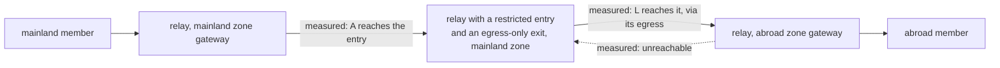

# FR-125: A one-way line carries a cross-zone path

> **Status:** in progress — claimed 2026-11-21. Tracking issue: none (GitHub Issues are disabled on
> `jk-zhang-meta/MeshHarbor`); this spec and its registry row are the record.

## Goal

Relays connect to relays freely. The one rule is the logical zone: a pair's path uses relays
of the two members' zones only, a link that crosses zones joins those two zones and no other,
and the path starts and ends on those zones' gateways. Nothing else is configured per link: no
approved edge, no declared endpoint, no direction.

That must hold for the machines real networks have. A machine may have several addresses, and
each has its own rules:

| Address kind | Inbound | Outbound |
|---|---|---|
| ordinary public | anyone | yes |
| restricted entry (a line's ingress that admits some sources only, or anyone) | the sources it admits | replies on the flows it accepted |
| egress-only (a line's exit NAT) | nobody | every flow the machine opens leaves here |
| private / LAN | its subnet | — |

The code knows none of these kinds by name. It learns, by measurement, which relay can reach
which address of which other relay, in which direction, and how fast; a link exists in the
direction it was measured to work, and only there.

## Field evidence (2026-11-21, agent 0.4.191, server 0.4.190)

| # | Observation |
|---|---|
| E1 | A new line: a relay in a mainland zone may send to the line's entry `ip:port` (the entry accepts that one source address only); the line's far end is an outbound-only NAT abroad. Nothing abroad can open anything toward the entry, and the exit takes no inbound at all (TCP to it times out from a host in the same city). |
| E2 | The line's machine is ~6 ms from the entry relay and ~25 ms from hosts abroad; a mainland zone device reaches the same hosts at ~83 ms today, over the existing line through Hong Kong. |
| E3 | The line carries a full 1500-byte packet (`ping -M do -s 1472` succeeds end to end), so the backbone's 1400-byte ciphertext cap fits. |
| E4 | Enrolled as an ordinary node, the line's machine is classed outside the zone (its egress geolocates abroad) and every cross-zone peer row from it reads `blocked`: an ordinary node is not a way across a strict zone, by design (FR-121, FR-124). |

## What already holds (read from master)

- **An edge is a directed dial capability; the session over it is bidirectional.**
  `plan_line` (`crates/modules/network/src/org_relay.rs:3793`): "The edge's source holds the
  bridge, so whichever member asked, the member in the source's zone binds there"; both
  orientations are tried, so a pair requested from the far side uses the same edge.
  `path_select.rs` computes both member orientations over the same directed edges.
- **The far relay accepts the leg by bind secret, not by address.** The cookie covers the
  *observed* source at the challenge step (`crates/tunnel-core/src/overlay/orgrelay/bind.rs:30`),
  so a leg arriving from the line's NAT'd exit is accepted.
- **Only the edge's source measures it.** Backbone probe targets come from the relay's own
  edges, on its pinned NIC; nothing makes the target probe the source.
- **The endpoint is opaque.** `valid_backbone_endpoint` (`routes/peer_relay.rs:376`) wants a
  unicast `ip:port` outside the overlay; it need not be the target's own address.

## What is missing

1. **The bridge leg has no keepalive and no re-bind.** It binds once and then only forwards
   (`backbone.rs`); member carriers have both. A quiet pair lets a stateful path's mapping expire
   and the session becomes a black hole. **Done in P1.**
2. (**Done in P3.**) **Cross-zone links exist only as admin-approved edges** with a declared endpoint and an
   ADMINISTRATOR-only `cross_border` flag (`path_candidate.rs`, "cross-zone router forwarding is
   strictly restricted to admin-configured `approved_backbone_edges`"); same-zone relays already
   auto-mesh.
3. **An auto link takes the target's FIRST valid endpoint**, unmeasured (**done in P3**). On a machine whose first
   endpoint is its egress-only NAT, or an entry that admits one source, that link never works,
   and nothing notices.
4. **Relays measure only some relays** (their own edges; same-zone relays over public endpoints). **Done in P2.**
5. **A dead link is found late** and the relay, not the link, is penalised. **Done in P4.**

## Design

| Phase | What | Kill switch |
|---|---|---|
| P1 | **Built.** The bridge keeps its remote leg alive: an in-band re-bind after 10 s of silence (fresh nonce, same VNI and secret), and the bridge ends when 3 rounds go unanswered. Only the bridge's side sends first. | `MESHHARBORD_RELAY_BACKBONE_KEEPALIVE=0` |
| P2 | **Built.** **Every relay measures every other relay's every endpoint**, in any zone (bounded: the org's relays only, at most 4 endpoints per relay, within the existing 16-target and 32-endpoint caps), and reports per (source, target, endpoint) reachability and RTT. The relay's dial allow-list lists the pre-FR-125 entries first (each same-zone relay's first endpoint), so nothing added can crowd one out; a crossing only ever lists a public address. The probe offers are a subset of that allow-list, and the connect-time list (`fleet/socket.rs`) is the same computation as the live push (`network_zones.rs`) — the daemon ignores a same-revision update, so the two must agree. | server `[app] relay_auto_links = false` (with P3) |
| P3 | **Built.** **Links are synthesized for any two relays** from those measurements: a directed link source→target on the fastest endpoint the source measured reachable since both last joined (the same cutoff path selection scores with). A link that crosses zones exists only where it was measured to work, only on a public address, and only between the pair's two zones; a same-zone link exists as before (not measured working, it keeps the pre-FR-125 first endpoint and its verdict ranks it), but takes the measured-best endpoint when there is one. The reuse check (`session_zone.rs`) accepts an installed crossing by the same zone rule, never by which endpoint measures fastest now, so a repeat request keeps a working session. The ends stay on the zones' gateways. Explicit edges stay valid (an override), but are no longer required. Legacy #21 `enforce` keeps its own edges: every consumer reads one predicate, `AppSettings::relay_auto_links_effective`. | server `[app] relay_auto_links = false` |
| P4 | **Built.** **Link health**: a bridge whose remote leg fails (its bind times out unanswered, or the P1 keeper gives up) publishes that endpoint, and the daemon's overlay runtime re-measures the relay that offered it at once (the reactive prober, 5 s cooldown). The measurement goes to the center as any probe does, filed per (source, target, endpoint), so the link — not the relay — reads down for the next mint within seconds instead of at the next 240 s round. No new wire message: the server already trusts only measurements of what it offered. On the server, a relay's report that one of its links is down revokes, at once, the sessions riding that hop (`backbone_link_down`), and the reuse check refuses a hop whose latest current measurement says down — never one whose measurement merely aged or was beaten by a faster address. | `MESHHARBORD_RELAY_LINK_HEALTH=0` (relay); server `[app] relay_auto_links = false` |
| P5 | **Built.** Docs: [`peer-relays.md` § Relays link by measurement](../peer-relays.md#relays-link-by-measurement-the-zone-is-the-only-rule-fr-125) (address kinds, mermaid, step table with anchors, kill switches), [`business-isolation.md`](../business-isolation.md#under-logical-network-zones-a-measured-crossing-needs-no-approval-fr-125) (legacy `enforce` vs zones), `docs/README.md` row. | — |
| P6 | **Built.** **A relay that cannot dial out is reached at its entry.** A pair member that is itself an approved relay may end its own path at itself: the relay before it dials the address it measured, instead of the member dialing out to a gateway. For that pair the member keeps no link that crosses zones, in or out, so it never becomes its zone's border unless it is one of the zone's gateways; the reuse check applies the same rule (`path_candidate.rs` `member_relays_end_at_themselves`, `session_zone.rs`). | server env `MESHHARBOR__ORG_RELAY__MEMBER_SELF_END=0` |

A line whose entry admits anyone needs no first relay: members of its zone reach it directly,
by the same measurements. Nothing in the code names either case.

## Acceptance criteria

- [x] A mainland-zone device and an abroad device ride the new line in both request directions,
      at a round trip near the line's (≤ 45 ms), shown at ~83 ms over the old line first.
- [ ] The pair stays up through 10 minutes with no traffic and answers at once afterwards; shown
      FAILING without P1 (unit test that fails without the fix, and the field run).
- [ ] With the line's forward stopped, the pair moves to the other line within 60 s and back when
      it returns; shown slower without P2.
- [ ] A device whose business policy keeps it inside its zone gets no row over the line.
- [ ] No link is approved or declared by hand: the path above is found from measurements alone,
      and a relay that cannot reach an address never gets a link to it.
- [ ] No code path names a host, a country pair or a line; the recipe works for any line.
- [ ] `docs/peer-relays.md` and `docs/business-isolation.md` describe one-way lines (mermaid,
      tables, anchors), and `docs/README.md` indexes this FR.

## Open decisions

- The line's machine is a relay of the mainland zone (its entry is there); its link abroad is
  the one zone crossing. Its zone is pinned by an admin, since its egress geolocates abroad.

## Known limits (independent review, 2026-11-21)

An independent static review (Codex, GPT-6.2, xhigh) of P1–P4 raised twelve findings. Fixed: the
connect-time allow-list, the reuse check on an installed crossing, the `enforce` predicate, the
list order and caps, the probe cutoff for crossings, and a local socket error counted as a dead
link (each fix has a test that fails without it). Left as they are, and why:

| Finding | Why it stays |
|---|---|
| A path may cross between the pair's two zones more than once | Every relay on it is in one of the two zones and both ends are gateways, which is the rule; the planner picks the lowest-latency path, so a longer zig-zag only wins when it is measured faster. A third zone is reachable only over an admin's explicit edge, as before. |
| A relay session with no payload expires after its idle timeout | WireGuard sends a keepalive every 25 s through the session, which refreshes it. Only on-demand dormancy (default off) goes silent, and that holds for every relay session, not just a bridge. |
| A lost Answer after a NAT remap costs one keeper round (~10 s) | Bounded, and the next round recovers it. |
| A dead first address on a relay whose second still answers does not move a pair already on it | The pair moves when its own carrier fails and it asks again; the new mint takes the answering address. |
| One relay's address change re-tells every relay its list | Relays are few and their addresses rarely move; an identical re-advert pushes nothing. |

## Known limits (field, 2026-11-22)

| Limit | What it means |
|---|---|
| An established pair moves to a newly measured line only at its next mint | Make-before-break upgrades of a bound session need path trials (`MESHHARBORD_PATH_TRIAL`, default off fleet-wide, so no device advertises `supports_path_trial_v1`). Without them a pair re-mints when its session ends (one-hour lifetime) or churns; after a server restart every pair is minted before any line is re-measured. Each pass of the upgrade weigher now takes the least recently weighed pairs first (it took the first 16 in map order and starved the rest), which matters once path trials are on. |
| A line that drops a port | The first such line dropped destination UDP 3478 at its exit. Configuration, not code: the target relay also answers on another port (a host redirect, e.g. 3479 → 3478, in its own nft table) and declares that address as a static endpoint; the source measures both and links on the one that works. |
| A relay whose cloud firewall blocks its relay port inbound | Its own line still works (it only dials out), but members of its zone cannot bind to it; open the port in the provider's security group. |
| The line's machine, as a member, bound nothing (fixed, 0.4.199) | Its exit drops destination UDP 3478, so as an endpoint (dialing out to its zone's gateways on 3478) its own sessions never bound; each was re-requested, minted and revoked about once a minute per peer (~800 `nhop_reauthorization_failed` revokes an hour), and devices listed it as blocked. It carried other pairs as a relay regardless. Now its path may end at itself, the gateway before it dialing its entry (P6). |
| A relay with several public addresses on several interfaces may answer from the wrong one (open) | The relay listener binds the wildcard address and does not choose a reply source, so on a multi-homed host a reply can leave from an address other than the one the packet arrived on. Such an address measures unreachable and is not used, which is safe; using it needs the agent to reply from the arrival address (`IP_PKTINFO` / `IPV6_RECVPKTINFO`). |
| A path with two middle relays does not hold (re-check on agent 0.4.200) | Seen 2026-11-22: a mainland server and an abroad host over mainland gateway → line → abroad relay → abroad gateway were minted and revoked 44 times in two hours. The 0.4.199 field run found the same churn on paths with one middle relay too, and its cause in the agent (next row); this case is expected to be the same one. |
| A pair whose two ends both hold a relay-death streak never binds (fixed, agent 0.4.200) | After three relay deaths a member defers its own re-request (60 s doubling to 300 s), on the premise that the other end's request still pairs it at once. For an org session that held only while the member was tracking the peer or had a carrier installed: a carrier-less member stored the pushed session and never bound it. Both ends of a pair that failed for hours (the line's machine before 0.4.199) then took turns binding only their own requests, each 60 s bind window expiring with the other side absent (field log, 0.4.199). Now a carrier-less member binds the other end's session at once (`runtime.rs` `accept_org_bind_session`). |
| Address re-adverts reset measurement freshness (fixed, 0.4.198) | Every `rc:overlay.endpoints` / `rc:overlay.srflx` write advanced the node's probe cutoff, even with the same addresses; nodes re-advertise on the srflx keepalive and on every relay link they bring up, so cutoffs were 0–17 s old fleet-wide and a crossing (which needs a measurement after the cutoff) into a re-advertising node usually did not exist. Now only a change of the addresses its relay endpoints are built from advances it (`overlay.rs` `note_probe_addresses`, compared against the write's atomic before-image). Kill switch `MESHHARBOR__OVERLAY__PROBE_CUTOFF_ON_CHANGE=0`. |

## Out of scope

- A per-edge MTU: E3 shows this line fits the network-wide cap.
- More than one edge between the same two relays (`path_graph.rs` `DuplicateTarget`).
- `install.sh` from the server choosing the tarball on Debian and a per-user unit as root (found
  while enrolling the line's machines; fixed separately under FR-123).

## Field-verification log

| When | Build | Result |
|---|---|---|
| 2026-11-21 | 0.4.191 | Baseline: mainland-zone node → abroad host at ~83 ms over the existing line; the line machine enrolled as an ordinary node sees every cross-zone row `blocked` (E4) |
| 2026-11-22 | agent 0.4.192, server 0.4.192 → 0.4.194 | Rolled to 15 Linux root nodes; the two new relays approved, the line's machine pinned to the mainland zone with its entry as a static endpoint, the Shanghai relay added to that zone's gateways. Measured: the entry relay reaches the line at 5–6 ms; the line's machine reaches the abroad gateway at 25 ms — but only on UDP 3479: its exit drops destination port 3478 (DNS and other ports pass). Configured the gateway's alternate port (above). Found and fixed on the server: an automatic crossing revoked by reauthorization 40 s after its mint (0.4.193), and the upgrade weigher's starvation (0.4.194). Pair under test: Shanghai relay ↔ abroad gateway as endpoints, baseline 77–79 ms. One abroad home host cannot reach that gateway's relay port at all (its own network), so it cannot exit there. |
| 2026-11-22 | server 0.4.194 → 0.4.195 | **Regression in 0.4.194**: 20 server panics in 75 min ("comparison function does not correctly implement a total order"), each dropping one agent's control socket. The upgrade weigher sorted by a weigh time read live from a map that concurrent reports write. Fixed by reading each key once (`sort_by_cached_key`); the new test fails on 0.4.194 with the same panic. 0 panics since. |
| 2026-11-22 | server 0.4.195 → 0.4.198 | The pair's next mints still skipped the line: 246 ms straight across, then 78 ms over the old line, while the line measured 6 + 25 ms (checked by hand: no loss at one probe a second). The same layout in an integration test, reports sent over the wire, took the line, so the cause was live state. A rate-limited path explain log (0.4.196 at INFO was filtered by the server's `warn` level; 0.4.197 at WARN) showed every link into the far gateway with a cutoff 0–4 s old and, at one mint, no crossing into it at all. Cause and fix in Known limits (address re-adverts); the test now re-advertises after the measurements and is red without the fix. |
| 2026-11-22 | server 0.4.198 | Cutoffs on the explain log ~10 min old (the agents' reconnect), not 0–17 s; every link into the far gateway measured. At its next mint the pair took **Shanghai relay → line → abroad gateway, 30.5 ms** (class 0; was 78 ms over the old line, 246 ms straight across), requested from the mainland side. **Idle:** 10 min with no traffic, then the first ping answered at 30.6 ms, no re-mint in between. **Failover:** with the line's forward to the gateway dropped on the line's machine, pings stopped at once; 17 s later the client re-asked and was re-minted onto the same line (not yet re-measured); 3 s later the line's machine measured the leg down, P4 revoked the session (`backbone_link_down`) and the next mint took the old line — **20 s without answers**, then 75 ms. The block's auto-undo (a systemd timer) ran ~30 s late; removed by hand. |
| 2026-11-22 | server 0.4.198 | **Back:** at 01:01 UTC, the pair's first mint after the failover test, it returned to the line by itself at 31.5 ms, requested this time from the abroad side. With the earlier mint requested from the mainland side (30.5 ms), both request directions ride the line. |
| 2026-11-22 | server 0.4.198 → 0.4.199 | **Before:** the line's machine as a device was `blocked` from every node and `mh ssh` to it failed (`proxy CONNECT failed (REP=0x4)`); ~77 revokes per 5 min named it as a member. **After:** 13 of its 22 online peers on an org relay (the mainland devices at 28–70 ms, the Shanghai relay at 4 ms), every chosen path class 0 and ending at the machine itself once measurements refilled (~10 min after the restart, which resets every cutoff); `mh ssh` to it from a mainland Windows device printed its hostname; ~10 revokes per 5 min. The other 9 alternated: the server pushed each end's request to both ends, but the end that did not ask never bound (15 of 15 sessions bound when the machine asked, 1 of 13 when the peer asked; a peer's own 300 s re-request hold explained each one) — the agent cause above. One pair also sat stranded after the restart: the machine's request raced it ("off-loop allocate failed"), the session minted anyway, and neither end asked again. |
| 2026-11-22 | agent 0.4.192 → 0.4.200 (Linux x86/ARM, macOS, Windows) | Rolled to every online Linux node at 03:59 UTC (the Windows build environment was restored first: the FFmpeg/libvpx/pkgconf/nasm/WiX inputs re-fetched and checked against recorded or published hashes; the MSI upgraded a 0.4.189 Windows test device in place). **After:** the line's machine had 22 of 23 online peers on an org relay at 04:11 (the 23rd was restarting into the new build), including all 9 that alternated before; `mh ssh` to it from a mainland WSL node that had been `blocked` printed its hostname (31 ms); revokes naming it fell from ~10 per 5 min to 0, and no revoke at all was written in the 10 minutes after the roll settled; 24 of 25 devices online, 0 server panics. Some first mints after the restart took slow paths (an abroad relay pair at 286 ms) because every node's measurements restart with it; they move at their next mint. |

