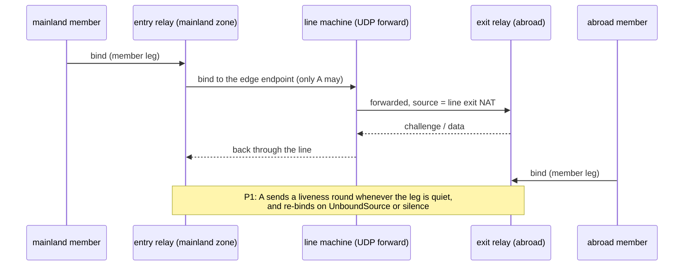

# FR-125: A one-way line carries a cross-zone path

> **Status:** in progress — claimed 2026-11-21. Tracking issue: none (GitHub Issues are disabled on
> `jk-zhang-meta/MeshHarbor`); this spec and its registry row are the record.

## Goal

An operator who has a private line between two zones adds it as a backbone edge and nothing
else: a strict zone's devices reach the other zone over it, from either side, and fall back to
another line when it dies. This must hold when the line is **one-way**: only one machine may
open it, its far end accepts nothing from outside, and replies come back only on the flows the
near end opened.

The code knows no topology. It knows a directed dial capability (`PeerRelayBackboneEdge`: a
source relay, a target relay, an exact UDP endpoint), and it must not assume the target can
reach the source, that the endpoint is the target's own socket, or that an idle flow stays open.

## Field evidence (2026-11-21, agent 0.4.191, server 0.4.190)

| # | Observation |
|---|---|
| E1 | A new line: a relay in a mainland zone may send to the line's entry `ip:port` (the entry accepts that one source address only); the line's far end is an outbound-only NAT abroad. Nothing abroad can open anything toward the entry, and the exit takes no inbound at all (TCP to it times out from a host in the same city). |
| E2 | The line's machine is ~6 ms from the entry relay and ~25 ms from hosts abroad; a mainland zone device reaches the same hosts at ~83 ms today, over the existing line through Hong Kong. |
| E3 | The line carries a full 1500-byte packet (`ping -M do -s 1472` succeeds end to end), so the backbone's 1400-byte ciphertext cap fits. |
| E4 | Enrolled as an ordinary node, the line's machine is classed outside the zone (its egress geolocates abroad) and every cross-zone peer row from it reads `blocked`: an ordinary node is not a way across a strict zone, by design (FR-121, FR-124). |

## What already holds (read from master)

- **An edge is a directed dial capability; the session over it is bidirectional.**
  `plan_line` (`crates/modules/network/src/org_relay.rs:3793`): "The edge's source holds the
  bridge, so whichever member asked, the member in the source's zone binds there"; both
  orientations are tried, so a pair requested from the far side uses the same edge.
  `path_select.rs` computes both member orientations over the same directed edges.
- **The far relay accepts the leg by bind secret, not by address.** The cookie covers the
  *observed* source at the challenge step (`crates/tunnel-core/src/overlay/orgrelay/bind.rs:30`),
  so a leg arriving from the line's NAT'd exit is accepted.
- **Only the edge's source measures it.** Backbone probe targets come from the relay's own
  edges, on its pinned NIC; nothing makes the target probe the source.
- **The endpoint is opaque.** `valid_backbone_endpoint` (`routes/peer_relay.rs:376`) wants a
  unicast `ip:port` outside the overlay; it need not be the target's own address.

## What is missing

1. **The bridge leg has no keepalive and no re-bind.** It binds once and then only forwards
   (`backbone.rs:465`); member carriers have both (`client.rs`, `IDLE_REBIND`). A quiet pair lets
   the line's NAT state expire; the next packet reaches the far relay from a new port and is
   dropped as unbound, and its replies go to the dead mapping. The session is a black hole until
   a member re-requests. Any NAT or stateful firewall on a line does this, one-way or not.
2. **A dead line is found late.** It is ranked last only after a failed 240 s probe; members
   cannot see a dead bridge themselves (their relay still answers), so the move to another line
   waits for a WireGuard handshake timeout and a re-request.

## Design

| Phase | What | Kill switch |
|---|---|---|
| P1 | The bridge keeps its remote leg alive: a liveness round on silence (reusing the member carrier's `with_liveness`/`with_rebind`), and a re-bind when the far relay answers `UnboundSource` or the round goes unanswered. Interval below a short NAT timeout (well under 30 s of silence). | `MESHHARBORD_RELAY_BACKBONE_KEEPALIVE=0` |
| P2 | A failed bridge bind or liveness round is reported, and the server marks **that edge** unusable for new mints for a cooldown (keyed by edge, not by relay); the pair's members are told to re-request, so the next mint takes another line within seconds. | server `[network] backbone_edge_health = false` |
| P3 | Operator recipe, written for any line: the edge source, the exact entry endpoint, and the line machine's plain L4 UDP forward to the target relay's port (a systemd unit, like the line's existing TCP forwards). Nothing in MeshHarbor names the line. | — |
| P4 | Docs: `docs/peer-relays.md` (one-way lines, mermaid) and `docs/business-isolation.md` (the cross-border line section), `docs/README.md` row. | — |

## Acceptance criteria

- [ ] A mainland-zone device and an abroad device ride the new line in both request directions,
      at a round trip near the line's (≤ 45 ms), shown at ~83 ms over the old line first.
- [ ] The pair stays up through 10 minutes with no traffic and answers at once afterwards; shown
      FAILING without P1 (unit test that fails without the fix, and the field run).
- [ ] With the line's forward stopped, the pair moves to the other line within 60 s and back when
      it returns; shown slower without P2.
- [ ] A device whose business policy keeps it inside its zone gets no row over the line.
- [ ] No code path names a host, a country pair or a line; the recipe works for any line.
- [ ] `docs/peer-relays.md` and `docs/business-isolation.md` describe one-way lines (mermaid,
      tables, anchors), and `docs/README.md` indexes this FR.

## Open decisions

- The exit relay: an existing abroad relay that takes inbound (the target of E1's forward), not
  the line machine itself, which accepts nothing abroad.
- Whether the line machine stays enrolled as an ordinary node (harmless; it is not on the path).

## Out of scope

- A per-edge MTU: E3 shows this line fits the network-wide cap.
- More than one edge between the same two relays (`path_graph.rs` `DuplicateTarget`).
- `install.sh` from the server choosing the tarball on Debian and a per-user unit as root (found
  while enrolling the line's machines; fixed separately under FR-123).

## Field-verification log

| When | Build | Result |
|---|---|---|
| 2026-11-21 | 0.4.191 | Baseline: mainland-zone node → abroad host at ~83 ms over the existing line; the line machine enrolled as an ordinary node sees every cross-zone row `blocked` (E4) |
