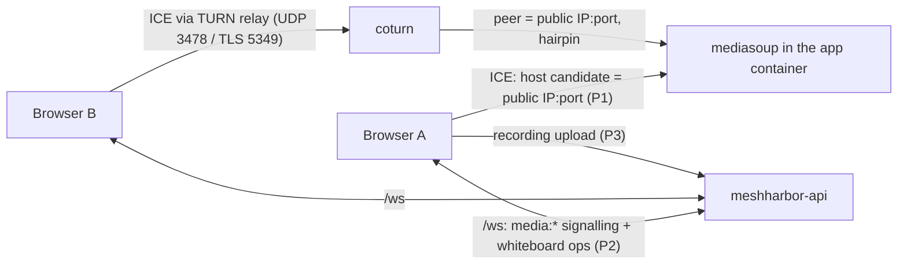

# FR-126: A meeting that works — audio, video, screen share, a whiteboard and a recording, from a browser

> **Status:** in progress — claimed 2026-11-22. Tracking issue: none (GitHub Issues are disabled on
> `jk-zhang-meta/MeshHarbor`); this spec and its registry row are the record.

## Goal

Anyone in an org opens a room in the browser, starts or joins a meeting, and the others **see and
hear** them. Nothing is installed. During the meeting they can share a screen, draw together on a
whiteboard, and record it. The bar is a meeting product people already use daily (Tencent Meeting,
Google Meet), not "the join button works".

Operator, 2026-11-22. Asked whether MeshHarbor has meetings, then "它继承的会议 是基于浏览器的 能画板
分享屏幕？". Then, after a survey of open-source meeting software, "行 开始做吧" on the plan:
1. fix the deployment so media flows;
2. add a whiteboard (Excalidraw);
3. add recording.

## Field evidence (2026-11-22, server 0.4.206)

| # | Fact | Where |
|---|---|---|
| E1 | The conference module is mounted and the UI shows it. Rooms with media get the video icon, and the dashboard has a meeting card. `/api/capabilities` lists `conference`. | `ui/src/components/layout/AppLayout.vue:291`, `ui/src/views/dashboard/TenantDashboard.vue:258` |
| E2 | It has never been used. `call_sessions`, `recordings` and every `stats_call*` collection hold 0 documents. | production Mongo, read-only query |
| E3 | mediasoup announces a **loopback** address. `MESHHARBOR__MEDIASOUP__ANNOUNCED_IP` is `127.x`, which is the built-in default. Every ICE candidate a browser receives is therefore unreachable from any other machine. | `crates/config/src/settings.rs:1794`; `crates/modules/conference/src/media/room_manager.rs:756-786` |
| E4 | The RTC port range is not published. The app container publishes only `127.0.0.1:18081->80/tcp`. `rtc_min_port..rtc_max_port` (40000–40031 on this host) is reachable only inside the compose network. | `docker inspect` of the app container |
| E5 | TURN cannot rescue it. The coturn relay refuses private and loopback peers (`denied-peer-ip=127.0.0.0-127.255.255.255` …), so a relayed candidate pair toward the announced `127.x` is refused too. Refusing those peers is correct for a public TURN server and stays. | the relay's `base.conf` |
| E6 | So the result is signalling that works and media that never flows. `connect_transport` records only the client's DTLS parameters. The one tell is the 15 s `media transport has no DTLS` warning. | `room_manager.rs:305-339` |
| E7 | Every org is on `free`, and this server sells plans (`plans_sold` = `saas` compiled and mounted), so the free 60-minute meeting cap is live here. The org's enforcement mode never softens it. On a private install that sells nothing, every meeting would end at 60:00. | `crates/api/src/state.rs:310`; `crates/modules/conference/src/meeting_cap.rs:100-105, 297-307` |
| E8 | Screen share exists (`getDisplayMedia`). | `ui/src/stores/conference.ts:490` |
| E9 | There is no whiteboard: no whiteboard, canvas-drawing or collaboration code anywhere in `ui/src` or `crates/modules/conference`. | repo search |
| E10 | Recording is a stub. `POST …/recordings` writes a row with `size: 0` and an empty URL and accepts no bytes. No UI calls it. | `crates/modules/conference/src/recording.rs:58-108` |
| E11 | The existing two-party e2e passes without media. It counts tiles and swallows the failure ("the join flow itself completing without errors is the main assertion"). | `ui/e2e/conference-multi.spec.ts` |
| E12 | `media:join` checked no room membership: a signed-in user of any org who knew a room id got transports and could consume the call; `media:play_audio` needed no join at all. Harmless while no meeting carried media, live the moment P1 made them carry it. Fixed and released first (0.4.207). | `crates/modules/conference/src/ws_media.rs` (before `fd40a7086`, `9c16c798a`) |

## Key design

### P1: media reaches the SFU

- **Deployment** (this host; the k8s layout already announces per-node public IPs through
  `announced_ip_map`, `settings.rs:1493`):
  - announce the host's public IPv4;
  - publish the RTC range for UDP **and** TCP on that address (TCP is mediasoup's second listen
    info, `room_manager.rs:768-780`, for networks that drop UDP);
  - keep TURN as the fallback for symmetric-NAT and UDP-blocked browsers. Its relay reaches the
    published port by hairpin, because a public peer is not refused.
- **Meeting cap:** set `meetings.free_cap = false` on this private install (E7). The code default
  stays on for a server that sells plans.
- **Code:**
  - At boot the SFU warns when its announced address is loopback, private or unspecified: "remote
    browsers will connect and get no audio or video".
  - The field e2e asserts **frames**, not tiles: the remote `<video>` has `videoWidth > 0` and a
    rising `getVideoPlaybackQuality().totalVideoFrames`, on both sides. It runs once direct and once
    with `iceTransportPolicy: relay`.

### P2: a shared whiteboard

- **Engine:** [Excalidraw](https://github.com/excalidraw/excalidraw) (MIT). tldraw is excluded: its
  current license needs a license key and a commercial license.
- **Loading:** Excalidraw is React. It mounts in a lazily loaded island inside the Vue meeting view,
  so React loads only when someone opens the board.
- **Sync:** one board per meeting, synced over the existing `/ws` as element deltas. Excalidraw's own
  per-element `version` and `versionNonce` reconcile concurrent edits. The server relays only to
  members of the room and keeps the latest scene, so a late joiner gets the board as it is.
- **Saving:** the board is kept with the room (`meeting_whiteboards`, written every 2 s while drawn), so the next meeting in the room opens it as it was. Excalidraw's own menu exports it as an image or a `.excalidraw` file.
- **Kill switch:** `meetings.whiteboard = false` hides the button and refuses the ops.

### P3: recording

- **Where it records:** in the browser of the person who starts it. A canvas composes the tiles and
  any screen share, WebAudio mixes every audio track, and `MediaRecorder` writes WebM.
- **Who sees it:** everyone in the meeting sees a recording indicator for as long as it runs.
- **Where it goes:** the file is uploaded into the room's files when it stops, and the `recordings`
  row (E10) gets its real size, duration and storage key.
- **Kill switch:** the existing plan feature `recordings` (`recording.rs` `require_feature`) plus
  `meetings.recording = false`.
- **Not in this phase:** server-side recording (mediasoup `PlainTransport` into ffmpeg), which needs
  no recording browser to stay open.

## Phases

| Phase | What | Kill switch | Status |
|---|---|---|---|
| P1 | Media path on the production host, plus the boot warning and the frames e2e | revert the compose file; `MESHHARBOR__MEDIASOUP__ANNOUNCED_IP` | config applied 2026-11-22; boot warning on master, not yet released; the TURN relay leg is open (field log) |
| P2 | Whiteboard (Excalidraw), synced and kept with the room | `meetings.whiteboard = false` | built; e2e passes on the production copy |
| P3 | Browser-side meeting recording into the room's files | plan feature `recordings`; `meetings.recording = false` | built |
| P4 | Docs: `docs/real-time.md` meeting section (mermaid, tables), a `docs/README.md` index row | — | written |

## Acceptance criteria

- [ ] **AC1.** Two browsers on different networks, one of them in mainland China if available, see
  and hear each other in a production meeting. The frames e2e passes direct and relay-only, and it
  is shown to FAIL on the current deploy first.
- [ ] **AC2.** Screen share reaches the other side as frames.
- [ ] **AC3.** A meeting on this private install runs past 60 minutes without being ended.
- [ ] **AC4.** Two people draw on the whiteboard at the same time and each sees the other's strokes
  in under a second. A third person who joins late sees the whole board. The board is kept with the
  room (the next meeting opens it) and exports from Excalidraw's menu. *(Changed from "in the room's
  files" while building P2: a kept board is what a meeting product does; an export is one click.)*
- [ ] **AC5.** A recording started in a meeting is in the room's files when it stops, plays back
  with every participant's video and audio, and every participant saw the indicator while it ran.
- [ ] **AC6.** The SFU logs the loopback/private-announce warning at boot on a misconfigured
  server, and does not log it on production after P1.
- [ ] **AC7.** Docs: the meeting section in `docs/real-time.md` (mermaid diagram, tables, `file:line`
  anchors) and a row in `docs/README.md`'s index, updated before close.

## Open decisions

- **Server-side recording**, for a meeting nobody records from a browser. Out of P3; it needs
  ffmpeg on the server.
- **Mobile apps.** Out of scope: the product is browser-first.
- **Mainland reach.** The SFU is in Hong Kong. If CN browsers see poor media, a mainland SFU node is
  a separate FR.

## Out of scope

Phone dial-in (SIP), live transcription and AI minutes, breakout rooms, waiting rooms, E2EE for
meetings.

## Field log

| When (UTC) | What | Result |
|---|---|---|
| 2026-11-22 | E1–E11 gathered on server 0.4.206 | the meeting has never carried media on this host |
| 2026-11-22 14:40 | `conference-media.spec.ts` against a copy of production on the same host (same image, own Mongo/Redis/JWT, open registration, reached by SSH tunnel), media config as production: announce `127.x`, RTC range unpublished | **FAIL**: 0 frames and 0 audio bytes on both sides; the server logs `media transport has no DTLS 15s` for all 4 transports |
| 2026-11-22 14:44 | same, P1 config: announce the public IPv4, RTC range published UDP+TCP | **PASS** direct: 48 / 53 frames decoded, audio both ways, `host/udp` pairs. **PASS** TCP-only (server UDP candidates dropped): 40 / 44 frames, `host/tcp` pairs |
| 2026-11-22 14:47 | relay-only (`iceTransportPolicy: relay`) | **FAIL**, two causes. (1) The test network cannot reach TURN's TLS port 5349, while 443 works and another network reaches 5349 in 0.16 s, so a network that blocks 5349 has no relay. (2) Through a forward to 5349 the allocation works, but the relay cannot reach the SFU: the relay container sits on `docker0` and the app on its compose bridge, and Docker's `DOCKER-ISOLATION-STAGE-2 -o br-… -j DROP` drops the hairpin to the published port. Fixing it means changing the TURN container's networking, which also serves fleet remote control, so it is left for the operator. |
| 2026-11-22 14:51 | P1 applied to production (override on the live compose file, app recreated in 20 s, previous file kept) | healthy; 64 RTC ports published; 0 panics or errors; 24 / 26 devices seen in 5 min. Production itself needs owner approval for new accounts, so the two-browser run there is pending a real meeting. |
| 2026-11-22 15:32 | server 0.4.207 (E12 fixes, boot warning) deployed | healthy; P1 config kept through the cutover; the boot warning absent on production |
| 2026-11-23 | `conference-whiteboard.spec.ts` on the production copy running the P2 build | **PASS**: a rectangle appears on the other board 148 / 149 ms after the stroke begins (SFU and board in Hong Kong, browsers on another network); a late joiner opens the board with it |
| 2026-11-23 00:16 | `conference-recording.spec.ts` on the production copy running the P3 build | **PASS**: the other participant saw the indicator during the recording and not after; `… part 1.webm` (574 KB, `video/webm`) in the room's files; `ffprobe`: VP9 1280x720, 195 frames over 8.1 s (24 fps), Opus with sound (mean −17.9 dB, the fake microphone's tone); a frame shows both cameras, labelled. Gap: MediaRecorder WebM carries no duration in its header, so players seek poorly |
