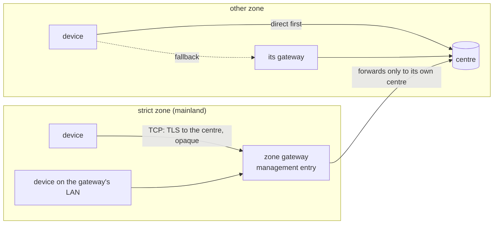
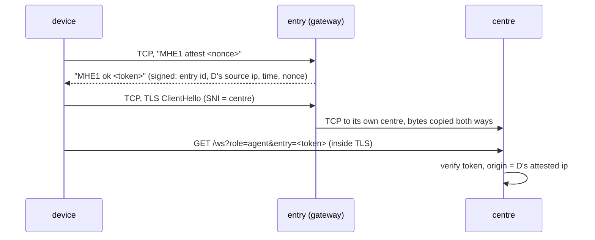

# FR-128: The centre is a zone of its own — a device reaches it through its zone's entry

> **Status:** in progress — claimed 2026-11-23. Tracking issue: none (GitHub Issues are disabled on
> `jk-zhang-meta/MeshHarbor`); this spec and its registry row are the record.

## Goal

Today every enrolled device must reach the centre **directly** over TCP 443. Management traffic is
exempt from the zone rules ([business isolation](../business-isolation.md), "Management is exempt"),
so the zone model routes every connection except the one that keeps a device on the fleet. That has
two costs:

1. **One blocked path takes a device off the fleet.** On 2026-11-23 three mainland lab servers on
   one subnet lost every route to the centre's address at about 01:04Z (ICMP and TCP 80/443 silent).
   The rest of the internet, the lab's other subnet and a mainland relay stayed reachable. The
   centre reaped their sockets 104 s later, and they stayed offline, although their daemons ran and
   still held direct mesh paths (RTT ≤ 1 ms) to a peer on the other subnet.
2. **A strict zone's devices hold a direct cross-border connection** to the centre: the one
   connection the zone model never routes.

The centre becomes a zone of its own. A device whose zone may not reach the centre directly (the
FR-124 verdict) reaches it **through one of its zone's gateways**, which forwards the management
connection to the centre. Every other device still dials the centre first and falls back to its
zone's gateways when that fails. The device keeps end-to-end TLS with the centre: a gateway sees
only ciphertext and forwards only to the centre.

## Key design

### Who is an entry

- A zone's **entries are its approved gateways** (`zone.gateway_relay_ids`, read in
  `crates/modules/network/src/network_zones.rs:161`) that run a management entry. A device runs
  one when it has the device-owned key `management_entry_port` set (default `0` = off). The key is
  absent from `DesiredConfig`, and it is refused under `protected` (FR-127). So two parties
  agree: the device's owner opens the port, and the org admin made the device a gateway.
- An entry's dialable addresses are the gateway's public addresses, the same candidates
  `relay_endpoints` uses for the relay port (`crates/modules/network/src/org_relay.rs:2332`), each
  paired with the entry port, plus the IPs of the admin's static endpoints. They are public
  literals only (the same SSRF rule), because a server-pushed dial target is a port scanner run by
  every device in the zone.
- A device-owned `management_entries` list (`ip:port`, any address, including a LAN peer) is set
  by the device's owner. It is tried before the pushed entries.

### What a device may do

- **Direct is allowed** exactly when FR-124 lets the device's zone use the centre
  (`zone_central_relay_ok`, `network_zones.rs:178`). A `RouterOnly` zone whose infrastructure
  countries do not hold the centre gets no direct path. Every other zone, an org with no zones, and
  a device with no resolved zone keep direct first.
- The centre pushes `rc:agent.management_path { direct, entries }` after hello, and again when the
  device's verdict or entry list changes. The device persists it next to its config: it is state,
  not configuration.
- **The device is never stranded.** If a device whose zone forbids direct has had every entry fail
  for a whole round, it dials the centre directly as a last resort and says so: the log, and its
  heartbeat's `management_path` field. Business isolation requires a mainland device to stay
  manageable. The fallback is counted and visible.

### The device's path ladder

1. The path that last worked.
2. Then, in order: direct (if allowed), local entries, pushed entries.
3. A candidate fails on TCP connect, TLS or the WebSocket handshake, within 15 s.
4. On an entry while direct is allowed, the device probes the centre directly every 10 min and
   reconnects direct when it answers. It never ratchets.

HTTP requests to the centre (renew, update check and download, crash upload, service RPC) take
the control socket's current path. The HTTP client resolves the centre's host to the entry
address; SNI and the certificate check are unchanged.

### The entry forwarder

- It listens on `0.0.0.0:<port>` and `[::]:<port>`. Each connection is one of two kinds:
  - It starts with `MHE1 `: an attestation request. The entry answers one line and closes.
  - Anything else is forwarded raw to the host and port of the entry's own `server_url`, resolved
    by the entry.
- The destination never comes from a message.
- Limits: 1024 concurrent connections, 32 per source address, a 10 s upstream connect, and 180 s
  idle (the control socket pings every 25 s).

### A zone through an entry

The centre sees the entry's address. Left alone, a device would take the entry's zone. An entry
must not lend its zone, so:

- **Attestation.** The token's payload is `{e: entry id, ip: source ip as the entry saw it, t: unix
  secs, n: nonce}`, signed with HMAC-SHA256 under the entry's key. The key is
  `HMAC(server secret, "fr128-entry-v1" ‖ entry id ‖ token generation)`. It is sent to the entry in
  `rc:agent.management_entry { key }`, and only while the entry is an approved gateway with a port.
- **The check at upgrade.** The device sends the token as `entry=` on `/ws?role=agent`. The centre
  accepts it only when all of these hold:
  1. the HMAC verifies;
  2. `|now − t| ≤ 120 s`;
  3. the entry is a live agent of the **same tenant**, currently an entry;
  4. the connection's own client address (the trusted chain) is the entry's last observed public
     address.

  Then the connection's origin is the attested address (a new `ConnectionOriginSource::
  ManagementEntry`, `crates/core/src/client_ip.rs:111`). Zone, GeoIP and `public_ip` read it as if
  the device had dialed directly.
- **A connection from a current entry's address with no valid token gets no client address**, so
  its zone is unresolved. A pin (`app.business_zone_pins`) still applies.
- An entry is trusted with its key: a gateway already relays its zone's traffic. A compromised
  entry could attest a wrong address for devices that come through it. It cannot read or forge
  their TLS.

### Kill switches

| Where | Switch | Effect |
|---|---|---|
| device | `MESHHARBORD_MANAGEMENT_ENTRIES=0` | direct only, today's behaviour |
| entry | `management_entry_port = 0` | no listener, no key |
| centre | `app.management_entries = false` | pushes no path (devices keep direct) and ignores tokens |

## Phases

| Phase | What | Kill switch | Status |
|---|---|---|---|
| P1 | entry forwarder and attestation, the device's path ladder (WebSocket and HTTP), the centre's push and token check, zone through an entry | all three above | in progress |
| P2 | the zone page shows each zone's entries and every device's current path; `mh status` shows it | — | open |
| P3 | install and sign-in carry the org's entry list, so a fresh install in a strict zone never dials the centre | — | open |
| P4 | browser access (web console, remote-desktop viewer) through a zone's entry | — | open |
| P5 | an entry caches release assets, so updates do not cross the line once per device | — | open |

## Acceptance criteria

- [ ] **AC1 (field).** A device whose direct path to the centre is blocked comes online through its
  zone's entry, and its zone stays the one its own address gives. Shown failing first.
- [ ] **AC2 (field).** While an entry works, a device in a strict zone whose countries exclude the
  centre has no direct TCP connection to the centre.
- [ ] **AC3.** None of these moves a zone (tests): a token from another tenant's entry, an expired
  token, a forged token, a token presented from an address that is not the entry's. A current
  entry's address with no token gets no zone.
- [ ] **AC4.** Each kill switch restores direct connection within one reconnect.
- [ ] **AC5 (docs).** [Business isolation](../business-isolation.md) gains "Management through an
  entry" (diagrams, anchors), and the docs index row in [docs/README.md](../README.md) names it.

## Open decisions

- **Last-resort direct for a strict zone** is on: it keeps a device manageable when its zone's
  entries are all down. A per-zone "never direct" setting can follow.
- Whether entries also carry tunnel clients and browsers (P4).

## Out of scope

- A second centre, or failover of the centre itself.
- Moving management onto the overlay. The control socket deliberately does not ride the mesh: the
  diagnostics it carries are needed most when the mesh is broken ([fleet RPC](../fleet-rpc.md)).

## Field log

| When (UTC) | What |
|---|---|
| 2026-11-23 ~01:04 | Red, before any change. Three lab servers on one subnet go silent on the control socket together; the centre reaps them at 01:05:41 (`receive-liveness deadline exceeded`, 104–108 s). From one of them: the centre's address answers no ICMP or TCP 80/443, while public sites, a mainland relay (TCP 22 open; other ports answer RST, so reachable) and a peer on the lab's other subnet all answer. That peer reaches the centre normally. The daemons keep running, with direct mesh paths to that peer. |
