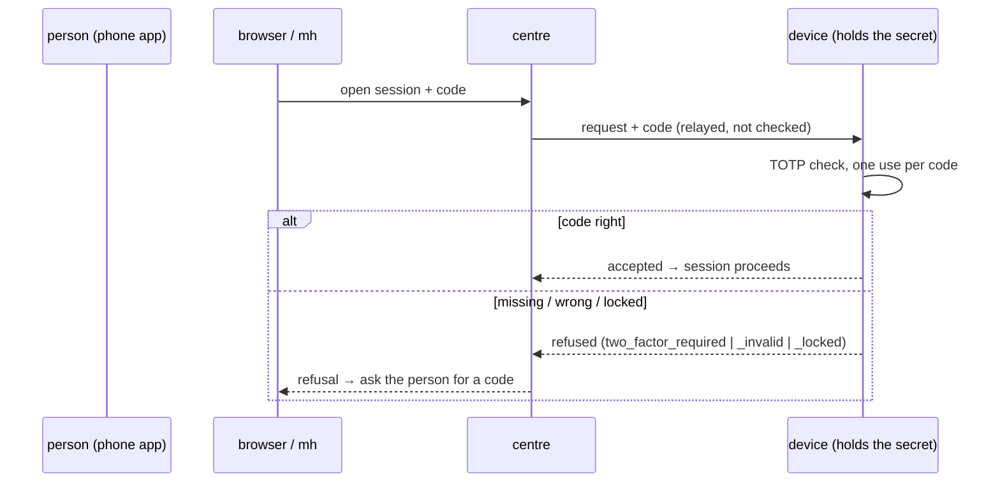

# FR-129: A device that asks for a code — two-factor (TOTP) on every way in

> **Status:** in progress — claimed 2026-11-23. Tracking issue: none (GitHub Issues are disabled on
> `jk-zhang-meta/MeshHarbor`); this spec and its registry row are the record. Supersedes the
> multi-switch hardening plan behind FR-127 as the user's chosen protection for a high-value host.

## Goal

The owner of a high-value machine (a GPU server) wants to stop malware on any other enrolled
machine from getting into it. Today, a person who holds a signed-in admin session can open every
way into a device: the browser session's token lives for seven days and cannot be revoked
(`docs/security-baseline.md` §1), so malware on any machine where an admin once signed in can
call the API as that admin.

The user's design (2026-11-23): a device can have **two-factor** switched on, from the central admin
page only. A device with it on asks for a **6-digit code from an authenticator app** (Microsoft
Authenticator or Google Authenticator: standard TOTP) on **every** connection. Off by default on
every device.

The property that makes it worth having: **the device keeps the secret and checks the code
itself.** A stolen admin session holds no secret and cannot compute a code, so it can neither get
in nor switch two-factor off. A compromised centre is limited to misusing a code it saw a person
send, once, within its minute ([two-factor](../two-factor.md), "What a compromised centre can
still do").

## Key design

### The device owns the secret

- `crates/agent-core/src/two_factor.rs` keeps `two-factor.json` beside the daemon's config file
  (owner-only permissions): the secret (20 random bytes), the last accepted time step, and the
  SHA-256 of each unused recovery code. It is not part of `AgentConfig`: never in
  `DesiredConfig`, `mh config`, a config report or a log line.
- A code is RFC 6238 TOTP (HMAC-SHA1, 30 s, 6 digits), accepted for the current step ±1. **A code is
  used once**: a step at or before the last accepted one is refused, so a code a compromised centre
  saw on its way through cannot be replayed. Five wrong codes lock checking for 1 min, doubling to
  15 min.
- Ten one-time **recovery codes** (`xxxx-xxxx`) stand in for a lost phone.
- Local break-glass: `meshharbord two-factor reset`, as the user the daemon runs as (root on a
  system install). Someone who is already root on the device is past any gate this FR adds.

### Turning it on and off (the admin page)

- `POST /api/tenant/{tid}/agent/{aid}/two-factor` with `op`:
  - `begin` → the device makes a pending secret (10 min) and answers with it and the `otpauth://`
    URI. The page shows the app choice (Microsoft / Google: the same QR code, different
    instructions), the QR code, and the key in groups of four with a copy button.
  - `confirm {code, setup_id}` → the device checks the code against the pending secret that
    `begin` answered (`setup_id` binds the two), switches on, and answers with the recovery
    codes, shown once.
  - `disable {code}` → the device checks a code or a recovery code, and switches off.
- Relayed as `rc:agent.two_factor` / `rc:agent.two_factor_result` over the control socket, awaited
  like exec (`crates/modules/fleet/src/hub.rs:5091`). The centre stores no secret and no code.
- **Primary org only** (the device refuses a secondary org: two-factor is machine-wide).
- `begin` on a device that already has it is refused: replacing the secret needs `disable` first,
  which needs a code. So a stolen admin session can only switch it on where it was off (where it
  could already get in), never take it over.
- The device reports `two_factor: true` in its hello caps; the admin page and the viewers read
  that.

### Every way in

| Way in | Agent decision (today) | On a two-factor device |
|---|---|---|
| Remote desktop (`rc:request`) | `agents/meshharbord/src/signaling.rs:4035`, consent at `:4642` | code required, checked before consent; refusal `Consent{granted:false, reason}` |
| `mh ssh` / `scp` / `sftp` (`rc:ssh.grant`) | `signaling.rs:6264` | code required; refusal in `SshGrantAck` |
| `mh exec` / web console (`rc:rpc.exec`) | `signaling.rs:5977` | code required; refusal in `RpcResult.error` |
| Share links (desktop `shared_lease`, `rc:share.ssh.*`) | `signaling.rs:4064`, `:3989` | refused: nobody with the phone is asked |
| External access login (FR-52, `rc:extauth.*`) | `extauth.rs:340` | refused |
| Remote configuration push (`rc:agent.config`) | `signaling.rs:5894` | refused: a pushed key must not weaken the device |
| Hive start | `hive/supervisor.rs:1847` | refused |
| Tunnel forwards (`rc:tunnel.tcp/udp.forward`) | `tunnel/acceptor.rs:49`, `:318` | only to the device's own `forward_acl` allowlist (empty = none), as FR-127 |

The code travels in a new optional `two_factor_code` on the controller's request
(`rc:session.request`, `rc:ssh.request`, `rc:rpc.request`, the exec and ssh HTTP routes) and on the
frame to the device. Every new field is optional, so an older peer ignores it.

### Kill switches

| Switch | Effect |
|---|---|
| Per device (default **off**) | Nothing changes on a device until an admin turns it on for that device |
| Centre `app.device_two_factor = false` | The route refuses `begin`/`confirm` (403). It cannot turn off a device that has it on (by design): `disable` still reaches the device |
| Device `meshharbord two-factor reset` (local) | Switches it off on that device |

## Phases

| Phase | What | Kill switch | Status |
|---|---|---|---|
| P1 | device secret + check, the three code-carrying ways in, the closed ways in, the admin page enable/disable dialog, code prompts in the viewer, web console and `mh` | per device; centre switch | built, not released |
| P2 | the admin's own sign-in: TOTP at login and for sensitive actions (exec/ssh policy, device removal) | — | open |
| P3 | a two-factor device takes overlay traffic only to ports it lists (raw mesh packets carry no code) | — | open |
| P4 | the centre host's own SSH asks for a code (an operation on a shared host, separate approval) | — | open |

## Acceptance criteria

- [ ] **AC1 (field).** On a test device: switch on from the admin page (QR + key, both apps' text);
  remote desktop, `mh ssh` and `mh exec` each refused without a code, refused with a wrong or reused
  code, accepted with a fresh one. Shown failing first (before switching on, they pass with no
  code).
- [x] **AC2.** A stolen admin session cannot switch it off or replace the secret: `disable` with no
  or a wrong code is refused; `begin` on an enabled device is refused (tests:
  `two_factor::tests::it_cannot_be_replaced_or_switched_off_without_a_code`,
  `two_factor_tests`).
- [ ] **AC3.** Share links, external access, remote configuration and hive are refused on a
  two-factor device; forwards follow the device's own allowlist (tests).
- [ ] **AC4.** A device with it off behaves exactly as before (the existing suites pass; no code
  is asked anywhere).
- [x] **AC5 (docs).** `docs/two-factor.md` (diagrams, anchors) and a row in
  [docs/README.md](../README.md).

## Open decisions

- Every connection asks for a code (the user's choice). A "trust this controller for N hours"
  option can follow if it proves tiresome.
- What the code does NOT cover: raw overlay traffic to the device's own services (P3).

## Out of scope

- Push approval, SMS, hardware keys (WebAuthn).
- Storing the secret on the centre.

## Field log

| When (UTC) | What |
|---|---|
| 2026-11-23 | P1 built (not released). Local: the device's checks (`two_factor` tests: RFC 6238 vectors, one use per code, lock doubling and restart persistence, the 100-code cap, recovery past a lock, no replace or switch-off without a code, `confirm` bound to its `begin`), fleet 275, wire 503, localapi 90, meshharbord 2027, integration (`two_factor_tests`, remote control, SSH, exec, external access, shares, composition) all pass; UI build passes. AC1 (field) waits for the release. |
| 2026-11-23 10:30–10:56 | 0.4.212 released: the server (8e37621, with the admin page's dialog) cut over at 10:3x; the Linux agent (7835a92) published at 10:45, the gateway first, then every online Linux device. The release build was the first to compile the hive's SSH client (`ssh-server` only) and found the new field missing there: fixed in 7835a92 before anything shipped. With two-factor off, `mh exec` across the fleet on 0.4.212 runs with no code, as before. |
| 2026-11-23 10:38–10:41 | AC1 on a throwaway device (a separate user in its own network namespace on a lab server, enrolled ephemeral; exec and SSH policy on). **Before** (two-factor off): exec ran with no code (exit 0); the SSH grant answered an address. Switched on through the route: `begin` answered the `otpauth://` URI and a 32-character key. The first `confirm` was refused: the test's own code was a step old (the device's clock runs about 4 s ahead, and the script picked the previous step at a boundary); the second passed, with 10 recovery codes, `two-factor.json` at 0600, and `begin` again refused (`already_on`). **After**, exec and SSH each: no code → `two_factor_required`; a wrong code → `two_factor_invalid`; a fresh code → accepted (exit 0 / an address); the same code again → `two_factor_invalid`. `disable` with no code → 422; with a wrong code → `two_factor_invalid`. Remote desktop not yet run: the organization's plan runs one remote session at a time, and a person's session held it. |
