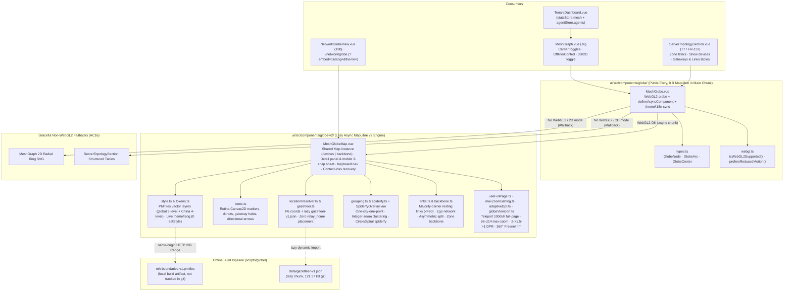

# FR-136: 3D interactive mesh globe and shared globe architecture

> **Status:** implemented (MapLibre GL JS v6 + self-hosted PMTiles v2 rebuild P0–P6 complete;
> retired Three.js / `world-atlas` / `?globe=legacy` / `globe-proto` removed in P5; optional
> real-phone hardware G1/G2 spot-check remains owner-side). Tracking issue: none (GitHub Issues are
> disabled on this repository); this spec and its registry row are the record.

## Goal

Replace the dashboard's static radial ring mesh visualisation with an interactive, rotatable,
zoomable **3D WebGL2 globe** backed by a shared reusable globe module
(`ui/src/components/globe/` + `ui/src/components/globe-v2/`) that powers **both** the organization
overlay mesh dashboard (T6 / `MeshGraph.vue`), the dedicated full-page / desktop-companion embed
route (`NetworkGlobeView.vue`), and the live read-only zone backbone view (T7 / FR-137 /
`ServerTopologySection.vue`):

- **Smooth 3D interaction & zero idle frames**: MapLibre GL JS `6.19.0` native globe projection,
  north-up locked (`maxPitch: 0`, rotation disabled), zero auto-rotation, **0 rendered WebGL frames
  at rest**, adaptive monotonic DPR degradation (`2 → 1.5 → 1` when rolling 120 interactive frames
  exceed p95 > 24 ms), and zero motion under `prefers-reduced-motion: reduce`.
- **Zero third-party CDN at runtime**: all boundary vector tiles (`mh-boundaries-v1.pmtiles`, built
  locally via `scripts/globe/build-boundaries.sh` and excluded from git), lazy gazetteer
  (`gazetteer-v1.json`), and worker bundles (emitted as `.js` — 0 `.mjs` assets) are self-hosted
  same-origin; MapLibre style omits `glyphs` so CJK/Latin labels render with system fonts.
- **Global 3-level & China 4-level administrative boundaries**: Natural Earth 1:10m/50m de facto
  admin-0 lines (dashed disputed/LoC segments, neutral `Country/region` / `国家/地区` wording,
  TW/HK/MO overrides), global geoBoundaries CGAZ ADM1/ADM2 internal shared lines, plus
  full-resolution China 4-level boundaries (province / prefecture `admin2_pref` / district `admin2`
  + district labels `label_admin2`) with per-viewer max-zoom (`z6–z14`, default `z11`, persisted in
  `localStorage`).
- **One city = one point & no hairball**: zero geographic scatter — co-located devices share exact
  coordinates and expand in screen space via circle (`n = 2–8`) or Archimedean spiral (`n = 9–20`)
  spiderfy or a paginated list (`n > 20`, 50/page); peer links aggregate by display node (0
  intra-city lines, resting overview capped at 60 majority-carrier lines, full carrier-patterned ego
  network on hover/select, asymmetric midpoint split, and problem/RTT filters).
- **Honest location precision**: consumes P6 MMDB `lat`/`lon`/`accuracy_radius_km`/`geo_level`
  (with 67% confidence 64-gon accuracy circle at `z ≥ 3`), falling back to lazy gazetteer city →
  region (`≈`) → country (`≈`) → off-globe `Unknown location N` chip; `relay_home` is never used
  for placement.
- **Graceful WebGL2 fallback & zero main-bundle growth**: MapLibre + PMTiles + gazetteer load
  strictly through lazy async chunks (`defineAsyncComponent` + dynamic `import()`); when WebGL2 is
  unavailable (or when the user toggles `2D Ring`), `MeshGraph.vue` renders the preserved radial
  SVG ring and `ServerTopologySection.vue` renders its structured summary tables.

---

## Historical Stage 1: Late-2026 SOTA Survey & Top-2 SwiftShader Benchmark (Superseded by MapLibre Rebuild)

> **Historical record:** Stage 1 (initial T6 delivery) initially shipped a custom Three.js WebGL2
> globe (`three` + `world-atlas/countries-50m.json`) based on the SwiftShader benchmark below.
> During the T9 rebuild review, the owner fixed three-level global boundaries, one-city-one-point
> placement, constant screen-size markers, aggregated links, and zero idle frames — requirements
> that map onto a vector-tile map engine rather than continuous 300-arc software-rasterized
> animation. The SwiftShader benchmark is preserved here as engineering history; Three.js and
> `world-atlas` were retired in P5.

| Candidate | Late-2026 Version | License | Lazy Engine Size (gz) | 3D Elevated Arcs | Self-Hosted Basemap & Offline Fit | Zoom Range | Stage 1 Verdict → Final Outcome |
|---|---|---|---|---|---|---|---|
| **MapLibre GL JS** (native `projection: 'globe'`) | `6.19.0` | BSD-3-Clause | ~452–493 KB gz (main + worker + CSS; 0 B entry) | Surface lines (`Variant L` selected at G4; elevated custom layer dropped) | Native self-hosted PMTiles 4.5.0 vector tiles, LOD, collision, system CJK fonts | Planet (`z0.6`) → urban detail (`z6–z14` configurable) | Stage 1 Runner-up → **Final Production Engine (P0–P6)** |
| **Custom Three.js WebGL2** (`three` + `world-atlas`) | `0.187.0` | MIT | ~130 KB gz (+227 KB `countries-50m`) | Native 1-draw-call GLSL `ShaderMaterial` | Natural Earth 1:50m only; 3-level boundaries + label collision would require rewriting a tile engine | Planet → regional | Stage 1 Winner → **Retired & removed in P5** |
| **`globe.gl` / `three-globe`** | `2.46.2` / `2.45.x` | MIT | ~220–320 KB gz | TubeGeometry per arc | Default textures on external CDN (`unpkg`) | Planet → country/region | Rejected |
| **`deck.gl` v9** (`_GlobeView` / `MapLibreOverlay`) | `9.4.1` | MIT | ~300 KB gz standalone; ~750 KB interleaved | GPU `ArcLayer` | Depth-test issues in interleaved globe mode; worker defaults to unpkg | Planet → street | Rejected |
| **CesiumJS** | `1.147.0` | Apache-2.0 | 1.7–4+ MB gz | Native 3D polylines | Heavy offline setup (`CESIUM_BASE_URL`) | Orbital → centimetre | Rejected |

### Stage 1 SwiftShader Benchmark (Historical Baseline — 30 nodes, 300 continuously animated arcs)

Measured in headless Chromium 151 under software SwiftShader WebGL2 (zero GPU acceleration) at
desktop `1200×700` (1× CPU) and mobile `390×460` (4× CPU throttle). Because SwiftShader measures
CPU rasterization under continuous per-frame animation rather than zero-idle-frame aggregated
rendering on real GPUs, these numbers were not carried forward as MapLibre v2 performance proof:

| Metric | Retired Three.js `0.187.0` | MapLibre GL JS `6.19.0` (300 animated arcs, SwiftShader) |
|---|---|---|
| **Desktop rotating FPS (avg / p95)** | 44.5 FPS / 29.9 FPS | 12.2 FPS / 10.0 FPS |
| **Mobile 4× CPU-throttled FPS (avg / p95)** | 53.2 FPS / 30.0 FPS | 12.5 FPS / 10.0 FPS |
| **External CDN requests** | 0 | 0 |

---

## Backend Location Precision Audit (Updated Through P6 & FR-137)

No new MongoDB collection was added. P6 extended existing MMDB lookups to expose `lat`, `lon`,
`accuracy_radius_km`, and `geo_level` alongside country/region/city strings:

| Endpoint | Source Anchor | Location Fields Returned | Finest Precision | Notes |
|---|---|---|---|---|
| `GeoIp::lookup_location` | `crates/core/src/user_analytics.rs:111-124`, `289-340` | `country_code`, `country`, `region`, `city`, `lat`, `lon`, `accuracy_radius_km`, `geo_level` | **MMDB coordinates + 67% confidence radius (`coords`)**; falls back to `city` / `region` / `country`. | Returns empty when GeoIP MMDB is disabled or IP is non-public. |
| `GET /api/tenant/{tid}/stats/mesh` | `crates/api/src/routes/stats.rs:763-917` | `relay_home` on `nodes[]` & `agents[]`; `center: { id, name, country_code }` | **Relay region id only** (never used for globe placement). | Intentionally member-visible; carries no public IPs. |
| `GET /api/tenant/{tid}/agent` | `crates/modules/fleet/src/agent.rs:1005-1025`, `2097-2154` | `public_ip`, `country_code`, `country`, `region`, `city`, `lat`, `lon`, `accuracy_radius_km`, `geo_level`, `pinned_zone_id`, `effective_zone_id`, `effective_zone_name`, `relay_home` | **MMDB `lat`/`lon` + `accuracy_radius_km` + `geo_level`** (`coords` / `city` / `region` / `country`). | Already fetched on `TenantDashboard.vue` & `NetworkGlobeView.vue` when fleet access is granted; `public_ip` shown only when present. |
| `GET /api/tenant/{tid}/network-zones/backbone` | `crates/modules/network/src/routes/network_zones.rs:368-760` | Per-gateway `country_code`, `country`, `region`, `city`, `lat`, `lon`, `accuracy_radius_km`, `geo_level`, `zone_ids`, `is_centre`, `serving_relay`, `entry_listening`, `entry_port`, `entry_device_count` | **MMDB coords / city / region / country** (FR-137). | Powers `ServerTopologySection.vue` in read-only Zone Backbone mode. |

Client-side placement (`ui/src/components/globe-v2/locationResolver.ts:368`) resolves fields strictly
in S4/S7 precedence without fabricating coordinates or touching `relay_home`:
`explicit P6 lat/lon (coords + accuracy circle) → lazy P1 gazetteer city → built-in city → region centroid (≈) → country/region label point (≈) → off-globe unknown chip`.

---

## Final Shared Architecture (MapLibre GL JS 6.19 + Self-Hosted PMTiles 4.5)

---

## MapLibre Globe Rebuild Phases (P0–P6)

| Phase | Scope | Deliverables | Exit Gate / Kill Switch | Status |
|---|---|---|---|---|
| **P0 Prototype** | Hidden `/network/globe-proto` diagnostic route, initial P0 PMTiles (`admin-0/1` + CHN ADM2), Synthetic ×10 stress dataset, Variant L vs Variant A comparison, 10 s Perf HUD, and `.mjs` → `.js` worker asset emission fix. | `scripts/globe/build-boundaries.sh`, `SOURCES.lock`, `SHA256SUMS`, `globe-v2/` prototype, Perf HUD, `vite.config.ts` `.mjs` → `.js` rule | **G3** same-origin HTTP 206 + `.js` worker MIME verified; **G4** Variant L selected (Variant A dropped); headless `idleFramesAfter1s === 0` verified. **G1/G2** real-phone hardware manual spot-check remains owner-side optional. Route retired in P5. | implemented (Variant L selected; route retired in P5) |
| **P1 Data Pipeline** | Full global `mh-boundaries-v1.pmtiles` (`z0–z9`, global NE admin-0 + CGAZ ADM1/ADM2 + NE HK/MO patch + full-resolution China 4-level `admin2_pref`/`admin2` + `label_admin2`, 36.83 MB local artifact, not in git) and lazy `gazetteer-v1.json` (121.37 kB gz). | `scripts/globe/build-boundaries.sh`, `build-chn-admin.py`, `build-gazetteer.py`, `chn-district-exonyms.json`, `SOURCES.lock`, `SHA256SUMS`, `gazetteer.ts`, `gazetteer.spec.ts` | Gazetteer ≤ 150 KB gz (measured 121.37 kB gz); TW/HK/MO neutral naming tests pass; `.pmtiles` untracked in git | implemented |
| **P2 Devices Core** | Production `MeshGlobeMap.vue`, WCAG S2 tokens & live `applyThemeToMap`/`applyLangToMap` (0 `setStyle`), retina Canvas2D icons, one-city-one-point grouping (zero geo scatter), integer-zoom clustering, circle/spiral spiderfy, WCAG 1.4.13 hover card, desktop side panel & mobile 3-snap bottom sheet, `<Teleport>` `100dvh` full-page + Fullscreen API, per-viewer max-zoom (`z6–z14`, default `z11`), full-page `/network/globe` embed route (`T8b`). | `MeshGlobeMap.vue`, `style.ts`, `tokens.ts`, `icons.ts`, `grouping.ts`, `locationResolver.ts`, `spiderfy.ts`, `SpiderfyOverlay.vue`, `useFullPage.ts`, `maxZoomSetting.ts`, `globeViewport.ts`, `NetworkGlobeView.vue`, unit specs | `2D Ring` toggle & automatic WebGL2 `#fallback`; zero main-bundle growth | implemented |
| **P3 Links** | Display-node link aggregation (0 intra-city lines), resting overview capped at 60 majority-carrier lines + overflow count + mixed-carrier `◆` indicator, full carrier-patterned ego network on hover/select, asymmetric midpoint split, carrier/problems-only/RTT filters. | `links.ts`, `links.spec.ts`, `MeshGlobeMap.vue` link layers & detail breakdown | Carrier filters & 2D Ring fallback | implemented |
| **P4 Backbone View** | Wire `ServerTopologySection.vue` (FR-137) onto the shared MapLibre globe (`view-mode="backbone"`), sharing one Map instance with `devices \| backbone` switcher, zone palette + centre diamond + gateway halos + FR-134 management paths + directional 120 px arrows + optional 3 px Devices overlay (OFF by default). | `backbone.ts`, `backbone.spec.ts`, `zoneBackbone.ts`, `ServerTopologySection.vue`, `ServerTopologySection.spec.ts` | Non-WebGL2 `#fallback` + always-present responsive Gateways & Links tables | implemented |
| **P5 Polish & Cleanup** | Monotonic adaptive DPR degradation (`adaptiveDpr.ts`, `2 → 1.5 → 1`), keyboard arrow/focus-preview list navigator, reduced-motion & `webglcontextlost`/`restored` recovery; remove `three`, `@types/three`, `world-atlas`, `topojson-client`, `@types/topojson-client`, `d3-geo`, `@types/d3-geo`, `MeshGlobeCanvas.vue`, `earthTexture.ts`, `geoLayout.ts`, `GlobeDetailPanel.vue`, `?globe=legacy`, and `/network/globe-proto`; update docs. | `adaptiveDpr.ts`, `adaptiveDpr.spec.ts`, cleaned `MeshGlobe.vue`/`types.ts`/`router.ts`/`package.json`/`bun.lock`, updated `FR-136`, `docs/ui.md`, `docs/README.md` | Full Vitest + Vite build (`0 .mjs`, 0 legacy chunks) + `name-audit` / `anchor-range-audit` / `fr-registry-audit` | implemented |
| **P6 Backend Geo** | Expose MMDB `lat`, `lon`, `accuracy_radius_km`, `geo_level` on agent/device listings and render S7 67% confidence 64-gon accuracy circles (`z ≥ 3`) with honest precision text. | `crates/core/src/user_analytics.rs`, `crates/modules/fleet/src/agent.rs`, `crates/api/src/routes/device.rs`, `locationResolver.ts`, `MeshGlobeMap.vue` | Graceful fallback to city/region/country when coords absent | implemented |

---

## Rebuild Acceptance Criteria (S13)

- [x] **R-AC1 (One city = one point).** Co-located devices share identical coordinates (0 px scatter) at all zooms; legacy `geoLayout.ts` scatter removed in P5 (`grouping.spec.ts`, `locationResolver.spec.ts`).
- [x] **R-AC2 (Constant screen-size markers).** Retina Canvas2D symbol icons maintain constant CSS px sizes (`6 px` online / `7 px` stale & offline / `16·20·24 px` city donuts / `10·14 px` backbone gateways & centre) across zooms (`icons.ts`).
- [x] **R-AC3 (Hit targets).** Nearest-feature query box uses ±12 px (`24 px` fine pointer) and ±22 px (`44 px` coarse touch) via `hitHalfBoxPx` (`icons.ts`, `MeshGlobeMap.vue`).
- [x] **R-AC4 (Spiderfy & list thresholds).** `n = 2–8` circle, `n = 9–20` Archimedean spiral, `n > 20` paginated list (50/page); foot spacing ≥ 28 / 44 px; Esc / blank click / anchor click / zoom Δ > 0.3 / occlusion collapse triggers (`grouping.spec.ts`, `spiderfy.ts`, `SpiderfyOverlay.vue`).
- [x] **R-AC5 (Camera bounds).** Zoom `0.6` to per-viewer configurable max zoom (`z6–z14`, default `z11`, persisted in `localStorage` via `maxZoomSetting.ts` / `maxZoomSetting.spec.ts`), north-up locked (`maxPitch: 0`, `pitch: 0`, `bearing: 0`, rotation disabled).
- [x] **R-AC6 (Global 3-level & China 4-level boundaries).** Built via `scripts/globe/build-boundaries.sh` (`z0–z9`, global NE admin-0 with dashed disputed/LoC lines + global CGAZ ADM1/ADM2 + NE HK/MO patch + full-resolution China province / prefecture `admin2_pref` / district `admin2` + `label_admin2`).
- [x] **R-AC7 (Neutral naming & i18n parity).** Field reads `国家/地区` (`Country/region`); TW/HK/MO render as `台湾`/`香港`/`澳门` (`Taiwan`/`Hong Kong`/`Macau`) and are never labelled as countries (`gazetteer.spec.ts`, `tokens.spec.ts`); 100% `en`/`zh-CN` key parity verified in `MeshGlobe.spec.ts` and `i18n.spec.ts`.
- [x] **R-AC8 (Zero external requests).** Style omits `glyphs` (local system + CJK font stack); MapLibre worker emitted as `.js` same-origin (`0 .mjs` assets); PMTiles served same-origin (`/geo/mh-boundaries-v1.pmtiles`); lazy gazetteer bundled locally.
- [x] **R-AC9 (Links).** Zero intra-city lines; resting overview capped at 60 majority-carrier lines with overflow count and mixed `◆` badge; full carrier-patterned ego network, asymmetric midpoint split, and problem/RTT filters verified (`links.spec.ts`).
- [x] **R-AC10 (Live theme/lang & contrast).** `applyThemeToMap` and `applyLangToMap` mutate paint/layout/sky in place with 0 `setStyle()` reloads preserving camera & selection; all S2 tokens (including light `zone5` `#8A7A00`) verified ≥ 3:1 WCAG contrast (`tokens.spec.ts`).
- [ ] **R-AC11 (Full-page & Fullscreen — automated verified; physical iPhone Safari spot-check owner-side).** `<Teleport to="body">` fixed `100dvh` overlay, `?g_full=1` history Back/Esc/× exit with focus return, `#app` `inert`, progressive Fullscreen API, and `/network/globe?embed=1` verified in unit tests (`useFullPage.ts`, `NetworkGlobeView.spec.ts`); real physical iPhone Safari spot-check remains optional/owner-side.
- [ ] **R-AC12 (Mobile UX — implementation verified; physical phone touch spot-check owner-side).** 3-detent non-modal bottom sheet (`30%` / `60%` / `92%` dvh, min `160 px`) with camera bottom padding, collapsed mobile legend chip, and embedded `cooperativeGestures` implemented in `MeshGlobeMap.vue`; real physical phone touch check remains optional/owner-side.
- [ ] **R-AC13 (Performance budget & zero idle frames — bundle/DPR/idle automated; physical phone GPU G1/G2 owner-side).** 0 B main-entry growth (`index-*.js` unchanged at `161.72 kB` gz), lazy `MeshGlobeMap` + worker `~493 KiB` gz (≤ 520 KB gz), lazy `gazetteer-v1` `121.37 kB` gz (≤ 150 KB gz), 0 idle frames (zero auto-rotation; CSS-only selection pulse), and monotonic `2 → 1.5 → 1` adaptive DPR degradation (`adaptiveDpr.spec.ts`); real-phone GPU p95 (G1) and multi-device CJK glyph spot-check (G2) remain optional/owner-side on physical hardware.
- [x] **R-AC14 (Honest location precision).** P6 `coords` + 67% confidence accuracy circle (`z ≥ 3`), `≈` prefix on region/country precision, unlocated devices kept off-globe under `Unknown location N` / `位置未知 N`, and `relay_home` never used for placement (`locationResolver.spec.ts`, `grouping.spec.ts`).
- [x] **R-AC15 (Accessibility & reduced motion).** Keyboard canvas pan/zoom (`Arrows`, `+/-`), Esc dismissal chain, keyboard-navigable device/gateway list (`ArrowUp`/`ArrowDown`/`Home`/`End` + focus-hover sync), WCAG 1.4.13 hoverable hover card, and zero motion under `prefers-reduced-motion: reduce` (`MeshGlobeMap.vue`).
- [x] **R-AC16 (WebGL2 fallback).** Automatic fallback to the preserved 2D radial ring SVG in `MeshGraph.vue` (`MeshGlobe.spec.ts`) and structured tables in `ServerTopologySection.vue` (`ServerTopologySection.spec.ts`) whenever WebGL2 is unavailable or `forceFallback` is set.
- [x] **R-AC17 (Docs).** `docs/ui.md`, `docs/README.md`, `docs/fr/README.md`, and this spec updated with final MapLibre v2 architecture, verified `file:line` anchors (`anchor-range-audit.sh`: 0 faults), and honest verification records.

## Field-verification & Build Log

| When (UTC) | What | Result |
|---|---|---|
| 2026-11-24 | Stage 1 Top-2 headless Chromium SwiftShader benchmark (historical, 30 nodes / 300 animated arcs) | Retired Three.js `0.187.0` 44.5 / 53.2 FPS vs MapLibre `6.19.0` 12.2 / 12.5 FPS (SwiftShader CPU rasterization; superseded by MapLibre zero-idle-frame rebuild) |
| 2026-11-24 | P1 boundary & gazetteer pipeline (`scripts/globe/build-boundaries.sh`, `z0–z9`, global 3-level + full-res China 4-level) | `mh-boundaries-v1.pmtiles`: 36,830,069 B (local build artifact, SHA-256 recorded in `scripts/globe/SHA256SUMS`, untracked in git); `gazetteer-v1.json`: 398.09 KiB raw / 121.37 kB Vite gz |
| 2026-11-24 | P5 cleanup build & unit verification (`ui/`: `bun run build`, `bunx vitest run`) | Main entry `index-*.js` 453.59 kB raw / **161.72 kB gz** (0 B globe code); lazy `MeshGlobeMap-*.js` 1,247.45 kB raw / **350.30 kB gz** + `MeshGlobeMap-*.css` 13.45 kB gz + `maplibre-gl-worker-*.js` 550.75 kB raw / **153.71 KiB gz** (gzip -9); `gazetteer-v1-*.js` **121.37 kB gz**; **0 `.mjs` assets**; **0 `three` / `countries-50m` / `MeshGlobeCanvas` / `GlobeProtoView` chunks**; Vitest 217/218 files (3120/3121 tests, only the 1 pre-existing unrelated `DevicesGeoAndRelay` test failing) |
