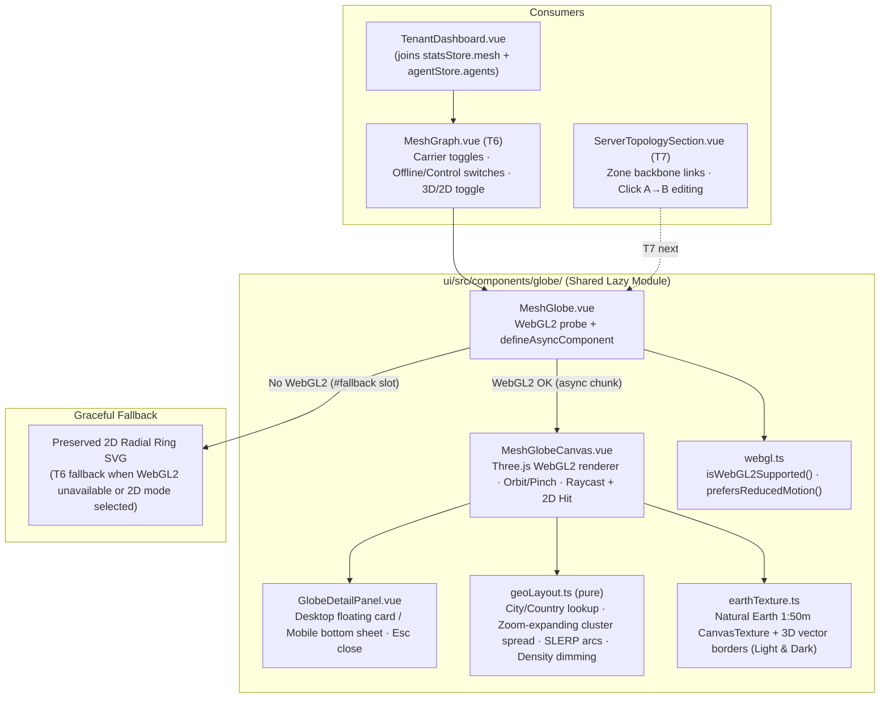

# FR-136: 3D interactive mesh globe and shared globe architecture

> **Status:** in progress — claimed 2026-11-24. Tracking issue: none (GitHub Issues are disabled on
> this repository); this spec and its registry row are the record.

## Goal

Replace the dashboard's static radial ring mesh visualisation with an interactive, rotatable,
zoomable **3D WebGL2 globe** backed by a shared reusable globe module (`ui/src/components/globe/`)
that powers **both** the organization overlay mesh dashboard (T6) and the upcoming zone/server
backbone topology view (T7):

- **Smooth 3D interaction**: drag/inertia rotation, wheel and mobile pinch-to-zoom, slow idle
  rotation that pauses immediately on user interaction and never runs under
  `prefers-reduced-motion: reduce`.
- **Zero third-party CDN at runtime**: every basemap geometry, font, and shader is self-hosted
  inside the SPA bundle / `ui/public/` (essential for mainland China and air-gapped self-hosted
  deployments). Proper Natural Earth public-domain attribution is displayed on the globe.
- **No hairball at fleet scale**: ~30 devices and ~300 great-circle peer arcs stay legible via
  density-scaled base opacity, single-draw-call animated GLSL signal pulses, hover/select highlight
  that dims unrelated arcs, asymmetric two-colour direction coding, stalled/blocked dashed styles,
  and deterministic zoom-expanding cluster spread for co-located devices.
- **Rich node and link inspection**: hover tooltip plus click/tap pinned detail card (floating card
  on desktop, bottom sheet on mobile `<600 px`, `Esc` to close) showing every field the server
  already provides — device status/last seen, OS/version, logical zone & role badges, finest known
  location, public IP *only* where the existing UI already renders it, FR-134 `management_path`
  readiness, relay home, connected peers with carrier/RTT, and per-direction link breakdown — with
  a direct action to open the device page.
- **Graceful WebGL2 fallback & zero main-bundle growth**: the 3D globe chunk is dynamically
  imported via `defineAsyncComponent`; when WebGL2 is unavailable (or when the user toggles `2D Ring`),
  `MeshGraph.vue` falls back seamlessly to the preserved radial SVG graph.

---

## Late-2026 SOTA Survey

Evaluated all five mainstream 3D web-globe architectures as of late 2026 against MeshHarbor's
constraints (zero external CDN, strict CSP in `files/security-headers.conf`, AGPL/MIT/BSD license
compatibility, ~30–100 nodes / ~300–1000 animated arcs, light & dark themes, and mobile
responsiveness):

| Candidate | Late-2026 Version | License | Lazy Engine Size (gz) | 3D Elevated Arcs | Self-Hosted Basemap & Offline Fit | Zoom Range | Verdict |
|---|---|---|---|---|---|---|---|
| **Custom Three.js WebGL2** (`three` + `world-atlas`) | `0.187.0` | MIT | **~130 KB gz** (0 workers, 0 CSS) | **Native 1-draw-call GLSL `ShaderMaterial`** (dual-colour, pulses, dash, hover dim) | **Excellent** — reuses `world-atlas` (`countries-50m.json`, Natural Earth 1:50m, Public Domain) already in `ui/package.json`; hybrid CanvasTexture + 3D vector coastline `LineSegments` | Full planet → crisp regional/city clusters | **Winner (Prototyped #1)** |
| **MapLibre GL JS** (native `projection: 'globe'`) | `6.19.0` | BSD-3-Clause | **~452 KB gz** (288 KB main + 155 KB worker + 10 KB CSS) | Flat surface lines only (3D arcs require custom WebGL or +300 KB `deck.gl`) | Good with self-hosted GeoJSON or PMTiles; v6 pure ESM requires explicit `setWorkerUrl` wiring; street-level planet PMTiles (GBs) are unusable in-repo and unneeded for city/country GeoIP | Planet → street level (when tiles hosted) | **Runner-up (Prototyped #2)** |
| **`globe.gl` / `three-globe`** | `2.46.2` / `2.45.x` | MIT | ~220–320 KB gz (Three.js + Kapsule + transitive deps) | Built-in TubeGeometry per arc (high draw-call count; CPU rebuilds on highlight/filter) | Default Earth textures point to external CDN (`unpkg`) unless replaced; harder to match flat light/dark MeshHarbor design tokens | Planet → country/region | Rejected — heavier & less controllable than direct Three.js |
| **`deck.gl` v9** (`_GlobeView` / `MapLibreOverlay`) | `9.4.1` | MIT | ~300 KB gz standalone; **~750 KB gz** interleaved with MapLibre | GPU `ArcLayer` / `TripsLayer` (requires `cullMode: 'none'` globe workaround) | Standalone `_GlobeView` remains experimental with no built-in atmosphere; interleaved mode doubles bundle & context complexity | Planet → street (with MapLibre) | Rejected — overkill for ≤1k arcs, 5× bundle cost |
| **CesiumJS** | `1.147.0` | Apache-2.0 | **2–4+ MB gz** even tree-shaken | Native 3D polyline/arc primitives | Heavy offline setup (`CESIUM_BASE_URL` workers, shaders, widgets, terrain/imagery) | Orbital → centimetre 3D Tiles | Rejected — disproportionate footprint & GC overhead |

---

## Top-2 Prototype Benchmark (Measured)

Both top candidates were built as production Vite ESM bundles with the **identical synthetic
workload** (**30 global mesh devices**, **300 animated peer-to-peer great-circle arcs** across all
five carrier classes, Natural Earth 1:50m `world-atlas/countries-50m.json`) and benchmarked in
isolated **headless Chromium 151** (SwiftShader WebGL2 software renderer — worst-case CPU-bound
baseline, zero GPU acceleration) at desktop `1200×700` (1× CPU) and mobile `390×460` under
**4× CPU throttling** (`Emulation.setCPUThrottlingRate(4)`):

| Metric | Candidate A: **Custom Three.js `0.187.0`** | Candidate B: **MapLibre GL JS `6.19.0`** | Delta |
|---|---|---|---|
| **Engine lazy payload (raw / gzip)** | **520.9 KB / 130.1 KB gz** | 1,638.9 KB / 452.0 KB gz (main + worker + CSS) | **3.47× smaller** |
| **Shared Natural Earth 1:50m data (`countries-50m`)** | 738.7 KB / 227.4 KB gz | 738.7 KB / 227.4 KB gz | Same |
| **Total lazy payload (raw / gzip)** | **1,264.1 KB / 360.1 KB gz** | 2,382.2 KB / 682.0 KB gz | **1.89× smaller** |
| **Desktop rotating FPS (avg / p95)** | **44.5 FPS** (22.5 ms) / **29.9 FPS** (33.4 ms) | 12.2 FPS (82.3 ms) / 10.0 FPS (100.0 ms) | **3.65× faster** |
| **Mobile 4× CPU-throttled FPS (avg / p95)** | **53.2 FPS** (18.8 ms) / **30.0 FPS** (33.3 ms) | 12.5 FPS (79.7 ms) / 10.0 FPS (100.0 ms) | **4.26× faster** |
| **Time to first frame (desktop / 4× mobile)** | **75 ms / 346 ms** | 478 ms / 775 ms | **6.4× / 2.2× faster** |
| **External CDN requests** | **0** | **0** | Tie |
| **Console / page errors** | **0** | **0** (after explicit `setWorkerUrl`) | Tie |

### Why Custom Three.js WebGL2 Won

1. **Performance**: Batching all 300 animated great-circle arcs into a **single `BufferGeometry` +
   GLSL `ShaderMaterial`** (1 draw call) and all nodes into an **`InstancedMesh`** (1 draw call)
   sustained **44.5–53.2 FPS even under software SwiftShader WebGL2 + 4× CPU throttling** (vs 12 FPS
   for MapLibre globe re-projection + worker messaging), translating to locked 60–120 FPS on real
   GPUs.
2. **Bundle & CSP simplicity**: Tree-shaken `three` adds **~130 KB gz** lazily with zero Web
   Workers and zero extra stylesheets, running cleanly under `files/security-headers.conf` CSP
   without worker-URL plumbing.
3. **True 3D network-topology aesthetics**: Supports elevated spherical-SLERP arcs with animated
   light pulses, per-half asymmetric carrier colouring, dashed stalled/blocked styles, and crisp
   two-layer Fresnel atmosphere tuned specifically to MeshHarbor's light ("Harbor Nautical Paper")
   and dark ("Harbor Night Chart") themes.
4. **Crisp zoom without texture blur**: Combining a baked CanvasTexture land-fill map with a
   single-draw-call **3D vector coastline/border `LineSegments`** overlay from the same
   `world-atlas/countries-50m.json` keeps borders sharp at regional/city zoom without needing a
   gigabyte street-tile PMTiles archive (which would exceed our backend's GeoIP precision anyway).

---

## Backend Location Precision Audit (No New Collection)

No new backend location collection was added. The finest location fields already returned by the
server are:

| Endpoint | Source Anchor | Location Fields Returned | Finest Precision | Notes |
|---|---|---|---|---|
| `GeoIp::lookup_location` | `crates/core/src/user_analytics.rs:108-114`, `254-310` | `country_code`, `country`, `region`, `city` | **City / Region / Country name** (localized `zh-CN` preferred, `en` fallback). **No `latitude`/`longitude` returned.** | Falls back to country-only on Country MMDBs; empty when GeoIP disabled. |
| `GET /api/tenant/{tid}/stats/mesh` | `crates/api/src/routes/stats.rs:763-917` | `relay_home` on `nodes[]` & `agents[]`; `center: { id, name }` | **Relay region id only** (no country/city/IP). | Intentionally member-visible; carries no public IPs. |
| `GET /api/tenant/{tid}/agent` | `crates/modules/fleet/src/agent.rs:998-1013`, `2020-2116` | `public_ip`, `country_code`, `country`, `region`, `city`, `pinned_zone_id`, `effective_zone_id`, `effective_zone_name`, `relay_home` | **City / Region / Country name + ISO-2** (no lat/lon). | Already fetched on `TenantDashboard.vue` when `showFleet` is true; `public_ip` is displayed ONLY when populated via this store. |
| `GET /api/tenant/{tid}/server-link` | `crates/modules/network/src/routes/server_link.rs:34-43` | `country` (ISO 3166-1 alpha-2), `zone` (`mainland` \| `non_mainland`) | **ISO-2 country code** (no lat/lon). | Used by T7 (`ServerTopologySection.vue`). |

Client-side placement (`ui/src/components/globe/geoLayout.ts`) maps these existing fields at the
finest available resolution without inventing data:
`explicit coords (future/T7) → city/region lookup (~170 major global & China cities/provinces) → ISO-2 country centroid (Natural Earth largest polygon) → relay_home PoP hint → deterministic unlocated staging arc` (honestly labelled "Location unknown" in the UI).

---

## Shared Architecture (T6 & T7)

---

## Phases

| Phase | What | Kill switch | Status |
|---|---|---|---|
| **P1 (T6)** | Late-2026 SOTA survey & Top-2 benchmark; shared `ui/src/components/globe/` Three.js WebGL2 module; `MeshGraph.vue` & `TenantDashboard.vue` integration with preserved 2D Ring fallback + `3D Globe / 2D Ring` toggle; rich node/link detail card & mobile bottom sheet; full `en` & `zh-CN` i18n | `2D Ring` view toggle in `MeshGraph.vue` / automatic WebGL2 fallback | implemented |
| **P2 (T7)** | Wire `ServerTopologySection.vue` onto `MeshGlobe.vue` for interactive 3D zone backbone editing | Existing 2D Natural Earth SVG fallback | planned (T7) |
| **P3 (docs)** | Update `docs/ui.md` and `docs/README.md` with shared globe architecture, anchors, and fallback rules | — | implemented |

---

## Acceptance Criteria

- [x] **AC1 (Survey & benchmark).** Late-2026 SOTA comparison table and headless Chromium benchmark
  (desktop + 4× CPU-throttled mobile FPS, raw/gzip chunk sizes) for the Top-2 prototypes recorded in
  this spec.
- [x] **AC2 (Shared globe module).** Reusable lazy-loaded `ui/src/components/globe/` renders
  smoothly with drag rotation, wheel/pinch zoom, auto-rotation that pauses on interaction and stops
  under `prefers-reduced-motion: reduce`, light & dark themes, elevated great-circle arcs with
  hover/select dimming, zoom-expanding cluster spread, and a distinct centre marker.
- [x] **AC3 (Node & link info UI).** Hover tooltip + click/tap pinned detail panel (floating desktop
  card / mobile `<600 px` bottom sheet, `Esc` closes, keyboard-reachable) showing all already-available
  device/link metadata, honest omission of absent fields, `public_ip` only where already shown,
  optional FR-134 `management_path` hook, peers list, and action emitting `select`.
- [x] **AC4 (Preserved MeshGraph features & WebGL fallback).** Carrier toggles with counts, offline
  devices toggle, control plane toggle, asymmetric two-colour edges, stalled/blocked styles, empty
  state, `select` event, and automatic SVG radial ring fallback when WebGL2 is unavailable.
- [x] **AC5 (Zero external CDN & zero main-bundle growth).** Verified via Playwright request
  interception (**0 external requests**, **0 console/page errors**) and `bun run build` before/after
  chunk measurements (entry `index.js` unchanged).
- [x] **AC6 (Full i18n & visual verification).** All strings in `MeshGraph.vue` and `globe/` exist
  in both `en.json` and `zh-CN.json` (100% key parity); visually verified at `1440×900` and
  `390×844` in light & dark themes and both locales.
- [x] **AC7 (docs).** `docs/ui.md` updated with globe architecture and `file:line` anchors, and
  linked from [docs/README.md](../README.md).

## Field-verification log

| When (UTC) | What | Result |
|---|---|---|
| 2026-11-24 | Top-2 headless Chromium prototype benchmark (30 nodes, 300 animated arcs) | Three.js `0.187.0` 44.5 FPS desktop / 53.2 FPS 4× mobile (130.1 KB gz engine) vs MapLibre `6.19.0` 12.2 / 12.5 FPS (452.0 KB gz engine); 0 external requests |
