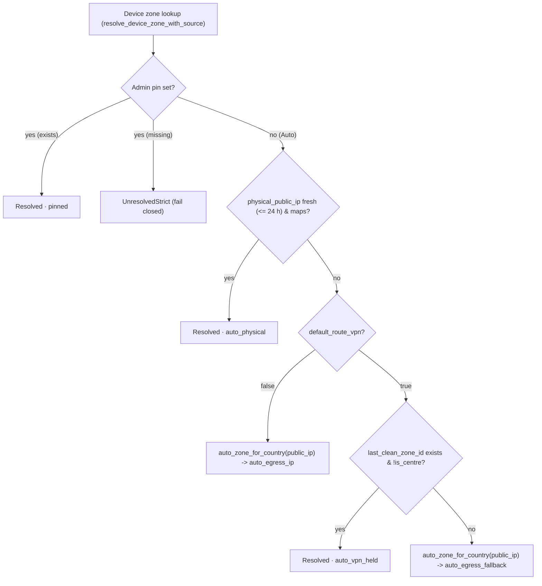
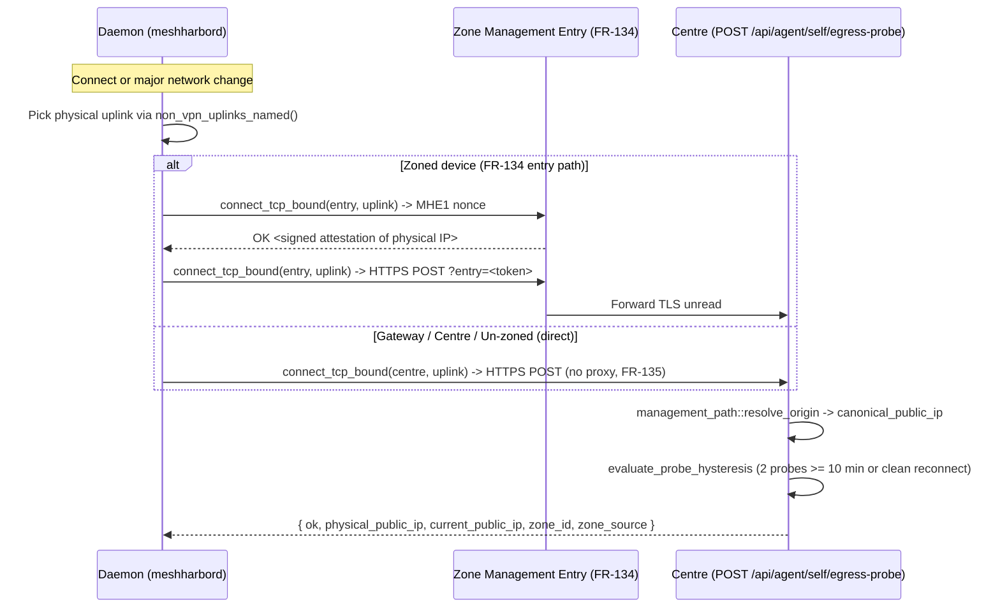

# FR-138: Automatic logical zones must not follow a VPN

> **Status:** in progress — claimed 2026-11-24 (`FR-137` remains reserved for T7). Tracking issue:
> none (GitHub Issues are disabled on this repository); this spec and its registry row in
> [`README.md`](README.md) are the record.

## Goal

An **Auto** device's Logical Network Zone must track the device's physical location, not the exit
country of a TUN-mode VPN or proxy. Operators should not have to manually pin every laptop in a
region just to prevent VPN toggles from pulling the device across a zone boundary.

- **Server-observed physical-path egress probe (`POST /api/agent/self/egress-probe`).** On each
  control-socket connect and on each major network change, the daemon fires one non-blocking HTTPS
  probe bound strictly to a physical non-VPN uplink (never the OS default route). The server
  observes the connection's `canonical_public_ip` (honouring FR-134 attested management entries) and
  records `physical_public_ip` + `physical_seen_at`. The device never asserts an IP in the request
  body.
- **Unified 5-step resolution order** (one canonical pure function
  `resolve_device_zone_with_source` used across WS connect/heartbeat, Hub ICE policy, overlay
  netmap/org-relay snapshots, management paths, and every device listing):
  1. **Admin pin** (`pinned_zone_id`) → `pinned`.
  2. **Fresh physical egress IP** (`physical_public_ip` seen within **24 h** that maps to a
     non-centre Auto zone) → `auto_physical`.
  3. **Control-WS egress IP** (`public_ip`), **only when `!default_route_vpn`** → `auto_egress_ip`
     (updates `last_clean_zone_id`).
  4. **Last verified clean zone** (`last_clean_zone_id`, verified to still exist and `!is_centre`)
     when `default_route_vpn == true` → `auto_vpn_held`.
  5. **Fallback without clean history** → resolves from control-WS egress IP, explicitly flagged as
     `auto_egress_fallback` (never pollutes `last_clean_zone_id`).
- **Additive VPN default-route report (`AgentCaps::default_route_vpn`).** Reported in `AgentHello`
  and re-announced on `AgentHeartbeat` when it changes. Security invariant: `default_route_vpn` can
  only **hold** an earned `last_clean_zone_id` (step 4); it can never move a device into another
  zone.
- **Anti-flapping hysteresis.** Within a single control-WS connection, an Auto device's physical
  zone changes only after two probes at least **10 minutes** apart observe the same new country, or
  immediately on reconnect with a clean physical probe (`!default_route_vpn` and WS country does
  not contradict the probe).
- **Visibility in Web UI and `mh status`.** Zone chips and tooltips name the deciding source
  (`Pinned` / `Auto · Physical egress` / `Auto · VPN excluded (held {zone})` / `Auto · Egress IP`
  and Chinese equivalents), and device details + `mh status` show both **Physical egress**
  (`物理出口`) and **Current egress** (`当前出口`).

## Architecture

### Platform socket binding (`connect_tcp_bound`)

| Platform | Mechanism | Unprivileged / failure behavior |
|---|---|---|
| Windows | `setsockopt(IPPROTO_IP, IP_UNICAST_IF, ifindex.to_be())` + source IP bind; `IPV6_UNICAST_IF` (host order) for IPv6 | Works without elevation; bypasses Wintun / Clash TUN weak-host default route |
| macOS | `IP_BOUND_IF` / `IPV6_BOUND_IF` via `socket2::Socket::bind_device_by_index_v{4,6}` + `libc::if_nametoindex` | Works without elevation; bypasses `utun*` / `ipsec*` / `ppp*` default routes |
| Linux | `SO_BINDTODEVICE` (`socket2::Socket::bind_device`) when `euid == 0` or `CAP_NET_RAW` (bit 13 of `/proc/self/status` `CapEff`) | Per-user unprivileged installs detect `!linux_can_bind_to_device()` and skip silently (relying on `default_route_vpn` + `last_clean_zone_id`) |

A probe that finds no physical uplink, cannot bind, or times out logs only at `debug!`, never
surfaces an error, and runs on a detached task so it never stalls control-socket connect.

## Key code anchors

| Component | Location |
|---|---|
| Unified 5-step resolver & hysteresis state machine | `crates/remote_control/src/models.rs:7353-7635` |
| Persisted agent fields & DAO writers | `crates/remote_control/src/models.rs:2435-2462`, `crates/services/src/dao/agent.rs:1105-1152` |
| Hub live `conn_id`, `default_route_vpn`, hysteresis map | `crates/modules/fleet/src/hub.rs:1198-1275` |
| Unified fleet resolver & connect/heartbeat sync | `crates/modules/fleet/src/socket.rs:1815-2006` |
| Snapshot resolver for overlay / org-relay / DERP | `crates/modules/network/src/network_zones.rs:275-322` |
| Server probe endpoint (`POST /api/agent/self/egress-probe`) | `crates/api/src/routes/agent_self.rs:486-672` |
| Physical uplink binding & VPN default-route detection | `crates/tunnel-core/src/overlay/direct.rs:740-1220` |
| Daemon non-blocking probe runner (FR-134 + FR-135) | `agents/meshharbord/src/egress_probe.rs:1-345` |
| LocalAPI `NodeStatus.egress` & `mh status` rendering | `crates/localapi/src/lib.rs:444-472`, `agents/meshharbor-cli/src/localclient.rs:2502-2548` |
| Web UI zone-source chips & dual-IP details (`en` + `zh-CN`) | `ui/src/utils/deviceLocation.ts:12-235`, `ui/src/components/admin/AgentsSection.vue:209-399` |
| Integration test suite | `crates/tests/src/vpn_zone_tests.rs:1-415` |

## Phases

| Phase | Scope | Status |
|---|---|---|
| P1 | Server unified 5-step resolver, `POST /api/agent/self/egress-probe` (FR-134 attested), `default_route_vpn` tracking, 10-min hysteresis, composition baseline | built & unit-tested; integration tests pending stack run |
| P2 | Agent physical-path probe (`IP_UNICAST_IF` / `IP_BOUND_IF` / `SO_BINDTODEVICE`), `is_vpn_or_virtual_iface` audit (`utun*` / `ipsec*` / `ppp*` / Clash / Mihomo / sing-box), `default_route_vpn` report, FR-135 no-proxy compliance, LocalAPI + `mh status` | built & unit-tested |
| P3 | Web UI zone-source chips/tooltips (`en` + `zh-CN`), dual physical + current egress IP display, docs (`docs/business-isolation.md`) | built & unit-tested |
| P4 | Field verification on Windows (Clash TUN on → off) and Linux/macOS | pending release deploy |

## Acceptance criteria

- [x] **AC1.** Unified 5-step zone resolution order (pin → fresh physical ≤ 24 h → clean WS egress →
      VPN-held `last_clean_zone_id` → flagged fallback) implemented in one pure function, used by
      every server surface, and exhaustively unit-tested (`models.rs`).
- [x] **AC2.** `POST /api/agent/self/egress-probe` observes `canonical_public_ip` (honouring FR-134
      attested management entries), never reads an IP from the request body, applies 10-min
      anti-flapping hysteresis, and updates `composition.baseline.json`.
- [x] **AC3.** Daemon probe uses `non_vpn_uplinks_named()`, platform-native egress binding
      (`IP_UNICAST_IF`, `IP_BOUND_IF`, `SO_BINDTODEVICE` when root/`CAP_NET_RAW`), `http_client::builder_with(false)`
      (FR-135), and is silent & non-blocking on failure.
- [x] **AC4.** `default_route_vpn` is additive on `AgentCaps`, detects VPN/virtual IPv4/IPv6 default
      routes, and can only hold an existing `last_clean_zone_id` (security invariant tested).
- [x] **AC5.** Web UI (`en` + `zh-CN` parity, neutral country/region copy) and `mh status` display
      both physical and current egress IPs plus the deciding zone source.
- [x] **AC6 (docs).** `docs/business-isolation.md` updated with diagram and anchors; `FR-138` ledger
      row added to `docs/fr/README.md` in the same commit.
- [ ] **AC7 (field).** On Windows with Clash TUN toggled on and off, an Auto device stays in its
      physical zone throughout and `mh status` shows both physical and current egress IPs.

## Field-verification log

| When (UTC) | What | Result |
|---|---|---|
| — | Pending release deployment | — |
