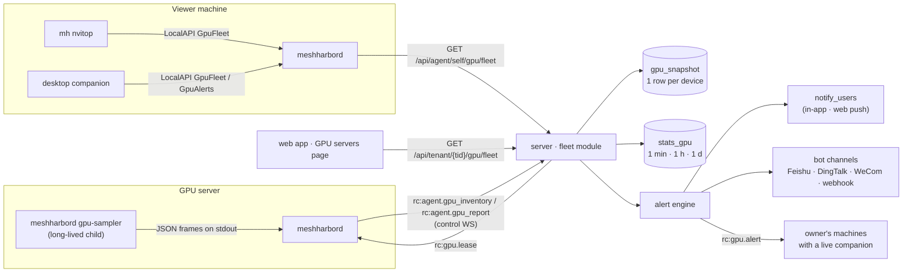
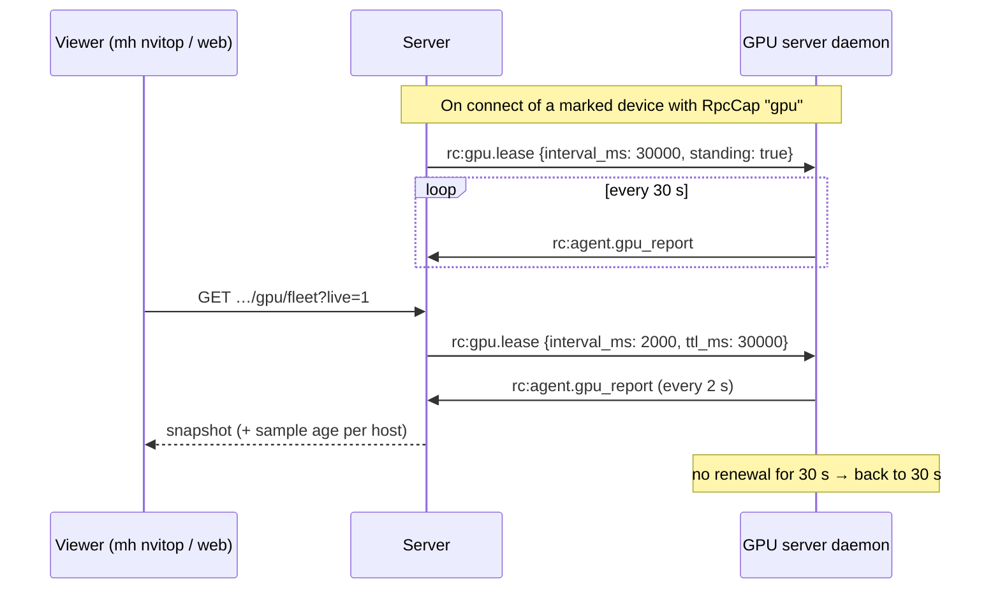

# FR-139: GPU servers at a glance — `mh nvitop`, a fleet GPU page, and alerts

> **Status:** spec — claimed 2026-11-26. Tracking issue: none (GitHub Issues are disabled on this
> repository); this spec and its registry row in [`README.md`](README.md) are the record.
> **One release, no phases** (operator, 2026-11-26): everything below ships together. The build
> order in [§11](#11-build-order-one-release) is only an order of work.

## 1. Goal

An admin marks an enrolled machine as a **GPU server**. From then on, any member who can see that
device gets one aggregated, live view of every GPU server in the organization:

- **`mh nvitop`** in a terminal on any enrolled machine: one command, one screen, all GPU servers.
  It shows per-GPU utilization, memory, temperature, power, the processes on each GPU with their
  Linux user, and host CPU / memory / disk / network. It also has a watch mode, a per-user rollup
  and a free-GPU finder.
- **A "GPU servers" page** in the web app, with the same data plus history charts.
- **The desktop companion**: a tray line "GPU: N free" and OS notifications.
- **Alerts**: changes on a GPU server are sent to the **device owner's** MeshHarbor clients and,
  optionally, to Feishu / DingTalk / WeCom group bots or a generic webhook.

Why MeshHarbor and not an existing tool: every multi-host GPU dashboard surveyed (all-smi,
gpustat-web, gpuview, gpu-hot, RackTop, GPUBeat, …) spends most of its effort, and most of its
user complaints, on *reaching* each host: SSH keys and config, jump hosts, NAT, an unauthenticated
exporter port. MeshHarbor already has an authenticated, NAT-traversing, zone-aware control socket
on every machine. The work here is the sampler, the data model and the views.

## 2. Decisions already made (operator, 2026-11-26)

| # | Decision |
|---|---|
| D1 | One release; no phases. NVIDIA, AMD, Intel and Apple backends all ship. |
| D2 | Process rows (Linux user, PID, process name, GPU memory, SM%) are **shown by default** once a device is marked. The device can switch them off locally (`gpu_processes = false`). |
| D3 | **No new permission bit.** Whoever can see the device in the devices list can see its GPUs. Marking a device needs `MANAGE_AGENTS`. |
| D4 | Alerts go to the **device owner** (`Agent.owner_user_id`, `crates/remote_control/src/models.rs:2233`) only: MeshHarbor clients by default, plus optional bot channels. A viewer the device is shared with sees the page but gets no alerts. |
| D5 | Process users are **Linux local accounts on the GPU server**. They are not MeshHarbor users and nothing maps them, so nothing is ever sent "to the person holding the GPU". Alerts describe GPU and machine changes; the owner decides what to do. |
| D6 | **No GPU reservation / booking.** |

## 3. Prior art: what we borrow, and what we do not

Design ideas only. **No code is copied from a GPL tool.** If code is ever lifted from an Apache-2.0
project, keep its license header and add a NOTICE entry.

| Source (license) | What we take | What we leave |
|---|---|---|
| **all-smi** (Apache-2.0), the closest existing tool | A per-host deadline, after which the host shows "disconnected" with its last sample age, instead of blocking the whole screen. Back-off for a host that keeps failing. A cluster-wide **per-user rollup** tab. NVML initialized once and **never unloaded**, because each init + unload leaks a file descriptor. Fdinfo de-duplication for AMD. | Not embedded as a crate: it pulls tokio/reqwest/tonic/russh even with the CLI off and needs Rust 1.97, and its exporter port relies on a trusted network. |
| **nvitop** (library Apache-2.0, CLI GPL-3.0) | The process columns (user, PID, GPU mem, SM%, CPU%, elapsed). A read-only view with no terminate key. The `nvisel` idea: pick free GPUs and print `CUDA_VISIBLE_DEVICES` with **UUIDs** plus `CUDA_DEVICE_ORDER=PCI_BUS_ID`. Probing the NVML process-info struct version at runtime (a 550-series driver filled the old struct for the `_v3` call). | Its GPL CLI code. |
| **nvtop** (GPL-3.0) | Behaviour only: drop per-process utilization samples that are over 100 %, older than the last read, or for unknown PIDs. | All code. |
| **gpustat** (MIT) | One compact line per GPU; `--json` for scripts. | — |
| **btop** (Apache-2.0), **bottom** (MIT) | Slow readings (PCIe throughput blocks ~20 ms) are taken off the main loop. Sparklines for recent history. | — |
| **k9s** | `/` **filters** the list (not nvitop's "reverse sort"), and single-key sort. | — |
| **nvidia_gpu_exporter** (MIT) | Confirms the design choice: a subprocess isolates the collector from driver calls that never return. | nvidia-smi parsing: we call NVML directly. |
| **DCGM / dcgm-exporter** (Apache-2.0) | Event semantics: Xid errors, ECC and row-remap changes and throttle reasons are **events**, not just gauges. Labels saying "GPU-Util only means a kernel was running". | DCGM itself: profiling counters need `nv-hostengine` as root, and it is NVIDIA-only. |
| **gpu-hot** (MIT) | A hub pushing over WebSocket. Its lesson too: strings supplied by a node (GPU name, host name, user name) must be rendered as text only. | — |
| **macmon** (MIT) | Used **as a library** for Apple Silicon: IOReport/SMC readings without sudo. | Its Prometheus endpoint. |
| **amdgpu_top / libdrm_amdgpu_sys** (MIT) | The AMD data sources (sysfs, hwmon, DRM fdinfo, KFD). Reading them directly is enough. | GRBM performance-counter reads: they can disable power saving. |
| **RackTop, GPUBeat** (lab dashboards) | "Held idle for 3 h 12 m" as a first-class state; per-user GPU·hours. | SSH collection. |
| **Netdata** (counter-example) | — | A proprietary UI served from a CDN. Everything here is bundled into the SPA; no CDN, no SaaS, no Grafana. |

New dependencies (all permissive, compatible with the MPL-2.0 daemon and the AGPL server):

| Crate | Where | Why |
|---|---|---|
| `nvml-wrapper` 0.13 (MIT OR Apache-2.0) | `meshharbord`, used **only inside the sampler child** | NVML loaded at run time; a host without a driver gets an error, never a link failure. Check its MSRV against the workspace toolchain. |
| `macmon` (MIT) | `meshharbord`, macOS only | Apple Silicon GPU readings without sudo. |
| `crossterm` (MIT) | `meshharbor-cli` | Raw mode, key events and the alternate screen for `mh nvitop -w`. No `ratatui`: the layout is hand-rendered with `unicode-width`, which is already in `Cargo.lock`. |

Existing crates reused: `sysinfo = "0.33"` (`agents/meshharbord/Cargo.toml:84`, no upgrade needed),
`libloading = "0.8"`, and workspace `hmac` / `sha2` / `base64` (`Cargo.toml:298–305`) for bot
signatures.

## 4. Architecture



The design does **not** break "the server never carries plaintext". That rule protects the data
plane: pixels, keystrokes, SSH bytes and tunnel payloads. GPU telemetry is control-plane metadata
of the same kind as the `AgentSysStats` the heartbeat already carries
(`crates/remote_control/src/signaling.rs:6292`). Process command lines, arguments and environment
are **never collected** (§8).

Riding the control WS also means the existing rules apply for free: tenant affinity (the pod-local
snapshot cache is consistent for a tenant), FR-134 zone gateways (a mainland GPU server reports
only through its zone's gateway), and the agent token's status check.

### Lease model



- A **standing** lease (30 s) is sent on every (re)connect of a marked device whose hello carries
  `RpcCap::Gpu`. Unmarking sends `{standing: false}`; with no lease at all, the sampler child exits.
- A **live** lease (2 s, TTL 30 s) is sent when any viewer asks with `live=1`. Leases from several
  viewers of one device are merged server-side (latest expiry wins), and the server sends a frame to
  the agent only when the effective interval changes.
- An agent without `gpu` in `AgentCaps.rpc` is never sent a lease; it shows `agent_too_old`.

## 5. The daemon side

### 5.1 Device-local switches

In `AgentConfig` (`crates/agent-core/src/config.rs:48`, next to `exec_enabled` at `:164`):

| Key | Default | Meaning |
|---|---|---|
| `gpu_telemetry` | `true` | `false`: never sample and never report, whatever the server asks. The device answers a lease with `status: "off_local"`, so the server can show *why* rather than silence. |
| `gpu_processes` | `true` | `false`: report device-level numbers only; `procs` is absent and `procs_state: "off"`. |
| `gpu_backends_deny` | empty | Comma list of backends never opened (`nvml`, `amdgpu`, `xe`, `i915`, `apple`). It only removes, so it may be pushed by remote config with `MANAGE_AGENTS`, like `encoder_cells_deny`. |

The local setting is a floor, like `consent::strictest_of`: a server lease never overrides
`gpu_telemetry = false` or `gpu_processes = false`. GPU reporting runs for the **primary org only**:
the sampler and host numbers are machine-global, the same reason peer relays are primary-only.

### 5.2 The sampler child: `meshharbord gpu-sampler`

A new hidden subcommand of the same signed binary, modelled on `caps-probe`
(`agents/meshharbord/src/encode/caps.rs:326–400`, `CHILD_ENV` at `:153`, `TIMEOUT` at `:165`). The
difference: it is **long-lived** and streams, rather than answering once.

| Item | Rule |
|---|---|
| Start / stop | Started when the device holds any lease (standing or live) and `gpu_telemetry` is on. It exits when the lease is gone. |
| Output | One line per sample on stdout: `MESHHARBOR_GPU_JSON:{…}`, marker-parsed like `MESHHARBOR_CAPS_JSON`. stderr is inherited, so backend errors land in the daemon log. |
| Input | Interval changes are sent as one line on stdin (`{"interval_ms":2000}`); EOF on stdin means exit. |
| Internal cadence | Samples every `min(interval, 5 s)`, so `idle_since` and process `started_at` stay accurate at the 30 s report interval. The daemon forwards the newest sample at the report interval. |
| NVML | `nvml-wrapper` with `Nvml::builder().lib_path(..)`, trying `libnvidia-ml.so.1`, `/usr/lib/wsl/lib/libnvidia-ml.so.1`, then `nvml.dll`. **Init once, never unload** for the child's lifetime. |
| Deadline | The parent expects a frame within 3 × interval (minimum 10 s). Missed, crashed or unparseable → terminate the child, report `sampler_stalled`, restart with back-off 30 s → 60 s → … → 5 min. After 5 consecutive failures, report `unavailable` until the daemon restarts. |
| Stuck in the driver | A child blocked inside a driver call may not exit even after SIGKILL. The parent **never calls a blocking `wait()`** on it: it reaps asynchronously, does not start a second child while the first is unreaped, and reports `driver_hung`. |
| Host numbers | CPU %, load 1/5/15, CPU count, memory and swap, root-filesystem used/total, and host network rx/tx rate are read **in the daemon** with `sysinfo` (plain file reads, no driver), then merged into the report. |

Backend data sources (every field is `Option`; `None` means *not available*, never 0):

| Backend | Device level | Per process | Notes |
|---|---|---|---|
| NVIDIA (`nvml`) | util, memory used/total, temperature, power and limit, fan, SM clock, throttle reasons, ECC uncorrected count, retired/remapped rows | `running_compute_processes` + `running_graphics_processes` (MPS variants included), `process_utilization_stats(last_seen_ts)` for SM / enc / dec | Struct version probed at runtime (nvitop's fix). "No new sample" and an empty list both mean 0 %; *not supported* is `None`. Samples > 100 % dropped (nvtop's rule). |
| AMD (`amdgpu`) | `gpu_busy_percent`, `mem_info_vram_used/total`, hwmon temp / power | DRM fdinfo (`drm-memory-vram`, `drm-engine-gfx`), plus KFD `/sys/class/kfd/kfd/proc/<pid>/` for ROCm compute processes, which fdinfo does not show | No GRBM counter reads. |
| Intel (`xe` / `i915`) | hwmon temp / power, engine busy from fdinfo totals | DRM fdinfo engine and memory keys | Device-wide PMU needs `CAP_PERFMON`; skip it when not root and say so. |
| Apple (`apple`) | GPU util, frequency, power via `macmon` | none (macOS does not expose it): `procs_state: "unsupported"` | Unified memory: report system memory, flagged `unified: true`. A zero from a counter that macOS 27 broke is reported as `None`. |
| Windows | NVML as above | PDH `GPU Process Memory` counters fill per-process memory, which NVML leaves empty under WDDM | — |

Process attribution (Linux): NVML returns host PIDs. For each PID read `/proc/<pid>/status`
(`Uid`, `NSpid`) and `/proc/<pid>/cgroup` (docker / containerd / k8s pod / systemd unit short id),
and resolve the uid to a name with `sysinfo` `Users`. **Never contact a container runtime socket.**
A per-user install (no root), or a host mounted with `hidepid`, may be unable to read another
user's `/proc/<pid>`: then `user`/`name` are `None` and `procs_state: "partial"`. Never guess.

Status mapping, reported in `status`:

| NVML / backend result | `status` |
|---|---|
| all good | `ok` |
| no GPU of any enabled backend | `no_gpu` |
| library missing / `DriverNotLoaded` | `driver_missing` |
| `LibRmVersionMismatch` (driver upgraded, not rebooted) | `driver_reboot_pending` |
| WSL2 (no utilization, no processes) | `limited` |
| MIG enabled on a GPU | that GPU's `util_pct` and per-process `sm_pct` are `None`, `mig: true` (memory and processes per MIG instance still reported) |
| `NoPermission` on one field | that field is `None` |
| `GpuLost` | GPU flagged `lost: true` and an event |
| `gpu_telemetry = false` | `off_local` |
| child stalled / stuck | `sampler_stalled` / `driver_hung` / `unavailable` (above) |

## 6. Wire

All new variants are owned by **fleet** and listed in the namespace table next to
`("rc:agent.heartbeat", Owner::Fleet)` (`crates/remote_control/src/signaling.rs:3372`). Wire names
are locked by tests, as `rc:agent.heartbeat` is at `:10577`.

New capability verbs in `RpcCap` (`crates/remote_control/src/models.rs:903`; add the variant, the
`wire()` arm and the `ALL` entry). **Match by equality**, never prefix (`ssh` / `ssh-consent`):

| Verb | Meaning |
|---|---|
| `gpu` | "I send GPU inventory and reports and honour `rc:gpu.lease`". Every new agent advertises it, GPU or not. |
| `gpu-alerts` | "I relay `rc:gpu.alert` to a local companion over LocalAPI". |

| Direction | Wire name | Body |
|---|---|---|
| agent → server | `rc:agent.gpu_inventory` | Once per connect and when it changes: `backend`, `driver_version`, `gpus[{uuid, idx, name, mem_total_mb, power_limit_w, mig, pci_bus, unified}]`, `status`. |
| agent → server | `rc:agent.gpu_report` | Every report interval: full snapshot (below). |
| server → agent | `rc:gpu.lease` | `{interval_ms, ttl_ms, standing}`. |
| server → agent | `rc:gpu.alert` | `{seq, at, severity, title, body, link}`, only to agents advertising `gpu-alerts`. |

```rust
// crates/remote_control/src/signaling.rs — sketch; every metric is Option.
pub struct GpuReport {
    pub seq: u64,
    pub interval_ms: u32,
    pub status: GpuHostStatus,      // wire strings above; #[serde(other)] Unknown
    pub backend: Option<String>,
    pub host: HostLoad,             // cpu_pct, load1/5/15, cpu_count, mem/swap used+total MB,
                                    // disk_root used+total GB, net_rx_bps, net_tx_bps
    pub gpus: Vec<GpuSample>,
}
pub struct GpuSample {
    pub uuid: String,
    pub idx: u16,
    pub util_pct: Option<u8>,
    pub mem_used_mb: Option<u32>,
    pub temp_c: Option<i16>,
    pub power_w: Option<u16>,
    pub fan_pct: Option<u8>,
    pub sm_clock_mhz: Option<u16>,
    pub throttle: Option<Vec<String>>,   // e.g. "hw_slowdown", "thermal", "power_cap"
    pub ecc_uncorrected: Option<u64>,
    pub remapped_rows: Option<u32>,
    pub mig: bool,
    pub lost: bool,
    pub idle_since: Option<i64>,         // unix s; util < 5 % continuously since
    pub procs_state: ProcsState,         // ok | partial | off | unsupported
    pub procs: Option<Vec<GpuProc>>,
}
pub struct GpuProc {
    pub pid: u32,
    pub user: Option<String>,            // Linux local user name
    pub name: Option<String>,            // executable basename, ≤ 32 chars
    pub mem_mb: Option<u32>,
    pub sm_pct: Option<u8>,
    pub cpu_pct: Option<f32>,
    pub started_at: Option<i64>,
    pub container: Option<String>,       // "docker:3f2a9c", "k8s:<pod>", "systemd:<unit>"
    pub kind: Option<String>,            // compute | graphics
}
```

Size: about 0.9 KB of JSON per GPU with 5 processes. An 8-GPU host is about 7 KB per report:
~240 B/s at 30 s and ~3.6 KB/s at 2 s. 50 servers all live is ~180 KB/s, far below
`MAX_WS_MESSAGE_BYTES` (8 MiB, `crates/core/src/ws/upgrade.rs:28`). **Plain JSON, full snapshots;
no MessagePack, no deltas.**

## 7. The server side (fleet module)

### 7.1 Marking

- `Agent.gpu_server: bool` (default `false`), a **typed field**, not a free-text tag: it drives
  leases, cadence and the default view, and a misspelt tag would fail silently.
- `PUT /api/tenant/{tid}/agent/{agent_id}/gpu-server {"enabled": bool}`, next to
  `/{agent_id}/exec-policy` (`crates/modules/fleet/src/lib.rs:479`). It needs `MANAGE_AGENTS`
  (`crates/db/src/models/role.rs:59`), resolves the agent **within** the tenant, and is audited. On
  change it sends `rc:gpu.lease` to the live agent via `send_to_agent`
  (`crates/modules/fleet/src/hub.rs:5661`).
- The inventory is stored on the agent row, so the device page can offer "8× A100 80 GB detected —
  mark as GPU server?".

### 7.2 Snapshot, freshness, states

- `gpu_snapshot`: one document per agent, replaced on each report (the pattern of
  `upsert_mesh_snapshot`, `crates/services/src/dao/stats.rs:357`), stamped with the **server's
  receive time**. A one-shot query after a pod roll still has an answer with an age.
- Freshness uses server receive time only (agent clocks drift): `fresh` < 2 × interval ≤ `stale` <
  5 × interval ≤ `offline`, and `offline` immediately when the control WS is gone. A half-open WS
  therefore greys out instead of freezing the last frame.
- Host states shown to users, mutually exclusive, each with its own text because each has a
  different fix: `fresh`, `stale`, `offline`, `not_marked`, `agent_too_old`, `secondary_org`, plus
  the agent-reported ones from §5.2.

Per-GPU state, computed on the server (thresholds as server config `MESHHARBOR__GPU__*`):

| State | Rule (defaults) |
|---|---|
| `free` | no processes and memory used ≤ 1 GiB |
| `busy` | anything not below |
| `held_idle` | memory used > 1 GiB, util < 5 %, `idle_since` older than 30 min |
| `unattributed` | memory used > 1 GiB, `procs_state: ok`, but no process listed (another PID namespace). **Never counted as free.** |
| `unknown` | data unavailable (status not `ok`, or the field is `None`) |

### 7.3 History

- `stats_gpu`: minute buckets per agent (TTL 7 d): per GPU `util_avg`, `util_max`, `mem_used_max`,
  `temp_max`, `power_avg`, `users` (the Linux users present), and host `cpu_avg`, `mem_used_max`.
  Rolled up to `stats_gpu_1h` (90 d) and `stats_gpu_1d` (730 d) by the task that already rolls
  `stats_machine` into `stats_machine_1h` / `_1d` (`crates/db/src/indexes.rs:598`, `:603`).
- **Index sets go in the fleet module's `indexes()`** (`crates/modules/fleet/src/lib.rs:732`), never
  in `crates/db/src/indexes.rs`. Re-record the composition baseline with `COMPOSITION_UPDATE=1`
  and say why in the commit message.
- Add a guard test like `sys_doc_carries_every_counter` (`crates/modules/fleet/src/socket.rs:2822`)
  for the persisted GPU docs: `machine_sys_doc` once dropped new fields silently and the traffic
  chart read "no telemetry" fleet-wide for days (`socket.rs:2527`).
- Per-user GPU·hours come from history: *held* = minutes a user's process was on a GPU; *busy* =
  the subset where that GPU's util ≥ 5 %.

### 7.4 Routes

| Route | Who | Answers |
|---|---|---|
| `GET /api/tenant/{tid}/gpu/fleet?live=0\|1&hosts=` | user | every marked device the caller can see in the devices list (D3): host state, sample age, host load, GPUs with state and processes, plus tenant totals. `live=1` renews the live lease for the listed devices. |
| `GET /api/tenant/{tid}/gpu/fleet/{agent_id}` | user | one host in full, incl. inventory |
| `GET /api/tenant/{tid}/gpu/history?agent_id=&uuid=&range=1h\|24h\|7d\|30d` | user | chart series from the right tier |
| `GET /api/tenant/{tid}/gpu/users?range=24h\|7d\|30d` | user | the per-user rollup |
| `GET /api/agent/self/gpu/fleet?live=0\|1&wait_ms=0..3000&hosts=` | agent token | same body as the tenant route, with the **same visibility rule as `/agent/self/devices`** (`crates/api/src/lib.rs:415`, `crates/api/src/routes/agent_self.rs:234`). With `live=1` and `wait_ms`, the server waits until every listed host has a report newer than the request or the wait runs out, then answers; hosts that missed it carry their age. |
| `GET/PUT /api/tenant/{tid}/gpu/alert-rules` | user (own rules) | §7.5 |
| `GET/POST/PATCH/DELETE /api/tenant/{tid}/gpu/channels[/{id}]`, `POST …/{id}/test` | user (own channels) | §7.5 |

Every handler resolves ids **within** the tenant (`is_member` is not an authorization check). An
unmounted fleet module answers 503 like every other fleet route.

### 7.5 Alerts

Recipient: the GPU server's `owner_user_id`, and only while that user is still a member of the
tenant (D4, D5).

| Event | Default | Trigger | Recovery message |
|---|---|---|---|
| GPUs free | off until the user adds a rule | rule `{hosts: all \| [ids], count: N, min_free_mb: X, same_host: bool}` satisfied continuously for 2 min | — (one message per transition into "satisfied") |
| Held idle | on | a GPU enters `held_idle` | when it leaves |
| Fault | on | Xid error (several within 3 min become one message), ECC uncorrected or remapped-rows count increases, GPU count drops or `lost`, a throttle (`hw_slowdown` / `thermal`) lasting > 60 s | when it clears |
| Machine state | on | `offline` > 5 min, `driver_reboot_pending`, `sampler_stalled` / `driver_hung` / `unavailable` | when it clears |

Rules evaluate on the server when a report arrives; `offline` uses a server timer. **Edge-triggered**:
one message on entering a state, one on leaving it, a per-(host, event) cooldown of 10 min, never a
message per sample.

Channels:

| Channel | Delivery |
|---|---|
| In-app (always on) | `meshharbor_core::notify::notify_users` (`crates/core/src/notify.rs:291`) with a new `NotificationType::GpuAlert` (`crates/db/src/models/notification.rs:25`; older pods read it as `Other`). That gives the in-app row, `notification:new` on the user WS, and web push to offline users. `link` opens the host on the GPU servers page. |
| Desktop | The server also sends `rc:gpu.alert` to the owner's online agents that advertise `gpu-alerts` and whose heartbeat reports a live companion (`companion_version`, `signaling.rs:904`). The daemon keeps the last 50 in a ring; the companion polls LocalAPI `GpuAlerts { after_seq }` every 15 s and raises an OS notification. |
| Feishu bot | POST to `https://open.feishu.cn/open-apis/bot/v2/hook/<token>` (or `open.larksuite.com`). With a signing secret: `timestamp` + `sign` in the body, where `sign = base64(HMAC-SHA256(key = "<timestamp>\n<secret>", message = ""))`. |
| DingTalk bot | POST to `https://oapi.dingtalk.com/robot/send?access_token=<token>`. With a secret: `&timestamp=<ms>&sign=<urlencode(base64(HMAC-SHA256(key = secret, message = "<ms>\n<secret>")))>`. |
| WeCom bot | POST to `https://qyapi.weixin.qq.com/cgi-bin/webhook/send?key=<key>`; no signature. |
| Generic webhook | POST JSON `{event, severity, host, agent_id, gpus, text, at}` to any HTTPS URL. |

Bot rules:

- Re-check the three vendor formats against their current documentation when implementing; the
  signing recipes above are the 2026 formats as recalled, not re-fetched.
- **Address validation** at save time **and** before every send (DNS can change): HTTPS only; the
  three bot kinds are pinned to their official hosts and path prefixes; a generic webhook's host
  must resolve only to global unicast addresses (`meshharbor_core::net::is_global_unicast`, the
  same check `validate_push_endpoint` does at `crates/api/src/routes/push.rs:24,74`). Redirects are
  not followed. The server POSTs from inside the cluster, so this check is what keeps a bot URL
  from reaching internal addresses.
- The URL token and signing secret are credentials: stored server-side, never logged, and returned
  **masked** (host plus last 4 characters). The secret is never returned.
- DingTalk and WeCom allow about 20 messages a minute per bot: coalesce to at most one message per
  channel per 10 s, batching events into one text.
- Failures: retry at 5 s, 30 s and 120 s, then record `last_error` on the channel (shown in
  settings). One failing channel never delays another.
- Each channel has `include_users` (default `true`): whether Linux user names appear in its
  messages, because a group bot posts into a third-party chat.
- Message text follows the owner's UI language (zh / en), e.g.
  `[MeshHarbor] gpu-a100-1：2 张 GPU 空闲（GPU 1、5，各 79 GB 可用）`.

## 8. Privacy and visibility

| Level | Content | Default | Visible to | Device switch |
|---|---|---|---|---|
| L0 | device GPU numbers; host CPU / memory / disk / network | on once marked | anyone who sees the device (D3) | `gpu_telemetry = false` |
| L1 | process rows: Linux user, PID, executable basename (≤ 32 chars), GPU memory, SM %, CPU %, start time, container short id | on once marked (D2) | same | `gpu_processes = false` |
| L2 | command line, arguments, environment | **never collected** | — | — |

## 9. The views

### 9.1 `mh nvitop` (alias `mh gpu`)

The CLI asks its local daemon over a new LocalAPI verb, the same path as `mh devices` (FR-84;
`agents/meshharbor-cli/src/cli.rs:330`, `crates/localapi/src/devices.rs`):
`Request::GpuFleet { live, wait_ms, hosts }` → `Response::GpuFleet(GpuFleetPage)`, in a new
`crates/localapi/src/gpu.rs`. The daemon calls `GET /api/agent/self/gpu/fleet`.

| Command | Behaviour |
|---|---|
| `mh nvitop` | One shot: `live=1&wait_ms=2000`; hosts that did not answer in time show their cached data and age. |
| `mh nvitop --cached` | Latest snapshot at once, no wait. |
| `mh nvitop -w [--interval 2]` | Watch mode: alternate screen, redraw with DEC 2026 synchronized output, live lease renewed every 10 s. Keys: `q` quit, `/` filter, `s` cycle sort (host · util · free memory · temperature), `p` show/hide processes, `Enter` expand/collapse a host, arrows / PgUp / PgDn scroll, `?` help. |
| `mh nvitop <host…>` | Only these hosts; names resolve like `mh peers`. |
| `mh nvitop users [--range 24h\|7d\|30d]` | Per Linux user across hosts: hosts, GPUs, processes, GPU memory now; held and busy GPU·h over the range. |
| `mh nvitop free [-n N] [--min-free 40G] [--same-host] [host…]` | Free-GPU finder: hosts that can satisfy the whole request first, then by free memory. Prints a ready command per host: `mh ssh <host> -- CUDA_DEVICE_ORDER=PCI_BUS_ID CUDA_VISIBLE_DEVICES=GPU-…,GPU-… <your command>`. |
| `--json` (any form) | Stable machine output; every host carries `state`, `sample_age_s`, `reachable`, so a script can tell 0 % from "no data". |

```text
$ mh nvitop
GPU servers 6/7 online · 48 GPUs: free 9 · busy 31 · held idle 6 · unknown 2 · free memory 612G
gpu-a100-1   CPU 37%  load 12.1  mem 210/512G  disk 61%  8×A100-80G                       2s
  0  A100-80G  54°C  97%  71.2/80G  290W  alice  python  70G
  1  A100-80G  31°C   0%   0.0/80G   62W  free
  3  A100-80G  33°C   1%  38.0/80G   71W  held idle 3h12m  bob  jupyter  38G
gpu-4090-2   offline · last sample 17 min ago
gpu-wsl-3    limited (WSL2: NVML gives no utilization or processes)
```

Rules:

- Always show GPU **UUIDs** in `free` output and JSON. nvidia-smi numbers by PCI order and CUDA by
  "fastest first", so an index can point at a different card.
- Read-only: no terminate key. Ending a process goes through the existing `mh exec` / `mh ssh` gates.
- Colour: blue/cyan free, default busy, orange held idle, magenta error (blue/orange is the pair
  colour-blind users tell apart best). State words are always printed too. `NO_COLOR` is honoured,
  and piped output has no ANSI.
- State labels are short words, not symbols: `○` / `●` are East Asian Ambiguous width and take two
  columns in many zh_CN terminals. Truncate user names and paths by **display width**
  (`unicode-width`), not by character count. Labels follow the CLI's existing zh/en choice.

### 9.2 Web: the "GPU servers" page

- Route `gpu` (name `gpu-servers`, `meta: { module: 'fleet' }`) next to `devices` in
  `ui/src/plugins/router.ts:278`, plus a link from `DevicesView.vue`. Shown when any device is
  marked, or to `MANAGE_AGENTS` holders so they can mark one.
- Files: `ui/src/views/gpu/GpuServersView.vue`, `GpuHostDrawer.vue`, `GpuUsersTab.vue`,
  `GpuFindDialog.vue`, `GpuAlertSettings.vue`; `ui/src/stores/gpu.ts`; `ui/src/api/gpu.ts`; zh and
  en strings in `ui/src/locales`.
- **Top**: totals (servers online, GPUs free / busy / held idle / unknown, free memory).
  **Body**: a heat grid, one row per server and one cell per GPU, coloured by state, showing free GB,
  with the row's sample age; `/`-style filter and sort. **Host drawer**: per-GPU cards, the process
  table, and 1 h / 24 h / 7 d charts using the existing `ui/src/components/stats/TimeSeriesChart.vue`
  (d3, already bundled). **Users** tab; **Find GPUs** dialog producing the same command as
  `mh nvitop free`; **Alerts** settings (rules, channels, "Send test", last error).
- Live mode: while the page is visible, poll `…/gpu/fleet?live=1` every 2 s (each call renews the
  lease); on `visibilitychange` to hidden, stop. No new browser WS message. After the tab closes,
  devices fall back to 30 s within the 30 s lease TTL.
- Marking lives on the device's detail panel: a "GPU server" switch (`MANAGE_AGENTS`) with the
  inventory hint.
- Every string a node supplies (GPU name, host name, user name, process name, container id) is
  rendered through Vue interpolation only: **no `v-html`** anywhere on these pages.
- Phone layout per FR-132: the grid wraps, tables become cards.
- No CDN and no external assets.

### 9.3 Desktop companion

- Tray line "GPU: N free" (hidden when the org has no GPU server), opening the web page. Fed by
  LocalAPI `GpuFleet { live: false }` every 30 s; when the answer has no GPU servers, poll every
  5 min instead.
- OS notifications from `GpuAlerts` (§7.5), with the same title / body as the in-app notification.

### 9.4 Optional local metrics

`gpu_metrics_listen` (default empty): when set to a **loopback** address, the daemon serves the
latest snapshot in Prometheus text format for someone who already runs Prometheus on that host. A
non-loopback address is refused at config load.

## 10. Kill switches

| Switch | Effect |
|---|---|
| server `MESHHARBOR__GPU__ENABLED=false` | no leases, routes answer 503, alerts stop |
| server `MESHHARBOR__GPU__LIVE_INTERVAL_MS` (0 disables live) | live leases off; standing 30 s only |
| server `MESHHARBOR__GPU__ALERTS=false` / `__BOTS=false` | all alerts / only bot channels off |
| device `gpu_telemetry`, `gpu_processes`, `gpu_backends_deny` | §5.1 |
| per user | each alert rule and each channel has `enabled` |

## 11. Build order (one release)

Only an order of work; the release contains all of it.

1. Wire types, `RpcCap::Gpu` / `GpuAlerts`, namespace rows, wire-name tests.
2. `gpu-sampler` child with the NVML backend, the parent supervisor and the status mapping; a fake
   backend (`MESHHARBORD_GPU_FAKE=<file>`) that replays recorded frames, for tests and UI work.
3. Server: marking route, leases, `gpu_snapshot`, states, fleet routes, `/agent/self/gpu/fleet`.
4. LocalAPI `GpuFleet`, `mh nvitop` (one shot, `--cached`, `--json`, `-w`, `users`, `free`).
5. Web page and device-panel switch.
6. History (`stats_gpu` + rollups), users rollup, charts.
7. Alerts: engine, in-app, desktop relay, bot channels and settings.
8. AMD, Intel, Apple and Windows PDH backends.
9. Docs (`docs/gpu-servers.md`) and the index row.

Tests that must exist: wire names and `RpcCap` equality matching; status and state mapping
(`None` vs 0, `unattributed` never free); freshness by server receive time; lease merge and expiry;
sampler deadline, back-off and "never wait on a stuck child" (a fake child that sleeps forever);
alert edge-triggering, cooldown and coalescing; the Feishu and DingTalk signature recipes against
fixed vectors; address validation (loopback, private, link-local and redirect cases refused); the
persisted-doc guard test; per-user GPU·h from fixed history.

## 12. Acceptance criteria

Field criteria are run on real machines, and each is first shown **failing** on the current
deploy (the feature absent) before it passes.

- [ ] **AC1 (field).** On a multi-user NVIDIA server with a **per-user** install, `mh nvitop` shows
  other users' processes with their Linux user names. A root install also shows container short ids.
- [ ] **AC2 (field).** With 10 GPU servers, including one reached through a zone gateway,
  `mh nvitop` returns in ≤ 3 s. A host whose network is cut shows "offline · N min ago" within
  150 s, and never shows old numbers as fresh.
- [ ] **AC3 (field).** `SIGSTOP` on the sampler child gives `sampler_stalled` within 3 × interval,
  while a remote desktop session and `mh exec` on the same host keep working.
- [ ] **AC4 (field).** A host whose driver was upgraded without a reboot shows
  `driver_reboot_pending`, not "no GPU".
- [ ] **AC5 (field).** A WSL2 host shows "limited", not 0 %; a MIG GPU shows its SM % as
  "not supported".
- [ ] **AC6 (field).** After the web tab closes, the server measures that tenant's GPU report rate
  back at the 30 s cadence within 30 s.
- [ ] **AC7.** A report whose GPU name contains HTML markup (for example `<b>x</b>`) renders as
  literal text on every page.
- [ ] **AC8 (field).** The sampler child's CPU and RSS on an 8-GPU server are measured and written
  into this spec.
- [ ] **AC9 (field).** With a rule "2 GPUs with ≥ 40 GB free", freeing two GPUs sends, after 2 min,
  exactly **one** message to the owner's desktop companion and one to a Feishu, DingTalk or WeCom
  bot. A viewer the device is shared with gets none.
- [ ] **AC10 (field).** Stopping a GPU server's daemon sends one "offline" message after 5 min and
  one "recovered" message when it returns, with nothing in between.
- [ ] **AC11.** Saving a channel whose URL points at a loopback, private or link-local address is
  refused, and so is a send after its DNS changes to one.
- [ ] **AC12 (field).** At least one real AMD, one Intel and one Apple Silicon machine show correct
  numbers in `mh nvitop`, or the matching "limited / not supported" state.
- [ ] **AC13.** `gpu_telemetry = false` on a marked device shows `off_local` within one report
  interval, and no GPU frame leaves that device.
- [ ] **AC14 (docs).** `docs/gpu-servers.md` describes all of the above in the house style (mermaid,
  tables, `file:line` anchors), and `docs/README.md` has its index row.

## 13. Out of scope

- GPU reservation or booking (D6).
- Any message to the Linux user holding a GPU (D5).
- Terminating processes from the view.
- DCGM profiling counters, MPS / vGPU per-client detail.
- Server-side Prometheus scraping, Grafana, Slurm / Kubernetes scheduler integration.
- Command lines, arguments, environment (L2).

## 14. Open decisions

None. Default thresholds (1 GiB, 5 %, 30 min, 2 min, 10 min) are server config and may be tuned
after AC8 and the first field week.

## 15. Field-verification log

| Date | Version | What | Result |
|---|---|---|---|
| — | — | — | — |
