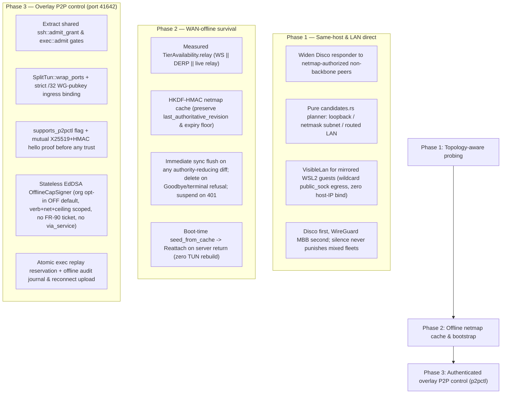

# FR-140: Topology-aware direct paths, offline LAN continuity, and overlay P2P control fallback

> **Status:** in progress — claimed 2026-11-26. Tracking issue: none (GitHub Issues are disabled on
> this repository); this spec and its registry row in [`README.md`](README.md) are the record.

## Goal

Two authorized devices on the same physical machine or the same local network should always
discover and prefer the shortest working direct path (`loopback < subnet < routed LAN < public /
srflx < relay`) through active authenticated probing rather than static `/24` guesses, and must
continue working — including after a cold boot or address/port change while WAN and the central
server are unreachable — across both the WireGuard overlay data plane and MeshHarbor's interactive
peer features (`mh ssh`, `mh scp`, `mh sftp`, `mh exec`, `mh rdp`, and the Desktop Companion device
view).

Offline WebRTC browser remote desktop stays out of scope for FR-140 (follow-up FR); Windows targets
already obtain offline remote desktop through `mh rdp` over the overlay with P2P certificate-pin
lookup.

## Architecture (three phases)

### Phase 1 — Topology-aware probing (`DirectTier::Lan` sub-kinds)

- **No new `DirectTier` variant.** Same-host loopback, on-link subnet, and same-NAT routed LAN all
  ride `DirectTier::Lan` with a diagnostic `LanPathKind` (`loopback`, `subnet`, `routed`) surfaced
  on `PeerCarrierDebug` and LocalAPI diagnostics. All existing on-link invariants stay intact, and
  the exit-route exemption builder asserts `!dst.ip().is_loopback()`.
- **Disco responder widening.** `CarrierPlane::disco_handle` checks netmap-authorized peers
  (excluding `backbone_only`) rather than installed-only peers (`send.has_peer`), keeping fixed
  85-byte frames and preserving `observed` in `DiscoInbound`.
- **Mirrored WSL2 (`VisibleLan`).** `gather_lan_interfaces_named()` stays empty for binds and
  advertisements on mirrored WSL2 guests (preventing host socket starvation and phantom self-LAN
  candidates). A distinct `VisibleLan` newtype supplies visible prefixes strictly for outbound LAN
  matching on the wildcard `public_sock` and self-address exclusion.
- **Same-host loopback.** Enabled on Windows hosts and mirrored WSL2 guests (`OVERLAY_LOOPBACK_DIRECT`,
  default on; automatically skipped when `public_sock` is `IP_UNICAST_IF`-pinned), probing the
  public-dial port bands (`base + 256..+263`, `base + 768..+775`), `peer_lan_port + 256`, and
  peer `srflx` ports over `127.0.0.1` via `public_sock`.
- **Netmask-aware & routed LAN.** Interface prefix masks (clamped `/16..=/30`) match non-`/24` LANs
  while preserving existing `/24` tests; same-NAT RFC 1918 routed endpoints require an authenticated
  Disco pong before WireGuard probing. Unsolicited inbound Disco pings supply candidate hints only
  and never promote without a fresh source-matched pong or validated WireGuard handshake.

### Phase 2 — Offline netmap cache, cold boot, and measured relay availability

- **Measured relay availability.** `TierAvailability.relay` is `true` iff the control WS is attached,
  OR a DERP mux is connected, OR a relay carrier/warm grant is live. Online decisions (including
  FR-124 strict-zone nodes without `/derp`) are unchanged. When `relay == false`, `PathMonitor`
  never returns `PathAction::Relay` and caps direct-tier retry penalties at 10 s (reset on network
  change).
- **Local HKDF-HMAC cache.** Stored beside config (`<config_dir>/overlay/netmap-<tenant>.json`,
  owner-only permissions, atomic temp + fsync + rename), keyed with
  `HKDF-SHA256(wg_secret, "meshharbor/netmap-cache/v1" || tenant_id || node_id)`.
- **Anti-resurrection & hygiene.** Preserves `last_authoritative_revision` and
  `last_authoritative_at_ms` across reboots (with a separate `cache_seeded` state flag so offline
  rewrites never extend expiry). Flushes synchronously on any authority-reducing diff (full netmap
  or delta: dropped peer, tighter `ingress_rules`, newly set `backbone_only`, fewer routes, key
  removal, raised `offline_caps_not_before_ms`). Deletes on `Goodbye` and terminal `JoinRefused`;
  suspends (skips cold seed without deleting) on HTTP 401 `AuthRejected`. On replay: overrides
  `reachable = true`, preserves `backbone_only`, `central_relay_denied`, and `Some([])` vs `None`
  `ingress_rules` verbatim, and strips relay pins (`prefer_relay_ms`, `relay_strategy`, forced-DERP,
  `warm_relay_endpoint`).
- **Recovery order after DHCP/port change.** (1) Inbound authenticated learning → fresh proof,
  (2) learned endpoints, (3) cached `lan_endpoints`, (4) known peer IPs across bounded LAN &
  public-dial port bands, (5) loopback band. No multicast/broadcast or subnet-wide sweeps.

### Phase 3 — Unified Overlay P2P control plane (`p2pctl`)

- **Transport & ingress binding.** Intercepts TCP port `41642` (`P2P_CTL_PORT`) on the node's IPv4
  overlay address via `SplitTun::wrap_ports` (covering both OS-TUN and netstack). WireGuard ingress
  unconditionally enforces exact `/32` peer source == decrypting WG static key for `P2P_CTL_PORT`
  even when `RpfMode::Warn` is active, rejecting routed subnet sources. Inbound WG ACLs still apply
  (never auto-exempted under `enforce`).
- **Mixed-fleet & daemon proof.** Peers advertise an optional `supports_p2pctl` netmap bit (default
  `false`). Origins never dial `P2P_CTL_PORT` to a peer lacking `supports_p2pctl`. Every connection
  starts with a mutual X25519+HMAC `hello` challenge-response bound to both daemons' WG static keys,
  both nonces, and `(tenant_id, origin_node_id, target_node_id)` before trusting `device_info`
  (SSH host key / RDP cert pin) or transmitting capabilities, TOTP codes, or commands.
- **Shared admission & stateless EdDSA capabilities.** `ssh::admit_grant` and `exec::admit` are
  extracted first so online WS and offline `p2pctl` enforce identical local gates (`ssh_enabled`,
  `exec_enabled`, FR-127 protected, FR-129 TOTP, `strictest_of` consent). `via_service` (FR-94 /
  FR-105) is always refused offline. Server-side `OfflineCapSigner` (EdDSA JWT, `aud="mh-offline"`,
  verb-scoped `"ssh"` or `"exec"`, bound to `tid`, `net`, `tgt`, `org`, `opk`, ceilings, and `jti`)
  issues optional `offline_cap` only when org `offline_access` is enabled (default **off**) and the
  online request is granted (never for FR-90 ticketed requests). Raw capabilities stay daemon-internal
  and never cross LocalAPI.
- **Exec idempotency & offline audit.** Target persists `(origin, cap_jti, req_id, req_digest)`
  atomically before launching offline `exec` so crash-retry never double-executes, and buffers
  bounded offline admit/refuse audit records for upload on reconnect.

## Phases & kill switches

| Phase | Scope | Kill switches | Status |
|---|---|---|---|
| P1 | Disco responder widening, `candidates.rs`, netmask/routed LAN, mirrored WSL `VisibleLan`, loopback discovery | `OVERLAY_CANDIDATE_DISCO`, `OVERLAY_LOOPBACK_DIRECT`, `OVERLAY_WSL_MIRRORED_GUARD` | in progress |
| P2 | Measured `TierAvailability.relay`, `netmap_cache.rs`, `overlay_cache.rs`, boot-time `seed_from_cache` | `overlay_netmap_cache` (`overlay_netmap_cache_max_days`) | in progress |
| P3 | Shared `ssh::admit_grant` / `exec::admit`, `p2pctl` (`41642`), `OfflineCapSigner`, offline `ssh`/`exec`/`rdp` pin | `p2p_control_enabled`, org `offline_access` (default off) | in progress |

## Acceptance criteria

- [ ] **AC1 (Phase 1 — Topology & Probing).** Mirrored WSL guests and Windows hosts discover
  same-host loopback (`tier=lan path=loopback`) and mirrored-WSL-to-LAN (`path=subnet`) via Disco +
  WireGuard without binding or advertising host LAN addresses; non-`/24` and same-NAT routed LANs
  promote on Disco proof; `backbone_only` peers receive zero direct probes or Disco replies.
- [ ] **AC2 (Phase 2 — Offline Bootstrap & Continuity).** With the central server unreachable, a
  cold-booted daemon brings up TUN/netstack + MagicDNS + direct LAN/loopback carriers from its
  HMAC-verified cache; authority-reducing diffs flush synchronously; `Goodbye`/terminal refusals
  delete cache and `401` suspends without deleting; reconnect re-attaches without rebuilding TUN;
  online relay behavior (including FR-124 nodes without `/derp`) is unchanged.
- [ ] **AC3 (Phase 3 — Overlay P2P Control).** Offline `mh ssh`/`scp`/`sftp`, `mh exec`, and
  `mh rdp` certificate-pin lookup succeed over `P2P_CTL_PORT` for authorized peers; mutual
  static-key `hello` rejects spoofed listeners on legacy targets; all refusal cases (wrong `tgt`,
  `opk`, `net`, `verb`, expired, pre-`not_before`, clock skew, disabled `ssh`/`exec`, FR-127
  protected, missing/bad FR-129 TOTP, `via_service`, FR-90 ticketed, replayed `req_id`, routed
  source IP) fail closed with explicit reasons; `composition_tests` passes.
- [ ] **AC4 (Docs).** `docs/overlay-nat-traversal.md`, `docs/overlay-communication.md`,
  `docs/meshharbor-ssh.md`, `docs/security-baseline.md`, and `docs/README.md` document the new
  behavior with Mermaid diagrams and verified anchors.

## Out of scope

- Offline WebRTC browser remote desktop (follow-up FR; Windows targets use `mh rdp` over overlay).
- Unsolicited L2 multicast/broadcast discovery and subnet-wide UDP sweeps.
- OS ARP/neighbor-table scanning in v1.
