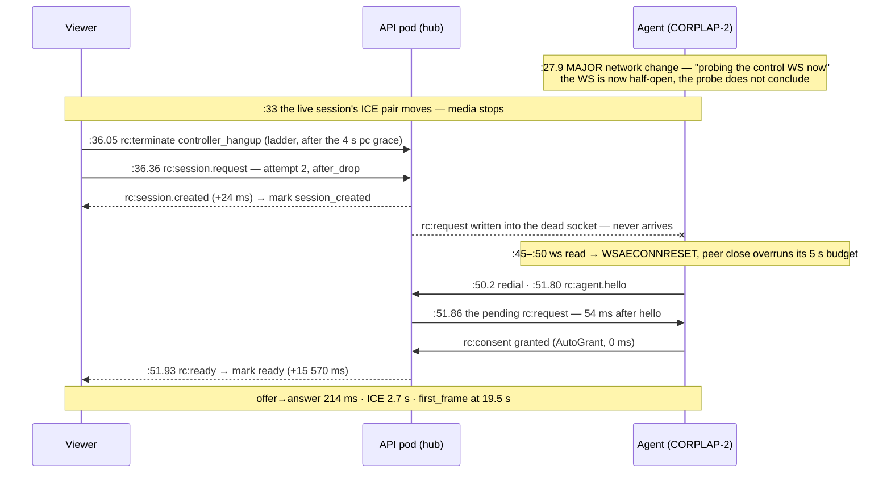

# FR-22: Time-to-first-frame — connecting sometimes takes 10–15 s

Status: **parts 1 + 3 + 3b + 4 shipped (part 4 live since `hosted-20260925-d5a7a3d`); ROOT CAUSE
TRACED 2026-10-06 (prod `0.4.116`) — the 10–15 s connect is the agent's control WebSocket going
half-open after a host network-path change, so the ladder's retry request sits undelivered until
the far end resets the socket 11–16 s later (AC5 `[x]`, two instances traced browser ↔ server ↔
agent). AC4's paint-inclusive number now exists (foreground first-attempt p50 1.45 s, n 232) but
the criterion's "unchanged" has no pre-#821 baseline — the operator's call (AC4 `[~]`). Part 5
(kill the half-open WS within seconds of a network change) is PROPOSED, not built. The FR does not
close until AC4 is decided.** Tracking issue: `FR-22` (#819). Reader-facing doc:
`docs/remote-control.md` §12.1.
UX rather than picture quality — but it is the first thing every session is judged on,
and the quality work is invisible to someone still looking at a blank stage.

## Report

Operator, 2026-08-28: *"In some occasions it can take up to over 10 or even 15 secs to
see the remote screen."* Usually much faster.

## Measured — the agent is not the cause

Ten consecutive CORPLAP-3 sessions, from the agent's own log timestamps:

| stage | span |
|---|---|
| session request → first ICE candidate | **127–253 ms** |
| session request → `video-bytes` DC open | **0.95–2.25 s** |
| session request → first pump heartbeat | **2.5–4.7 s** |

Consistent across all ten, no outliers. Capture bind (`DXGI-direct: bound Desktop
Duplication`) and encoder open together account for ~500 ms of that.

**ICE is already trickled correctly**, so the usual suspect is ruled out before we
start: `useRemoteControl.ts` sends the offer immediately after `setLocalDescription`
and streams candidates from `onicecandidate` as they arrive. It never waits for
`iceGatheringState === 'complete'`.

## The cost mechanism

`RC_SIGNALING_TIMEOUT_MS = 15000`.

An attempt that stalls in `requesting` or `negotiating` is not noticed for **15
seconds**. The ladder then retries after 250 ms (`RC_RECONNECT_LADDER_MS[0]`) and the
retry completes on the normal ~3 s path. **≈18 s total**, which matches the report.

So the 10–15 s case is not a slow connection — it is *one silently lost attempt plus a
timer that is three times longer than the path it is guarding*.

## ⚠️ What we have NOT proven

**Why the first attempt stalls.** The 15 s is the cost, not the trigger.

Circumstantial evidence in the same sample: session `…ff8c23` (07:53:00.923Z) reached
the agent, gathered candidates at +160 ms, and then produced no `video-bytes` DC and no
heartbeat; a fresh request arrived 2.4 s later and succeeded. So an attempt CAN die
after the agent has already accepted it.

Candidate causes worth testing, none confirmed:
- a **half-open agent control WS** — the server pushes into a socket that still ACKs
  but whose upstream leg is dead (the documented class that made agents look GREEN
  while `agent_offline`);
- a **pod split** — the RC hub is pod-local, so a browser and an agent hashed to
  different pods during a roll cannot meet;
- a lost `rc:sdp.offer`/`answer` on a WS that reconnected mid-negotiation.

We cannot currently distinguish these, because **there is no browser-side timing at
all**: "sometimes 10–15 s" cannot be turned into a distribution, and a fix cannot be
shown to work.

## Proposed direction — three parts, cheapest first

**1. Phase-aware signalling timeout.** ✅ **SHIPPED** (PR #821). 15 s is far beyond the
measured healthy path (worst observed end-to-end: 4.7 s agent-side). A short bound on
`requesting` — *has the server answered at all?* — with the existing longer bound kept
for `negotiating`, where ICE legitimately varies by network. Cuts the bad case from
~18 s to ~7 s and does not touch the good case. `awaiting_consent` stays exempt: the
SERVER owns that timeout, and a human approving a prompt may legitimately take longer
than any client-side number.

`signalingTimeoutFor(phase)`: `requesting` **4 s**, `negotiating` 15 s (unchanged),
everything else `null` = never arm. Exported and total over `RcPhase`, so a new phase
must declare its own bound instead of silently inheriting the ICE-sized one.

⚠️ **Mitigation, not diagnosis.** This shortens the cost of the stall; it does not
explain it. Criterion 5 stays open on purpose.

**2. Make the server answer instead of the client guessing.** ✅ **ALREADY IMPLEMENTED**
— checked against the tree rather than assumed, and deliberately NOT rebuilt (PR #821).
`Hub::create_session` returns `AgentOffline` when the request cannot reach a live agent;
`ws/remote_control.rs` runs a 250 ms cross-pod rehome probe and then sends
`ServerMsg::Error` with an attributable code (`agent_offline` / `agent_on_other_pod`);
the client surfaces it via `rcErrorMessage` and advances the ladder via
`isRetryableRcErrorCode`. So the undeliverable case already fails in well under a second.

⚠️ **This is the wrong-turn worth recording**: the proposal was written from the
assumption that the fast-fail was missing, and it is not. What the server genuinely
CANNOT see is the case actually observed — session `…ff8c23` **reached** the agent,
gathered candidates at +160 ms, and then went silent. A live agent that stops answering
is not detectable by another server-side check; it needs part 3.

**3. Instrument time-to-first-frame.** ✅ **SHIPPED** (PR #821). Request → first painted
frame, reported the way FR-1 P7 instrumented paint age. Without it every future claim
here is an anecdote. Feeds FR-16 (#798) L3.

`ui/src/composables/rcConnectTiming.ts` records eight marks — `request_sent`,
`session_created`, `ready`, `offer_sent`, `answer`, `pc_connected`, `dc_open`,
`first_frame` — and logs per-STEP deltas. (#824 added three pre-flight marks —
`ws_ready`, `turn_ready`, `probes_ready` — after a field repro showed the clock
started at the request while the operator waits from the click; **eleven** in all.)

⚠️ **Marks are per ATTEMPT, not per connect.** A recorder shared across the ladder would
let a fast retry overwrite the lost attempt's marks and report an 18 s connect as a 3 s
one — hiding the exact defect being hunted.
⚠️ **An unreached step prints as `<name>:—`, not omitted**, and the abandoned/cancelled
paths log too. A MISSING mark is the finding: it names the step that never completed,
which is what separates a half-open agent WS from a cross-pod split from a lost SDP
frame. The three fail in different phases; a single total cannot tell them apart.
⚠️ Deltas rather than absolute offsets — the actionable quantity is *which wait was
long*, and with offsets every step after a 9 s stall looks equally late.

**3b. Say it to the OPERATOR, not the console** (PR #822). The console line is invisible
during exactly the sessions this exists to explain — nobody has devtools open when a
connect takes 15 s, so the report that comes back is still *"it was slow again"*.
`describeConnectTiming()` turns the marks into one sentence in the existing app
snackbar, naming which wait dominated in plain words, with the short mark name in the
tail so a reported snackbar is traceable without devtools.

⚠️ **Consent is never named as "what was slow".** `ready` is human-paced BY DESIGN — the
server owns its timeout for that exact reason — so it is excluded from the verdict while
still advancing the clock for the steps after it. Reporting "most of the wait was
someone approving the prompt" is true, useless, and points the operator at themselves
instead of at the slow step. Locked by a test, because getting this wrong yields a
CONFIDENTLY WRONG message rather than a missing one.
⚠️ **A normal connect says nothing** (`CONNECT_SLOW_MS` 7 s — above the measured healthy
band, below the reported 10–15 s). A message on every success is noise, and a threshold
inside the healthy band would train people to dismiss it.
⚠️ **A retry is always notable even when the total looks fine** — that is the FR-22
signature, and the operator waited through it either way.
⚠️ **Stall warnings throttle (20 s), resolutions never.** A flapping path would otherwise
bury its own message; but showing "it is failing" and suppressing "it finally connected"
leaves a warning with no ending.

## Acceptance criteria

- [x] Instrumented TTFF exists and a normal connect reports it. **Built** (#821);
      the p50 number itself is a FIELD reading and lands in the log below once a build
      carrying this has run — the criterion is not "we assumed 3–5 s".
- [x] An attempt that cannot reach the agent fails in **< 2 s** with an attributable
      reason, rather than after the signalling timeout. **Already true** — see part 2:
      `AgentOffline` → 250 ms cross-pod probe → `rc:error` with a code the UI shows.
      Verified by reading the path, not by rebuilding it.
- [x] A deliberately stalled attempt recovers in **< 8 s** end-to-end, down from ~18 s.
      Arithmetic locked by a unit test: 4 s bound + 250 ms ladder + ~3 s normal connect.
      ⚠️ Holds for a stall in `requesting`; a stall in `negotiating` still costs 15 s by
      design, because that bound is guarding ICE.
- [~] The healthy path is not slowed: p50 TTFF unchanged within noise. **Signalling half
      met; paint-inclusive half unproven.** Field-verified 2026-09-25 on prod `0.4.101`
      (§ Field-verification): the server-observed signalling band — consent EXCLUDED,
      `consent_prompted`→`session_started`, mined from `remote_audit` (90 d) — shows **no
      slowdown attributable to #821**. The numbers are not "unchanged": p50 **116 ms → 143 ms**,
      p90 216 → 293 (n 6503 before / 1809 after), a shift that sample sizes this large do not
      put down to chance. But the aggregate is confounded by fleet composition (corporate and
      WSL hosts carry the later tail), the last 7 d read p50 118 (n 49), and #821 only arms a
      *client-side* timeout that never fires on a healthy connect, so it has no mechanism to
      slow one. A per-host before/after would settle it. ⚠️ MISSING: a **paint-inclusive** TTFF
      (through `first_frame`) p50 baseline. TTFF is browser-only and **not persisted** —
      `agent_logs` holds **zero** browser rows because the `/api/log/browser` route was
      never wired — so no pre-#821 TTFF distribution exists and none can be reconstructed;
      a current self-measurement was blocked by the automation tab being a hidden background
      tab (no `requestAnimationFrame` ⇒ viewer-paint timing invalid, standing rule).
      **2026-09-25, part 4 built (§ Part 4):** the marks are now persisted per attempt, so a
      paint-inclusive p50 becomes mineable once a build carrying it is deployed and used from a
      foreground tab; the fail-first read on the current deploy (`hosted-20260925-3f17571`,
      19:04 Z) is `agent_logs` browser = **0**, `rc.connect` = **0**. ⚠️ **The "unchanged" half is
      structurally unmeasurable as written**: a *before* would have to predate #821, and
      browser timing did not exist before #821 — no build ever recorded it. Part 4 can produce
      the *current* distribution, never the comparison. What to accept as AC4's paint-inclusive
      evidence (the signalling-band read on its mechanism argument, a re-worded "sits inside the
      healthy band" criterion, or striking the paint half) is an **operator decision**, recorded
      under Open decisions. **2026-10-06, the number exists** (§ Field-verification 2026-10-06):
      foreground (`hidden:false`), first-attempt, no-drop `first_frame` records in the 7 d window —
      **n = 232, p50 1 453 ms, p90 2 505 ms, max 12 820 ms** — deep inside option (b)'s "≤ ~5 s".
      Still `[~]`: measuring it was agent work; which number the criterion means is not.
- [x] The stall's ROOT CAUSE is identified from the new instrumentation and recorded here.
      **Identified from the part-4 records and traced end to end on two instances, 2026-10-06
      (§ Field-verification 2026-10-06):** the persisted browser marks named the phase
      (`session_created → ready`, +15 570 / +11 399 ms on sessions `…1d7a` / `…0758`), the
      server's `remote_audit` matched it to the millisecond (`consent_prompted → consent_granted`
      +15 571 / +11 400 ms), and the agent's own log named the mechanism: a **`MAJOR network
      change`** on the host (default route moved — CORPLAP-2, the Check Point laptop) killed the
      live session's media path AND left the agent's **control WebSocket half-open**; the ladder
      retried 0.3 s after its hangup, the hub wrote `rc:request` into the dead socket, and the
      agent noticed only when a `ws read` returned `WSAECONNRESET` **18.9–22.3 s after its own
      probe**, redialled, and received the pending request **54–70 ms after `rc:agent.hello`**;
      consent (AutoGrant) then took 0 ms and offer→answer ~60 ms. NOT the session slot (no
      `agent_busy`; the consent broker ran the instant the request arrived), NOT consent, NOT the
      carrier. The fix is agent-side and proposed as **Part 5**. The earlier reading below stands
      as the path that led here. — Field-verified 2026-09-25 on prod `0.4.101`
      (§ Field-verification): the server-visible stall is the **negotiating** band
      (offer→answer, i.e. `consent_granted`→`session_started`), consent EXCLUDED (consent
      was tiny on every outlier), **34 of 8312 started sessions ≥ 3 s (0.41 %)**, ~17 ≥ 8 s,
      clustered on the flap-prone control-WS hosts (CORPLAP-1/2/3, NEO16, NEO16-WSL) while
      direct/LAN hosts stay p99 < 630 ms — which points at a **half-open / flapping agent
      control WS delaying offer delivery**, NOT the media carrier (which sits AFTER the
      answer) and NOT consent. ⚠️ MISSING: (a) no single stall could be traced through BOTH
      ends' logs — every recorded outlier predates the pod-log (~21 h) and `agent_logs`
      (7 d) windows while `remote_audit` persists 90 d, and the browser marks that name the
      phase per-attempt are not persisted at all; (b) the **requesting**-phase stall is
      unquantifiable from records (a request that never reaches a hub leaves no row).
      Closing it needs the marks persisted (wire `/api/log/browser`) or a live catch —
      proposed as **part 4** below — which is what produced the trace above. **2026-09-25, part 4 built**: each
      attempt's marks, outcome, `stalled_at`, `error_code` and `hidden` flag now persist to
      `agent_logs` within the agent-log window, so the next stall can be traced through both
      ends (join on the session hex) and the `requesting`-phase class becomes countable (a
      browser row with no `session_id`). Fail-first on the current deploy: **0** such rows.
      The pass read — a stall with its phase named, and the agent's log for the same session —
      was produced 2026-10-06 from real foreground use (two instances, above).
- [x] **Docs updated/created with diagrams, linked from `docs/README.md`** —
      [`docs/remote-control.md`](../remote-control.md) §12.1 *Time-to-first-frame — the connect
      timeline*: the eleven marks and who can see each (flowchart), the phase-aware signalling
      bound, the `agent_offline` fast-fail (sequence diagram), the operator's verdict rules, the
      persisted per-attempt record with its collection, filter, 7 d retention, the `hidden`
      validity flag and the mining recipes, and what the 2026-09-25 field read found; `file:line`
      anchors verified against master; `docs/README.md`'s remote-control row names the section.
      ⚠️ **Added retroactively (2026-09-25)**: FR-22 opened on 2026-08-28, before the
      docs-before-close rule (#1401, 2026-09-05), and a close after that date binds it. Marked
      rather than backdated, so the spec does not claim it always complied. Ticked when the PR
      carrying the docs has merged, not before. **Merged 2026-09-25 as `3796c9762` (#1658)** and
      checked on master: §12.1 is at `docs/remote-control.md:748` with 2 mermaid diagrams, and
      the `docs/README.md` remote-control row names it.

## Open decisions

- **AC4's paint-inclusive half (operator).** "p50 TTFF unchanged within noise" needs a
  pre-#821 TTFF distribution, and none can exist: the browser marks *are* #821, and until part 4
  nothing persisted them. Part 4 yields the current distribution only. Options: (a) accept the
  server-side signalling-band before/after (§ Field-verification) as AC4's evidence, on the
  mechanism argument that a client-side timer which never fires on a healthy connect cannot slow
  one; (b) re-word the paint half to *"the foreground, first-attempt, paint-inclusive p50 sits
  inside the healthy band the agent-side measurement predicts (≤ ~5 s)"* and tick it from part
  4's data; (c) strike the paint half. Measuring the number is agent work; deciding which
  number the criterion means is not. **2026-10-06: the number for (b) exists** — foreground,
  first-attempt, no-drop p50 **1 453 ms**, p90 2 505 ms (n 232), § Field-verification 2026-10-06.
- **Part 5 (operator).** Build the control-WS probe-with-deadline, or accept the 11–16 s after-drop
  reconnect on hosts whose default route moves as the cost of not churning the control plane. The
  trace says which seconds it would save; the risk paragraph says what it could break.

## Out of scope

- Picture quality after the first frame — that is FR-1 and its children.
- The base connect latency imposed by a relayed carrier (FR-9 / FR-18 territory).

## Field log

| date | build | result |
|---|---|---|
| 2026-08-28 | 0.4.12 | Investigated. Agent-side spans measured across 10 sessions (above); ICE trickle ruled out; 15 s signalling timeout identified as the cost mechanism. Trigger not yet proven. |
| 2026-08-28 | — | Parts 1 + 3 merged (#821): phase-aware bound (`requesting` 4 s) and eight-mark connect timing. Part 2 measured against the tree and found ALREADY PRESENT — recorded rather than rebuilt. **No field reading yet**; the p50 and the root cause both need a deployed build, so nothing here is a result. |
| 2026-08-28 | `v20260828-afeb977584f0` | Parts 1 + 3 DEPLOYED. Verified in the SERVED bundle, not just the rollout: `/assets/RemoteControl-*.js` carries the markers. Awaiting a field connect. |
| 2026-08-28 | — | 3b merged (#822): the verdict reaches the operator through the snackbar. Console-only reporting could not produce a root cause, because the console is closed during the sessions that stall. |
| 2026-09-25 | prod `0.4.101` | **AC4 field read.** Server-observed signalling band (consent excluded) shows no slowdown attributable to #821, though the aggregate moved: p50 116 → 143 ms, p90 216 → 293 (n 6503/1809). Last 30 d p50 142, last 7 d p50 118 / p99 204 / max 252 (n 49) — no stalls in the recent window at all. AC4 → `[~]`: signalling half met; paint-inclusive TTFF has no recorded baseline (browser marks unpersisted) and could not be self-measured (hidden automation tab). |
| 2026-09-25 | prod `0.4.101` | **AC5 field read.** The server-visible stall is the **negotiating** band; 34/8312 started sessions ≥ 3 s (0.41 %), ~17 ≥ 8 s, clustered on flap-prone control-WS hosts, consent excluded. Leading mechanism: a half-open agent control WS delaying offer delivery — not the carrier, not consent. AC5 → `[~]`: phase + mechanism localized; single-attempt end-to-end trace and requesting-phase quantification still owed (explanatory logs aged out; marks unpersisted). |
| 2026-09-25 | `hosted-20260925-3f17571` (current deploy) | **Part 4 built; fail-first read.** Read-only count in prod `agent_logs` at 19:04 Z: **total 220 969 batches, `source: browser` = 0, `lines.target: rc.connect` = 0**; by source `agent` only; oldest row 2026-09-18 (the 7 d TTL, `expireAfterSeconds` 604 800); both pods on `hosted-20260925-3f17571` (started 18:33 Z, 0 restarts). This is the run the change must be shown to change: today no attempt leaves a record. The pass read is owed after the deploy, from foreground use. ⚠️ The build alone ticks nothing. |
| 2026-10-06 | prod `0.4.116`; part 4 live since `hosted-20260925-d5a7a3d` (#1658, `3796c9762`) | **Part 4 PASS — records now persist (server-confirmed via the write path).** Beside the 09-25 fail-first (**0** browser rows): RC connects driven from the automation Chrome — a **hidden** background tab (`visibilityState=hidden`, **0** rAF frames in 400 ms) — to NEO16 (auto-consent) produced `rc.connect` records, and **every `POST /api/log/browser` returned `201`**. That route returns `201` only *after* `record_batch` → `insert_one` succeeds (`crates/modules/fleet/src/agent_log.rs`), so each `201` is the server confirming a stored row. One record captured at the wire carried `source: browser`, `target: rc.connect`, `v=1`, `outcome=first_frame`, `attempt=1`, `after_drop=false`, **`hidden=true`**, `stalled_at=null`, `ttff_ms=2005`, **all 11 marks** (`ws_ready … first_frame`), `error_code=null`, and **no URL / JWT / Bearer** (748 B); earlier frameless attempts produced `abandoned`/`retried` stall records. ⚠️ `hidden=true` ⇒ `ttff_ms` is NOT a valid paint number (2026-09-07 rule) — persistence and shape are proven, paint timing is not. ⚠️ OWED (operator): the independent `agent_logs` count, the fleet-wide **`hidden:false`** census (real foreground use — the data AC5 needs) and the stall screen could not be run — all fleet SSH (mars/deploy tmux) had dropped and a worker never re-authenticates (passphrase + IP-whitelist). Records persist 7 d. **Ticks nothing**: AC4 is the operator's decision, AC5 needs a traced foreground stall. |
| 2026-10-06 | prod `0.4.116` | **Part 4 census, fleet-wide, read-only** (`agent_logs`, the 7 d TTL window since 2026-09-29 22:29 Z; run by the operator over Fleet RPC): **1 654** browser batches. Foreground (`hidden:false`): `first_frame` **254**, `retried` 29, `closed` 9, `abandoned` 3. Hidden (automation noise): `retried` 1 329, `first_frame` 29, `abandoned` 1. Foreground stalls: 12 at `session_created` (mostly `agent_offline` — the designed fast-fail), 2 at `first_frame`, 1 at `dc_open`; the `requesting`-phase class that left no server row is now countable, and small. **The FR-22 symptom, in the record: 14 foreground `first_frame` attempts ≥ 5 s, 7 of them `attempt=2, after_drop=true`, 14–19.5 s, and in every one of the 7 the dominant wait is `session_created → ready` at +11.4…+16.3 s.** The other slow ones: 5 first attempts on 09-30 ~14:14 Z with every phase inflated (one bad path that day), one `ready` +8.3 s (a prompt), one `probes_ready` +8.1 s (the loopback relay probe). |
| 2026-10-06 | prod `0.4.116` | **AC4 — the paint-inclusive number.** Foreground, first-attempt, no-drop `first_frame` records: **n = 232, p50 1 453 ms, p90 2 505 ms, max 12 820 ms.** Inside option (b)'s "≤ ~5 s" band with room to spare. No pre-#821 comparison exists or can; AC4 stays `[~]` for the operator's (a)/(b)/(c) call. |
| 2026-10-06 | prod `0.4.116`; agent `0.4.116` | **AC5 — the stall traced end to end, twice** (§ Field-verification 2026-10-06). `…1d7a` (10-06 12:47:36 Z, TTFF 19.5 s) and `…0758` (10-05 20:43:34 Z, 14.1 s), both `attempt=2, after_drop=true`, both CORPLAP-2 (consent `auto`). Browser `session_created→ready` **15 570 / 11 399 ms** = `remote_audit` `consent_prompted→consent_granted` **15 571 / 11 400 ms**. Agent log: `MAJOR network change — probing the control WS now` at 12:47:27.9 / 20:43:24.5 → the live session's ICE path moves, the ladder hangs it up 8–9 s later and re-requests 0.3 s after that → the hub's `rc:request` goes into a **half-open control WS** → the agent notices only on `ws read … WSAECONNRESET (10054)` at 12:47:50.2 / 20:43:43.4 (**22.3 / 18.9 s after its own probe**) → redial, `rc:agent.hello` +1.6 s → the pending request delivered **54 / 70 ms after hello** → AutoGrant 0 ms → offer→answer ~60 ms. In `…1d7a` a `peer close overran its budget (5000 ms, why: ws_disconnect)` sat between detection and redial — the ~4 s between 15.5 and 11.4. Not the slot (no `agent_busy`), not consent, not the carrier. **AC5 → `[x]`.** Pod logs had rotated (oldest line 14:14 Z / 21:37 Z) and were not needed: `remote_audit` is the hub's own timestamped record. |

## Field-verification — 2026-10-06 (prod `0.4.116`) — the stall traced end to end

Run by the FR-backlog worker from the dev box, read-only, over Fleet RPC (`mh exec mars`,
then `kubectl exec mongodb-0 -- mongosh` with credentials read from the cluster secret and never
printed): the part-4 browser records, the hub's `remote_audit`, and the agent's own `agent_logs`
lines for the same seconds. The census itself was run by the operator the same way. Two of the
seven after-drop stalls were traced — the freshest, then one more to confirm the pattern.

### The two timelines (all times UTC; ids are session tails)

| | `…1d7a` — 2026-10-06 | `…0758` — 2026-10-05 |
|---|---|---|
| host / consent | CORPLAP-2 (windows, `0.4.116`), `auto` | same |
| agent: `MAJOR network change — probing the control WS now` (default route moved) | **12:47:27.854** | **20:43:24.527** |
| live session's ICE `selected pair changed` / falls to relay | 12:47:33.079 | 20:43:25.1 → relay 20:43:28.8 |
| browser: ladder hangs up the dropped session (`controller_hangup`, audit) | 12:47:36.049 | 20:43:33.686 |
| agent: sees that session's DTLS close-notify (the hangup DID arrive, over the media path) | 12:47:36.082 | 20:43:33.761 |
| browser → hub: `rc:session.request` (attempt 2, `after_drop`) → audit `session_requested` + `consent_prompted`; browser mark `session_created` | **12:47:36.359** (+24 ms) | **20:43:33.991** (+21 ms) |
| hub → agent: `rc:request`, written into the control WS | 12:47:36.36 — **never arrives** | 20:43:33.99 — **never arrives** |
| agent: `ws read … connection reset by remote host (os error 10054)` → `torn down peers … on ws disconnect` → `network changed during reconnect backoff — retrying immediately` → `connecting` | **12:47:50.199–.202** (after `peer close overran its budget 5000 ms`) | **20:43:43.433–.781** |
| agent: `rc:agent.hello sent` | 12:47:51.802 | 20:43:45.268 |
| agent: `incoming session request — running consent broker` (the pending request, delivered on re-registration) | **12:47:51.856** (+54 ms after hello) | **20:43:45.338** (+70 ms) |
| agent: `consent decision → Granted (AutoGrant)` → audit `consent_granted`; browser mark `ready` | 12:47:51.930 — **+15 571 ms** (browser **+15 570**) | 20:43:45.391 — **+11 400 ms** (browser **+11 399**) |
| offer → answer (`session_started`) | +214 ms | +178 ms |
| `pc_connected` / `dc_open` / `first_frame` | +2 751 / +320 / +574 ms → **TTFF 19 505 ms** | +1 715 / +267 / +436 ms → **TTFF 14 064 ms** |
| dead-socket survival: agent's own probe → teardown | **22.3 s** | **18.9 s** |

### What the three records agree on

The browser's `session_created → ready` and the hub's `consent_prompted → consent_granted` are
the **same interval to the millisecond**, so the wait is between the hub pushing `rc:request` and
the agent's `rc:consent` coming back — not in the browser, not in consent (AutoGrant answered in
0 ms once the request arrived), not in the carrier (ICE came after). The agent log puts all of it
in one place: the **control WebSocket was half-open** from the host's network-path change until
the far end's TCP reset reached it. The agent had *detected* the change (`MAJOR network change —
probing the control WS now`) but the probe did not conclude; the socket stayed believed-alive for
19–22 s. Once re-registered, the hub delivered the pending request within 54–70 ms — the server
side needs no change.

### Why it reads as "~15 s", and why only after a drop

The wait is (how long the dead socket survives after the network change) minus (how long the
first session takes to die and be retried): 19–22 s of half-open socket, minus the 4 s
`RC_PC_DISCONNECTED_GRACE_MS` plus detection and the 250 ms ladder step. Both ends of that
subtraction are timers, which is why seven independent instances land in 11–16 s. It is **only**
visible on attempt 2 because the network change that kills the first session is the same event
that kills the control WS: a first connect over a healthy socket never meets it. And it is the
corporate-laptop class because that is where default routes move (VPN, docking, Wi-Fi ↔ wired)
and where a TLS-inspecting middlebox keeps a dead TCP session looking alive.

⚠️ **The slot hypothesis is refuted**: no `agent_busy`, no wait in the consent broker, and the
dropped session's teardown reached the agent at +33 ms over the media path. The coordinator's
guess was reasonable and wrong, which is exactly what the end-to-end trace was for.

⚠️ **The 09-25 reading was right about the class and wrong about the band.** It said "half-open
agent control WS delaying *offer* delivery" from the server's `negotiating` band; the persisted
marks show the delayed frame is the **request** (`session_created → ready`). The server-side
band looked like negotiating because `consent_prompted` is stamped when the hub *sends* the
request, not when the agent receives it — a server-only read cannot tell the two apart. That is
the whole reason part 4 exists.

### What this does not establish

- The *other* 7 slow first attempts (5 on 09-30 with every phase inflated; one `ready` +8.3 s;
  one `probes_ready` +8.1 s) are different stories and were not traced.
- How often a MAJOR network change leaves the control WS half-open on hosts *without* a
  middlebox — the two traced instances are one host. The census says the pattern is 7 of 7
  after-drop ≥ 5 s connects in the window, all on CORPLAP-2; that is where to measure Part 5.

## Field-verification — 2026-09-25 (prod `0.4.101`)

Run by the FR-backlog worker from the dev box: `remote_audit` / `remote_sessions` /
`agent_logs` mined via the prod MongoDB (through the mars deploy session), the live carrier
roster read from the local daemon (`mh peers`). **No fix was under test** — parts 1/3/3b
already shipped — so this is a *measurement + root-cause* pass, not a fix A/B. The AC4 "before"
is the genuine pre-#821 distribution from the 90 d audit window (#821 merged
2026-08-28 10:46 Z; the split is at 12:00 Z that day).

### What the server can and cannot see

The eight browser marks (#821) and where each one is observable:

Only three marks have a server record, via `remote_audit` (`event.kind`, 90 d TTL):
`session_created` ≈ `consent_prompted`, `ready` ≈ `consent_granted`, `answer` ≈
`session_started` (stamped when the hub forwards the SDP answer — `crates/modules/fleet/src/hub.rs:1526`,
`crates/remote_control/src/audit.rs:152`). Everything blue is server-visible; everything grey
is **browser-only and unpersisted**:

- ⚠️ **The `/api/log/browser` ingest route exists but is unwired** — no UI uploader ships to
  it (`crates/modules/fleet/src/agent_log.rs:160` as of that read; part 4 rewrites the comment, and the route's own `// punted to rc.59`
  comment), and `agent_logs` holds **0** browser-source rows. So the TTFF number and the
  `stalled waiting for <mark>` verdict live only in the live browser (console + snackbar)
  and are gone the moment the tab closes.
- ⚠️ The **carrier** phases (`pc_connected`, `dc_open`, `first_frame`) sit *after* the
  server's `session_started` and dominate a relayed connect (the 2026-08-29 read on a
  relayed pair: `answer` +214 ms but `pc_connected` +1.2 s, `dc_open` +0.3–0.8 s,
  `first_frame` +0.4 s of a 2.7 s TTFF). The server is blind to all of it.

### AC4 — no slowdown attributable to #821 in the healthy signalling band

Negotiate band = consent EXCLUDED (`consent_granted`→`session_started`), the only part of
the wait #821 shares a code path with. Consent (`consent_prompted`→`consent_granted`) is
reported separately and excluded, exactly as the snackbar excludes it.

| window | n | p50 | p90 | p99 | max |
|---|---|---|---|---|---|
| **before #821** (< 08-28 12:00 Z) | 6503 | **116 ms** | 216 | 439 | 17 604 |
| **after #821** | 1809 | **143 ms** | 293 | 2 777 | 21 625 |
| last 30 d | 2141 | 142 ms | 283 | 2 777 | 21 625 |
| last 7 d | 49 | 118 ms | 177 | 204 | 252 |
| consent band, before | 6503 | 43 ms | 84 | 12 846 | 29 276 |
| consent band, after | 1809 | 46 ms | 215 | 25 232 | 202 386 |

p50/p90 are **not** flat across the boundary: 116 → 143 / 216 → 293, and with n 6503 and 1809
that shift is real, not chance. What it is not is evidence against #821. The last 7 d (n 49)
read 118 / 177, back at the "before" level, so the aggregate moves with which hosts happened
to connect in a window. A per-host before/after, not this aggregate, is what would show a
change in the healthy path. The p99 rose (439 → 2 777) but that is the negotiating stalls #821 deliberately did **not**
touch (AC3's caveat) plus sample composition, not a slowdown of the healthy path — and #821
only arms a client-side `setTimeout` that never fires on a healthy connect. The consent band's
huge p99/max (up to 202 s) is a human taking their time on a Prompt-mode device — correctly
excluded from the connect verdict.

Per host (negotiate band, last 30 d) — the p50/p90 are small **regardless of carrier**
(the offer→answer exchange rides the signalling WS, not the media path); the multi-second
tails land only on the flap-prone hosts:

| host (display name) | current carrier | n | p50 | p90 | p99 | max |
|---|---|---|---|---|---|---|
| CORPLAP-3 | relay (derp/tcp) | 482 | 157 | 287 | **6 065** | **21 625** |
| CORPLAP-2 | relay (Check Point) | 338 | 217 | 325 | 1 101 | 9 138 |
| CORPLAP-1 | direct (was VPN) | 315 | 202 | 409 | **5 351** | **18 784** |
| NEO16-WSL | relay (derp/tcp) | 56 | 171 | **1 191** | **8 215** | 12 667 |
| NEO16 | direct | 107 | 118 | 201 | 1 407 | 3 951 |
| MacBook-1 | direct | 190 | 108 | 160 | 305 | 627 |
| Apple-Asahi | direct | 116 | 79 | 112 | 187 | 276 |
| mars / zeus / jupiter | direct / relay | 9 / 5 / 3 | 66 / 59 / 56 | — | — | 105 / 60 / 67 |

⚠️ **What AC4 still lacks is a paint-inclusive TTFF baseline.** Browser timing did not exist
before #821 and is not persisted after it, so a pre/post TTFF-through-`first_frame`
distribution cannot be built from records; and the current self-measurement was blocked —
the Claude-in-Chrome automation tab was a **hidden background tab** (`document.hidden = true`,
`hasFocus() = false`), where `requestAnimationFrame` does not run and viewer-paint timing is
invalid (the 2026-09-07 standing rule). Hence AC4 is `[~]`, not `[x]`.

### AC5 — the stall is in the negotiating phase, on flap-prone control-WS hosts

Decomposing every started session (n 8312) into consent vs negotiate bands, then taking the
consent-excluded outliers:

- **34 sessions (0.41 %) have a negotiate band ≥ 3 s; ~17 (0.2 %) ≥ 8 s; range 6–21 s.**
  Consent on those outliers was tiny (26–800 ms) — the delay is **not** someone approving a
  prompt.
- They cluster on **CORPLAP-1, CORPLAP-2, CORPLAP-3, NEO16, NEO16-WSL** (and one
  home device) — every one a host whose control WS runs through a TLS-inspecting corporate
  middlebox or a WSL NAT that is documented to keep half-open sockets ACKing after the
  upstream leg dies. Direct/LAN hosts (MacBook-1, Apple-Asahi, mars/zeus/jupiter, the vmtest
  VMs) stay p99 < 630 ms.
- A dense **2026-09-02** burst spans several agents at once (a signature more consistent with
  a server-side event — a pod roll / cross-pod split — than an independent per-host fault;
  though 09-02 was also a heavy self-driven RC-testing day, so some is reconnect churn).

**Reading:** the dominant server-observable FR-22 stall is in the **negotiating** phase —
the agent is slow to *receive the offer or return the answer*. Because this sits **before**
`pc_connected`, it is **not** the media carrier (a relayed carrier only costs time after the
answer, and the carrier does not touch the signalling WS the offer travels on). Consent is
excluded. The remaining explanation that fits the host clustering is a **half-open / flapping
agent control WS**: the hub pushes the offer into a socket that still ACKs but whose upstream
leg is dead, and it is not delivered until the agent's receive-liveness deadline forces a
reconnect (the same class as the "GREEN but `agent_offline`" note in `CLAUDE.md`; agents
≥ rc.293 self-heal in ≤ ~2 min). That is a **candidate localized by phase + host**, not a
mechanism observed end-to-end — see the gap below.

⚠️ **Why this is `[~]` and not `[x]`:**

1. **No single stall could be traced through both ends' logs.** The `remote_audit` rows live
   90 d, but the pod log is ~21 h (a pod restart 6 h ago; `Exit Code 137` = OOM/limit) and
   `agent_logs` (agent source) is 7 d (oldest 2026-09-18). Every recorded outlier is older
   than 7 d — and there are **zero** negotiate stalls in the last 7 d — so the logs that would
   name the mechanism have aged out. A stall's phase is in the browser marks, which are not
   persisted at all. To trace one you must first make the evidence outlive the event.
2. **The requesting-phase stall is invisible to records.** A request that never reaches a hub
   (lost frame, dead WS, cross-pod before the row is written) creates no `remote_audit` row,
   so the requesting-vs-negotiating split the spec describes can only be quantified from the
   browser marks — again, unpersisted.

### Part 4 — persist the connect marks ✅ BUILT (2026-09-25; awaiting deploy + field read)

The RC viewer now POSTs **one record per finished attempt** to the existing
`/api/log/browser` route (`crates/modules/fleet/src/agent_log.rs:170`), so a stall's phase — the
missing mark — is mineable server-side **within the same 7 d window as the agent's own logs**.
The marks already existed; only the uploader was missing
(`ui/src/composables/rcConnectTimingUpload.ts`, wired from `logConnectTiming` in
`useRemoteControl.ts`). Reader-facing detail, the record shape and the mining recipes:
`docs/remote-control.md` §12.1.5.

What one record carries: the attempt number, `after_drop`, the outcome (`first_frame` ·
`abandoned` · `closed` · `retried`), `stalled_at` (the first mark never reached), `ttff_ms`,
every mark reached (absolute ms; an unreached mark is *absent*, never zero), `agent_id`,
`session_id` **when known**, the `rc:error` code when one ended the attempt, and `hidden`.
It lands in `agent_logs` as `source: "browser"`, `lines.target: "rc.connect"`.

Decisions worth recording, each of which a cheaper build would have got wrong:

- **`retried` is a new outcome, and it closes a hole the console never had a line for.** An
  attempt the ladder advanced past for a reason other than a phase bound — a transient
  `rc:error` it rides (`agent_offline`, `agent_busy`, `agent_on_other_pod`), an ICE failure, dead
  air before the first frame — had its recorder replaced by the next `beginAttempt()` with no
  trace. "One record per attempt" was false for exactly the attempts the server *refused*, and a
  refusal and a silence stop at the same missing mark. The record now carries `error_code`, and
  `scheduleReconnect` reports the live recorder before it clears the session id.
- **`hidden` is a validity flag.** Standing rule (2026-09-07): paint timing from a hidden tab is
  invalid (no `requestAnimationFrame`; the watchdog tears the session down ~30 s in). The
  recorder starts from the tab's visibility at `beginAttempt` and a `visibilitychange` listener
  makes the flag sticky for the attempt. **Every paint-inclusive distribution filters
  `hidden: false` first** — this run's own self-measurement was invalid for exactly this reason.
- **Best effort, by construction.** A raw `fetch` with `keepalive`, deliberately *not*
  `api/client.ts` (its 401 path would refresh-then-logout, its 429/5xx paths raise a snackbar);
  every settlement swallowed; no retry; capped at 12 records/min per page under the 60 req/min
  per-IP governor. A diagnostic must never become the incident.
- **Timing metadata only, by shape, not by trust.** Ids must be ObjectId hex or are dropped;
  `error_code` must match the server's snake_case code vocabulary or is recorded as `other` (the
  Vitest that asserts "no URL, no token" found the pass-through — the server sends short codes,
  but the record's promise cannot rest on that); `msg` is the console's mark/delta line. The row
  is filed under the **page's** org (membership is what let the operator open the page; the
  route refuses any other), with the device's org alongside when it differs (FR-52).
- **The exact JSON is locked to parse on the route** (`browser_connect_timing_record_parses`,
  `agent_log.rs:445`), including the canonical extended-JSON `ts` that `bson::DateTime`
  accepts — because a 422 is swallowed like every other failure, and a shape drift would look
  exactly like nobody connecting.

**Fail-first read (2026-09-25 19:04 Z, prod, read-only):** `agent_logs` total 220 969,
`source: browser` **0**, `rc.connect` **0**; oldest row 2026-09-18 (TTL 604 800 s); pods on
`hosted-20260925-3f17571`. ⚠️ **Not field-verified**: the payoff is a *future* stall, the
build carrying this is not deployed, and the automation browser is a hidden tab whose records
would be `hidden: true` by design. The pass read — records from the operator's own foreground
use, then one stall traced through both ends by its session hex — is owed after the deploy.

**What it can and cannot give AC4/AC5.** AC5's trace becomes a query instead of a live catch,
and the `requesting`-phase class (a browser row with no `session_id`) becomes countable. AC4
gains a *current* paint-inclusive distribution, foreground and first-attempt filtered — but
never the pre-#821 comparison the criterion's wording asks for (§ Open decisions).

### Part 5 — PROPOSED (not built): a network change must kill the control WS in seconds, not when the far end resets it

The traced mechanism (§ Field-verification 2026-10-06) is agent-side and bounded by exactly one
latency: after `MAJOR network change — probing the control WS now`, the socket stayed
believed-alive for **19–22 s** until a `ws read` returned `WSAECONNRESET`. Everything after
detection took under 2 s, and the hub delivered the pending request 54–70 ms after `hello`. Two
levers, both in `meshharbord`'s signalling loop; the server needs nothing.

1. **Probe with a deadline.** On a MAJOR network change (default route moved / NAT rebind — the
   netstate watcher already classifies it and logs the probe), send a WS ping and require a pong
   within a short deadline; no pong ⇒ close the socket and redial at once, through the existing
   "network changed during reconnect backoff — retrying immediately" path. Expected effect: the
   after-drop retry's `rc:request` lands ~2–3 s after the change instead of 11–16 s, so the
   reconnect completes in ≈ 4 s (pc grace) + ~2 s rather than 14–19 s.
2. **Redial before the slow peer close.** On `ws_disconnect`, start the redial concurrently with
   the peers' teardown; `peer close overran its budget (5000 ms)` must not sit between detection
   and `rc:agent.hello` (it cost `…1d7a` ~4 s).

**Kill switch:** a per-device config value (`control_ws_probe_deadline_ms`, `0` = today's
behaviour, deliverable by remote config) so a host where the probe misfires can be returned to
the old behaviour without a release.

⚠️ **Risks to reason through before building** — the blast radius is the control plane of every
enrolled machine: a false-positive probe failure on a slow-but-alive link would churn the WS on
every path flap and, through `torn down peers … on ws disconnect`, END live sessions that would
have survived; the deadline must sit above the measured ping RTT on the middlebox hosts (measure
CORPLAP-1/2/3 first, the probe RTT is in the agent log); and a redial storm across a fleet whose
default route moves at once (an office VPN cutover) must stay inside the existing reconnect
backoff. Fail-first: on CORPLAP-2 with the flag at `0`, force a default-route move during a live
session and read the after-drop reconnect's `session_created → ready` from the part-4 records
(`hidden:false`) — expect 11–16 s; then the same with the deadline on — expect < 3 s. Both runs
recorded, or the phase is not done.
