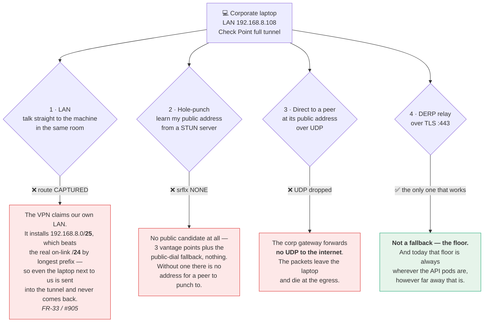
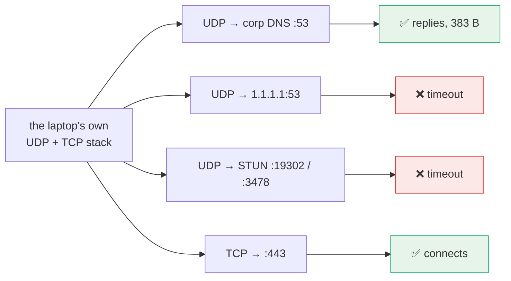

# FR-76 — Tenant-owned DERP nodes: a floor the UDP-blocked population can reach *near them*

**Issue:** [#1454](https://github.com/jk-zhang-meta/MeshHarbor/issues/1454) · **Status:** spec — not started · **Opened:** 2026-09-06

## Goal

A tenant can run its own DERP relay and its nodes will **use it when it is
measurably better**, falling back to the control-plane DERP whenever it is not.
Today every agent's DERP endpoint is derived from its own control-plane URL, so
the floor is always wherever the API pods are — however far that is from the
hosts that can only reach the floor.

## Why — the population that has nothing else

Measured 2026-09-06 on two corporate laptops behind a Check Point full tunnel,
both on the same LAN, both on 0.4.76:

| blocker | evidence |
|---|---|
| **LAN route-captured** | `lan CAPTURED — 192.168.8.0/24 leaves via "Ethernet"` (FR-33 / #905) |
| **no hole-punch** | `srflx NONE` — STUN, 3 vantages + public-dial fallback |
| **UDP egress dropped to the internet** | UDP → corp DNS `:53` **replies (383 B)**; UDP → `1.1.1.1:53`, STUN `:19302`, `:3478` all time out; **TCP 443 passes** |

⇒ No LAN tier, no srflx, no direct-public. **DERP over TLS 443 is not a fallback
for these hosts — it is the only carrier that can exist.** The cascade is already
choosing correctly; there is nothing left to choose.

### The same three blockers, as a picture

The overlay normally tries four ways to reach a peer, cheapest and fastest
first. On these laptops the first three are each blocked by a *different* thing,
which is why no single fix helps:



🔑 **Why blocker 3 is the corp network and not the laptop** — the same host, the
same socket, four destinations:



UDP works perfectly *into* the corporate network and dies only on the way *out*
to the internet, while TCP 443 passes. So the host is not blocking anything —
**the policy is at the corporate egress**, and nothing we ship on the laptop can
change it.

🔑 **This is exactly the population FR-19 cannot serve.** Org relays run on UDP
**3478**, chosen because the symmetric-NAT corp population was *measured* to
reach it — but that population is NAT'd, not UDP-blocked. Here 3478 is as dead
as everything else. ⚠️ **Probe a host's UDP egress before proposing an org relay
for it.**

So the only lever left for these hosts is *where their floor lives*, and today
that is not a lever at all.

## The gap, precisely

`agents/meshharbord/src/derp.rs:89` derives the DERP URL from the control WS URL:

```rust
/// Derive the `/derp` WSS URL from the control `ws_url` (`wss://host/ws`).
fn derp_url_from_ws(ws_url: &str) -> String { … }
```

There is no per-tenant, per-region or per-node DERP selection anywhere. ⚠️ Note
`GET /api/relay/regions` is the **TURN/remote-control PoP topology**, not DERP —
easy to mistake for this and it is not.

## Key design

1. **The server names the DERP endpoints; the agent still measures.** A tenant
   may register DERP nodes (URL + label). The netmap carries the candidate set;
   the node **measures** each and uses the best. Heuristics may detect; they
   never decide — the carrier-cascade rule, applied one layer down.
2. **Auth needs no new primitive.** `remote_control::derp_ticket` already mints
   an Ed25519 ticket scoped to `(network_hex, wg_pubkey)` and verifies it
   **offline against a pinned public key** — so a tenant DERP authenticates
   agents without ever calling the control plane, and cannot serve another
   tenant's network. The registry key is already `(network_id, pubkey)`.
3. **The control-plane DERP stays the floor, always.** A tenant node is an
   *addition*. If it is unreachable, slow, or lying, the node falls back — and
   `derp_floor` must be provably intact with every tenant node down.
4. **Ciphertext only, unchanged.** DERP already carries only ciphertext; a
   tenant node learns the same metadata the control-plane DERP already does
   (who talks to whom, when, how much). ⚠️ That is *not* nothing, and the docs
   must say so plainly rather than implying a tenant relay is zero-trust.
5. **Reuse `crates/derp-relay`** — the standalone binary already exists. The
   work is registration, distribution of the candidate set, ticket verification
   at the node, and selection at the agent. Not a new relay.

## Phases

| # | Phase | Kill switch |
|---|---|---|
| P1 | Server: tenant DERP registration + the candidate set in the netmap (advertised only; agents ignore it) | the registration is opt-in; empty set = today's behaviour byte for byte |
| P2 | Agent: measure the candidates, pick the best, **fall back to the control-plane DERP** | `overlay_tenant_derp` (default OFF) |
| P3 | `derp-relay`: verify the ticket offline against the pinned key; refuse any other network | — (a node that cannot verify serves nobody) |
| P4 | Field: a DERP node near the corp egress; measure RTT on both Check Point laptops before/after | the switch |
| P5 | Docs: extend `docs/overlay-communication.md` + a row in `docs/README.md` | — |

## Acceptance criteria

- [ ] With **zero** tenant nodes registered, behaviour is byte-identical to today
      (the empty-set case is the one that must never regress).
- [ ] A node prefers a tenant DERP **only when measured better**, and re-measures
      — never a static preference, never a ratchet.
- [ ] ⚠️ **`derp_floor` holds with every tenant node down**, proven by taking
      them all down on a host that has no other carrier. *This is the criterion
      that matters*: this feature exists for hosts whose only path is DERP, so a
      bug here does not degrade them — it disconnects them.
- [ ] A ticket for network A is **refused** by a node serving network B.
- [ ] Field: measured RTT improvement on both Check Point laptops, with the
      before/after recorded. **Must fail first** — record the current 56–97 ms.
- [ ] Docs updated with a diagram, linked from `docs/README.md`.

## Open decisions

- **Who may register a node** — presumably `MANAGE_AGENTS` + a tenant-scoped
  route, but a DERP node is closer to infrastructure than to a device.
- **Whether a tenant node may serve *other* tenants** (a "community relay").
  Default no; it multiplies the metadata question by every participant.
- **Selection metric** — RTT alone, or RTT + loss? The relay tier already has
  measurement machinery; reuse rather than invent.

## Out of scope

- Bypassing a VPN's LAN capture — policy evasion, out of scope by standing rule
  and, separately, **measured not to work**: 500 packets to a LAN peer,
  default-bound *and* source-bound to the WLAN address, **zero arrived**;
  `Find-NetRoute` returns the VPN interface with the VPN source, and binding a
  source address does not change the egress interface on Windows.
- Making UDP work where the corp egress drops it. Not ours.
- FR-19 org relays (UDP 3478) — a different population, and useless here.

## Related

- **FR-33 / #905** — the LAN-capture surfacing that named this class in one line
  per host; read `mh status`'s `lan` line before any archaeology.
- **FR-19 / #805** — org relays; the sibling this cannot reuse, and why.
- **FR-28** — DERP drain on pod roll.
