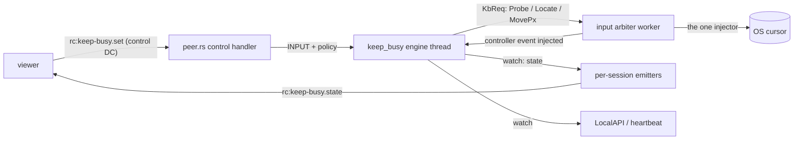
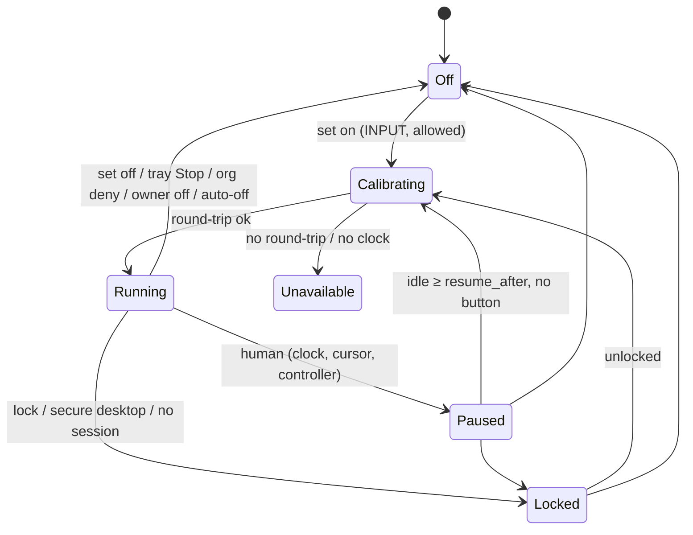

# FR-92: Keep busy — the agent keeps a host active with mouse patterns, and any real user takes over at once

**Issue:** [#1942](https://github.com/gjovanov/roomler-ai/issues/1942) · **Status:** **closed (2026-10-13)** — P0–P9 shipped in 0.4.126, #1991 in 0.4.127, P10 (a local On) in 0.4.129, P10b (SYSTEM never starts it) in 0.4.130. Field-verified (§9, rows 1–57) on Windows, macOS, GNOME on Xorg and Wayland, and KDE Plasma; every criterion ticked (§5)
· **Owner:** remote desktop (agent + viewer), fleet (the org switch) · **Anchors:**
master `71afd2b4c` · **Builds on:** [FR-55](FR-55-always-reachable.md) (power),
[FR-27](FR-27-consent-surfaces-and-desktop-companion.md) (consent, the companion banner, the person socket),
[FR-85](FR-85-hq-screen-recording.md) (`record_remote_enabled`, the device-owned key precedent),
[FR-43](FR-43-macos-single-enrollment.md) (the supervised macOS worker), the P6 input arbiter

## 1. Goal

An operator switches **keep busy** on from the remote-desktop viewer. The agent then moves the host's
mouse in a pattern so the host stays active: no screensaver, no idle lock, no "Away" in Teams or Slack.

The patterns:
- the geometric ones: circle, triangle, square, a one-stroke star, figure-8, heart, spirograph, an 8-petal rose, a wave;
- a Lissajous knot that morphs each loop;
- **wander**, a smooth random path with uneven speed and short rests, which looks the most human;
- **subtle**, a 1 px nudge every ~45 s that resets the idle clock with no visible motion;
- **shuffle**, which rotates through the visible ones.

**A real user always wins.** Any real input pauses it at once: the person at the machine, or a remote
controller, moving, clicking, typing or scrolling. It resumes once that person has been idle for
`resume_after` (30 s by default), and keeps going until someone switches it off. It survives
disconnects, self-updates and reboots.

**Operator decisions (2026-10-10):**
1. **Lifetime:** on until switched off, even across reboots. The state is kept **per signed-in
   person**: it resumes at that person's next login, and someone else signing in starts with it off.
   An optional auto-off is offered.
2. **Availability:** on by default for any session holding `INPUT`. The device owner can turn it off
   (`keep_busy_enabled`, never server-settable), and an **org admin can deny it org-wide** in v1. The
   deny also stops it where it is already running.
3. **Host side:** a companion tray item ("Keep busy is on · Stop") and `roomler keep-busy status|off`.
   - **Amended 2026-10-11** (operator, "i want an On in meshharbor-desktop too"): the person at the
     computer can also turn it on, from the tray ("Start keep busy") and with `roomler keep-busy on`.
     This is P10. Only that person's place may do it: never root, SYSTEM (P10b), a service or another
     session. The server itself still has no "on" (§7). That gate decides who is named. It is not a
     wall against `roomler exec`, which on an attended Windows install runs as the person and passes
     it (§3g, §9 row 43).

## 2. Evidence (master `71afd2b4c`, 2026-10-10)

| What | Where | Consequence |
|---|---|---|
| FR-55 holds `PowerCreateRequest(PowerRequestSystemRequired)` / `IOPMAssertion("PreventUserIdleSystemSleep")` | `agents/meshharbord/src/power.rs` L305-471 | stops sleep, but not the screensaver, the idle lock or presence, because none of these reset the user-idle clock |
| Injected input does reset it: macOS logs a `UserIsActive` assertion "tickle … process:roomlerd" during a session | FR-55 field log; `power.rs` L17-22 | the mechanism works, but today it only runs while a controller types |
| One process-global injection worker owns the only OS injector, created lazily and **cached for the life of the process, Noop included** | `input/arbiter.rs` L581 `global()`, L646 `worker`, L652, L781 `get_or_insert_with` | a second injector would break modifier fencing and the portal route; an early Noop would break RC input until restart |
| Every RC input event already passes through `ArbiterState::plan` with an exact per-session held-key/button set | `arbiter.rs` L286-355, L125-131 | the engine gets an exact "a controller is active" signal, and knows when a remote button is down |
| Clicks carry coordinates, and dispatch **moves before every button event** | `input/mod.rs` L167-173; `input/enigo_backend.rs` L123-138 | a controller's click lands where they point, even after the engine moved the cursor |
| enigo 0.6.1's Windows `move_mouse(Abs)` is `SendInput(ABSOLUTE)` without `VIRTUALDESK`, normalised to the primary display; `to_pixels` ignores `mon` by default | `enigo-0.6.1/src/win/win_impl.rs` L175-176; `enigo_backend.rs` L293-308 | moving through `InputMsg` cannot reach a secondary monitor, so keep-busy needs its own pixel-space move |
| No idle-clock reader exists anywhere (`GetLastInputInfo`, `CGEventSourceSecondsSinceLastEventType`, `XScreenSaverQueryInfo`, Mutter IdleMonitor: 0 hits) | `agents/`, `crates/` | detection is new code; `Win32_UI_Input_KeyboardAndMouse` is already enabled (`agents/meshharbord/Cargo.toml` L425) |
| Lock state is Windows-only and per session; macOS/Linux stubs always read `Unlocked`, and the RC input gate drops input while `Locked` | `lock_state.rs` L170-214, L290-306, L313-335; `peer.rs` L8088-8112 | keep-busy needs its own lock probes on macOS/Linux, and they must **not** feed the RC gate (a Mac controller types the password on the lock screen) |
| The Windows worker lives for the whole console session, regardless of RC, and is respawned at login | `win_service/supervisor.rs` `decide_spawn` L664-763 | an engine there can outlive any session |
| The machine-global config dir is hardened to SYSTEM + Administrators; the default worker runs as the user | `crates/agent-core/src/config.rs` `harden_machine_global_dir`; `supervisor.rs` L816-880 | state "beside the config" is not writable by every worker, so it goes in the signed-in person's profile (`win_identity.rs` L104 `session_user_profile_dir`) |
| Control-DC verbs are untyped JSON switched on `t`; the arbiter fans state out to every session; the viewer drops unknown `t` | `peer.rs` L8239-8699; `arbiter.rs` L789-825; `ui/src/composables/useRemoteControl.ts` L966 | new verbs need no baseline re-record and no server change |
| Org kill switches live in `TenantSettings` (`remote_exec_enabled`, `remote_ssh_enabled`); reconcile-on-connect pushes are cap-gated; cross-pod hub ops go through `publish_rc_ctrl` | `crates/db/src/models/tenant.rs` L79-165; `crates/modules/fleet/src/socket.rs` L240-290; `fleet/src/ctrl.rs` L21-45 | the org deny has a precedent for each of its parts |
| The person-at-the-device LocalAPI socket serves an exhaustive allowlist | `crates/localapi/src/lib.rs` L2235 `person_may` | the Stop must be added there, so a Linux system install's companion can reach it |

## 3. Design

### 3a. One more input source, not a second injector

- **New module `agents/meshharbord/src/keep_busy/`**: one std thread. It contains:
  - `engine.rs`: a pure state machine over a `Host` trait, tested with a fake host and clock, the
    `ArbiterState` split again;
  - `patterns.rs`, `state.rs`;
  - per-OS host probes (idle clock, lock, mouse buttons, work area).
  
  File I/O and lock probes run on this thread, never on the input path.
- **The arbiter serves requests.** `Cmd::KeepBusy(KbReq{ op: Probe | Locate | MovePx{x,y}, reply })`:
  - Reads run on the injector thread, so the SystemContext desktop rebind covers them, with a reply
    timeout so a stuck injector can't hang the engine.
  - `MovePx` is **refused while any session holds a mouse button**.
  - After every *session-caused* injection (never a `Heartbeat`, never a denied event), the arbiter
    notes remote activity.
- **The injector trait gains `cursor_px` / `move_px`** in desktop pixel space. They default to
  unsupported (Noop, or a portal-owned route ⇒ `unavailable:portal`, never a silent no-op).
  - Windows: `move_px` is a direct `SendInput(MOVE|ABSOLUTE|VIRTUALDESK)` over the virtual screen, and
    `cursor_px` is `GetCursorPos` (the process is per-monitor-v2).
  - macOS/X11: enigo's `move_mouse(Abs)` and `location()` share global/root coordinates.
  - The read and the write use one coordinate space, so a divergence means something. The pixel moves
    bypass enigo `dispatch`, so they never spend the 50 INFO input-diagnostic samples or the keyboard
    layout sampler.
- **Start** after `arbiter::global()` exists (it captures the tokio handle). The engine homes:
  - **Windows:** the console-session worker.
  - **macOS:** the GUI-session worker, which runs the full `run()`.
  - **Linux:** the daemon.

### 3b. Who is a real user — an expected-state diff

The engine only ever causes absolute mouse moves, so anything else is a human. Each tick it pauses on:

1. **An idle-clock advance it did not cause.**
   - **Windows `GetLastInputInfo`.** It's session-scoped and updated asynchronously, in 15.6 ms ticks.
     After its own move the engine polls until `dwTime` advances (cap ~50 ms) and keeps that as the
     baseline. A later `dwTime` ≠ baseline (a wrapping u32 compare) means a human. No advance at all
     means the move is not landing (UIPI, the wrong desktop) ⇒ `not_landing`, never "busy".
   - **macOS `CGEventSourceSecondsSinceLastEventType`.**
   - **X11 `XScreenSaverQueryInfo`** (the x11rb `screensaver` feature).
   - **A host with no idle clock** does not advertise the feature: v1 refuses rather than run
     keyboard-blind.
2. **Cursor divergence:** the cursor is more than 1 px from where the engine left it.
3. **Controller input** noted by the arbiter.

Divergence with no clock evidence means an app warped or confined the cursor. That's
`cursor_contended`, with exponential backoff, so it never oscillates.

**Banned:**
- `SetWindowsHookEx` (low-level hooks);
- `RegisterRawInputDevices(INPUTSINK)`;
- keyboard `GetAsyncKeyState` polling;
- key event taps.

EDR flags each as a keylogger, and GPO-locked corporate desktops with EDR are in the acceptance bar.
Mouse-*button* state is read **once per resume**, never polled.

**Calibration** on every enable and resume: read the cursor, move it **3 px out and back**, verify the
pointer reached each leg, and require the idle clock to register the moves. Otherwise
`unavailable:calibration_failed` (or `not_landing` when the clock never moves).

Two details matter:
- A move to the same point may not count as input anywhere.
- A pointer stuck at the anchor round-trips "home → home" perfectly. Only checking the out-leg catches it.

A test pins this (P1).

**Resume** when the human has been idle for `resume_after`, no button is held, the session is unlocked
and present. The engine re-anchors at the **current** cursor and continues from the nearest point of the
pattern: no jump, an eased start.

### 3c. Safety invariants

- **Moves only**: never a click, key or scroll.
- **Safe box**: the work area of the monitor under the anchor, intersected with a 48 px inset from
  every monitor edge. It stays out of hot corners and edges: GNOME Activities, macOS hot corners (which
  can start the screensaver or **lock the screen**), auto-hide taskbars and Docks, the menu bar, Peek.
- **Pause while locked, on a secure desktop, or with no session.**
  - Windows: `probe_lock_state_detailed()`, a free function called per tick. It is not the
    session-scoped monitor (#1738).
  - macOS: `CGSSessionScreenIsLocked`.
  - Linux: logind `LockedHint`.
  - These probes are **keep-busy-only**.
- **Never the first caller of the cached injector before a display exists.** No `Locate`/`MovePx`
  until `Probe` confirms an interactive session. A boot-time restore on a Linux daemon without
  `DISPLAY` would otherwise cache a Noop and break RC input until restart.
- **The viewer never re-asserts keep-busy on connect.** It's the opposite of display-match
  (`RemoteControl.vue` ~L4148): the device's state is authoritative, and a reconnecting tab must not
  undo the host's Stop.
- **Wayland is refused explicitly** (loginctl `Type=wayland`). XTest there moves only Xwayland's
  private pointer, so a calibration could pass while nothing real moves.
- **Warnings are reported, not swallowed:**
  - `focus_follows_mouse` (Windows `SPI_GETACTIVEWINDOWTRACKING`; the viewer suggests `subtle`);
  - `resume_after_exceeds_lock_timeout`.

### 3d. Wire

- **Control DC in:**
  - `{"t":"rc:keep-busy.set","on":true,"pattern":"circle","size":"m","speed":"normal","resume_after_s":30,"auto_off_min":null}`
  - `{"t":"rc:keep-busy.set","on":false}`
  - `{"t":"rc:keep-busy.get"}`
  
  Each requires `INPUT`.
- **Control DC out** (to every session on change, and on open/get): `{"t":"rc:keep-busy.state","available":true,"on":true,"phase":"calibrating|running|paused|locked|off|unavailable","reason":"…","paused_by":"local|remote|null","resumes_in_ms":23000,"pattern":"circle","size":"m","speed":"normal","resume_after_s":30,"auto_off_at_ms":null,"set_by":"Alice","detector":"clock+cursor","warn":[]}`.
  - `reason` is a closed enum with wire codes; the sentence is written on the agent (the
    `apps::Unavailable` pattern).
- **Caps:** `keep-busy` in `AgentCaps.input` (`encode/caps.rs` L1445). It's present only when the build,
  the host, the idle clock and `keep_busy_enabled` allow it, and it follows the key at heartbeat time,
  like the `record` cap. Matching is equality, and unknown words are ignored.
- **LocalAPI:** `keep_busy_status` / `keep_busy_off` → `keep_busy`.
- **Server → agent:** `ServerMsg::KeepBusyPolicy { denied }`, tag `rc:agent.keep_busy_policy`,
  owned by fleet in `namespace()`. It is the only server→agent keep-busy message (§3f).

### 3e. Persistence — per signed-in person

- **The file:** `keep-busy.json` (version, on, settings, `set_by`, `set_at`, an absolute `auto_off_at`,
  last-known org denies, `#[serde(flatten)] extra`).
  - Atomic temp+rename, copied from `crates/agent-core/src/desktop_state.rs`.
  - Written on On/Off edges only, never on pause/resume.
  - Corrupt ⇒ Off.
- **Location:**
  - **Windows:** the console user's profile (`win_identity::session_user_profile_dir` under SYSTEM, else
    `own_profile_dir`). The user-context and SystemContext workers resolve the same file.
  - **macOS:** the GUI worker's `data_local_dir`.
  - **Linux root daemon:** `keep-busy-<console uid>.json` next to the logs.
- **Never stored in `config.toml`.** It's SYSTEM/root-owned on system installs, sits behind an
  in-process write lock, gets reported to the server, and `adopt_local` would read every toggle as a
  config edit.

### 3f. Policy gates

- **Device: `keep_busy_enabled`**, default true (`AgentConfig`, near `power_policy` L167).
  - It's a live `config_surface` key in RemoteDesktop, like `record_remote_enabled` (L1590), and goes
    in `live_keys_are_exactly_the_adopt_local_set` (L2699).
  - A local `ConfigSet` takes the console-user gate of `record_*` (`localapi/src/lib.rs` ~L2431).
  - It is **absent from `DesiredConfig`**, pinned by a twin of
    `no_record_key_is_server_pushable_via_desired_config` (`models.rs` L4448).
  - Its description says that keep-busy overrides `power_policy = never`, because injected input
    defeats idle sleep.
- **Org: `TenantSettings.keep_busy_denied`** (default false = allowed).
  - `GET/PUT /api/tenant/{tid}/keep-busy-settings`: reading needs MANAGE_AGENTS, writing needs
    MANAGE_TENANT, following exec-settings (`fleet/src/agent_exec.rs`).
  - **Standing:** reconciled on connect after `ConfigPush` (both `true` and `false`, so a re-allow while
    offline clears), and pushed on change through `publish_rc_ctrl` → an `apply_rc_ctrl` arm, because
    the PUT can land on any pod. Both are cap-gated (`supports_keep_busy`).
  - **The word reappearing counts as a connect.** When the owner turns `keep_busy_enabled` back
    on, the agent re-announces its caps on a heartbeat, and the policy is pushed then. Without
    this, a deny made while the word was absent would never arrive. It is pushed only on the
    reappearance: caps are also re-announced for the record word and for a worker's permissions.
  - **On the agent:** the effective deny is the strictest of every enrolled org's last-known deny,
    persisted. An old server (no push) means allowed.
  - **An org the device has left drops out.** At each start, a stored policy from an org that is
    no longer the primary or in `[[orgs]]` is dropped (`prune_departed_orgs`). Otherwise leaving
    an org that had denied keep busy would deny it on that device for good, because no server
    would ever push that org's re-allow.
  - **Device-wide, so no per-session field.** Under strictest-of a deny is device-wide, and the
    engine itself refuses every enable while it holds (`org_denied`, to every viewer). The connect
    reconcile reaches the agent before any session request, and a change is pushed at once. A
    `keep_busy_denied` field on `ServerMsg::Request` would only repeat that, at the cost of threading
    it through the session authz, the hub, the cross-pod relay JSON and the macOS delegation. That
    design was dropped in P1 (see §8).

### 3g. Host side

- **LocalAPI `KeepBusyStatus` / `KeepBusyOff`**, both on the person-socket allowlist.
  - Off is open to every peer the endpoint admits (including `roomler exec`), because stopping is
    the safe direction.
- **LocalAPI `KeepBusyOn { opts }` (P10)**, also on the person-socket allowlist, and gated on the
  peer by `ClientPeer::may_start_keep_busy` (`crates/localapi`):
  - Windows: the active console session, never session 0;
  - a per-user daemon's socket (the macOS GUI worker, a Linux user daemon): its owner;
  - a Linux system install's person socket: its person;
  - **root never**. The console-user gate the recording verbs use lets root through on Unix, and root
    is how `roomler exec` arrives there.
  - **SYSTEM never** (P10b, operator 2026-10-12), nor LocalService or NetworkService: Windows' root.
    The pipe listener reads the client's account from its token at accept time
    (`pipe_client_peer` → `GetNamedPipeClientProcessId` → `OpenProcessToken` →
    `IsWellKnownSid`), never from what the client says. A Windows peer whose account cannot be read is
    refused. This closes `roomler exec` on a host in SystemContext mode, where exec runs as SYSTEM
    *inside* the console session. It also refuses structurally any later exec that runs as SYSTEM
    (#2021). The person's tray and CLI run as the person, whose token the worker can always read.
  - ⚠️ **Not a wall against `roomler exec`** (§9 row 43, 0.4.129). On Windows exec runs in the worker
    that holds the agent socket (`RunAs::Daemon` is the worker's identity), and that worker lives in
    the console session: the signed-in user's elevated token on an attended install, SYSTEM in that
    session in SystemContext mode (`ROOMLERD_ENABLE_SYSTEM_SWAP`). A controller connecting changes
    neither. So
    `roomler exec <win> -- roomler keep-busy on` passes the session test and is named "the person at
    this computer". On Unix exec arrives as root and is refused, but root can `sudo -u` the person
    (row 42 did exactly that, to stand in for the person). No local gate can be that wall: an exec
    caller could as well write the person's `keep-busy.json`, or run an input loop of its own. What
    an exec caller may do is the owner's `exec_enabled`. Not an escalation, then, but the naming is
    wrong for such a start. Since P10b that holds only on an **attended** install, where exec runs as
    the signed-in user. Which identity exec should have on Windows is #2021 (§6).
  - `opts` are the viewer's wire names (pattern, size, speed, `resume_after_s`, `auto_off_min`),
    checked by the viewer's own parser (`wire::parse_set`); absent means the product default.
  - The start names `"the person at this computer"` as who turned it on: the person's account name
    is not ours to show every viewer and the org's history.
  - A supervised Mac's root daemon refuses it rather than relay it. The person's clients reach the
    GUI worker directly, and nothing that can only reach the root daemon may start synthetic input.
- **CLI:** `roomler keep-busy [status|on|off] [--json]`. `on` takes `--pattern`, `--size`, `--speed`,
  `--resume-after SECONDS` and `--auto-off MINUTES`.
- **Companion:**
  - a tray item and tooltip, polled like the recording item (`meshharbor-desktop/src/tray.rs`
    `spawn_recording_watch`). Since P10 it is a toggle:
    - "Stop keep busy (Pattern · phase)" while it is on;
    - "Start keep busy" while it is off and can run here (the product default pattern);
    - "Keep busy: unavailable", disabled, where it cannot run.

    The click reads the state at that moment, since the label may be 3 s old;
  - a one-shot notification when it turns on;
  - a "Keep busy is on · Stop" row in the viewing banner while that banner is up.

### 3h. Viewer and admin UI

- **Viewer composable:** `useKeepBusy.ts`, modelled on `useRemoteRecording.ts`.
- **Viewer menu:** sits beside Record and holds
  - an on/off switch;
  - a pattern grid of inline-SVG previews drawn from the same formulas;
  - speed and size;
  - `resume_after` (10 s – 5 min) and auto-off (never – 8 h);
  - a status line ("Paused, someone is using this computer · resumes in 23 s");
  - a live chip like Host-locked.
- **Gating:** on the cap word and the session's `INPUT` bit; an unavailable or denied state is shown
  with its reason.
- **Org admin:** a switch in `SettingsSection.vue` beside exec/SSH; since P8 a default-pattern
  select beside it, and since P7 the History list (when · device · what · who, a device-reported
  vs admin marker, a device filter, "load more").
- **Device list (P5b):** a "keep busy · <phase>" chip, shown while it is on, naming the pattern and who
  turned it on. It is driven by an additive `AgentHeartbeat.keep_busy` (a device *claim*, shown and never
  enforced on), persisted by `touch_heartbeat`, and **unset** when a device stops saying (an older
  build, a supervised Mac's root daemon, which cannot speak for its GUI worker). So it reads as
  unknown, never a stale "on" or an invented "off". A durable transition audit is an open decision (§6).

## 4. Phases

| Phase | What | Kill switch | Status |
|---|---|---|---|
| P0 | Claim: issue #1942, this spec, the ledger row | Docs only | #1943, merged `bca02736a` |
| P1 | Pure engine + patterns + fake-host tests; `cursor_px`/`move_px` + the arbiter `KbReq` seam; the Windows host; the control-DC verbs; the state file; `keep_busy_enabled`; the cap word | `keep_busy_enabled = false`; no cap word ⇒ the viewer hides it | #1948, merged `714032336` |
| P2 | Viewer: composable, menu, previews, chip | the cap word | #1949, merged `d98c8bb88` |
| P3 | **P3a, X11**: the X11 host (MIT-SCREEN-SAVER idle clock read as an interval, logind `LockedHint`, RandR ∩ `_NET_WORKAREA`), Xwayland refused from the display itself (`wayland`), the person followed under a root daemon or a SYSTEM worker, proven on Xvfb in CI. **P3b, macOS**: the CoreGraphics host, and the daemon handing every org's policy to the GUI worker | per-host cap word | P3a #1959, merged `a91171f26`; P3b #1960, merged `fff6c658b` |
| P4 | LocalAPI verbs (person socket), CLI, companion tray item. Not built: the OS notification (the companion has no notification plugin yet) and the viewing-banner row (the banner shows only during a session; the tray is the persistent surface) | — | #1951, merged `9f2bbe5f6` |
| P5 | Org deny: tenant key, routes, admin UI; a standing `rc:agent.keep_busy_policy` on every connect and on every change, across pods. No per-session `Request` field (§3f). Forwarding to a supervised Mac's worker moves to P3. Deferred to P5b: the heartbeat brief, the device-list badge, the audit | the org switch (default allowed) | #1952, merged `64e1bb7cf`; P5b #1965, merged `fc896ba31`: the brief + the device-list chip |
| P6 | Docs: `docs/keep-busy.md` (mermaid state machine + sequence), a cross-ref from `docs/remote-control.md` §6, the `docs/README.md` row, the configuration reference; the field log | — | #1963, merged `ce8799518`; the field log waits for a release candidate |
| P7 | **A permanent history** (operator, 2026-10-11): `keep_busy_events`, owned by `fleet`, **no TTL**. Server rows (`org_denied` · `org_allowed` · `org_default_pattern`, only on a change, naming the admin) and device rows (`on` · `off`, derived on the heartbeat path from the previous stored brief against the new one — ONE `find_one_and_update` returning the row as it was — with a restart dedupe); `source` tells the server's decision from the device's claim. `GET …/keep-busy-history` (`MANAGE_AGENTS`, tenant + device scoped, `before`/`limit` paging); a History list with a device filter in the org's card. Resolution is the 30 s heartbeat; exact device-pushed edges would need an agent release | none (a record, not a gate; the route alone) | #1977 open |
| P8 | **The default pattern**: circle stays the product default; `TenantSettings.keep_busy_default_pattern` lets an org choose another, validated by **equality** against the agent's 13 wire names, `null` clears, absent leaves alone; the settings `GET` becomes readable by any member so the viewer can pre-select it (`PUT` stays `MANAGE_TENANT`). No agent and no wire change: the menu pre-selects the org default only where the person has no remembered choice; a fetch failure means circle | unset the default (= circle) | #1977 open |
| P9 | **GNOME on Wayland** (and GNOME on Xorg under a root daemon) through the arbiter's uinput device: a normalised move (`KbOp::MoveNorm`), Mutter's idle clock and layout asked by `portal-helper --keep-busy` inside the person's session, a **blind** host (`Host::blind`). Plus the GDM/Xorg lock fix found in the field: `logind::pick` | `uinput = false` (the GNOME host needs the uinput device); the cap word | #1978, merged `211f2dc18` |
| P10 | **A local On** (operator, 2026-10-11). The person at the computer turns it on from the tray's "Start keep busy" or with `roomler keep-busy on [--pattern …]`. LocalAPI `KeepBusyOn`, gated to the console person: never root (`roomler exec` on Unix), never session 0, never relayed by a supervised Mac's root daemon. It names "the person at this computer". The server still has no "on". ⚠️ On Windows a `roomler exec` runs in the console session and passes the gate (§3g) | `keep_busy_enabled = false` and an org deny refuse it, as they refuse a viewer's | #2009, merged `97cc39b11`; released in **0.4.129** |
| P10b | **SYSTEM never** (operator, 2026-10-12, §6). The Windows pipe listener reads the client's account from its token at accept time (`ClientPeer::system_account`). SYSTEM, LocalService, NetworkService, or an account that cannot be read, are refused keep busy's On, wherever they run. That closes `roomler exec` in SystemContext mode. No environment marker. Plus a Windows CI step for the LocalAPI crate, whose Windows tests ran in no lane | `keep_busy_enabled = false` and an org deny, as for P10; no switch of its own (a refusal, and only of SYSTEM) | #2037, merged `c46ef3297`; released in **0.4.130**; field-verified with its negative control (§9 rows 50–51) |

## 5. Acceptance criteria

- [x] **AC1:** turning it on in the viewer starts it on the host, and every connected viewer shows the
  same live state.
- [x] **AC2:** while it runs, host idle time stays under 2 s on Windows, macOS and X11, measured. The
  negative control (OFF ⇒ the host locks at its idle delay) is recorded first. *Reworded 2026-10-13
  (operator):* the lock replaced "and Teams goes Away", which no lab host could show (none runs
  Teams). Teams' and Slack's Away read the same OS idle clock that the lock does.
- [x] **AC3:** local input (move, click, scroll, typing) and controller input each pause it within 1 s. It
  resumes after `resume_after`, and never while the screen is locked or a mouse button is held.
  *Accepted limit (operator, 2026-10-11):* on Windows, a single isolated key tap that lands in the same
  `GetLastInputInfo` tick (15.6 ms) as one of keep busy's own moves reads as that move and does not
  pause it (1 of 9 in the field). A second key, a click or any pointer motion does.
- [x] **AC4:** it survives a disconnect, a daemon self-update and a reboot (resuming at the same
  person's next login).
- [x] **AC5:** `keep_busy_enabled = false` withdraws the `keep-busy` cap word, so every surface that reads it
  hides keep busy; a viewer already connected shows the owner's reason ("Turned off on this computer")
  instead of a working control; every enable is refused; and the server cannot change that key
  (reworded 2026-10-11, operator: the connected viewer is told why rather than finding it gone).
- [x] **AC6:** an org deny refuses new enables and stops running instances, including on devices that
  reconnect later and across pods.
- [x] **AC7:** the tray's Stop and `roomler keep-busy status|off` work, including through a Linux
  system install's person socket.
- [x] **AC8:** no hook or raw-input API is used. A source-scan unit test passes (proven to fail on a
  planted line), the binary's import diff against the previous release is clean, and EDR stays quiet
  for 24 h on the corporate laptop.
- [x] **AC9:** Wayland and portal-only hosts that keep busy cannot drive report `unavailable` with a
  reason the viewer shows (`wayland` without the uinput path; `no_idle_clock` on a desktop with no idle
  clock a helper can read).
- [x] **AC14 (P10):** the person at the computer turns it on from the tray's "Start keep busy", and
  with `roomler keep-busy on` (any pattern, checked by the viewer's parser), on Windows and on a
  supervised Mac. Every connected viewer shows "turned on by the person at this computer". A root or
  SYSTEM caller is refused (reworded 2026-10-12, operator). On an attended Windows install,
  `roomler exec` runs as the signed-in user and is admitted until #2021 decides exec's identity. The
  owner's switch and an org deny refuse a local start as they refuse a viewer's.
- [x] **AC13 (P9):** on GNOME on Wayland, through a system install with uinput on, keep busy runs:
  the negative control (OFF ⇒ GNOME locks at its idle delay) recorded first, then ON ⇒ no lock and
  Mutter's idle clock under 2 s, and a local key pauses it within 1 s.
- [x] **AC10:** docs updated or created with mermaid diagrams (`docs/keep-busy.md`: the state machine,
  the sequence, the gates) and linked from `docs/README.md`; the configuration reference covers
  `keep_busy_enabled`.
- [x] **AC11 (P7):** the history records every on and off a device reports (with who and the pattern,
  and the reason for an off) and every change to the org's settings (naming the admin, only on a
  change), survives the device's removal, is readable only with `MANAGE_AGENTS` and only within the
  tenant, pages by `before`, and is never aged out — field-verified on a release: a device turned on
  and off from the viewer shows two rows with the right names within one heartbeat.
- [x] **AC12 (P8):** an org's default pattern is what a viewer's menu pre-selects on a device the
  person has no remembered choice on; a person's own last choice wins over it; `null` clears it to
  circle; an unknown pattern is refused; a plain member can read the setting and cannot set it.
  *Evidence (operator, 2026-10-13):* the pre-select, `null` and the refusal of an unknown pattern are
  field-proven (§9 row 25; prod HTTP 400, 2026-10-12). Two clauses are accepted on test-level evidence:
  a plain member's read but not set (`keep_busy_tests.rs`), and a remembered choice winning
  (`KeepBusyMenu.spec.ts`). The vmtest org has no member account, and none is created on production
  for a test.

## 6. Open decisions

- **Whether the arbiter should stop caching a `NoopInjector`** → **deferred to #2066** at the close
  (2026-10-13). Keep busy's own path already refuses to cache an injector without permission
  (`keep_busy_op`). The open question is RC's path (`get_or_insert_with(open_default)`), which changes
  RC behaviour, needs its own test and field check, and is not FR-92's.
**Resolved 2026-10-12 (operator: "do per recommendation and proceed"):**
- *How an On started through `roomler exec` is handled* (§3g, §9 row 43). The decision is an
  **identity check now, #2021's FR later, and no marker**.
  - P10b refuses SYSTEM, LocalService and NetworkService, read from the client's token, so an exec
    on a host in SystemContext mode is refused today. Once #2021 runs exec as SYSTEM, the same
    check refuses it everywhere, structurally.
  - The marker considered here (an environment variable in every exec and SSH child) was dropped.
    It's a courtesy anyone can strip, it touches three spawn paths, and it becomes dead weight
    once #2021 lands. Revisit it only if #2021 decides that exec stays as the signed-in user.
  - AC14's exec clause now reads "a root or SYSTEM caller is refused". On an attended Windows
    install, exec runs as the person and is admitted until #2021 lands. The harm in the meantime
    is low: it takes `EXEC_DEVICE` plus the owner's `exec_enabled`, and the server audits the
    caller and the command.
- *AC8's EDR clause* (§9 row 44): the operator takes the 24 h local reading as met, ticked at the
  close with its caveats.

**Resolved 2026-10-11 (operator: "do permanent history, default pattern and wayland support"):**
- *The default pattern* — circle stays the product default; an org may choose another (P8,
  `keep_busy_default_pattern`). `subtle` was not made the default: the visible motion was what
  was asked for.
- *A durable audit of keep-busy transitions* — P7: its own collection, `keep_busy_events`, with
  **no retention** (permanent), the index-plan change and the composition re-baseline it needed,
  derived from the heartbeat briefs on the server (so no agent release) at the heartbeat's
  resolution. The agent's log keeps recording every on/off locally as before.
- *When Wayland ships* — P9: GNOME's Mutter IdleMonitor plus the arbiter's uinput device, blind (it
  cannot read the pointer back). KDE and wlroots have no idle clock a session helper can read, and
  report `no_idle_clock`. Coordinated with FR-93 (#1972), which owns making uinput the default on
  Wayland and the one desktop-session resolver.

## 7. Out of scope

- Sleep and power assertions (FR-55).
- Clicks, keys or scrolling of any kind.
- **A server "on".** A server-side enable would be the only server-forgeable input path in the
  product, so there is none. The only ways to turn it on are a consented, `INPUT`-granted session
  and, since P10, the person at the computer. `roomler exec` is refused for that start where it
  arrives as root (Unix) or, since P10b, as SYSTEM (Windows in SystemContext mode). On an attended
  Windows install it runs inside the console session as the signed-in user, and passes (§3g,
  measured on 0.4.129). There it already holds every power a mouse jiggler needs, and the device
  owner's `exec_enabled` is the gate. #2021 decides exec's identity.
- Work-hour schedules.
- A per-device admin deny in `AccessPolicy`.

## 8. Rejected along the way

- **Reusing the recording verbs' console-user gate for P10's local On.** `peer_is_console_user` lets
  root through on Unix (`p == own || p == 0`), and root is how `roomler exec` arrives there. With it,
  the server could start synthetic input on every exec-enabled Linux or macOS device. The On has its
  own gate (`peer_may_start_keep_busy`): root never.
- **Low-level hooks or raw input to tell real from synthetic input.** They're exact (`LLMHF_INJECTED`,
  a null `hDevice`), but EDR reads them as keylogging.
- **Cursor warps** (`SetCursorPos`, `CGWarpMouseCursorPosition`, `XWarpPointer`). They move the
  pointer without resetting the idle clock, which defeats the purpose.
- **Moving through `InputMsg::MouseMove` and `to_pixels`.** It reaches the primary display only, and it
  spends the per-session input diagnostics.
- **State "beside the config" or inside `config.toml`.** The hardened machine-global dir is not
  writable by the default user worker, and `config.toml` has several writers.
- **Device-wide state.** It would start moving a different person's mouse after they sign in.
- **A per-session org flag, alone or beside the push.** Alone, it cannot stop an instance that
  outlived its session, so the standing push exists. Beside the push it is redundant: the deny is
  device-wide (strictest of every enrolled org), and the engine refuses every enable while it holds.

## 9. Field-verification log

**2026-10-11, prod** (server `hosted-20261011-967e5b6`, agents **0.4.125**), on throwaway vmtest VMs
on zeus enrolled in the vmtest org, never a machine someone uses. The viewer is the production SPA
driven by Playwright as the org's admin; every `rc:keep-busy.state` frame is logged on the same
clock as the injected input. **Local input is real**: `virsh send-key` and QEMU's `mouse_move` /
`mouse_button` reach the guest through its virtual keyboard and mouse. Idle is the host's own clock,
read inside the session: `GetLastInputInfo` (an interactive scheduled task), `xprintidle`, and
Mutter's `GetIdletime` over the person's bus.

| # | Cell | Host | Result |
|---|---|---|---|
| 1 | AC2 negative control | Win11, system install (SystemContext worker), machine inactivity limit 60 s | **OFF: idle grew 0 → 100 s and the session LOCKED at 66 s** (LogonUI) |
| 2 | AC3: never while locked | same, locked | turned ON while locked: `locked` in 37 ms, and it stayed there |
| 3 | AC4: reboot | same, hard reset | after autologon: `running (circle), turned on by vmtest admin`, no viewer connected |
| 4 | AC2 ON | same, the 60 s lock armed | **15 min: 894 samples, idle max 47 ms (p99 32 ms), no lock** |
| 5 | AC3: local and controller input | same, `resume_after` 10 s | local mouse 0.83 s · controller mouse 0.27 s · controller key 12 ms · each resumed after 10.1 s |
| 6 | AC3: a single local key | same | **8 of 9 isolated Shift taps** paused it (0.5–1.1 s, including ~0.5 s of injection path); one slipped through inside a `GetLastInputInfo` tick shared with an own move (`docs/keep-busy.md` §10). Bursts of four taps: 4/4 in 0.40–0.50 s |
| 7 | AC3: a held button | same, QEMU `mouse_button 1` for 25 s | paused 0.81 s after the press, `button_held` when `resume_after` ran out, resumed 10.1 s after the release |
| 8 | AC2 negative control | Ubuntu 24.04, GNOME on Xorg, root daemon given the display (`/etc/default/roomlerd`), uinput off | **OFF: X idle 123 s, GNOME locked** (`LockedHint=yes`) |
| 9 | **a bug** | same, locked | turned ON while locked: **`running` behind GNOME's lock screen** (X idle 5 ms). GDM's Xorg session names no display to logind, so `logind::pick` matched nothing and the lock was never read. **Fixed in P9** |
| 10 | AC2 ON | same, unlocked, GNOME's 60 s lock armed | **5 min: 301 samples, X idle max 33 ms, no lock** |
| 11 | AC9 | Ubuntu 24.04 GNOME **Wayland**, system install, uinput on | `unavailable`, reason **`unsupported`** ("Unavailable on this computer."), not `wayland`: a root daemon has no `DISPLAY`, so the X11 host never even saw Xwayland. P9 makes this host run |
| 12 | AC13 negative control | same, keep busy unavailable | **OFF: Mutter idle reached 60 s and GNOME locked** |
| 13 | AC6: org deny, **across pods** | all three VMs' sockets on pod A; the PUT sent straight to pod B | every device logged `org policy received denied=true` and turned off, 17–38 ms after the PUT |
| 14 | AC6: refuses new enables | Win11, denied | the viewer greys the switch ("Disabled by your organization."); a raw `rc:keep-busy.set on` sent past it, straight down the control channel, came back `on=false org_denied` in 10 ms |
| 15 | AC6: a device that reconnects | Ubuntu (X11), denied, `roomler restart` | the policy arrived 5 ms after the new hello, and it stayed off. The re-allow (via pod B again) reached all three in ~20 ms and turned nothing back on |
| 16 | AC7: the CLI | Win11, over the guest's own shell | `roomler keep-busy status` (and `--json`) read the live state; `roomler keep-busy off` turned it off, "Turned off at this computer." |
| 17 | AC8: imports | the release MSIs, `roomlerd.exe` 0.4.124 → 0.4.125 | **exactly two new imports**, `user32!GetLastInputInfo` and `user32!SystemParametersInfoW`; no hook, raw-input or keyboard-state API added (`GetAsyncKeyState`/`GetKeyState` predate keep busy) |
| 18 | AC13 ON (**P9 build**) | Ubuntu 24.04 GNOME **Wayland**, system install, uinput on, GNOME's 60 s lock armed | the GNOME host came up 44 ms after the turn-on (`idle_clock=true geometry=true`), `detector` `clock`; **~5 min: 284 samples, Mutter idle max 46 ms (p99 33 ms), no lock** |
| 19 | AC13: local input, lock (P9) | same | a key paused it in 0.64 s, a move of the VM's USB tablet in 0.54 s; each resumed after ~10 s. `loginctl lock-session` ⇒ `locked`; the unlock ⇒ paused for whoever unlocked, then running |
| 20 | **the fix** (P9) | the Xorg host of cell 9, P9 installed | turned ON while locked: **`locked` in 229 ms, X idle growing** — the same cell 0.4.125 failed |
| 21 | AC1: every viewer | two viewers on the GNOME Wayland guest, the second one with the floor | the floor holder switched it on; **the other viewer, doing nothing, saw it 13 ms later**, both toolbars "Keep busy · locked". The off reached the other in 15 ms (`stopped_by_controller`) |
| 22 | AC5: the owner's off | the GNOME Wayland guest, running | `roomler config set keep_busy_enabled false` applied live: it stopped (`device_disabled`, "Turned off on this computer"), the `keep-busy` word left the server's listing within a heartbeat, and a raw `set on` was refused `device_disabled`. A connected viewer shows the control **disabled with the owner's reason** (the P2 design: `agentSupportsKeepBusy \|\| state`), not hidden |
| 23 | AC7: a Linux system install's person socket | the GNOME Wayland guest, as the unprivileged user | `roomler keep-busy status` read the root daemon's state and `roomler keep-busy off` stopped it ("Turned off at this computer.") |
| 24 | Worker types: the user-context worker | Win11 attended install (`worker role probed role=User`) | on ⇒ running in 228 ms; **69 samples before the touch, session idle max 32 ms**; a real local key paused it ~1 s later, and it resumed after 10.1 s. The store is the person's own `%LOCALAPPDATA%\roomler\roomler\data\keep-busy.json` (its owner reads `BUILTIN\Administrators`: the default owner of the worker's elevated token; access is the profile's inherited ACL) |
| 25 | AC12 (P8), **prod** `hosted-20261011-a5429ac` | the vmtest org | the admin set the org default to `heart` (200). A FRESH viewer, with nothing remembered for the device, pre-selected `["heart"]`. Reset to `null` afterwards |
| 26 | AC11 (P7), **prod** | the GNOME Wayland guest | on from the viewer at 09:37:21 ⇒ an `on` row (device, `vmtest admin`, circle) at 09:37:50, the next heartbeat; off at 09:39:08 ⇒ an `off` row (`stopped_by_controller`) at 09:39:20. The org-wide list, newest first: `off` · `org_default_pattern` → null (server, the admin) · `on` · `org_default_pattern` heart (server, the admin) — exactly the four changes made, nothing else |
| 27 | **The release**: `agent-v0.4.126` + `setup-v0.4.126` → `41abdd4c1` (#1981) | — | published 13:09:25Z / 13:10:31Z; 28 agent assets with 10 `.asc`; "Resolved MSI ProductVersion: 0.4.126 (from 0.4.126)"; `/api/agent/latest-release` served it at once. The merge tree was byte-identical to the rehearsed tree |
| 28 | **AC4: a daemon self-update** | Win11 system install on **0.4.125**, keep busy running, no viewer | the agent's own updater: "installer signature verified … signer=G ROX LTD", "spawning installer and exiting current=0.4.125 latest=agent-v0.4.126"; 5 s later 0.4.126 started and **"keep-busy: restored from the per-person store"** (circle, `vmtest admin`) — running again with no viewer: 60 s of session idle, max 47 ms. (A server-pushed update is DROPPED while the device's `auto_update = false`, by design: "update trigger dropped — auto-update is off on this device".) |
| 29 | **AC9 + AC13 on the release** | a fresh Ubuntu 24.04 GNOME Wayland system install of **0.4.126** (uinput on) | OFF: a real key, then GNOME locked at 60.35 s. ON from the viewer: running in 229 ms; the GNOME host came up 24 ms after "no X display to drive"; **2 min: Mutter idle max 39 ms, no lock**; a real local key paused it at once (`paused_by: local`) and it resumed 10.3 s later |

**macOS, 2026-10-11, on the released 0.4.126** — the operator's MacBook, at the operator's request
and with the operator at the machine for the hands-on cells: macOS 27.0.1, a **supervised** install
(root daemon + GUI worker), display sleep set to never. Idle is read on the Mac by a 1 Hz sampler
(later 4 Hz): `HIDIdleTime` from `ioreg -c IOHIDSystem`, the screen lock from
`CGSSessionScreenIsLocked`, and the session's event-source clock
(`CGEventSourceSecondsSinceLastEventType`) through `osascript -l JavaScript`. The viewer is the
production SPA in the operator's Chrome, its control channel tapped as on the VMs.

| # | Cell | Host | Result |
|---|---|---|---|
| 30 | **AC2 on macOS**: the negative control, then ON | the MacBook | OFF: `HIDIdleTime` 803 → 826 s and climbing, unlocked. ON from the viewer (`wander`, size `l`, resume after 10 s): `running` 157 ms after the click. Over **83.5 min**, the session clock stayed at **max 1.005 s** (3,801 samples; one at or over 1 s, at one of wander's 250–900 ms rests). `HIDIdleTime` stayed at **max 5.82 s** (4,376 samples), never locked. It then ran on for **2.5 h**, never paused, until a person came back |
| 31 | **macOS idle clocks** (a finding, not a fault) | the MacBook | `HIDIdleTime` — what the screensaver and display sleep read — is refreshed by **posted** input only once per **5.0–5.1 s**: a sawtooth while keep busy posts about 30 moves a second. A remote controller's input showed the identical 5 s sawtooth. The session clock follows every move. Both stay far below any screensaver, lock or Away delay |
| 32 | **Hot corners** (cell 6) | the MacBook | All four corners set to **Lock Screen**; size `l`, anchored near the top-right: **none fired in 2.5 h**. Positive control: a viewer move to the exact corner (0, 0) locked the Mac. Keep busy said **`locked` 259 ms after that move**, and posted nothing while locked (`HIDIdleTime` climbed to 19.9 s). After the unlock: `paused` (`local`), then `running` 10.1 s after the last input. The corners were restored afterwards |
| 33 | **AC3 on macOS** | the MacBook | **Local**: a trackpad touch at 17:49:26.791 (a `HIDIdleTime` reset off the 5 s grid) gave `paused` (`local`) at 17:49:26.842, **51 ms**. A Shift tap gave `paused` 0.49 s **before** its key-up, which the 10 s resume dates exactly. **Remote**: a viewer's move gave `paused` (`remote`) in **109–126 ms**. Each resumed 10 s after the last input |
| 34 | **AC4 on macOS**: disconnect, then a worker restart | the MacBook | Viewer closed at 14:52:25: keep busy ran 2.5 h with no viewer. A reconnecting viewer read `running` and re-asserted nothing. A restarted GUI worker logged **"keep-busy: restored from the per-person store"**. The worker's store is in the person's `~/Library/Application Support/live.roomler.roomler/` and owned by them; the root daemon keeps its own under `/var/root` |
| 35 | **AC1, two viewers** | the MacBook | Two Chrome instances on one session ("shared ×2"). A move from viewer 2: both showed `paused` (`remote`) **33 ms apart** and `running` 38 ms apart, identical states. (The second instance was not Edge: Edge was not connected to the extension) |
| 36 | **AC7 on macOS**: the tray, and the CLI on a supervised Mac | the MacBook | **Tray**: the companion's "Stop keep busy (Wander · …)" reached the **worker**: `turned off reason="stopped_locally"` and `localapi: keep busy stopped at this computer`; every viewer showed `off`. The companion's own log reads the worker (`tray: keep busy is on pattern=wander`). **CLI as the person** (`sudo -u <person> roomler keep-busy status`, so `TMPDIR` dropped) reached the worker: `running`. **CLI as root**, what `roomler exec` runs, ❌: it reached the root daemon's own idle engine. `status` said `off`, and `off` stopped nothing — 6 s later the worker still said `running` and the session clock read 6–505 ms. Fixed in #1991 (the daemon asks the worker over the delegation channel); field confirmation rides the next release |
| 37 | **Accessibility denied** (cell 6) | the MacBook | macOS 27 lists the grant under Privacy & Security → **Device Control & Data Access**, with two entries: "Roomler" (the companion) and "roomlerd" (the agent). Only `roomlerd`'s counts: switching off the companion's changed nothing. With `roomlerd`'s off, a **running** worker kept its start-time grant, but its moves stopped landing: `unavailable` (`calibration_failed`) on every 30 s retry, never a false `running`. A **restarted** worker could not inject (it announced `permissions: ["screen-capture"]`, no `input`); the pointer stayed still. But it reported `unsupported`, "Unavailable on this computer." ❌, instead of `no_permission`: the enigo we ship refuses to construct without the grant, and a Noop read as "no backend". Fixed in #1991 (`classify_unpermitted` asks the OS first). Re-granted, a worker restart brought input back (`["screen-capture", "input"]`) |

**The releases, 2026-10-11/12**: 0.4.127 carries #1991, and 0.4.129 carries P10 (#2009). The hosts
are the operator's MacBook and the operator's Win11 PC, at the operator's request. The viewer is the
production SPA, as above.

| # | Cell | Host | Result |
|---|---|---|---|
| 38 | **The release 0.4.127** (#1991) | — | `agent-v0.4.127` on `719b4a57d`, published 20:51:16Z: 28 assets, 10 `.asc`, every installable with its `.asc` and `.sha256`; "Resolved MSI ProductVersion: 0.4.127 (from 0.4.127)" |
| 39 | **Row 36's ❌ on the release**: a root CLI on a supervised Mac | the MacBook on 0.4.127, keep busy on from the viewer (`wander`), the Mac locked | As root (`roomler exec`), `roomler keep-busy status` answered the **worker's** state: `locked` (wander, turned on by the viewer's user), where 0.4.126 answered the idle daemon's `off`. A root `off` stopped the worker (`turned off reason="stopped_locally"`). The worker then read `off` itself, and the viewer showed `off` (`stopped_locally`) live. The worker's log holds the daemon's two questions, `delegation: answered the daemon's keep-busy question id=0 … phase=locked` and `id=1 off=true … phase=off` ✅ |
| 40 | RC after the server roll (no regression) | prod `hosted-20261011-ffa860c`: the MacBook (0.4.127) and the Win11 PC (0.4.126) | **Mac**: H.265 4:2:0 in hardware (`hevc_videotoolbox`), relayed, hardware decode, 28 fps at 3024×1968. **Win11 PC**: AV1 4:2:0 in hardware (`av1_nvenc`), relayed, 2560×1600. A viewer's input reached both |
| 41 | **The release 0.4.129** (P10) | — | `agent-v0.4.129` on `f9ced3410`, published 23:24:42Z: 28 assets, 10 `.asc`; "Resolved MSI ProductVersion: 0.4.129 (from 0.4.129)". It was tagged on the rehearsed bump commit, so two hive PRs that merged together with the bump (#2017, #2018) are not in it. `setup-v0.4.129` points at the same commit, published 23:41:27Z with 10 assets. It is the first wizard release since #2014 (`setup-v0.4.128` failed with a 403, #2013), and `/api/setup/{windows,macos,linux}` serve 0.4.129 |
| 42 | **AC14 on a supervised Mac** | the MacBook on 0.4.129 | **As root** (what `roomler exec` runs): `roomler keep-busy on` was **refused**: "only the person at this device's console can turn keep busy on here — …". **As the person** (`sudo -u <person> roomler keep-busy on --pattern subtle`, through exec): `on`, `running`, `set_by` "the person at this computer". Root `status` then read the same state from the worker (row 39's relay), and `off` stopped it ✅ |
| 43 | **AC14 on Windows** | the Win11 PC on 0.4.129, a user-context worker | **In the person's own shell** (console session 1, 23:27:50Z): `roomler keep-busy on --pattern subtle` gave `running`, `set_by` "the person at this computer". `status` read it, and `off` gave `stopped_locally`, "Turned off at this computer." ✅. **Through `roomler exec`** (23:29:33Z) ❌, against AC14 as written and against what this spec and the refusal message said: the same `on` started it, named "the person at this computer". The exec ran as the signed-in user, in session 1, at **High** integrity. The worker that holds the agent socket (`roomlerd run --supervisor scm`) runs as that user in the console session, and exec runs as the worker (#2021). Not an escalation, since an exec caller already runs anything as that identity, but the claim was false. The docs and the message now say what the gate does; the naming is open (§6) |

**After the window, 2026-10-12**: the corporate laptop's 24 h EDR reading, taken on the device through
`roomler exec`, and the tray on the Win11 PC.

| # | Cell | Host | Result |
|---|---|---|---|
| 44 | **AC8: 24 h of EDR** | the corporate laptop (Microsoft Defender Antivirus plus Defender for Endpoint), 10-11 07:00Z to 10-12 07:00Z, read at 07:18Z | **The engines were on**, which a quiet result needs before it counts: `AMServiceEnabled`, `RealTimeProtectionEnabled`, `BehaviorMonitorEnabled` and `IoavProtectionEnabled` all true, `AMRunningMode=Normal`, `Sense` and `WinDefend` running. **0 detections.** **0** malware (1006/1007/1015/1116–1119), ASR (1121/1122), controlled-folder (1123/1124) or network-protection (1125/1126) events. None of the window's 166 Operational events names roomler, and the log reaches back to 10-01. The binaries went from 0.4.125 to 0.4.126 (14:30Z) and on to 0.4.129 (01:36Z), each installed by the agent's own updater and scanned on access. **Caveats:** keep busy itself was off until 18:02:46Z, when it was turned on from the viewer (`circle`). After each overnight restart it was restored "waiting for an unlocked session", because the laptop was locked. So it injected input from 18:03Z until the lock (at most ~3.5 h), and again in the morning. Alerts that exist only in Defender for Endpoint's cloud portal can't be seen from the device. Taken as met, and ticked at the close with these caveats (operator, 2026-10-12) |
| 45 | **AC14's tray half: the state read** | the Win11 PC on 0.4.129 (an attended install) | The companion's tray picked up both Ons from row 43 within 3 s: `tray: keep busy is on pattern=subtle set_by="the person at this computer"` at 23:27:53Z (the CLI's On, 23:27:50Z) and at 23:29:35Z (the exec's, 23:29:33Z). That is the state behind its "Stop keep busy (Subtle · …)" label. The **Start** click itself is still owed |

**The visit, 2026-10-12**: the operator at both machines, both on 0.4.129. Results are read from each
machine's own logs, the companion's and the agent's.

| # | Cell | Host | Result |
|---|---|---|---|
| 46 | **AC14's tray half on Windows** | the Win11 PC (an attended install) | **First attempt:** Start from the tray at 11:05:31Z (`tray: keep busy toggled on=true phase=running`), and it circled. The **Stop** click left no trace. The handler logs every click it gets (toggled, did not start, could not toggle), and none appeared. Keep busy stayed on, only paused by the person's own hand ("Paused: someone is using this computer"), and was stopped from the CLI at 11:06:59Z. **Slow retry:** Start at 15:35:05Z, then Stop at 15:35:29Z, which took (`stopped_locally`) ✅. Why the first Stop never reached the handler is unexplained. Either a click landed off the item while keep busy still moved the pointer (it pauses ~0.8 s after the first local input, row 5), or the pause on the person's own input read as a stop |
| 47 | **AC14's tray half on a supervised Mac** | the MacBook | Start from the menu bar at 12:31:27Z. The companion logged `tray: keep busy toggled on=true phase=running`, and the **GUI worker** logged `keep-busy: turned on session=None set_by=the person at this computer` and `localapi: keep busy turned on at this computer`: the person's own socket reaches the worker. It paused on the click itself (`user_active`, local) and ran again 31 s later. Stop from the menu bar at 18:23:17Z (`turned off reason="stopped_locally"`) ✅. In between, at 18:22:44Z, a viewer's switch set it again, relabelled with the viewer's name |
| 48 | **Row 37's fix on a release** (#1991) | the MacBook | With `roomlerd` switched off under Device Control & Data Access by the operator and the GUI worker restarted (new in 5 s), the person's `roomler keep-busy on` answered `phase: unavailable`, **`reason: no_permission`**: "Unavailable: the agent is not allowed to control the pointer here (macOS: Accessibility)." On 0.4.126 the same cell said `unsupported` (row 37) ✅. The worker logged `enigo init failed — input injection disabled`, and a connected viewer was told its input would not reach the desktop. **A finding:** before that On, `status` said `available: true`. The missing grant only shows when an On probes, so the tray offers a Start that will answer `no_permission`. After the re-grant and a restart (new in 9 s): "Screen Recording + Accessibility both granted", the worker announced `["screen-capture", "input"]`, and the reconnected viewer had input ✅ |
| 49 | **A misleading tray log line** (fixed with these rows) | both | A successful **Stop** from the tray logged `WARN tray: keep busy did not start reason="stopped_locally"` (15:35:29Z on the PC, 18:23:17Z on the Mac). The outcome match didn't know which way it had toggled. It now logs by the action taken: `stopped`, `started`, or `did not start` only for an On that was refused |

**P10b on vmtest, 2026-10-12**: throwaway Win11 VMs on zeus in the vmtest org, driven from mars as the
org's admin. It is the `win11/installer/system` cell (SystemContext mode) twice: pinned to **0.4.129**
(no P10b) with `VMTEST_AGENT_VERSION`, then on the latest, **0.4.131**. Both runs passed the lane's own
18 checks. Exec goes through the HTTP route (`POST …/agent/{id}/exec`), with its four gates opened for
the test: the org switch was on for the test only and restored to off, the device policy was `on` with
consent `auto`, and `exec_enabled` was set by the person. "The person" is the guest's signed-in user in
the console session, reached through an interactive scheduled task (`/IT`, the lane's own pattern).

| # | Cell | Host | Result |
|---|---|---|---|
| 50 | **P10b, the negative control** | `win11/installer/system`, SystemContext mode, **0.4.129** | Exec ran as `NT AUTHORITY\SYSTEM` in **session 1**, and `roomler keep-busy on --pattern subtle` **started it** (`running`), named "the person at this computer" ❌. That is the defect P10b closes. It was stopped again |
| 51 | **P10b on the release** | the same cell on **0.4.131** | The same exec (`NT AUTHORITY\SYSTEM`, session 1) was **refused**: "only the person at this device's console can turn keep busy on here — not root or SYSTEM, not a background service, not another session (anyone may stop it)". The state stayed `off` ✅. The person (the guest's signed-in user, session 1) started it: `running`, "the person at this computer" ✅. An Off sent through exec, as SYSTEM, stopped it: stopping is open to every peer |
| 52 | **AC14: the owner's switch and an org deny refuse a local start** | the 0.4.131 guest | With `keep_busy_enabled = false`, the person's On answered `device_disabled`: "Turned off on this computer (keep_busy_enabled = false)." With the org deny on (for 6 s, then restored), it answered `org_denied`: "Disabled by your organization." ✅ |
| 53 | **AC14: every connected viewer shows who turned it on** | the 0.4.129 guest (P10 is in it); the production viewer as the org's admin, through the lane's Playwright container | The viewer connected at 20:59:42.251Z, and the person's local On was fired at 20:59:42. At 20:59:45.347Z the toolbar chip's title read "Running: subtle, turned on by the person at this computer." ✅ |
| 54 | **P10b: no regression for the person on an attended install** | the Win11 PC on 0.4.131 (it had auto-updated) | The person's own `roomler keep-busy on` ran (`set_by` "the person at this computer"), and `off` stopped it ✅: the account check reads a user's own token. Exec there, as the signed-in user in session 1, still passes, as documented (§3g) |
| 55 | **AC8: the source scan fails on a planted line** | `no_keylogger_shaped_api_anywhere_in_keep_busy`, run locally on master `505175dbb` in a throwaway worktree | A real constant, `"SetWindowsHookExW"` (not a comment), was planted in `host_win.rs`, and the plant was confirmed to be there. The test **failed**, `host_win.rs:161: uses SetWindowsHookEx`. Restored (no diff), it passed ✅. With row 17's import diff and row 44's EDR window, every clause of AC8 has its evidence |

**AC9 on KDE Plasma, 2026-10-12**: the FR-93 lab's `wlab-kde-sys` (Fedora 44, KDE Plasma 6 on Wayland,
a system install of 0.4.130), with the lab owner's agreement. "The person" is the autologin user, whose
`roomler` reaches the system install's person socket. The guest was used as found, returned to stock
afterwards (`uinput` unset, keep busy off), and shut down.

| # | Cell | Host | Result |
|---|---|---|---|
| 56 | **AC9: `wayland`**, a Wayland desktop without the uinput path | `wlab-kde-sys` as found: stock, no `uinput` key | The person's `roomler keep-busy on` answered `phase: unavailable`, **`reason: wayland`**: "Unavailable on this Wayland desktop: here keep busy needs the system service with uinput input turned on, on GNOME." Twelve seconds later it was unchanged ✅ |
| 57 | **AC9: `no_idle_clock`**, a desktop whose idle clock no helper can read | the same guest with `uinput = true` (one restart) | The person's On answered `phase: unavailable`, **`reason: no_idle_clock`**: "Unavailable: this desktop does not report when it was last used, so a person could not take over." The daemon logged `no X display to drive — asking the GNOME session`, then `GNOME session helper up idle_clock=false geometry=false`: KWin has no idle monitor for the helper to read ✅. A connected viewer shows that sentence as it shows every unavailable reason (rows 14, 22) |

Wrong turns, recorded so nobody repeats them:
- **On Windows, `roomler exec` is not SYSTEM in session 0.** P10's gate was designed on that belief,
  which `docs/fleet-rpc.md` stated. Exec runs in the worker that holds the agent socket, inside the
  console session, as the signed-in user (row 43, #2021). Measure `whoami` and the session id before
  reasoning from a doc's claim about identity.
- **On macOS, two Accessibility entries.** Switch off **roomlerd**, not "Roomler": the companion's
  entry does not gate the agent's input. And a grant change reaches the agent only at its next
  start, so restart the GUI worker after flipping it.
- **The viewer's menu was not clickable from the extension.** In a tab that is not focused, the
  menu's enter transition never finished. Vuetify left `pointer-events: none` on it, so two "switch"
  clicks fell through to the remote picture and landed on the Mac's menu bar as a controller's
  clicks. Check `document.elementFromPoint` before clicking near a menu, and toggle the switch with
  a DOM `click()` (the same handler) instead.
- **A viewer's corner move must target the letterboxed picture, not the canvas.** In adaptive
  scale the picture is narrower than its element; points in the side bars are dropped.
- **An ephemeral (vmtest) device unenrolls on a clean OS restart.** Windows' servicing
  (TrustedInstaller, "Operating System: Upgrade") restarted the guest once after a hard reset, and
  the device removed itself, by design (FR-51). The reboot cell needs a standard enrollment.
- The machine inactivity limit does not arm until the next boot; a key after setting it is not
  enough.
- **A "missed" local mouse on the Ubuntu VM was the test's.** HMP `mouse_move` is relative, and that
  guest's active mouse is QEMU's absolute USB tablet (its PS/2 mouse is vmmouse, absolute too), so
  nothing reached GNOME. A QMP `input-send-event` move of the tablet paused it in 0.54 s.
- The P9 test binary was built locally with `RUSTFLAGS=-A dead_code`: without `ffmpeg-encoder` a
  release build hits rustc 1.95's ICE in the dead-code lint (`check_mod_deathness`, modules
  `clipboard` and `encode::policy`). CI's lines carry the feature or the flag.

Nothing is owed. FR-92 closed on 2026-10-13, after a re-read of every criterion against its rows
(2026-10-12) and the operator's three calls on what that re-read left open ("do per your
recommendation", 2026-10-13):
- **AC2's Teams clause** was reworded to the lock, the negative control recorded on every host
  (rows 1, 8, 12, 30). No lab host runs Teams.
- **AC9's two reasons** were measured on KDE Plasma (rows 56–57).
- **AC12's member and remembered-choice clauses** were accepted on their tests. "An unknown pattern is
  refused" was field-proven on prod (HTTP 400, the setting stayed `null`).

Proven:
- macOS: rows 30–37.
- The releases 0.4.127 and 0.4.129, and the root CLI on a supervised Mac (#1991): rows 38–41.
- P10 for the person, on a supervised Mac and on Windows: rows 42–43.
- AC8's 24 h of EDR on the corporate laptop: row 44 (ticked at the close, with its caveats).
- The tray reads the state on Windows: row 45.
- The tray's Start and Stop on Windows and on a supervised Mac, and row 37's fix on a release: rows
  46–48.
- **AC14, every clause**, P10b with its negative control included: rows 42–43, 46–47 and 50–54.
- **AC8, every clause**: the planted line (row 55), the import diff (row 17), and 24 h of EDR (row 44).
- AC11 and AC12, on prod: rows 25–26.
- AC4's self-update, and AC9/AC13 on the released 0.4.126: rows 28–29.
- **AC9's two reasons** on KDE Plasma, `wayland` and `no_idle_clock`: rows 56–57.

AC3 and AC5 were reworded on the operator's go (2026-10-11, "proceed per your recommendation"):
- **AC3** keeps "within 1 s" for moves, clicks, scrolls and typing, and states the accepted limit: on
  Windows, an isolated single key tap that shares a `GetLastInputInfo` tick with an own move is
  invisible (1 of 9 in the field). Typing, clicks, the mouse and a held button are always caught.
- **AC5** says what the device does: it withdraws the cap word, so every surface that reads it hides
  keep busy, and a connected viewer is shown the owner's reason (the P2 design) rather than finding
  the control gone.

## 10. Related

- FR-55: keep-busy overrides `power_policy = never` (§3f).
- FR-27, FR-85, FR-43, and the P6 arbiter (`input/arbiter.rs`).
- #1738: the lock monitor is session-scoped.
- **Found along the way, filed separately:** #1945, fixed and closed. The arbiter's release-all on
  session close sent a button-up at (0,0), and dispatch moved first, so a session that closed mid-drag
  threw the cursor into the top-left corner, a hot corner on GNOME and macOS (`arbiter.rs` L109-118,
  `enigo_backend.rs` L128-138, as of the anchors above).
- **Deferred at the close:** #2066, RC input caching a `NoopInjector` for the life of the process (§6).
- **Found in P10's field test, filed separately:** #2021. On Windows, Fleet RPC runs as the worker,
  because the worker holds the agent socket. That is the signed-in user on an attended install, or
  SYSTEM in the console session in SystemContext mode, never session 0. The docs, the CLI help and
  the admin UI all say SYSTEM.
