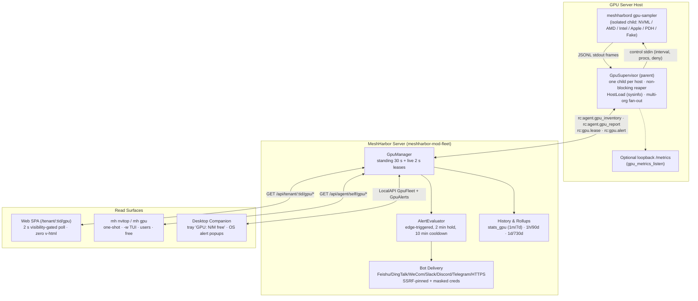

# GPU Servers at a Glance (FR-139)

MeshHarbor lets an organization mark any permanent or invited device as a **GPU server** and observe live utilization, VRAM, temperature, power, faults, L1 process attribution, multi-day history, per-Linux-user GPU-hours, and personal availability/fault alerts from the Web SPA, `mh nvitop` CLI, and Desktop Companion — with **zero driver code inside the main `meshharbord` process**.

## Architecture

## 1. Opt-in Marking, Invites, Enrollment & Shares

Only explicitly marked devices (`Agent.gpu_server == true`) receive GPU sampling leases and appear in GPU fleet views:

- **Direct device marking** (`PUT /api/tenant/{tid}/agent/{aid}/gpu-server`, `MANAGE_AGENTS`): works for both permanent org devices and temporary invited devices (`crates/modules/fleet/src/gpu/routes.rs:57`). When an unmarked device reports non-empty `gpu_inventory`, `AgentsSection.vue` shows a one-click hardware-detected hint chip.
- **Enrollment tokens & ephemeral keys**: `POST /api/tenant/{tid}/agent/enroll-token` (`EnrollmentClaims.gpu_server`) and `POST /api/tenant/{tid}/agent/enroll-key` (`EnrollmentKey.gpu_server`) accept `gpu_server: true` so newly enrolled hosts inherit the GPU server flag immediately on connect.
- **Temporary device invites**: `POST /api/tenant/{tid}/device-invite` accepts `gpu_server: true`. When redeemed, the invited device inherits `gpu_server = true` and appears in GPU fleet views with `source: "invited"` for the inviter, allowed roles, and `MANAGE_AGENTS` admins.
- **Device Shares (`ShareView`)**: Sharing a marked GPU server carries `gpu_server`, `gpu_inventory`, and live `gpu_summary` (`gpu_total`, `gpu_free`, `status`) by default (`crates/api/src/routes/device_share.rs`). Active share recipients also see the host in GPU fleet views with `source: "shared"` and `read_only: true`, receiving **zero alerts** (FR-139 D4) and losing visibility immediately on revoke or expiry.

## 2. Out-of-Process Sampler & Vendor Backends

All vendor libraries and sysfs/PDH/IOKit probes execute exclusively inside `meshharbord gpu-sampler` (`agents/meshharbord/src/gpu_sampler/mod.rs:195`), supervised by a single host-wide `GpuSupervisor` (`agents/meshharbord/src/gpu_sampler/supervisor.rs:101`) shared across all enrolled orgs:

| Backend | Platform | Source | Notes |
|---|---|---|---|
| `nvml` | Linux / Windows | `nvml-wrapper` (`dlopen` `libnvidia-ml`) | Per-card VRAM, SM/mem util, temp, power, fan, SM clock, throttle, ECC, remapped rows (`FieldId 142/143`), MIG detection, WSL2 limitation flag, driver-version mismatch detection (`driver_reboot_pending`). |
| `amd` | Linux | `/sys/class/drm/card*/device/*` + `/proc/<pid>/fdinfo/*` + KFD | VRAM, busy %, hwmon temp/power/fan, per-PID VRAM attribution via DRM `fdinfo`. |
| `intel` | Linux | `xe` / `i915` sysfs + DRM `fdinfo` | Card discovery, hwmon telemetry, DRM client memory when exposed. |
| `apple` | macOS | `macmon` (IOKit / IOReport) | Unified-memory GPU busy %, power, and thermal state (`unified: true`, no discrete VRAM total). |
| `windows_pdh` | Windows | PDH GPU Engine & Adapter Memory counters | Non-NVIDIA / iGPU fallback on Windows. |
| `fake` | All | `MESHHARBORD_GPU_FAKE=<jsonl>` | Deterministic JSONL frame replay for unit tests and UI verification. |

### Hung-Driver & Failure Isolation

- **One child per host**: `GpuSupervisor` runs at the minimum active lease interval across all connected orgs and fans out `rc:agent.gpu_inventory` and `rc:agent.gpu_report` per org at each org's leased cadence.
- **Non-blocking deadline & reap**: If a child misses its frame deadline (`max(3 * interval, 10 s)`), the supervisor calls `start_kill()` and hands the child handle to a detached background reaper task without ever blocking on `child.wait()`. If a previous child remains stuck in uninterruptible D-state, the supervisor refuses to spawn a second child and emits `GpuHostStatus::DriverHung`.
- **Bounded backoff**: `30 s → 60 s → 120 s → 240 s → 300 s`, reporting `SamplerStalled` while backing off and `Unavailable` after 5 consecutive failures.
- **L1-only process attribution**: On Linux, `/proc/<pid>/{status,comm,stat,cgroup}` resolves `uid`, Linux username (`/etc/passwd`), short `comm` name (never `/proc/<pid>/cmdline` or `environ`), process age, and container short ID from cgroup v1/v2.

## 3. State Classification & Freshness

Pure server/wire helpers live in `crates/remote_control/src/gpu.rs` (`compute_freshness` at `:292`, `classify_gpu_state` at `:323`):

- **Freshness** is computed strictly from server receive time (`now - received_at_ms`), never the agent's wall clock:
  - `live`: `age <= max(3 * interval_ms, 90 s)`
  - `stale`: `age <= max(5 * interval_ms, 150 s)`
  - `offline`: beyond `stale` or agent disconnected
- **Card states** (never conflating `None` with `0`):
  - `fault`: `lost == true`, `ecc_uncorrected > 0`, non-empty `xid_errors`, or sustained thermal/HW throttle
  - `unknown`: host status `!= ok` or missing VRAM/utilization readings
  - `unattributed_busy`: VRAM above free threshold while `procs` is empty/off-local (never reported as `free`)
  - `held_idle`: VRAM above threshold with utilization `<= 5%` continuously for `>= 30 min`
  - `busy`: VRAM above threshold or utilization `> 5%`
  - `free`: below VRAM & utilization thresholds with no active compute processes

## 4. Storage, History Rollups & Alerts

All 6 collections are owned by `FleetModule::indexes()` (`crates/modules/fleet/src/lib.rs:999-1047`):

| Collection | Purpose | Retention / Indexes |
|---|---|---|
| `gpu_snapshot` | Latest report per marked device (`_id = agent_id`) | `tenant_id: 1` |
| `stats_gpu` | 1-minute per-card & per-Linux-user buckets | Unique `(tenant_id, agent_id, uuid, ts)`, 7-day TTL on `ts` |
| `stats_gpu_1h` | 1-hour rolled-up buckets | Unique `(tenant_id, agent_id, uuid, ts)`, 90-day TTL on `ts` |
| `stats_gpu_1d` | 1-day rolled-up buckets | Unique `(tenant_id, agent_id, uuid, ts)`, 730-day TTL on `ts` |
| `gpu_alert_rules` | Per-user personal alert rules | Unique `(tenant_id, user_id)` |
| `gpu_alert_channels` | Per-user personal bot webhooks (masked on read) | `(tenant_id, user_id, created_at: -1)` |

- **Owner-only alerts** (`crates/modules/fleet/src/gpu/alerts.rs:111`): Edge-triggered per `(user, host, event)` with 2-minute continuous free hold, 10-minute per-(host, event) cooldown, 3-minute Xid coalescing, and 5-minute offline grace. Delivered only to the rule owner via in-app `NotificationType::GpuAlert`, desktop companion `rc:gpu.alert`, and the owner's enabled bot channels (`crates/modules/fleet/src/gpu/mod.rs:70`). Shared-device recipients receive zero alerts.
- **SSRF-hardened bots** (`crates/modules/fleet/src/gpu/bots.rs:201`): HTTPS-only, official host/path pinning for Feishu/DingTalk/WeCom/Slack/Discord/Telegram, public-IP validation at both save and send time with DNS pinning and `redirect::Policy::none()`, Feishu & DingTalk HMAC-SHA256 signing, 10 s message coalescing, and 5 s / 30 s / 120 s retries.

## 5. Surfaces & Configuration

- **HTTP API**:
  - `PUT /api/tenant/{tid}/agent/{aid}/gpu-server`
  - `GET /api/tenant/{tid}/gpu/fleet?live=0|1&hosts=`
  - `GET /api/tenant/{tid}/gpu/fleet/{aid}?live=0|1`
  - `GET /api/tenant/{tid}/gpu/history?agent_id=&uuid=&range=24h|7d|30d`
  - `GET /api/tenant/{tid}/gpu/users?range=24h|7d|30d`
  - `GET/PUT /api/tenant/{tid}/gpu/alert-rules`
  - `GET/POST /api/tenant/{tid}/gpu/channels`, `PATCH/DELETE /api/tenant/{tid}/gpu/channels/{cid}`, `POST .../test`
  - `GET /api/agent/self/gpu/fleet?live=0|1&wait_ms=0..3000&hosts=` and `GET /api/agent/self/gpu/users?range=`
- **CLI**: `mh nvitop` (alias `mh gpu`) — one-shot, `--cached`, `-w/--watch` (DEC 2026 synchronized output, `NO_COLOR`, `unicode-width`), `--json`, `mh nvitop users`, and `mh nvitop free [-n N] [--min-free 40G] [--same-host]`.
- **Web SPA**: `/tenant/:tenantId/gpu` (`ui/src/views/gpu/GpuServersView.vue`), live 2 s visibility-gated polling, `TimeSeriesChart` history drawer, zero `v-html`.
- **Desktop Companion**: dynamic `GPU: N/M free` tray line (hidden when 0 GPU servers; 30 s / 5 min backoff) + 15 s LocalAPI `GpuAlerts` poller raising native OS notifications (`agents/meshharbor-desktop/src/tray.rs`).
- **Kill switches & device-local controls**:
  - Server: `MESHHARBOR__GPU__ENABLED`, `MESHHARBOR__GPU__LIVE_INTERVAL_MS`, `MESHHARBOR__GPU__ALERTS`, `MESHHARBOR__GPU__BOTS`.
  - Device-owned (structurally refused in `DesiredConfig`): `gpu_telemetry` (live), `gpu_processes` (live), `gpu_metrics_listen` (strict loopback validation, `agents/meshharbord/src/gpu_sampler/metrics.rs:94`).
  - Admin-pushable via `DesiredConfig`: `gpu_backends_deny` (`MANAGE_AGENTS`).
