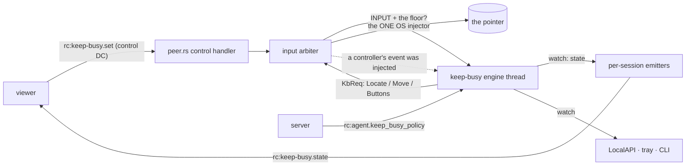
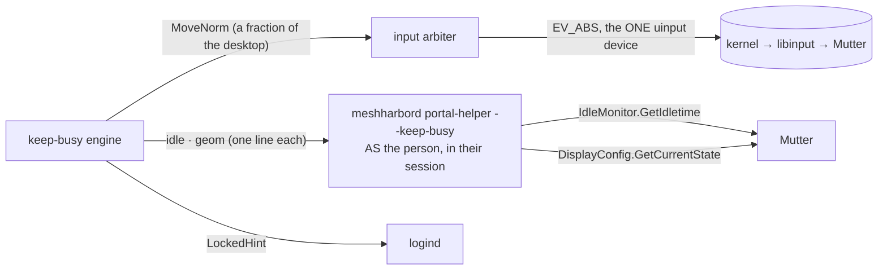
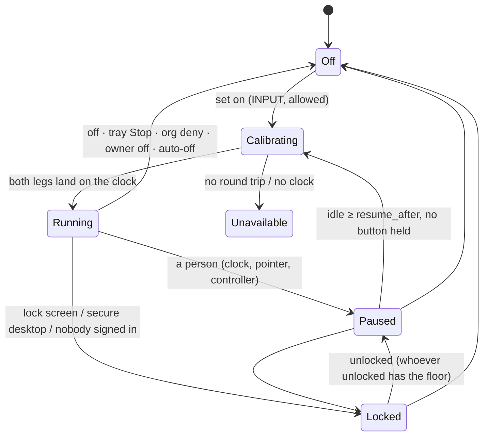
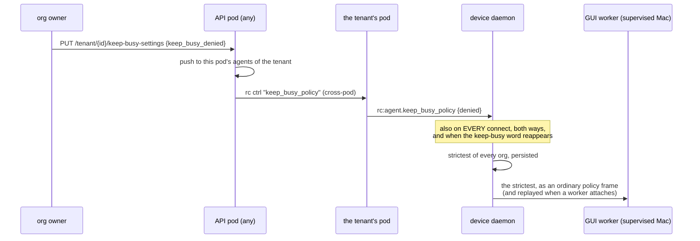
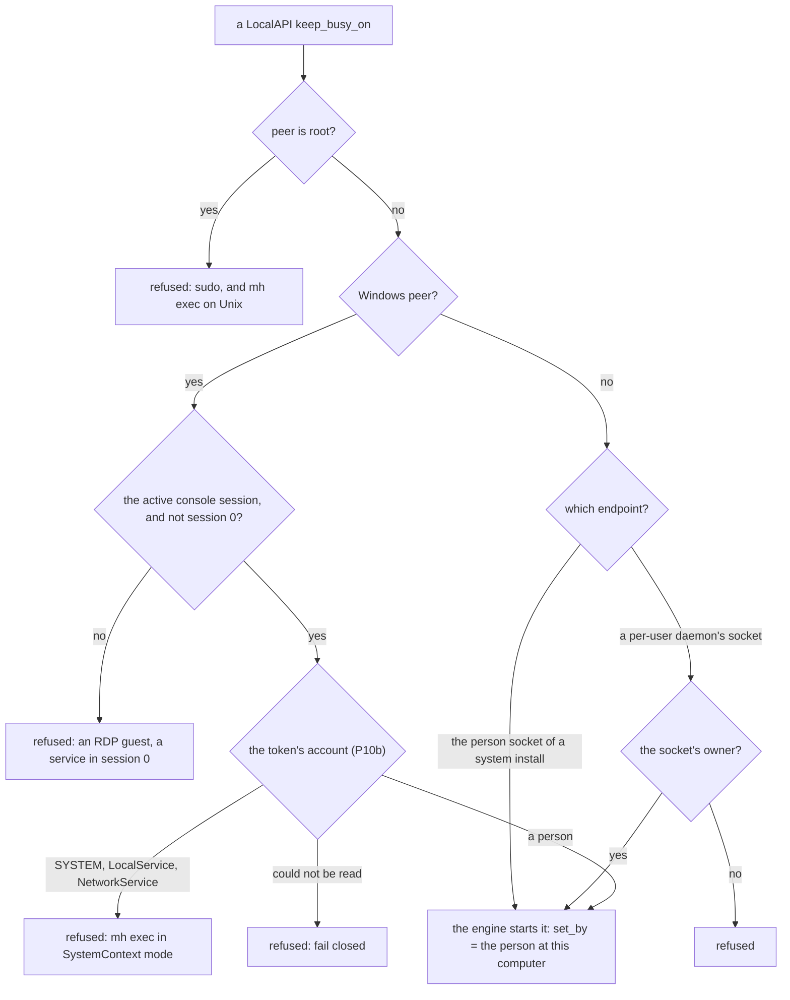
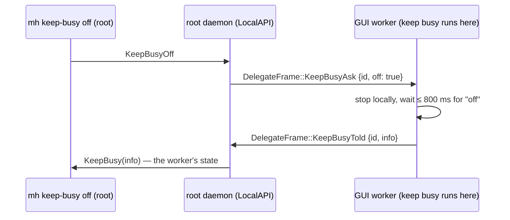
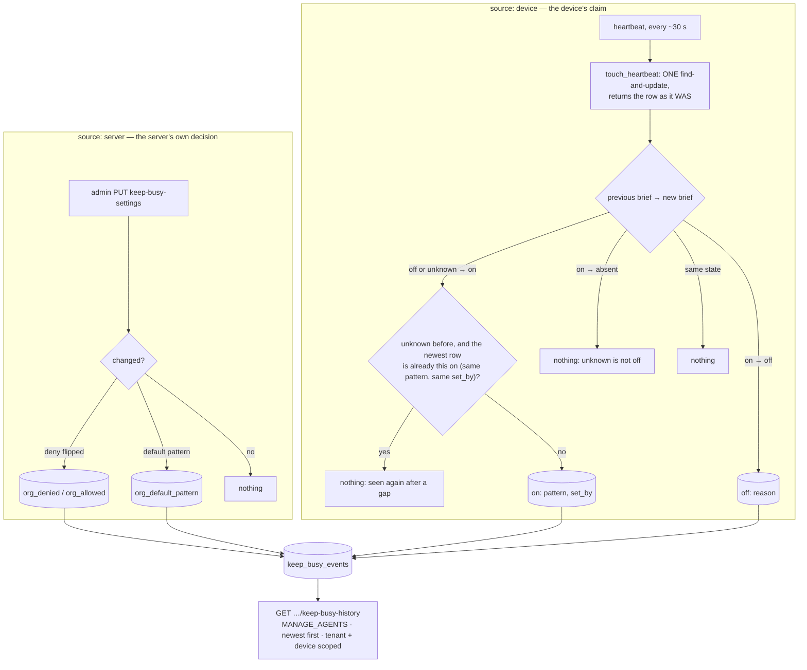

# Keep busy

> **FR-92** ([#1942](https://github.com/jk-zhang-meta/MeshHarbor/issues/1942),
> [spec](fr/FR-92-keep-busy.md)).
>
> **Status: released (0.4.125; GNOME Wayland in 0.4.126) and field-verified on
> Windows 11, GNOME on Xorg, GNOME Wayland and macOS** (a supervised MacBook), a
> self-update included ([spec §9](fr/FR-92-keep-busy.md#9-field-verification-log)).
> The macOS cell found two faults, fixed in #1991 (§9, and the macOS notes in
> §10).
>
> | Part | What |
> |---|---|
> | P1 | the engine, on **Windows** |
> | P2 | the viewer's menu |
> | P3a | **Linux X11**, proven against a real X server in CI |
> | P3b | **macOS**, including a supervised Mac's GUI worker |
> | P4 | the person at the device sees it and stops it: tray, `mh keep-busy`, LocalAPI |
> | P5 | the org deny |
> | P5b | the device list shows where it runs and who turned it on |
> | P7 | a **permanent history**: every on and off on every device, every change to the org's settings (§11) |
> | P8 | the org's **default pattern** (§12) |
> | P9 | **GNOME on Wayland**, and GNOME on Xorg under a root daemon, through uinput ([§2](#a-blind-host-gnome-through-uinput)) |
> | P10 | a **local On**: the tray's "Start keep busy" and `mh keep-busy on`, for the person at the computer only (§9) |
> | P10b | **SYSTEM never** starts it: on Windows the pipe listener reads the client's account from its token (§9) |
>
> Any other Wayland desktop is detected and reported unavailable, with its reason.
>
> It is turned on from a remote-desktop session that holds input, or (P10) by
> the person at the computer. There is no server "on". ⚠️ `mh exec` is not
> kept out everywhere: on an attended Windows install it runs as the person, and
> its `mh keep-busy on` passes the local gate. Root and (P10b) SYSTEM are
> refused (§9).

Keep busy moves a device's pointer in a pattern so the computer stays
**active**: no screensaver, no idle lock, no "Away" in Teams or Slack.

**A real user always wins.** The moment anyone uses the computer, keep busy
pauses. That is the person at it, or a remote controller, moving the mouse,
clicking, typing or scrolling. It resumes once they have been idle for
`resume_after` (30 s by default).

It stays on across disconnects, self-updates and reboots, until someone
switches it off. It resumes at the **same person's** next login.

The sleep assertions of FR-55 (`agents/meshharbord/src/power.rs`) cannot do this.
They keep the machine from **sleeping**, but they never reset the
**user-idle clock** that the screensaver, the idle lock and presence read. Only
input resets that clock. So keep busy produces real input, and only one kind:
an absolute mouse move.

## 1. One more input source, never a second injector

The engine is one std thread, `keep-busy`. It never touches the OS injector
itself. It asks the input arbiter to read or move the pointer: the one injector,
created lazily and cached for the life of the process
(`input/arbiter.rs` `keep_busy_op`, L953).

| Rule | Where |
|---|---|
| A SystemContext worker's desktop rebind covers the reads as well as the moves | the arbiter's injector thread |
| A move is **refused while any session holds a mouse button**, so a controller's drag never has a move spliced into it | `input/arbiter.rs` `any_button_held`, L513 |
| Every injected controller event bumps a counter the engine reads, so remote activity is known exactly. A heartbeat or a denied event is not counted | `input/arbiter.rs` L805, `keep_busy::note_remote_input` |
| Only a session holding **INPUT** may set it, and in exclusive mode only the floor holder | `input/arbiter.rs` `keep_busy_may_set`, L523 |
| An injector with **no pixel space** (uinput, below the compositor) is moved by a **fraction of the desktop** instead (`KbOp::MoveNorm`), under the same held-button rule | `input/arbiter.rs` `keep_busy_op`; `uinput_backend.rs` `move_norm` |

The state machine (`keep_busy/engine.rs`) is pure. A `Host` trait (L308)
carries every OS fact, and the tests drive the engine with a scripted fake host
and clock.

## 2. Who is a real user

The engine only ever causes absolute mouse moves, so anything else is a person.
Each running tick (`engine.rs` `detect`, L877) pauses on the first of these:

| Signal | Means |
|---|---|
| The controller-input counter moved since the last tick | a remote person (`paused_by: remote`) |
| The OS idle clock moved past the reading taken right after the engine's **own** last move | a key, a scroll, a click, a moved mouse (`paused_by: local`) |
| The pointer is not where the engine left it (±1 px), with no clock evidence | **not** a person: an app warped or confined the pointer. Reported as `cursor_contended`, with a doubling back-off so the two never fight |

> [!IMPORTANT]
> **No hooks, no raw input, no key polling.** `SetWindowsHookEx`,
> `RegisterRawInputDevices`, keyboard polling and event taps would tell real
> input from synthetic exactly. They are also what a keylogger looks like to
> EDR, and a GPO-locked desktop running EDR is in the acceptance bar.
>
> Mouse **buttons** (`VK_LBUTTON…VK_XBUTTON2`, `CGEventSourceButtonState`,
> `QueryPointer`'s mask) are read once per resume, never polled.

### The idle clock, per host

| Host | Clock | Reading |
|---|---|---|
| Windows | `GetLastInputInfo` (`host_win.rs` L45) | an exact tick, on the system timer (10–16 ms) |
| X11 | `MIT-SCREEN-SAVER` `ms_since_user_input` (`host_x11.rs` L55) | an **interval** |
| macOS | `CGEventSourceSecondsSinceLastEventType`, the session's combined state | an **interval** |
| GNOME through uinput (P9) | Mutter's `org.gnome.Mutter.IdleMonitor.GetIdletime`, asked by a helper inside the person's session (`session_helper.rs`) | an **interval**, round trip included |

A "time since" reading cannot say exactly when the clock was read: only that it
was read somewhere between asking and hearing back. So the last input lies in
`[sent − idle, received − idle]`. Two readings mean "nothing new" exactly when
those intervals **overlap** (`IdleMarker`, `engine.rs` L262).

A reply read late **widens** its interval instead of shifting it. Taken at
receipt instead, one 25 ms-late read on a loaded host made the engine pause for
its own move.

**Two of the engine's own moves are always at least 32 ms apart**
(`MIN_MOVE_GAP`, `engine.rs` L69). Closer together, the idle clock reads them as
one event. Calibration moves out and back; before this spacing, its back leg
usually never registered on Windows' 15.6 ms tick, and the host read as
`not_landing`.

### Calibration before trust

On every enable and resume, the engine moves the pointer **3 px out and back**
(`engine.rs` `calibrate`, L754).
- Both legs must land within 1 px.
- The idle clock must register both moves.
- A pointer stuck at its starting point round-trips "home → home" perfectly, so
  only the out leg catches it.
- A failed round trip is `calibration_failed`. A move the clock never sees is
  `not_landing` (UIPI, another desktop).

### A blind host: GNOME through uinput

On Wayland nothing tells an unprivileged process where the pointer is, and XTest
moves only Xwayland's private pointer. A **root** daemon can still drive the
real one: the uinput device the arbiter already owns for remote control
(`MESHHARBORD_UINPUT=1`, FR-36), below the compositor. What it cannot do is read
the pointer back. So the GNOME host (`keep_busy/host_gnome.rs`) is **blind**:

| Question | Answer on GNOME |
|---|---|
| Where is the pointer? | **where the engine last put it** (`Host::blind`); the first move starts at the primary monitor's middle |
| Did a person act? | **the idle clock alone**: every key, click, scroll and move a person makes reaches Mutter's IdleMonitor. `detector` reads `clock` |
| Where may it draw? | the logical monitors from `DisplayConfig`, scale and rotation applied (`gnome.rs` `layout`), each inset 48 px |
| Is it locked? | logind's `LockedHint`, which GNOME sets |

What blindness costs, said once here and in the spec:

- **After a pause it resumes where it stopped, not where the person left the
  pointer: the pointer jumps back.** It never jumps into a hot corner: the
  destination is inside the safe box, and an absolute move crosses no edge
  barrier.
- **Mouse buttons are not observable.** A button held perfectly still for
  longer than `resume_after` is not seen; any movement while it is held is.
- **Something moving the pointer without input** (there is no such thing for a
  Wayland client) cannot be seen as `cursor_contended`.

The helper is the FR-45 `portal-helper` subcommand with `--keep-busy`, started
through the same session lookup and privilege drop (`capture/portal/mod.rs`
`spawn_child`): the person's session bus checks `SO_PEERCRED`, so root cannot
ask Mutter itself. It reads no input and sends none, and it exits after a
minute nobody asks it anything. Another desktop's helper says so in its hello:
KDE and wlroots have no idle clock to offer here, and keep busy reports
`no_idle_clock`.

## 3. States

The device sends a reason code and writes the sentence itself
(`engine.rs` `Reason::sentence`, L178). The viewer, the tray and the CLI all
show that one sentence.

| `reason` | When |
|---|---|
| `user_active` | someone used the computer; `paused_by` says local or remote |
| `cursor_contended` | another program moved the pointer; it backs off, doubling |
| `button_held` | a mouse button is down, locally or in a controller's drag |
| `locked` · `no_session` | lock screen or secure desktop · nobody signed in, or a login screen |
| `calibration_failed` · `not_landing` | the round trip failed · the moves do not register |
| `unsupported` · `wayland` · `portal` · `no_idle_clock` · `no_permission` | this host cannot (no display, Wayland, no Accessibility, …) |
| `device_disabled` · `org_denied` | the owner's key · the org's deny |
| `expired` · `stopped_by_controller` · `stopped_locally` | why it turned off |

## 4. Safety

| Rule | Why |
|---|---|
| **Moves only.** Never a click, a key or a scroll | — |
| **The safe box**: the monitor's work area ∩ a 48 px inset from every monitor edge (`patterns.rs` `safe_box`, L233). macOS uses 96 pt (`host_mac.rs` `mac_safe_box`, L235): the release build has no AppKit, so no `visibleFrame`, and the margin keeps the menu bar and a Dock on any edge clear | The pointer never reaches a hot corner or edge: GNOME Activities, a macOS hot corner that can start the screensaver **or lock the screen**, an auto-hidden taskbar or Dock, Windows Peek |
| **No jumps.** Each loop starts at the pointer, and a changing pattern (Shuffle, Wander, Lissajous) continues from where the last loop ended. The one exception is a blind host (GNOME through uinput), which resumes where it stopped | — |
| **Never the first to create the injector before a display exists.** A boot-time restore waits for an unlocked session, and an injector the OS has not granted is answered for and not cached | The arbiter caches the injector, Noop included. Creating it too early would break remote control's input until a restart |
| **The viewer never re-asserts keep busy on connect**, unlike display-match | A reconnecting tab must not undo the person's Stop |
| **Wayland is refused from the display itself** (`host_x11.rs` `session`, L389): the `XWAYLAND` extension, or monitors named `XWAYLAND*`. The GNOME host is asked instead (`host_linux.rs`) | XTest there moves only Xwayland's own pointer, so a calibration could pass while nothing real moves |

## 5. Patterns

| Pattern | What it draws |
|---|---|
| circle · triangle · square | the classics |
| star | a pentagram in one stroke |
| figure8 | the lemniscate of Gerono |
| heart | `x = 16 sin³t`, `y = 13 cos t − 5 cos 2t − 2 cos 3t − cos 4t` |
| spirograph | a hypotrochoid (R 5, r 3, d 5): a five-lobed rosette |
| lissajous | 3:2, with a phase that drifts each loop, so it morphs |
| rose | eight petals, `r = cos 4θ` |
| wave | a sine across and back |
| wander | a smooth random loop with uneven speed and short rests: the most human |
| subtle | 1 px out and back every 45 s. It resets the idle clock and is invisible |
| shuffle | a new visible pattern each loop |

**Speed** is slow, normal or fast: 120, 260 or 520 px/s along the curve. The
speed is constant, because the walk is by arc length.

**Size** is s, m or l: 14, 26 or 42 % of the safe box's short side.

The viewer draws its previews from the same formulas
(`ui/src/composables/keepBusy.ts`). Only the picture is shared; the agent alone
moves anything.

## 6. Wire

| Where | Message |
|---|---|
| viewer → device (control DC, `peer.rs` L8648) | `rc:keep-busy.set {on, pattern, size, speed, resume_after_s, auto_off_min}` · `rc:keep-busy.get` |
| device → every viewer (control DC) | `rc:keep-busy.state {available, on, phase, reason, sentence, paused_by, resumes_in_ms, pattern, …, set_by, warn}` (`wire.rs` `state_payload`, L76). A refusal goes only to the viewer that asked, with `refused` |
| server → device | `rc:agent.keep_busy_policy {denied}` (`remote_control/src/signaling.rs` L2224) |
| local client → device | LocalAPI `keep_busy_status` / `keep_busy_off` / (P10) `keep_busy_on {opts}` → `keep_busy` (`crates/localapi/src/lib.rs` L1260) |
| caps | `keep-busy` in `AgentCaps.input`, matched by equality, and following the owner's key at every announcement |

## 7. Gates

| Gate | Owner | Default | Effect |
|---|---|---|---|
| The session's INPUT grant, and the floor in exclusive mode | the session | — | A `set` from a view-only session, or from a viewer without the floor, is refused to that viewer |
| `keep_busy_enabled` (`crates/agent-core/src/config.rs` L1388) | the device's owner | **on** | Off: no cap word, a running keep busy stops, and new enables are refused. A local `ConfigSet` needs the console user. It is absent from `DesiredConfig`, so the server can never turn it back on |
| `TenantSettings.keep_busy_denied` (`crates/db/src/models/tenant.rs` L154) | the org owner (MANAGE_TENANT to set; **any member reads** the settings route since P8, §12) | allowed | Deny: pushed at once to online devices and at the next connect to the rest. The device stops and refuses |

### How the org's deny reaches every device

| Piece | Where |
|---|---|
| The route | `crates/modules/fleet/src/keep_busy.rs` `set_org_settings`, L66 |
| The local push | `hub.rs` `push_keep_busy_policy`, L1665 |
| The cross-pod arm | `ctrl.rs` L41 |
| The connect reconcile | `socket.rs` `push_keep_busy_policy_on_connect`, L1048 |

**Strictest of every org.** A device enrolled in several orgs applies the
strictest of their last-known policies (`keep_busy/mod.rs` `org_denied`, L255).
- Each policy is persisted, so a deny holds at boot.
- A stored deny from an org the device has **left** is dropped at start
  (`prune_departed_orgs`, L263). No server would ever push that org's re-allow,
  so it would otherwise hold for good.
- There is no per-session field. The standing push reaches the device before
  any session, and a change is pushed at once.

**The supervised Mac.** The GUI worker runs keep busy, but it hears no org
itself, and delegation is primary-only.
- The daemon keeps every org's policy and hands the worker the strictest
  (`delegate.rs` `note_keep_busy_policy`, L611).
- It replays that policy when a worker attaches (`keep_busy_replay`, L628),
  because the connect-time push always arrives before any worker is there.

### Who can see where it runs (P5b)

The device list shows a **keep busy · \<phase\>** chip while it is on. Its tooltip names the pattern and
who turned it on. An org that denies keep busy, or simply wants to know, sees which devices are kept
awake.

| Piece | What |
|---|---|
| Source | the heartbeat's additive `keep_busy` brief (`KeepBusyBrief`, `crates/remote_control/src/models.rs`): `on`, `phase`, `reason`, and, only while on, `pattern` and `set_by` |
| Storage | `touch_heartbeat` stores it, and **unsets** it when a device stops saying |
| Display | the chip in `AgentsSection.vue`, with its tooltip from `keepBusyBriefTitle` |

It is the device's **claim**, shown as one, never enforced on. The device's own engine and gates
enforce.

A device that does not say shows nothing. That covers:
- an older agent;
- a host without keep busy;
- a supervised Mac's root daemon, which cannot speak for its GUI worker.

Nothing means **unknown**: never a stale "on", never an invented "off".

The chip is the **current** state. Who turned it on where, and when — and every off, and every
change to the org's settings — is the permanent history (§11), derived from these same briefs.

## 8. Where it remembers: per signed-in person

`keep-busy.json` is the **person's**, not the device's.
- It resumes at **that** person's next login.
- Someone else signing in starts with it off.
- It is written on on/off edges only. A file this agent cannot read means **off**.

| Host | The file | Written as |
|---|---|---|
| Windows, user worker | `%LOCALAPPDATA%\meshharbor\meshharbor\data\keep-busy.json` | the user |
| Windows, SystemContext worker | the **console user's** file, resolved through `session_user_profile_dir` | **the user**, impersonated (`win_identity.rs` `as_session_user`, L137; `state.rs` `as_owner`, L132) |
| Linux, per-user daemon | `~/.local/share/meshharbor/keep-busy.json` | the user |
| Linux, root daemon | **root's own** data dir: `/root/.local/share/meshharbor/keep-busy-<uid>.json`, for the person on our display, else in the active graphical session (`state.rs` `default_path`, L209; `logind.rs` `pick`) | root, in a directory only root can write |
| macOS GUI worker / LaunchAgent | `~/Library/Application Support/live.meshharbor.meshharbor/keep-busy.json` | the user |

On a host installed before the rename, the directory keeps its pre-rename name
(`appdirs::project_dirs`), like the rest of that host's state.

> [!WARNING]
> **A privileged writer never writes where the person can plant a link.**
>
> A SYSTEM write into a profile folder can be steered by a junction plus an
> object-manager link onto any file SYSTEM can write: the classic escalation.
> So it is impersonated. Validating the path first does not close it, because
> the link can be swapped between the check and the write.
>
> A root write into a home directory is the same class (the symlink to
> `/etc/shadow`), so the root daemon keeps its stores in root's own directory.

**Never in `config.toml`.** That file:
- is SYSTEM- or root-owned on system installs;
- sits behind a write lock;
- is reported to the server;
- and `adopt_local` would read every toggle as an edit.

### Following the person

On a root Linux daemon or a Windows SystemContext worker, the signed-in person
can change while the process runs (`state.rs` `person_can_change`, L245). The
engine looks the person up again every 10 s, and right before applying a
turn-on (`keep_busy/mod.rs` `person_switch`, L417, and `run_with`, L437):

| When the person changes | Keep busy |
|---|---|
| They have their own stored keep busy | theirs starts, after they have had the floor for `resume_after` |
| None stored, and the running one was turned on while **nobody** was signed in | **adopted**: a technician at the login screen, signing them in |
| Anything else | stops. It is **never** handed from one person to another |
| Everyone signs out | stops; it stays stored for its owner |

The org's word belongs to the device and carries over. With nothing running and
nothing stored for anyone, the lookup is skipped, so a headless root daemon
does not spawn `loginctl` forever.

## 9. The person at the device

| Surface | What |
|---|---|
| **Tray** (`meshharbor-desktop`, `tray.rs` L47) | A toggle, polled every 3 s: "Stop keep busy (Heart · paused)" while it is on, whoever turned it on; **"Start keep busy"** while it is off and can run here (P10, the product default pattern); "Keep busy: unavailable", disabled, where it cannot. The click reads the state at that moment |
| **CLI** (`meshharbor-cli/src/cli.rs` L336) | `mh keep-busy status\|off [--json]`, and (P10) `mh keep-busy on [--pattern P] [--size s\|m\|l] [--speed slow\|normal\|fast] [--resume-after SECONDS] [--auto-off MINUTES]` |
| **LocalAPI** | All three verbs are on the person-socket allowlist, so a Linux system install's companion reaches them. Off is open to every peer the endpoint admits, because it is the safe direction (`mh exec` included). **On** is the console person's alone (below). On a supervised Mac the root daemon asks the GUI worker for status and off (below) |

**Who may turn it ON here (P10).** Whoever stands where the person does: the
console session on Windows, the person's own uid elsewhere. Never root, and
(P10b) never SYSTEM. `ClientPeer::may_start_keep_busy` (`crates/localapi`)
answers per endpoint:

- **SYSTEM never** (P10b, `crates/localapi` `pipe_client_peer`). At accept
  time, before a byte is read, the pipe listener reads the client's account
  from its token: `GetNamedPipeClientProcessId`, then `OpenProcess` and
  `OpenProcessToken`, then `IsWellKnownSid` against SYSTEM, LocalService and
  NetworkService. It never takes the account from anything the client says,
  and an account it cannot read is a refusal. The person's tray and CLI run as
  the person, and the worker serving the pipe can always read its own user's
  token. In SystemContext mode the worker is SYSTEM, so it can read every
  client's token.
- ⚠️ **Not a wall against `mh exec`** (measured on 0.4.129, FR-92 §9
  row 43). On Windows, exec runs in the worker that holds the agent socket,
  and that worker lives in the console session: as the signed-in user (their
  elevated token) on an attended install, and as SYSTEM in that session in
  SystemContext mode (`MESHHARBORD_ENABLE_SYSTEM_SWAP`). P10b refuses the
  SystemContext case. On an attended install,
  `mh exec <win> -- mh keep-busy on` still passes, and the start is
  named "the person at this computer". On Unix exec arrives as root and is
  refused, but root can `sudo -u` the person. No local gate can tell them
  apart: an exec caller could as well write the person's `keep-busy.json`, or
  run an input loop of its own. A device that allows exec has given its exec
  callers more than keep busy. Its boundary against them is the owner's
  `exec_enabled` ([fleet-rpc.md](fleet-rpc.md)). Exec's identity on Windows is
  #2021. Once exec runs as SYSTEM there, the same check refuses it everywhere
  (FR-92 §6).
- **Not the recording verbs' gate**: on Unix that one lets root through, and
  root is how `mh exec` arrives there. With it, a plain
  `mh exec <host> -- mh keep-busy on` would start keep busy under the
  person's name (FR-92 §8).
- **Never relayed**: a supervised Mac's root daemon refuses a local On rather
  than pass it to the worker. The person's own clients reach the worker
  directly.
- The owner's `keep_busy_enabled = false` and an org deny refuse a local
  start exactly as they refuse a viewer's. The answer then carries the
  reason (`device_disabled`, `org_denied`).
- Who is named: "the person at this computer". The account name is not
  ours to show every viewer and the org's history.

**The supervised Mac.** Two processes, two engines: the root daemon starts one
like every host does, but only the GUI worker in the person's session runs keep
busy. The person's own clients reach the worker directly: the tray and a
`meshharbor` run as the person dial the per-user socket first. A **root** client
cannot: `mh exec <mac> mh keep-busy off` runs as root and lands on the
root daemon's socket. So the daemon does not answer for itself while a worker is
attached. It asks the worker over the delegation channel and answers with what
the worker says (`localapi_state.rs` `keep_busy_answer`, L408; `delegate.rs`
`ask_worker_keep_busy`, L664; the worker answers at `delegate_worker.rs` L353).

| Case | Answer |
|---|---|
| Worker attached and answering | the worker's state, after its stop for an `off` |
| No worker attached (nobody signed in) | the daemon's own engine, as before: nothing runs there |
| A worker that does not answer within 1.5 s (`KEEP_BUSY_ASK_WAIT`): an older build skips the frame | the daemon's own engine, after the wait |
| The worker leaves mid-question | the daemon's own engine, at once: the channel's close ends the wait |

> [!WARNING]
> Before this relay the root daemon answered for its own engine, which never
> runs on a supervised Mac. Field, 0.4.126, on a MacBook: with keep busy running
> in the worker, a root `mh keep-busy off` answered `on: false` and logged
> `keep-busy: turned off reason="stopped_locally"`. Six seconds later the worker
> still reported `running`, and the session's idle clock still read 6–505 ms. The
> remote off-switch the LocalAPI row promises stopped nothing.

## 10. Platforms

| Host | Status | Idle clock · lock · geometry |
|---|---|---|
| Windows, user-context and SystemContext workers | ✅ (field: Win11, 0.4.125) | `GetLastInputInfo` · `OpenInputDesktop` · `GetMonitorInfoW.rcWork` |
| Linux X11 (a user-session daemon, or root with the display's auth) | ✅ (Xvfb in CI; field: GNOME on Xorg, 0.4.125) | `MIT-SCREEN-SAVER` · logind `LockedHint` (`logind.rs` L144) · RandR 1.5 ∩ `_NET_WORKAREA` |
| **GNOME on Wayland**, or GNOME on Xorg, under a **root** daemon with uinput on (P9) | ✅ blind ([§2](#a-blind-host-gnome-through-uinput)) | Mutter IdleMonitor through the session helper · logind `LockedHint` · Mutter `DisplayConfig` |
| macOS, GUI worker or LaunchAgent | ✅ (field: a supervised MacBook, macOS 27, 0.4.126) | `CGEventSourceSecondsSinceLastEventType` · `CGSessionCopyCurrentDictionary` (`host_mac.rs` `console`, L182) · `CGDisplayBounds` + 96 pt |
| Wayland without the uinput path: a per-user daemon, or uinput off | ✖ reported (`wayland`) | — |
| KDE Plasma or wlroots on Wayland, uinput on | ✖ reported (`no_idle_clock`): no idle clock a helper can read | — |

> [!NOTE]
> **Lockers that never report `LockedHint`** (xscreensaver, i3lock) are not seen
> on X11. Keep busy then keeps moving the pointer behind them. That is
> harmless, since they have no hot corners and a move unlocks nothing, but the
> display stays awake while it is on.
>
> **A single isolated key tap can slip through on X11 or macOS** if it lands
> within a few milliseconds of the engine's own move. A person typing, scrolling
> or moving the mouse is caught at once, because the pointer moves too.
>
> **On Windows the window is a whole system-timer tick** (15.6 ms):
> `GetLastInputInfo` stamps an event with the tick it arrived in, so a lone key
> in the same tick as one of the engine's moves reads as that move. Measured
> on Win11 with 0.4.125: **one of nine isolated taps** slipped through; four
> of four short typing bursts, every mouse move and a held button were caught
> within a second.
>
> **GNOME's Xorg session names no display to logind** (`Display=` empty, while
> its Xorg serves `:0`). 0.4.125 matched the session by display alone, so it
> never saw GNOME's lock and kept moving the pointer behind the lock screen
> (field, GNOME 46 on Ubuntu 24.04). P9's `logind::pick` falls back to the
> active X11 session that names no display.

> [!NOTE]
> **macOS has two idle clocks, and posted input refreshes them differently.**
> The session's event-source clock, the one keep busy reads and apps such as
> Teams read, follows every move: on the MacBook it stayed under 1 s for 83
> minutes (the only longer gaps are wander's 250–900 ms rests).
> `IOHIDSystem`'s `HIDIdleTime`, the one the screensaver and display sleep read,
> is refreshed by **posted** input only once per ~5 s: a 5.0–5.1 s sawtooth,
> maximum 5.8 s, and identical for a remote controller's input. Both stay far
> below any lock or Away delay, so this is a measurement note, not a fault.
> Measure macOS by the session clock (`osascript -l JavaScript` with
> `CGEventSourceSecondsSinceLastEventType(0, ~0)`). `HIDIdleTime` alone reads
> as a 5 s idle that is not there.
>
> **The Accessibility grant.** macOS 27 lists it under Privacy & Security →
> **Device Control & Data Access**, with two entries: "MeshHarbor" (the companion)
> and "meshharbord" (the agent). Only `meshharbord`'s gates input, and the agent
> reads it at start.
> - A worker that **loses** the grant while running keeps its start-time view,
>   but its moves stop landing. Keep busy then says `calibration_failed` and
>   retries every 30 s; it never claims to run.
> - A worker that **starts** without the grant cannot build an injector at all:
>   the enigo we ship refuses ("the application does not have the permission to
>   simulate input"). Keep busy asks the OS (`arbiter.rs`
>   `classify_unpermitted`) and says `no_permission`, the reason that names the
>   fix. Before #1991 it said `unsupported`, "Unavailable on this computer."
>   (field, 0.4.126).

## 11. History (P7)

Every on and off on every device, and every change to the org's keep-busy
settings, is kept in `keep_busy_events` — **for good**. There is deliberately
no TTL, unlike every other audit collection (operator, 2026-10-11: "permanent
history"). A row outlives its device: the device's name is written on it when
the row is made.

Two sources share the collection, and the `source` field keeps them apart.
It is the trust split `ssh_audit` (the server's decision) and `ssh_activity`
(a claim by a host that may be compromised) make with two collections, made
inside one:

| `source` | Rows | Who speaks | Trust |
|---|---|---|---|
| `server` | `org_denied` · `org_allowed` · `org_default_pattern` | the settings route, naming the admin (`actor_user_id`, `actor_name`), only when the value **actually changed** | the server's own decision: authoritative |
| `device` | `on` · `off` | the device, through two consecutive heartbeat briefs; `actor_name` is the brief's `set_by` claim and `pattern` the brief's | a **claim**, shown as one, never enforced on |

| Piece | Where |
|---|---|
| The row | `KeepBusyEvent` (`crates/remote_control/src/models.rs`): `tenant_id`, `agent_id` (none for an org row), `agent_name`, `at`, `kind`, `source`, `actor_user_id`, `actor_name`, `pattern`, `reason` |
| The server rows | `crates/modules/fleet/src/keep_busy.rs` `set_org_settings`: the settings before and after, a row per field that changed |
| The device rows | `device_edge` (pure, the table below) and `record_device_edge`, on the agent's read loop right after the beat is stored |
| The one round trip | `crates/services/src/dao/agent.rs` `touch_heartbeat`: one `find_one_and_update` that hands back the previous brief and the name, so an edge costs no second read |
| The route | `history`, `GET /api/tenant/{tid}/keep-busy-history` |
| The indexes | `(tenant_id, at desc)`, `(tenant_id, agent_id, at desc)` — in the fleet module's `indexes()`, never the db crate's plan |

### The device's edges

| Previous brief → this beat's brief | Row |
|---|---|
| off, or absent (unknown) → on | **`on`**, with the pattern and `set_by` |
| on → off | **`off`**, with the device's reason (`stopped_by_controller`, `expired`, `org_denied`, …) |
| on → absent | nothing: a device that stops saying is **unknown**, never off (P5b's rule) |
| absent → off | **`off`** only while the newest row about the device is still an `on`: it stopped while it was not reporting (P7 review) |
| the same state again · absent → absent | nothing |
| on → on with another pattern or `set_by` | nothing: the history records ons and offs; the device row shows what is drawn now |

**The restart dedupe.** When the previous brief was absent and this one is on,
the newest row about this device decides: if it is already `on` with the same
pattern and the same `set_by`, this is the same keep busy seen again after a
gap in reporting (a daemon update that briefly reported nothing, a rollback and
re-update), and nothing is written. A failed lookup records anyway — a
duplicate row beats a lost edge.

**The gap the other way.** Absent → off writes an `off` only when the history
still ends on an `on` (`off_after_gap`): keep busy was stopped — at the
device, by an auto-off — while it was not reporting. Without that check the
history would end on an "on" that is long over; with it, a device that was
never on writes nothing at each restart.

> [!NOTE]
> **The resolution is the heartbeat.** Device rows come from consecutive
> ~30 s briefs, so an on and an off inside one beat are not seen at all, and
> a row's `at` is when the server saw the change, not when the device made
> it. Exact device-pushed edges — the engine reporting each transition itself
> — are a possible later phase; they need an agent release. The org rows
> have no such limit: they are written by the route that made the change.

> [!IMPORTANT]
> **Recording never fails a heartbeat.** A failed insert or lookup is logged
> and the beat goes on: the history is a record, not a gate.

### The route

`GET /api/tenant/{tid}/keep-busy-history`, `MANAGE_AGENTS` — the permission
of the device list the rows are about. Newest first, as a JSON list.

| Query | Meaning |
|---|---|
| `agent_id=<hex>` | one device's rows. Always paired with the tenant in the filter: another org's device id answers with nothing |
| `before=<RFC 3339 \| unix ms>` | rows strictly older than this — the "load more" cursor is the last row's `at` |
| `limit=<1..=200>` | default 50; out of range is clamped |

The org's keep-busy card (`SettingsSection.vue` → `KeepBusyHistorySection.vue`)
lists the latest 50 — when, device (or "Organization"), what, who — with a
small **device-reported** / **admin** marker on each row, a device filter,
and "Load more". A 403 shows in the list and ends nothing (FR-82).

## 12. The default pattern (P8)

The product's default is **circle**, what the operator asked for. An org can
choose another: `TenantSettings.keep_busy_default_pattern`, `None` = circle.

| Rule | Where |
|---|---|
| Validated by **equality** against the agent's exact wire names (`circle` … `shuffle`, 13 of them); an unknown word is a 400 | `KEEP_BUSY_PATTERNS` (`crates/remote_control/src/models.rs`), `validate_pattern` (`fleet/src/keep_busy.rs`) |
| `PUT …/keep-busy-settings` takes each field optionally: absent = unchanged, so the pre-P8 body `{keep_busy_denied}` still changes nothing else; `keep_busy_default_pattern: null` clears to the product default | `OrgKeepBusySettingsUpdate` |
| `GET …/keep-busy-settings` returns both fields, and is readable by **any member** of the org (it was `MANAGE_AGENTS`): the payload is only the org's keep-busy policy, which every device and every viewer is already told. `PUT` stays `MANAGE_TENANT` | `get_org_settings` |
| **No agent change, no wire change.** The default never reaches a device; the viewer reads it and pre-selects it | — |
| The viewer pre-selects the org default **only** for a device the person has no remembered choice on (`meshharbor-rc-keep-busy.v1:<agent>` in localStorage), and never while keep busy runs (the device's pattern shows); a fetch failure means circle | `KeepBusyMenu.vue` `defaultPattern`, `stores/agents.ts` `fetchKeepBusyDefaultPattern` |
| The org's card has a pattern select beside the switch, with the viewer's own labels | `SettingsSection.vue` |

## 13. Tests

### `keep_busy/engine.rs` (fake host and clock)

- each pause source, the resume timing, and continued activity extending a pause;
- a held button and a lock blocking the resume;
- calibration: a wrong landing, a stuck pointer, `not_landing`;
- **a coarse idle clock**: the 32 ms spacing;
- **interval markers**: a slow read only widens;
- **a new person** gets their own keep busy, never the last one's;
- no idle clock, the owner's and the org's off, auto-off, `subtle`, Shuffle without jumps;
- a boot restore that never touches the injector without a session.

### `keep_busy/patterns.rs`

- every shape is closed, continuous, and inside the unit box and the safe box from any anchor;
- the arc-length walk;
- a loop starts at the pointer.

### `keep_busy/host_x11.rs` against a real X server (Xvfb, a CI step)

- XTest motion resets the idle counter;
- the **whole loop** (engine + host + the arbiter's own enigo injector) runs with the server's idle at 4–17 ms;
- a key typed by another client pauses it.

The step runs with `--test-threads=1`: in parallel, another test's pointer move
**was** a person to it.

### Everything else

- `keep_busy/mod.rs`, `logind.rs`, `state.rs`, `host_mac.rs`:
  - the person switch;
  - the strictest org and leaving an org;
  - logind parsing, and **GDM's Xorg session that names no display** (P9);
  - the per-person root store;
  - the macOS console flags and safe box.
- `keep_busy/gnome.rs` (P9, pure, every platform): the monitor layout from
  `DisplayConfig` (scale, rotation, a dark connector), the desktop-fraction
  mapping with negative origins and clamping, the helper's line protocol
  (noise and unknown verbs ignored), and when the GNOME host may run.
- `keep_busy/host_linux.rs`: only what X11 cannot reach goes to GNOME, and the
  better reason shows.
- `keep_busy/engine.rs`, a **blind** fake host: calibration on the clock alone
  (`detector` = `clock`), a warp is not a person, a person is, and a resume
  starts where it stopped.
- `input/arbiter.rs`: the INPUT and floor rule, a held button blocking moves,
  and the normalised move under the same rule (P9).
- The AC8 scan covers every file of `keep_busy/` (a new one fails it until it
  is listed) and uinput's move.
- `win_identity.rs`: no token for the person means the store is not touched at all.
- `delegate.rs`: the worker gets the strictest policy on attach and on change.
- `crates/modules/fleet/src/keep_busy.rs`: the edge table, the pattern
  validated by equality, absent vs `null` in the body, the `before` cursor,
  the real `Query` extractor.
- `crates/tests/src/keep_busy_tests.rs`:
  - the org route's permissions;
  - the push on connect and on every change, and when the word reappears;
  - no frame to a device without the word;
  - **P7**: the history's permission and tenant scope, a PUT recording only a
    change with the admin's name, the heartbeat edges (on, off, a repeated
    beat, a silent beat, the restart dedupe), paging;
  - **P8**: every pattern accepted and near misses refused, `null` clears,
    absent leaves alone, a member reads and a non-member does not.
- The viewer:
  - `keepBusy.spec.ts`: the parser, the message, the status line, the previews.
  - `KeepBusyMenu.spec.ts`: chip vs button, the countdown, asking, view-only,
    the org default pre-selected only where nothing is remembered.
  - `KeepBusyHistorySection.spec.ts`: the rows, the source marker, a removed
    device by its written name, "load more" by the last row's instant, the
    device filter, a refusal shown in place.
  - `agents.spec.ts`: the ungated default read never throws; the history query.

## 14. Field verification

Run this on a release candidate, never on a machine someone is using. Record
the negative control **first**. The runs so far, with their numbers, are in the
[spec's log](fr/FR-92-keep-busy.md#9-field-verification-log): Windows 11 and
GNOME on Xorg on 0.4.125 (cells 1–5, 7 in part); GNOME on Wayland on the P9
build (cell 8); macOS on 0.4.126 (cells 1–3 and 6, spec rows 30–37).

> [!TIP]
> On a throwaway VM, **real local input** comes from the hypervisor:
> `virsh send-key <dom> KEY_LEFTSHIFT` is a key on the guest's keyboard, and
> QEMU's `mouse_move` / `mouse_button 1` move and hold its mouse. Neither is
> synthetic input inside the guest.
>
> ⚠️ HMP `mouse_move` is **relative**: where the guest's active mouse is the
> absolute USB tablet (the vmtest Ubuntu image; `info mice` says which), it
> reaches nothing, and a "missed" local mouse is the test's fault. Move the
> tablet itself with QMP:
> `input-send-event {"events":[{"type":"abs","data":{"axis":"x","value":9000}}, …]}`.

1. **Negative control.** A host with a 1-minute lock and Teams open, keep busy
   OFF: it locks, and Teams goes Away. Measure idle with `mh exec`:
   - Windows: a `GetLastInputInfo` one-liner;
   - macOS: the session clock, `osascript -l JavaScript -e
     'ObjC.import("CoreGraphics"); $.CGEventSourceSecondsSinceLastEventType(0, 4294967295)'`.
     `ioreg -c IOHIDSystem` `HIDIdleTime` shows a ~5 s sawtooth under posted
     input (§10), so on its own it overstates idle;
   - X11: `xprintidle`.
2. **ON:** no lock for 15 min, Teams stays Available, idle stays under 2 s.
3. **Pause and resume:** a local touch, local typing and controller typing each
   pause it within 1 s. It resumes after 30 s.
4. **Locks and reboots:** Win+L shows `locked`. A reboot and the same person's
   login brings it back running with no viewer connected.
5. **Org deny:** the PUT makes every online device log
   `keep-busy: org policy received` and stop within 5 s.
6. **macOS:**
   - with a lock hot corner set, it never fires in 30 min at size l. Prove the
     corner is live first: a viewer move to the exact corner must lock the Mac;
   - with Accessibility denied, it reports `no_permission`. Switch off
     **meshharbord** (not "MeshHarbor", the companion), then restart the GUI worker:
     the grant is read at start (§10).
   - On a **supervised** Mac, `mh keep-busy status` and the tray reach
     the **GUI worker**, which runs keep busy, and not the root daemon. The
     worker serves the per-user LocalAPI socket that clients try first. `sudo`
     drops `TMPDIR`, but `temp_dir()` falls back to the same per-user folder:
     proven on 0.4.126 (spec row 36). A **root** client lands on the daemon,
     which asks the worker since #1991 (§9).
7. **Worker types:** both the SystemContext and the user-context Windows
   workers. The SystemContext worker's store is **owned by the user**.
8. **GNOME on Wayland**, a system install with `uinput = true`: OFF ⇒ GNOME
   locks at its idle delay (Mutter's `GetIdletime` via `gdbus`); ON ⇒ no lock,
   `detector` `clock`; a local key pauses it. With uinput off, or as a
   per-user install: `unavailable: wayland`.
