# Roomler overlay communication — every path, inside and outside a VPN

> **Scope.** How any two Roomler nodes actually exchange packets: the control
> plane that introduces them, the five data-plane **carriers** they can pick
> from, and exactly which one wins on each kind of network — open internet,
> home NAT, corporate VPN, and the strict TCP-only firewall that only **DERP**
> can serve.
>
> Companion docs: the carrier-selection mechanics live in
> [`overlay-nat-traversal.md`](./overlay-nat-traversal.md); the Windows firewall
> override in [`overlay-wfp.md`](./overlay-wfp.md); full-tunnel egress in
> [`overlay-exit-nodes.md`](./overlay-exit-nodes.md); **per-tenant address
> blocks and the renumber runbook** in [`multi-org.md`](./multi-org.md) §4; the
> subsystem this belongs to in [`remote-control.md`](./remote-control.md).

---

## 1. Two planes, one rule

Roomler separates **who may talk** from **how bytes travel**. The rule that
falls out of it: *the server introduces peers; it never carries their plaintext.*

| | Control plane | Data plane |
|---|---|---|
| Transport | ONE WSS to `roomler.ai:443` | a **carrier** — see §3 |
| Payload | JSON `rc:overlay.*` messages | WireGuard ciphertext |
| Who terminates it | the Roomler API | the two nodes, end-to-end |
| Server sees | membership, endpoints, pubkeys | nothing — opaque bytes at most |

Every node holds the control WS open for its whole life. Through it the server
hands out a **netmap**: the list of peers in this tenant's overlay network with
their overlay IP, WireGuard public key, candidate endpoints, and capability
flags. The netmap is the *only* introduction mechanism — there is no peer
discovery protocol on the wire.

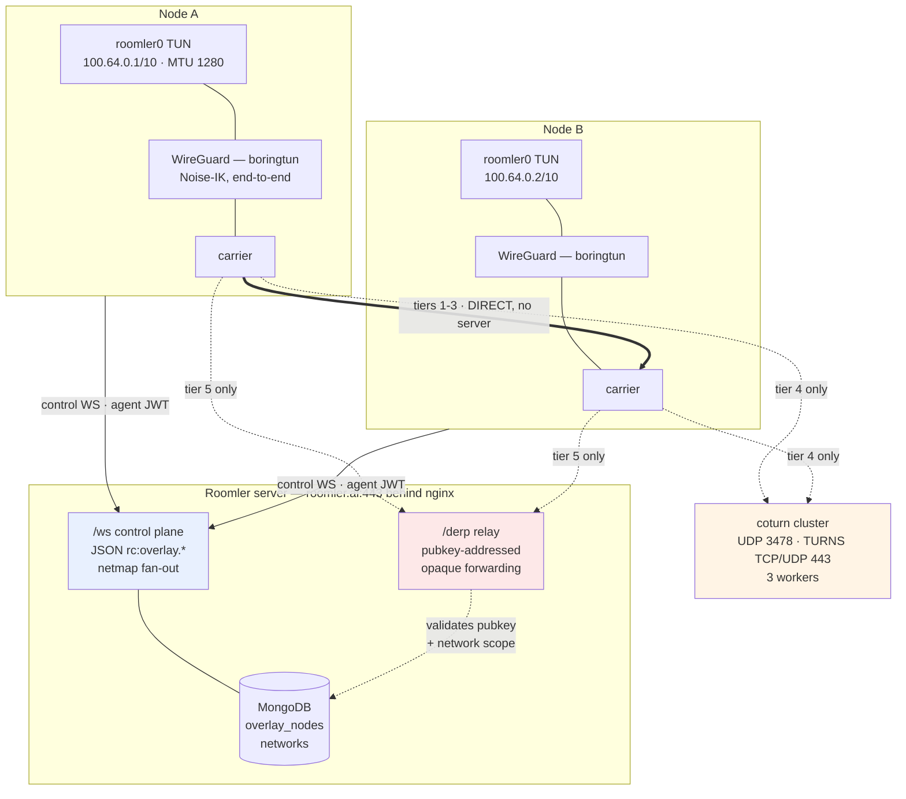

**Control-plane messages** (`crates/remote_control/src/signaling.rs`):

| Direction | Message | Purpose |
|---|---|---|
| node → server | `rc:overlay.join` | pubkey, LAN endpoints, MTU, capability flags |
| node → server | `rc:overlay.endpoints` | trickle current relay candidates |
| node → server | `rc:overlay.srflx` | trickle STUN-learned public mapping + NAT type |
| node → server | `rc:overlay.relay_request` | ask for coturn credentials for a peer |
| node → server | `rc:overlay.leave` | drop out of the mesh |
| server → node | `rc:overlay.netmap` | full peer list |
| server → node | `rc:overlay.netmap_delta` | incremental upsert/remove |
| server → node | `rc:overlay.relay_grant` | coturn ICE servers + a symmetric `pair_key` |

The data plane is always **WireGuard**: a userspace boringtun tunnel presenting
a `roomler0` TUN on `100.64.0.0/10` (CGNAT range, Tailscale convention) at MTU
1280. Only the *envelope* under WireGuard changes between tiers.

**A node's identity on the data plane is its WireGuard public key**, minted on the
device at enrollment; the server distributes the public half in the netmap and never
holds the private one. An admin can retire it from the device grid — the server
*orders* a re-mint it never sees, the device persists the new key and re-joins under
it, and every peer reinstalls the carrier on the resulting netmap upsert:
[`overlay-key-rotation.md`](overlay-key-rotation.md) (FR-40).

### Address leases — allocation and release

Each tenant has one `overlay_networks` row: a CIDR (`100.64.0.0/10`), a
monotonic `next_host` cursor, and `free_hosts`, a pool of **recycled** host
numbers. On `rc:overlay.join` the server looks the machine up by
`(tenant_id, machine_id)`:

- **a live node** → rehydrate it; the lease is unchanged.
- **no live node** → `allocate_host` pops the head of `free_hosts` (FIFO, so an
  address gets the longest possible cool-down before reuse) and falls back to
  bumping `next_host` when the pool is empty. Both branches are single atomic
  `find_one_and_update`s, so concurrent joiners can never be handed the same
  number.

The IPv6 address is **derived**, never allocated: `derive_overlay_v6` embeds the
v4 in the low 32 bits of the pinned ULA `fd72:6f6f:6d6c::/96`. There is one
allocator, and freeing the v4 frees both.

Consequences of derivation (from the shipped dual-stack work; the historical
plan doc is retired):

- **No per-peer v6 routing state anywhere**: the router *unmaps* a derived-ULA
  destination back to its embedded v4 at packet-extraction time
  (`Router::dst_of_ip_packet`) and routes on the existing v4 table.
- **No wire/DB `overlay_ip6` field** — it would only be a consistency liability;
  every consumer (LocalAPI `status`/`peers`, the tray, the admin nodes table via
  a TS mirror of the derivation) computes it locally.
- **MagicDNS answers AAAA** with the derived v6 by default;
  `ROOMLERD_DNS_AAAA=0` reverts to A-only — the mixed-fleet escape hatch,
  since a pre-v6 peer's OS doesn't own its derived address and v6 toward it
  blackholes (happy-eyeballs apps fall back on their own).
- `roomler ping <name> -6` resolves a peer's derived v6; the netstack SOCKS
  front accepts genuine ATYP=IPv6 targets when they are derived-ULA (v4-mapped
  unwraps; any other v6 is host-unreachable by design).

**Removal releases the lease.** All three removal paths — `DELETE …/agent/{id}`,
`DELETE …/overlay-node/{id}` (admin evict), `DELETE …/tunnel-client/{id}` — go
through one writer, and the order is load-bearing:

1. read the peer list while the node is still live;
2. **compare-and-swap** the node's `deleted_at` (winning that CAS is the release
   *token* — only the winner proceeds, so two concurrent removals can't pool one
   host twice);
3. return the host number to `free_hosts`;
4. fan `rc:overlay.netmap_delta { removes: [node_id] }` to those peers, and to
   the released node itself.

Pooling *before* the tombstone would hand the address to a second joiner while
the old row still held it, and the unique index would lock that joiner out of
the overlay permanently. In this order a crash merely leaks one host number out
of a 4.2 M-address `/10`.

The node row is **tombstoned, not deleted**: its address, name and pubkey stay
as the record of who held them — which matters precisely because addresses now
recycle. The three unique indexes on `overlay_nodes` are scoped to live rows, so
a tombstone holds neither its address nor its MagicDNS name.

Two consequences worth knowing:

- **Removal is final.** A removed machine that re-enrolls comes back as a *new*
  node with a fresh address and a fresh name; the tombstone is never revived.
- **Evict is "force a new lease", not "ban".** It doesn't touch the backing
  agent / tunnel client, so a still-enrolled device rejoins on its next connect
  with a *different* address. If its WireGuard key TTL expired while the evicted
  node was offline, the join refusal triggers `order_auto_key_rotate_if_needed`
  so an agent supporting `key-rotate` automatically rotates its key and rejoins.
  Evicting the node row (`DELETE /api/tenant/{tid}/overlay-node/{id}`) is also
  the operator recovery step when a previously rotated device (`key_epoch > 0`)
  loses its local config and reconnects with a fresh key at `key_epoch = 0`
  (which `rehydrate` otherwise rejects as stale epoch). Note that
  `ROOMLER_OVERLAY_KEY_TTL_SECS` applies to all newly created node rows regardless
  of agent version; legacy agents without `key-rotate` capability require manual
  update/intervention upon key expiry. To remove a device for good, delete it.
  There is deliberately no per-machine overlay denylist.

### Pre-release gaps are ACCEPTED — don't "fix" them

Every device removed *before* the release mechanism shipped (2026-07-29) burned
its host number with nothing to hand it back, so a long-lived tenant's cursor
sits above its live-node count with holes below. The fleet tenant is the worked
example: `next_host = 33`, 14 live nodes, and 16 numbers (`.3 .5 .8–.13
.16–.23`) that belong to no row at all.

**This is expected and deliberately not reclaimed.** Those numbers aren't
attached to any document, so eviction cannot reach them — recovering them means
writing `free_hosts` directly, which bypasses every guard in `release_host` (the
`next_host: {$gt: host}` sanity filter, the `$addToSet` dedup, the CAS release
token) for a `/10` that holds 4.19 M addresses. The pool already stops *new*
leaks, so the win is cosmetic.

If a tenant ever does churn enough for the cursor to matter, do it properly: an
admin-triggered reconcile that computes `(1..next_host) − live − pooled`
server-side and returns each number through `release_host`, so the guards still
apply. Not a hand-rolled database update.

Because addresses are reused, the client keys every routing teardown by
**pubkey**, never by address, and drops an OS `/32` only when no surviving peer
still claims it. Those two rules are what stop a late reap of a stale peer from
blackholing the address's new owner; the paths that exercise them are the delta
`removes` arm and `sweep_carrier_health`'s lazy reap. A *name* in
`overlay_exit_node` is pinned to the node it first resolved to — see
`docs/overlay-exit-nodes.md`.

Note that a **disconnect needs no pruning**: the node runtime is scoped to one
control-WS session, so losing the WS tears down `by_node`, the WireGuard device
and the TUN, and the reconnect rebuilds from an empty state. (There is a
defensive diff-and-prune on the full-netmap arm, but a second full netmap never
reaches a live runtime today — the server only sends one in reply to a join.)

---

## 2. What a "carrier" is

A carrier is whatever moves one WireGuard datagram from A to B. All five
implement the same tiny contract, so the WG layer is identical everywhere:

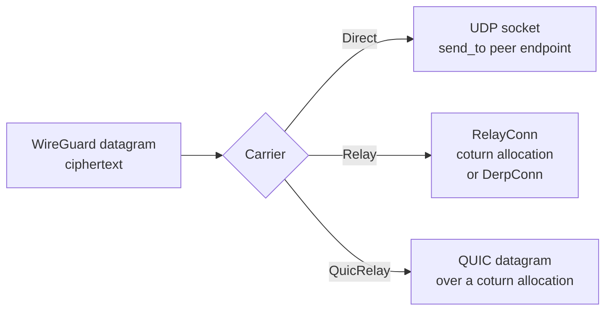

That uniformity is why adding DERP touched no WireGuard code: `DerpConn` is just
another `RelayConn`.

### The direct carrier's socket buffers (FR-110)

A direct carrier is one UDP socket, and the kernel holds whatever arrives
between two reads of it. At the OS default (208 KB to receive on Linux) a burst
at line rate fills that in under 2 ms. The kernel then drops WireGuard
datagrams before the daemon reads them, and TCP inside the tunnel reads every
drop as congestion: CPU idle, throughput low. So every direct carrier socket
asks for **7 MiB each way** as it is bound. That is `tune_carrier`
(`crates/tunnel-core/src/overlay/sockbuf.rs:145`), called from the one seam that
binds them all, `bind_direct_socket` (`direct.rs:1570`).

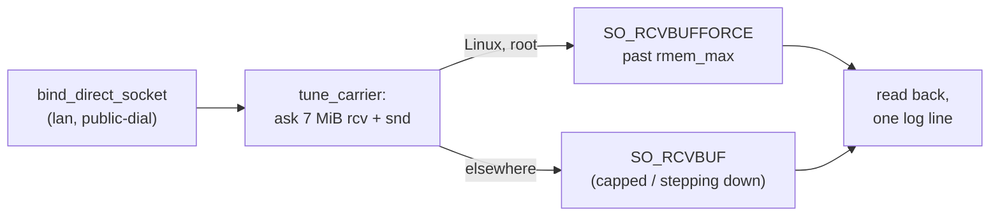

| OS | How | What caps it |
|---|---|---|
| Linux, root | `SO_RCVBUFFORCE` / `SO_SNDBUFFORCE` (`sockbuf.rs:87`) | nothing: past `net.core.rmem_max` |
| Linux, no `CAP_NET_ADMIN` | `SO_RCVBUF` / `SO_SNDBUF` | `net.core.rmem_max`, which is **212992 on most distributions**. That is why FORCE matters: the plain option alone changes nothing there. Under 1 MiB the line is a WARN |
| Windows | `SO_RCVBUF` / `SO_SNDBUF` | nothing: it takes the size |
| macOS | `SO_RCVBUF` / `SO_SNDBUF`, stepping down 7 → 4 → 2 → 1 MiB | `kern.ipc.maxsockbuf`, which refuses a larger size outright |

Measured into an M2 Pro Linux host over the overlay, 256 MiB from a server
17 ms away: **116 / 128 Mbit/s with 455 / 623 drops** (`RcvbufErrors`) on
0.4.140, against **516 / 543 Mbit/s with none** on the released 0.4.141. CPU was
~1% on both ends both times. Windows and macOS grant the full 7 MiB to the plain
option. A Windows receiver was not dropping at its default (UDP Receive Errors
0), so it gains little: 416 → 435 Mbit/s, interleaved with the old build under
one load.

⚠️ **Check the size with `ss`, not with a throughput test.** `ss -uampn` shows
each socket's `rb`. Linux reports twice the request, so a carrier socket shows
`rb14680064`, and every other socket of the daemon keeps the default. The
daemon logs the granted sizes once per socket (*"overlay: carrier socket
buffers"*) whatever `RUST_LOG` says. The packaged Linux units set
`RUST_LOG=roomlerd=info,warn`, which drops `tunnel_core` INFO, so the logger
appends this one target on its own (`crates/agent-core/src/logging.rs:225`). On
Windows that line is the only evidence of the size.

⚠️ **A per-user Linux install gains nothing until the host allows it.** It runs
without `CAP_NET_ADMIN`, so FORCE is refused. Under a distro-default
`rmem_max` its carrier sockets stay at 416 KB (`rb425984`), and the daemon says
so in a WARN line. Raise `net.core.rmem_max` and `net.core.wmem_max` to at least
7340032 (persisted in `/etc/sysctl.d/`), or install the daemon system-wide.

⚠️ **A full buffer delays instead of dropping.** A queue builds only when the
reader falls behind the arrival rate. Datagrams then wait rather than vanish,
and for TCP inside the tunnel a drop costs more than the wait. The kernel
charges a socket only for what is queued, so an idle carrier costs nothing.
Kill switch: `ROOMLERD_OVERLAY_SOCKBUF=0`.

---

## 3. The carrier cascade

The **PathMonitor** (`overlay/path.rs`, the one selection implementation since
rc.282) decides the tier on every netmap, health sweep, authenticated inbound
INIT, resume, and a ~30 s re-upgrade tick. Cold-start the decision follows the
priority order below (tier priors); after that, measured evidence — decaying
failure penalties, probe latencies, traffic credits — refines it, demoting
only on a typed carrier death. Best latency first, server-dependency last.

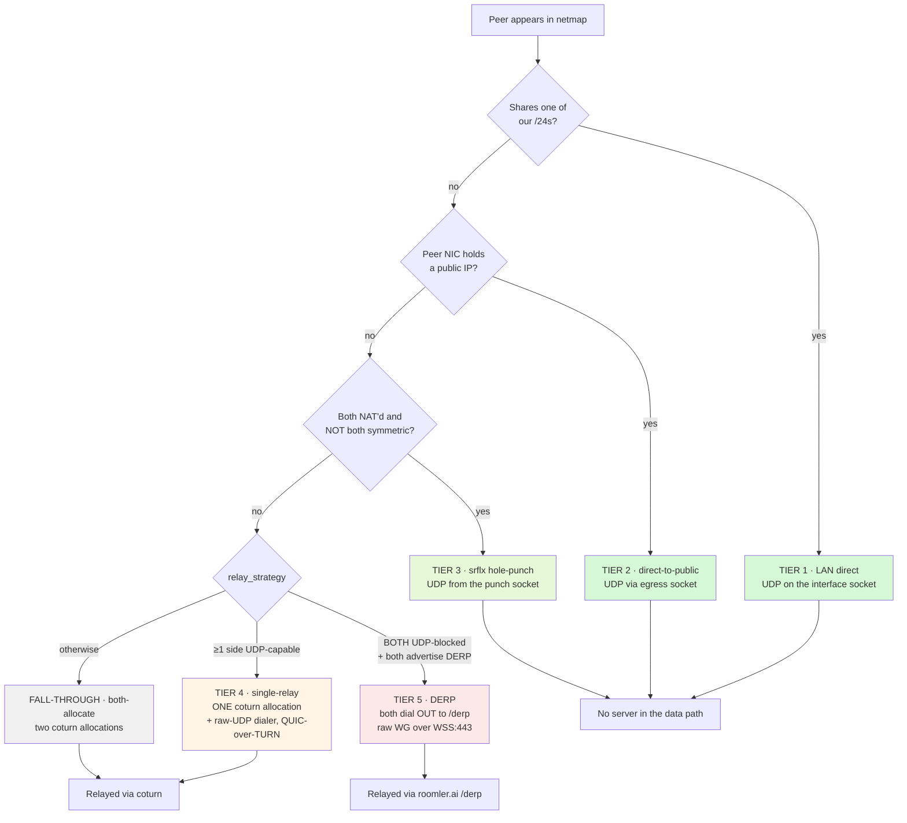

| # | Tier | Carrier | Wins when | Flag — `ROOMLERD_OVERLAY_…` |
|---|---|---|---|---|
| 1 | LAN direct | UDP, interface socket | peer shares a /24 | `DIRECT` (**on**) |
| 2 | direct-to-public | UDP, egress socket | peer's NIC is public | `PUBLIC_DIRECT` (off) |
| 3 | srflx hole-punch | UDP, punch socket | both NAT'd, not both symmetric | `SRFLX` (**on**, rc.200) |
| 4 | single-relay | 1 coturn alloc + raw dialer, QUIC | ≥1 side UDP-capable | `RELAY_SINGLE` (**on**, rc.200) |
| 5 | **DERP** | `/derp` WSS, pubkey-addressed | **both** UDP-blocked | `DERP` (**on**, rc.203) |
| 5′ | **org relay** (FR-19) | a tenant-owned `roomlerd` forwarding WG ciphertext on UDP 3478, Geneve-framed | the server **minted a session** for the pair — org switch on, an ACL rule granting each member the relay node, an approved + serving relay. A relay *kind* beside TURN/DERP on the relay tier, not a new tier | `ORG_RELAY` (off) |
| — | both-allocate | 2 coturn allocations | mixed capability / fall-through | always available |

Every gate accepts `0`/`false`/`no`/`off` to disable. Each direct tier carries
its **own** per-peer decaying failure penalty on the PathMonitor, so a failing
punch can never poison a proven LAN path (the CC1 rule — mechanics in
[`docs/overlay-nat-traversal.md`](./overlay-nat-traversal.md), "Path
selection: the two-plane PathMonitor").

---

## 4. Use cases — who wins, and why

### UC-1 · Both nodes on the same LAN (no VPN)

The happy path: L2 reachability, no NAT, no server in the data path.

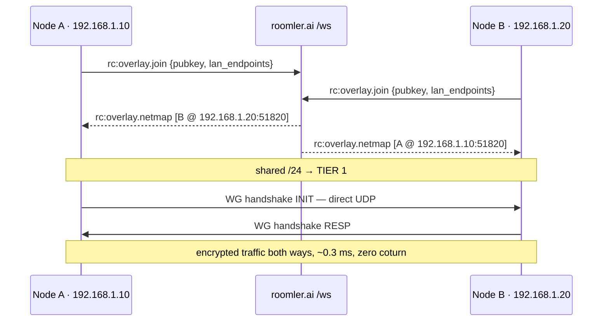

Direct carriers initiate **bilaterally** — each side's outbound INIT opens its
own stateful firewall hole for the other's inbound.

### UC-2 · One node has a public IP (cloud / fleet host)

A NAT'd client dials the public peer directly; no STUN needed, since the public
side has no NAT filter to open. The public side *accepts* an INIT from an
address it couldn't know in advance, after cryptographically authenticating it.

### UC-3 · Both behind home NAT — the hole-punch (outside VPN)

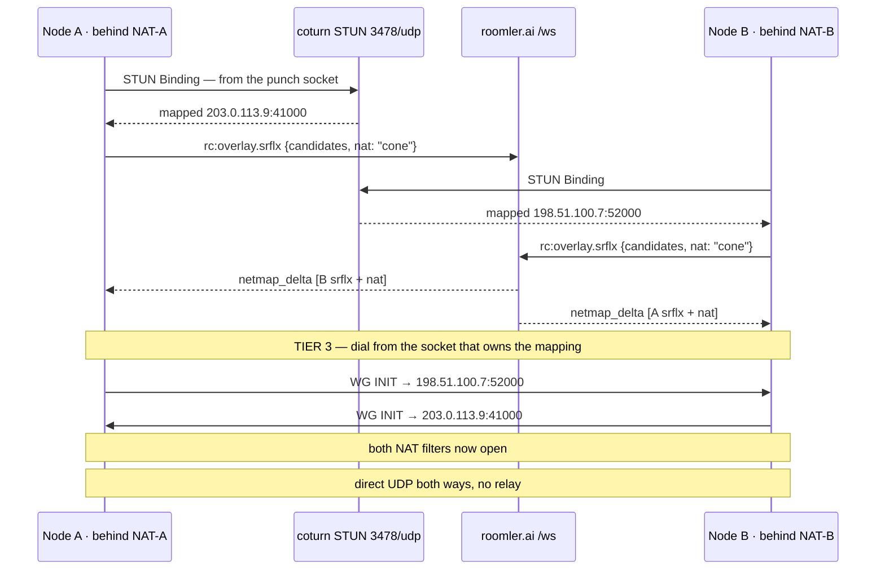

Two properties make this simpler than a generic ICE agent: **WG is the punch
burst** (boringtun retransmits INIT every ~5 s for ~90 s), and **the netmap
fan-out is the rendezvous**. Symmetric↔symmetric is skipped up front — neither
side can predict the other's per-destination port.

### UC-4 · Corporate VPN that still allows UDP — single-relay

This is the common corp case. A TLS-inspecting VPN typically **still permits**
UDP/3478 and UDP/443, so the host can reach coturn; it just can't be punched.
Single-relay uses exactly **one** coturn allocation, and — key point — the role
is chosen by **UDP capability, not pubkey**:

* the **UDP-blocked** side becomes the **anchor** (it can still *allocate* over
  the TURNS/TCP-443 fallback),
* the **UDP-capable** side becomes the **dialer** (a plain raw-UDP sender to the
  anchor's relayed address — no allocation of its own).

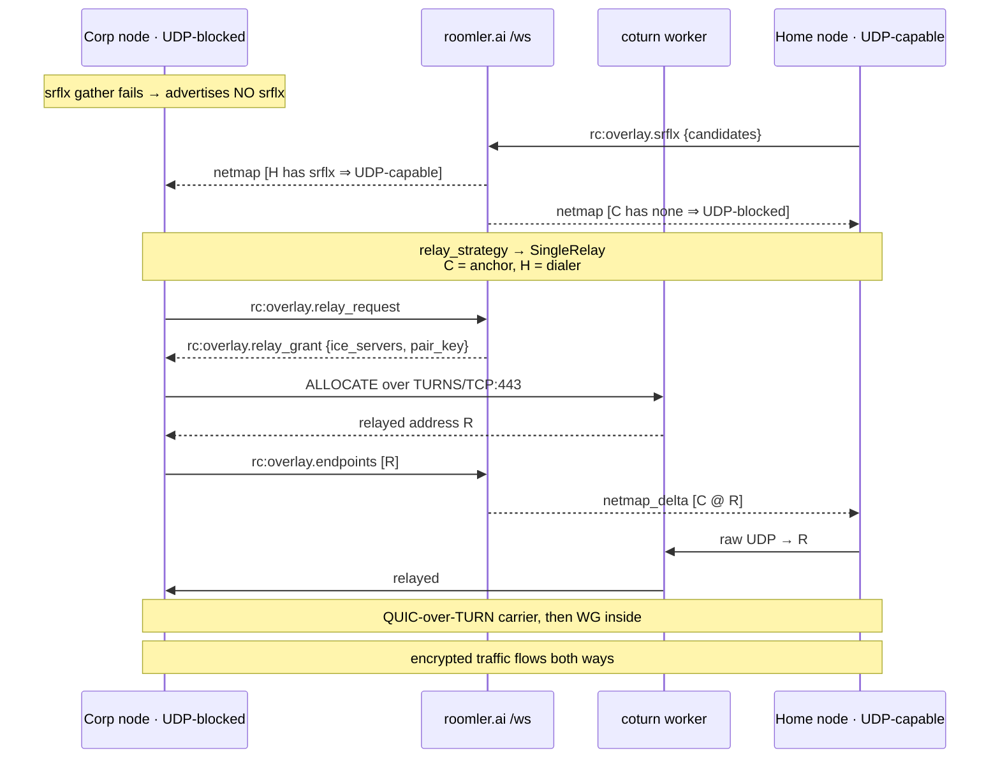

Single-relay **forces** the QUIC carrier: a raw relay carrier discards the recv
source, so the anchor couldn't reply to a symmetric dialer's coturn-observed
port — only quinn's server consumes the observed path.

The signal for "is my peer UDP-capable?" is beautifully cheap: **does it have
`srflx_endpoints` in the netmap?** A successful STUN round-trip *is* proof that
raw UDP to coturn works, so no extra wire field is needed and both ends compute
the same roles from the same inputs.

### UC-5 · Both sides UDP-blocked, TCP-only — **DERP**

The one topology no other tier can serve. Single-relay provably cannot: exactly
one side must be the raw-UDP dialer, and neither has UDP. DERP breaks the
deadlock because **both peers dial OUT** over TCP/TLS-443.

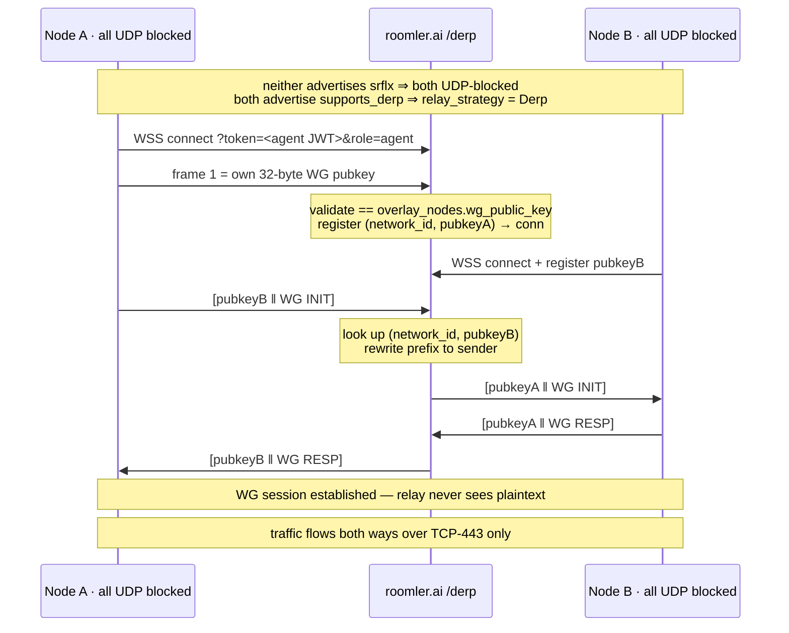

**Field-proven 2026-07-21**: buildhost↔fleet-host-2 network namespaces with *all* UDP and
*all* coturn TCP blocked — only `roomler.ai:443` reachable. Both nodes reached
`/derp`, `relay_strategy` chose `Derp`, the WG handshake completed over the relay
(INIT 148 B → RESP 92 B → data), and ping ran **0 % packet loss, ~2.7 ms RTT**
both directions.

### UC-6 · Fall-through: both-allocate

When single-relay isn't mutually supported and DERP doesn't apply, the pair
falls back to two coturn allocations. This path is cross-NAT fragile: it needs
both allocations on the **same** coturn worker, and a worker-co-location failure
was the root cause of the historic `REKEY_TIMEOUT`. Tiers 4 and 5 exist largely
to avoid it.

### UC-7 · Org relay (FR-19)

A pair that would otherwise sit on TURN or DERP can be routed through a node the
**org itself** owns — an HQ box with a public address — so relayed traffic never
crosses the API pod. The server decides (`docs/fr/FR-19-peer-relays.md` §1–§7):
on a `relay_request` it checks the org switch, the ACL grant for **each** member
to the relay node, an approved relay that is online and advertising
`relay-server`, and the per-(requester, relay) ceiling; then it pushes
`relay_serve` to the relay (both members' bind secrets) and `relay_session` to
each member (its own secret, the relay's endpoints). Each member binds with a
3-way authenticated handshake (`tag₁` covers no address — a NAT'd member cannot
know its mapping on its first packet; the cookie binds it at the challenge) and
installs an `OrgRelayConn` as a raw relay carrier: `relay:org/udp` in `roomler
peers`. Revocation is a **push** (org off, an ACL edit, approval cleared, a
party gone), because the idle deadline never fires under a WireGuard keepalive.
Sessions are 24-bit VNIs unique **per relay node**, capped at 64 per relay, 1 h
absolute lifetime. The floor is untouched: a node with no UDP stays on DERP.
Full treatment, including what the relay operator can still see:
[peer-relays.md](peer-relays.md).

---

## 5. Inside vs outside a VPN — what each network actually permits

The **corp VPN** column is measured — a real corporate VPN host probing the
fleet's coturn on 2026-07-21 via `coturn_test.html`. The other two columns are
the characteristic shape of those networks, not a single measurement.

| Transport | Open internet | Typical corp VPN | Strict TCP-only firewall |
|---|---|---|---|
| UDP 3478 — STUN/TURN | ✅ | ✅ | ❌ |
| UDP 443 — TURNS/UDP | ✅ | ✅ | ❌ |
| **TCP 443 — TLS** | ✅ | ✅ | ✅ |
| TCP 3478 — plain | ✅ | ❌ | ❌ |
| TCP 5349 — TURNS/TCP | ✅ | ❌ | ❌ |
| Inbound UDP / punchable | usually | ❌ | ❌ |

Reading across the rows gives the whole story:

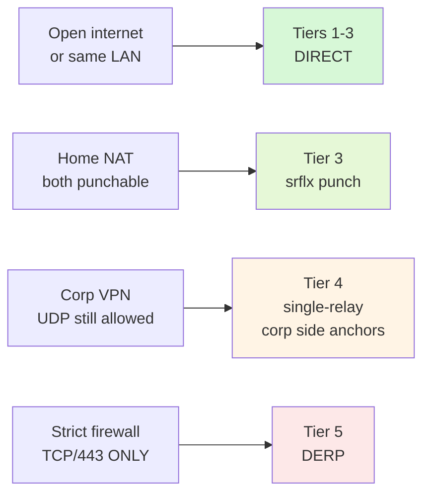

The load-bearing insight: **a corp VPN is usually not as restrictive as it
feels.** Because it still passes UDP/3478 and UDP/443, such a host is
*UDP-capable* and single-relay already covers it — which is why live telemetry
found no naturally-occurring both-UDP-blocked pair. DERP exists for the strictly
harder network where the only thing that survives is TCP/443-TLS. It was built
for **completeness of the solution**, not because demand forced it.

### The node's own firewall (FR-97 P3i)

The networks above sit between two nodes. A Linux node can also run a host
firewall of its own, firewalld or ufw. Measured on 2026-10-17 (FR-97 §8), it
affects the mesh in one way only.

| What crosses it | Behind firewalld | Why |
|---|---|---|
| A hole-punched carrier | ✅ passes (a Fedora host, zone `FedoraServer`) | direct carriers initiate bilaterally (UC-1): each side's outbound probe makes the conntrack entry that lets the other side's reply in |
| A LAN-direct carrier | ✅ passes (`tier=Lan`, 497 ms; zone `public`) | the same |
| A service on the node's overlay address | ❌ refused unless the zone admits it | the overlay adapter is in no zone, so the default zone governs it |
| Roomler's own services | ✅ untouched | roomler SSH is intercepted below the OS; exec, remote control and tunnels ride the daemon's own connections |

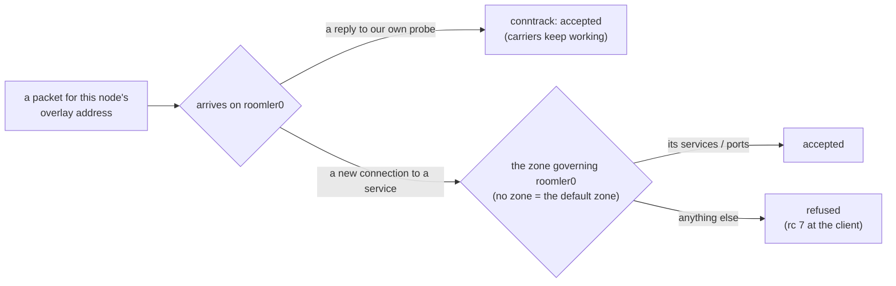

**The daemon reports this and never changes it** (FR-97 D13). The firewall
belongs to the host's owner, and putting the adapter in a trusting zone would
open every service on the host to every peer the overlay ACL admits. What it
does instead:

- The overlay runtime asks firewalld, then ufw, what governs its adapter,
  once the adapter is up and every ten minutes
  ([`runtime.rs:2158`](../crates/tunnel-core/src/overlay/runtime.rs#L2158),
  [`hostfw.rs:220`](../crates/tunnel-core/src/overlay/hostfw.rs#L220)), off
  the run loop.
- The answer is `HostFirewallStatus`
  ([`lib.rs:120`](../crates/localapi/src/lib.rs#L120)), parsed from
  `firewall-cmd --info-zone` ([`hostfw.rs:45`](../crates/tunnel-core/src/overlay/hostfw.rs#L45))
  or `ufw status verbose` ([`hostfw.rs:130`](../crates/tunnel-core/src/overlay/hostfw.rs#L130)).
- `roomler status` prints it only when the firewall limits what a mesh peer
  reaches ([`localclient.rs:2751`](../agents/roomler-cli/src/localclient.rs#L2751)):

  ```text
    host fw     firewalld has roomler0 in no zone, so the default zone public applies: mesh peers reach only dhcpv6-client, ssh here
  ```

To open the mesh, the owner runs one of these. Measured: the overlay address
answered while the LAN address stayed as its zone said.

```bash
sudo firewall-cmd --zone=trusted --add-interface=roomler0              # until firewalld reloads
sudo firewall-cmd --permanent --zone=trusted --add-interface=roomler0  # and after
sudo ufw allow in on roomler0
```

⚠️ **`trusted` admits every port to every peer the overlay ACL admits.** A
narrower zone, or `--add-port` on the governing one, opens less.

⚠️ **Rich rules and source-bound zones are not interpreted.** The status counts
a zone's rich rules ("2 rich rules") rather than guessing what they admit, and
a zone bound to a source range can admit more than the interface's zone says.

⚠️ **ufw needs root to answer**, so a per-user daemon reports no ufw line rather
than a guess. `ROOMLERD_HOST_FW_PROBE=0` switches the probe off. macOS's
Application Firewall is not asked: it passes forwarded traffic and filters per
application ([`overlay-exit-nodes.md`](overlay-exit-nodes.md)).

---

## 6. DERP in detail

### Wire protocol

Every frame is a WebSocket **binary** message on `wss://roomler.ai/derp`.

| Frame | Layout | Meaning |
|---|---|---|
| Registration — first frame only | `pubkey(32)` | "I am this WireGuard key" |
| Data — client → relay | `dst_pubkey(32) ‖ payload` | "deliver to this peer" |
| Data — relay → client | `src_pubkey(32) ‖ payload` | "this came from that peer" |

The relay rewrites only the 32-byte prefix. The payload is opaque WireGuard
ciphertext and is never inspected, decrypted, or stored.

### Server side

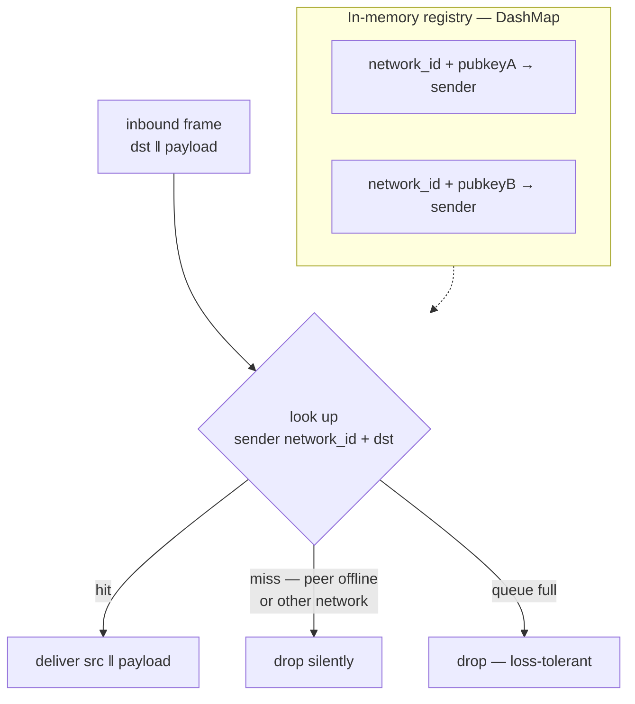

Three guarantees fall out of the key shape:

1. **Auth** — the agent JWT, same audience as `/ws?role=agent`. The database is
   authoritative for the agent's tenant, so a forged claim can't widen scope.
2. **Registration authz** — a node may only register the pubkey that matches its
   own `overlay_nodes.wg_public_key`. It cannot claim a peer's key to intercept
   that peer's frames.
3. **Network scoping** — `network_id` is part of the registry *key*, so a
   cross-network delivery is structurally impossible, not merely checked.

Backpressure is a bounded per-connection queue with drop-on-overflow; WireGuard
retransmits, so a dropped carrier datagram is harmless. Re-registration is
last-writer-wins, because corp middleboxes routinely leave half-open TCP.

### Client side

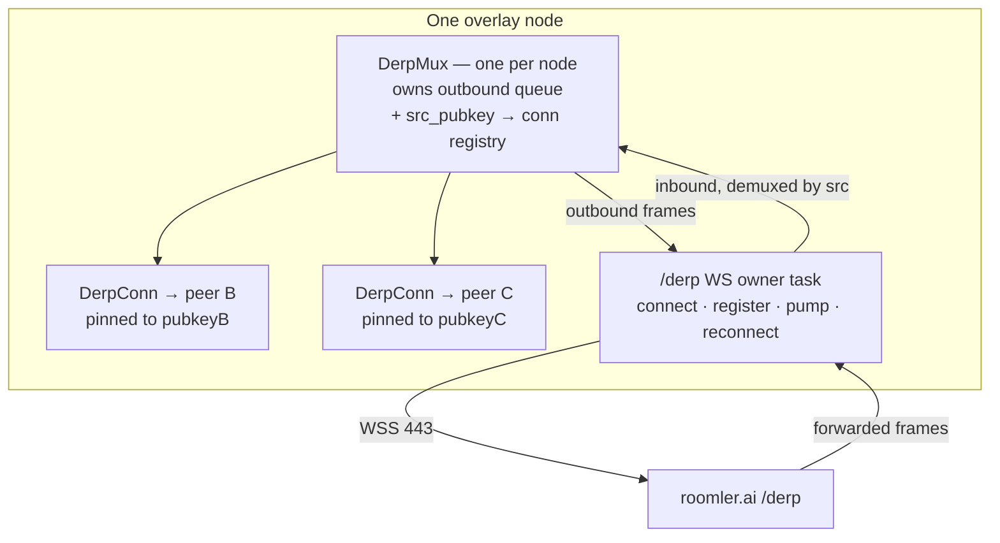

`DerpConn` implements the same `RelayConn` contract as a coturn allocation, so
the WireGuard layer is untouched. It is **pinned to exactly one peer pubkey**,
and that pinning is what makes **raw** WireGuard correct here: every datagram it
receives is, by construction, from that one peer, so the carrier's
recv-source discard can never be wrong. That is precisely the property
single-relay lacks — which is why single-relay must force QUIC while DERP
deliberately stays raw. QUIC over a reliable WebSocket would be double-reliable,
head-of-line blocking on top of head-of-line blocking.

### Lazy connection

DERP is default-ON, but the `/derp` WS is opened **only when the node is itself
UDP-blocked** — that is, when its own srflx gather came back empty, the same
signal that already picks the single-relay anchor role. A UDP-capable node can
never be in a both-UDP-blocked pair, so it never opens the socket:

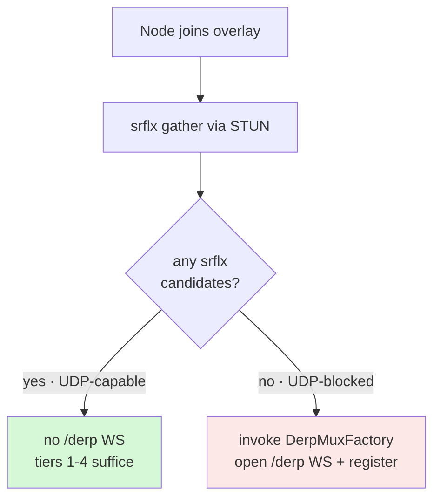

A reconnect re-runs the decision against a fresh gather, so a host that *becomes*
UDP-blocked — moving onto a restrictive network — opens `/derp` at that point.

### Deployment shape

`/derp` is served by the same API pods behind the same nginx as `/ws`, on its own
`location` block with 86400 s idle timeouts. It is a **separate** endpoint from
`/ws` on purpose: WireGuard data at line rate would head-of-line-block the JSON
control channel. The registry is in-memory on a single-replica deployment, so a
web deploy severs DERP links — they simply rebuild via the carrier's dead-latch.

---

## 7. What the server can and cannot see

| | `/ws` control | coturn relay | `/derp` relay |
|---|---|---|---|
| Peer membership, pubkeys, endpoints | ✅ sees | — | sees pubkeys only |
| Ciphertext passes through | ❌ never | ✅ | ✅ |
| **Plaintext** | ❌ | ❌ | ❌ |
| Can impersonate a peer | ❌ | ❌ | ❌ registration is key-bound |

WireGuard's Noise-IK handshake authenticates both ends by static key, so a
relay — coturn or DERP — is a blind pipe. Compromising it yields traffic timing
and volume, never content. On tiers 1–3 the server isn't in the data path at
all.

### What a node may learn about the other nodes

The netmap is also the boundary of what a **node** may be told about its
tenant. The companion app's Devices page asks the server, with the device's
agent token, for `GET /api/agent/self/{devices,mesh}` (FR-84 D5), and the answer
is exactly **this node ∪ the peers its netmap carries** — computed by the same
join-time ACL shaping (`shape_full_netmap`), so under `enforce` a withheld peer is
absent from the list and the mesh graph as well as from the netmap. It adds
display names, OS and version; machine ids, owner ids and keys never leave the
server. Detail and the negative-control test:
[desktop-companion.md](desktop-companion.md) §6.

---

## 8. Failure handling

* **Handshake deadlines** — a punch that never completes is invisible to the
  data-traffic health sweep, so a lock-free `handshake_complete` flag lets the
  sweep tear down a stalled srflx carrier at **12 s** and a public-direct one at
  **30 s**, then demote a tier.
* **Dead latch** — a relay carrier whose send hard-errors latches `dead`, so the
  next sweep rebuilds within ~5 s instead of waiting out the ~20 s rx-flat
  heuristic. `DerpConn` returns an error the moment its WS is down for exactly
  this reason.
* **Strategy recompute** — a peer's `srflx_endpoints` arrive on a *later* trickle
  than its join, so during that window a UDP-capable peer briefly looks
  UDP-blocked. The relay coordinator therefore stores the strategy each link was
  established with and re-evaluates it on every netmap, forgetting and
  re-establishing the link if it changed. Without this a pair could deadlock
  with both sides having chosen "dialer".
* **Decaying penalties** — per-(peer, tier) on the PathMonitor, never shared,
  so a routinely-failing punch cannot poison a proven LAN or public path.
  Repeated failures stretch the penalty half-life (60 s → 900 s) instead of
  hard-denying, so every tier retries eventually — lockout is impossible by
  construction.
* **Route erasure** — the route guard reacts to OS route-change events
  (Windows `NotifyRouteChange2`, Linux `ip monitor route`, macOS
  `route -n monitor`) with an immediate
  re-assert of the per-peer `/32`s and any exit `/1`s (waves rate-limited to
  ≥3 s apart; an event inside the quiet window pulls the next tick to the
  due boundary, so no erase waits longer than that). The blind tick is a
  30 s belt-and-braces heartbeat while the subscription is live
  (`…_ROUTE_TICK_SECS` to override; `2` = the pre-demotion cadence) and
  drops back to 2 s automatically whenever the subscription is unavailable
  or dies.
* **A re-assert must not write a route that is already ours** (#1856). Every
  wave re-asserts every peer, so a write that changes nothing still costs
  two things. It emits a route-change event, which arms the next wave
  through the trailing edge above and keeps the guard driving itself. And
  wherever the write is not atomic, it opens a hole. Linux
  (`ip route replace`) skips a matching route. Windows did for peer `/32`s
  (`winroute::ensure`) but **not** for prefixes: `add_cidr_route` deleted and
  re-added the four block-floor prefixes per adapter on every wave (field,
  NEO16: their route Age never passed 2 s while the peer `/32`s were 6 h old),
  and those writes are what ran the Windows guard at ~20 waves/min per adapter
  (#1282). Every write was also a brief hole in an exit client's `/1`s. It now
  checks `winroute::is_installed` first: no #1328 strike bookkeeping, so a VPN
  that keeps deleting an exit `/1` is still fought exactly as before.
  macOS has no idempotent `route` write: a re-assert is `route -n get`, and
  only a route that is missing or foreign gets the delete-then-add. A wave
  that wrote anyway left each peer's `/32` absent for 2.5–3.0 ms every 3 s,
  and macOS answers a socket **bound to the overlay address** with
  `EHOSTUNREACH` in that hole instead of falling through to the default
  route. That socket is WebRTC's host candidate whenever the controller's
  browser runs on an overlay node, so remote desktop to a Mac broke a few
  seconds into every session. The macOS monitor (`route -n monitor`) also
  counts only change headers: an `RTM_GET` is somebody's lookup, including
  netstate's own snapshot, and once counted it kept the monitor awake by
  itself.

> ⚠️ **`ROUTE_WAVES_TICK` ≫ `ROUTE_WAVES_EVENT` does not mean "no live
> subscription".** An event inside the quiet window does not run a wave. It
> pulls the TICK arm forward, and the tick counts the wave. A guard that feeds
> itself therefore reads as tick-driven: the MacBook showed tick 22512, event
> 8, with its monitor demonstrably live (#1282). `roomler status` now prints
> `pulled=N` inside the arms bracket (`ROUTE_WAVES_PULLED`): the tick waves an
> event pulled forward. `pulled ≈ tick` is a guard re-arming itself, and
> `tick − pulled` is the real heartbeat.

* **The OS change feed survives its own monitor dying** (#1867). On Linux and
  macOS, netstate's feed is a child process (`ip -o monitor`, `route -n
  monitor`). When that child exited, netstate used to stop for the life of the
  process. The runtime never even saw the feed close, so it ran on the 30 s
  heartbeat alone until a restart. The child is now supervised: it is respawned
  with a capped backoff (250 ms → 30 s), and each respawn sends one synthetic
  wake-up, so whatever changed while nothing was watching is re-sampled and
  re-asserted.
* **Evict a competing route only when it wins, and stop when it is futile**
  (#1405, Windows). AnyConnect mirrors our prefixes onto its miniport: every
  peer `/32`, the floor `/24`s, and the derived ULA `/96`. It re-adds a
  deleted mirror within milliseconds. Two rules stop the guard fighting a war
  it either already won or cannot win:
  1. **Only a winner is evicted.** Before deleting anything, the guard asks
     the FIB which interface it would use (`GetBestRoute2` on the host, or on
     the first address inside a prefix). If that is ours (a sibling roomler
     adapter counts as ours), the competitor's row loses every lookup and
     carries no traffic, so it is left alone. On CORPLAP-3 our v4 rows win
     (effective 1 vs Cisco's 26), so the per-wave v4 evictions stop entirely.
     Kill switch: `overlay_route_evict_winners_only` (default on).
  2. **A winner that comes straight back is a futile fight.** If the same
     prefix needs evicting on 4 consecutive waves, eviction of it pauses for
     the #1328 ladder (1 min, doubling, capped at 15 min) and the pause is
     counted in `yielded`. That is the ULA `/96` behind AnyConnect: their
     mirror wins 26 vs 261 and returns within milliseconds, so deleting it
     ~20×/min never held the prefix (v6 overlay stayed 100% lost). Each
     deletion only re-armed the guard: 0.4.121 measured ~200 evictions/min
     with `pulled == tick`. Shares the `overlay_route_yield` switch.

  ⚠️ IPv6 overlay behind AnyConnect stays unroutable either way. Winning the
  `/96` by metric gets our connected row deleted (rc.289, re-confirmed in
  #1405). The remaining lever is routes we ADD, more specific than `/96`,
  which AnyConnect tolerates for v4. Nothing opens overlay-v6 sockets today
  (#1405), so that stays unbuilt until something does.

---

## 9. Configuration reference

<!-- RETIRED-NAME-ANCHOR(4): names the legacy env prefix env::node_env still honours; an
     operator with it in a script needs to be able to grep for it. -->
All flags take the `ROOMLERD_OVERLAY_` prefix; the legacy `ROOMLER_AGENT_`
prefix is still honoured.

| Variable | Default | Effect |
|---|---|---|
| `…_DIRECT` | on | LAN-direct tier |
| `…_PUBLIC_DIRECT` | off | direct-to-public tier |
| `…_SRFLX` | on | srflx hole-punch tier |
| `…_SRFLX_KEEPALIVE_SECS` | 20 | STUN keepalive holding the mapping open |
| `…_RELAY_SINGLE` | on | single-relay tier |
| `…_DERP` | **on** since rc.203 | DERP tier |
| `…_ORG_RELAY` | off | ride a tenant-owned org relay when the server mints a session for a pair (FR-19 P4b); serving is `RELAY_SERVER_ENABLED` |
| `…_PATHMON` | **on** | path-monitor telemetry (`on`/`shadow`/`off`). Selection is always monitor-driven since rc.282 — non-`on` values only silence the 10-min decision summaries |
| `…_ROUTE_EVENTS` | **on** | event-driven route guard: OS route-change subscription driving immediate re-asserts; off = 2 s blind tick only |
| `…_ROUTE_TICK_SECS` | 30 | route-guard heartbeat seconds while the subscription is live (2–300; `2` = pre-demotion cadence). Ignored — always 2 s — without a live subscription |
| `…_ROUTE_EVICT_WINNERS_ONLY` | **on** | Windows: evict a competing VPN route only when it wins the FIB lookup (#1405); off = evict every competing row every wave |
| `…_NETSTACK_SOCKS` | unset | userspace netstack + SOCKS5 instead of an OS TUN |
| `…_SOCKBUF` | **on** (FR-110) | every direct carrier socket asks for 7 MiB receive and send buffers (§2); off = the OS default |

Joining the mesh at all additionally requires `overlay_enabled = true` in the
node config and a build carrying the `overlay-l3` (or `overlay-netstack`)
feature.

---

## 10. Field-proof record

| Tier | Proven | Result |
|---|---|---|
| LAN direct | 4-node single-Wi-Fi mesh | fully direct, ~3–9 ms, zero coturn |
| direct-to-public | NAT'd netns ↔ public host | 0 % loss, ~0.9 ms |
| srflx punch | buildhost↔fleet-host-2 netns, cone↔cone | 0 % loss, ~0.6 ms |
| single-relay | buildhost↔fleet-host-2 netns, sym↔sym | 0 % loss, ~1.3 ms |
| single-relay, UDP-aware anchor | UDP-blocked ↔ UDP-capable | 0 % loss, ~1–6 ms |
| **DERP** | buildhost↔fleet-host-2, both UDP **and** coturn-TCP blocked | **0 % loss, ~2.7 ms** |

**Throughput (FR-110):** TCP over a direct carrier into an M2 Pro Linux host
went from 116–128 Mbit/s to **516–543 Mbit/s** on the released 0.4.141, with the
receiver's drops from +455–623 per 256 MiB to none, once the carrier sockets
asked for 7 MiB buffers (§2).

Every tier in the cascade has now carried real WireGuard traffic between two
genuinely separated hosts. The cascade is complete: there is no longer a network
shape in which two Roomler nodes can reach `roomler.ai` yet fail to reach each
other.

---

### Testing note

The netns lab that validates these tiers blocks egress with a default-DROP
`OUTPUT` chain. That chain also matches the overlay's *own* traffic to
`roomler0`, which makes a perfectly healthy carrier look like 100 % packet loss.
Always add `iptables -I OUTPUT 1 -o roomler0 -j ACCEPT` inside the namespace, and
pin `roomler.ai` in `/etc/netns/<ns>/hosts` — DNS via the systemd-resolved stub
does not resolve inside a namespace.
