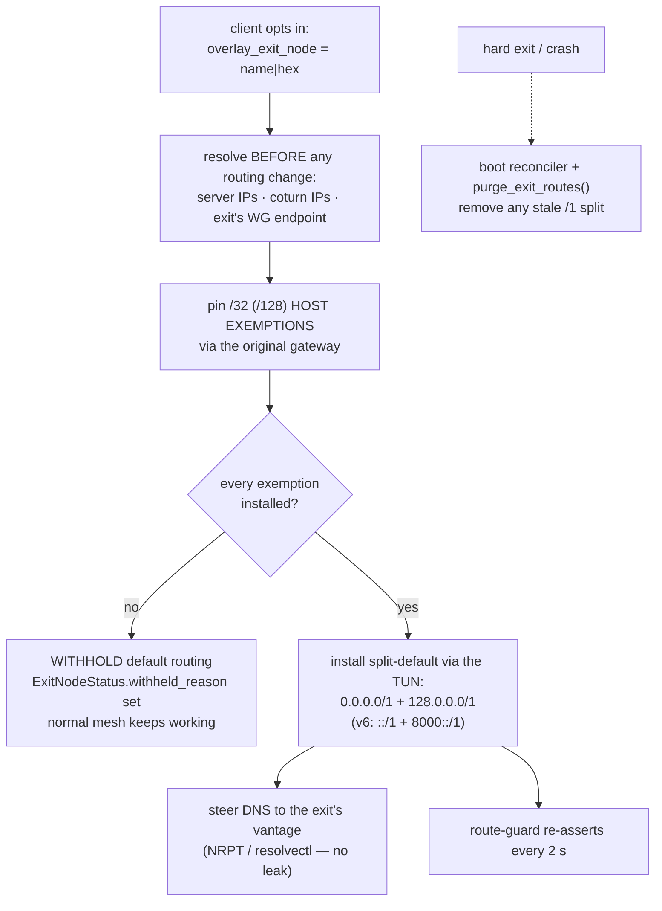
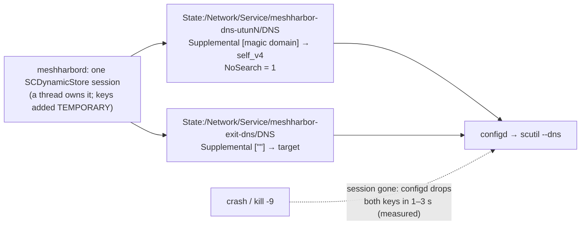
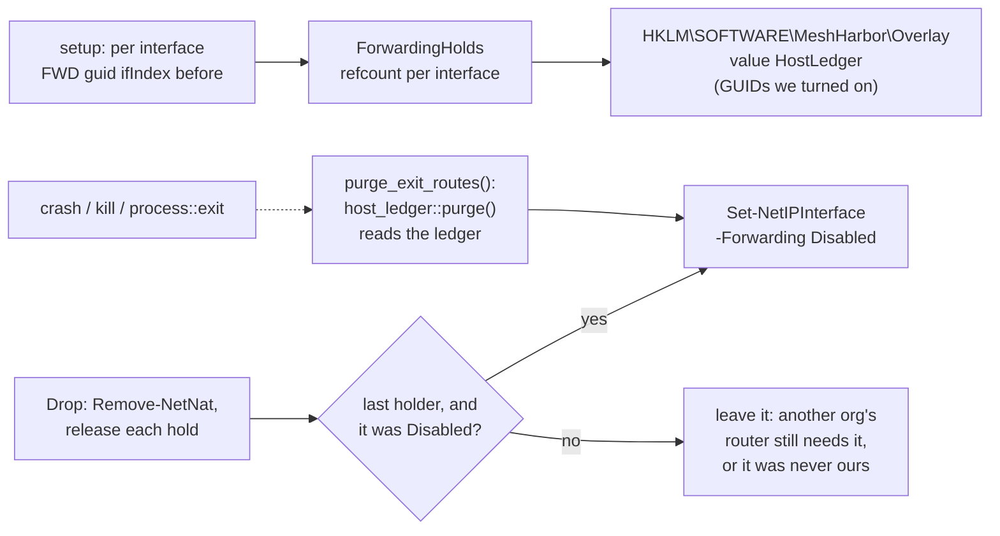
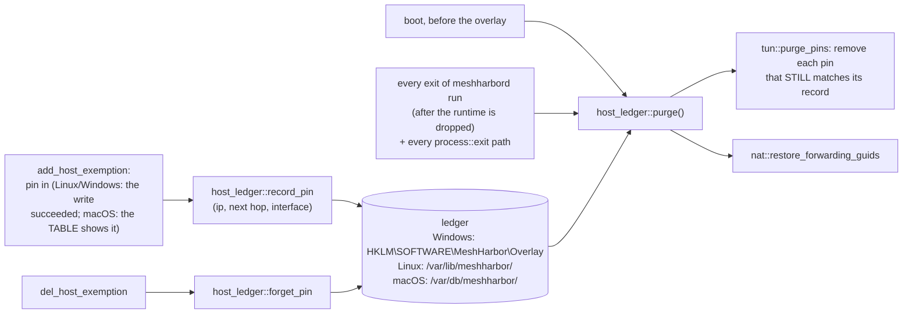
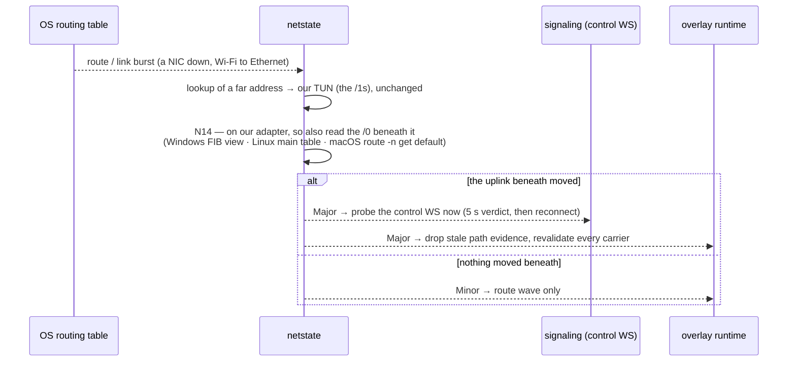
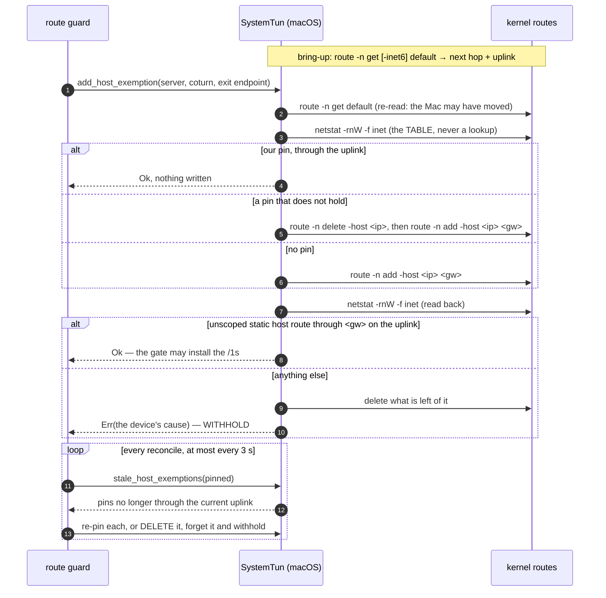
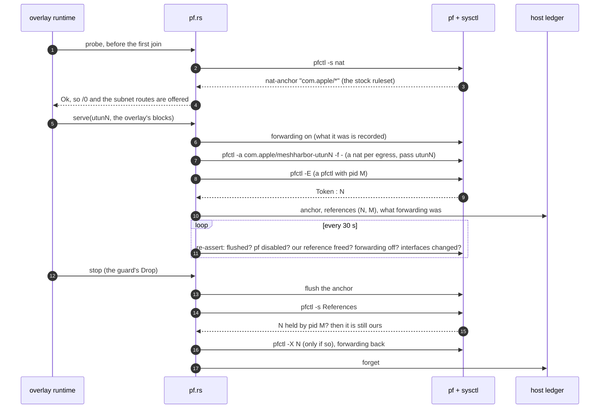
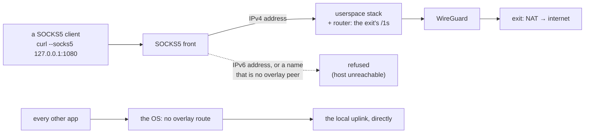

# Overlay exit nodes (default-route egress)

> Cross-ref: the L3 overlay mesh is part of the remote-control / tunnel
> subsystem ([`docs/remote-control.md`](./remote-control.md),
> [`docs/agent-tunnel-architecture.md`](./agent-tunnel-architecture.md)). This
> doc covers **exit nodes** — the Tailscale-style feature where one mesh peer
> routes another peer's *entire* internet egress. Related overlay docs:
> [`overlay-wfp.md`](./overlay-wfp.md) (Windows firewall override).

## What it is

An **exit node** is a mesh peer that forwards a **client's** whole internet
egress — `0.0.0.0/0` **and** `::/0` — out through *its* uplink, so the client
appears on the internet from the exit node's IP (and resolves DNS from the
exit's vantage). This is the Tailscale "exit node" model.

Feature-gated on **`overlay-l3`** (the OS-TUN carrier); **default-OFF**. The
userspace `overlay-netstack` device has no OS routing table: as a client its
exit carries only what its SOCKS5 front dials ([below](#a-netstack-client-fr-97-p0c-3)),
and it never serves as one. Everything else below is `overlay-l3`.

The design's north star is **"never self-wedge."** A client that routes all
egress through a peer can trivially cut off its own control channel (the
WebSocket to meshharbor.itachi.fans) and the WireGuard carrier itself — so the whole
feature is built around *exemptions* and a *safety gate* that refuses to install
default routing unless the escape hatches are provably in place.

## The three roles

Setting up an exit node touches three parties. All config lives in the agent's
`config.toml` (no env-var overrides for these keys).

### 1. The exit node (offers egress)

```toml
overlay_enabled          = true
overlay_exit_node_enabled = true      # OFFER to be an exit node
```

`overlay_exit_node_enabled` makes `AgentConfig::effective_overlay_advertised_routes()`
union `0.0.0.0/0` into what the node advertises to the coordination server.
Advertising `/0` is **just an offer** — it does nothing until an admin approves
it (below), and a generic advertised `/0` is *inert on every client* (see
[Safety model](#the-self-wedge-safety-model)).

When a client actually uses the exit, NAT engages automatically on the exit
(Linux: `iptables` MASQUERADE for the overlay CIDR + `FORWARD -i meshharbor0
ACCEPT` + established-return, `net.ipv4.ip_forward=1`; IPv6: `ip6tables`
MASQUERADE for the overlay ULA + forwarding + `accept_ra=2` so the host keeps
its own v6 default). Windows uses WinNAT (v4 only — see
[Platform support](#platform-support)).

### 2. An admin (approves it)

```
PUT /api/tenant/{tenant_id}/overlay-node/{node_id}/exit-node   { "enabled": true }
```

(UI: **Admin → Overlay → Subnet routes**, the exit-node toggle, gated on the
node having advertised `/0`.) This calls the DAO `set_exit_node`, which does
**two** things:

1. sets `is_exit_node = true`, and
2. adds `0.0.0.0/0` to the node's **`approved_routes`** — the *data-plane
   signal* the mesh actually acts on.

`approved_routes` is the source of truth: the server only propagates the exit
`/0` into peers' netmaps when it's in `approved_routes`, and this admin path is
the **only** way a `/0` gets there — the per-CIDR `set_approved_routes` rejects a
bare `/0` (guard **A6**). A direct DB edit of `is_exit_node` alone is *not*
enough; you must also set `approved_routes`, and the coordination hub only
re-reads a node when it (re-)joins.

### 3. A client (opts in to use it)

```toml
overlay_enabled  = true
overlay_exit_node = "buildhost"   # the exit node's name (or wg-pubkey hex)
```

This is distinct from the offer flag: `overlay_exit_node` is the client saying
"route my egress through that peer." The agent resolves the selector to a peer
and only installs default routing when the peer is **present + carriered +
admin-approved** (its netmap carries `/0`).

> **Prefer the node-id hex for long-lived configs.** A *name* is not a stable
> identity: removing a device from the fleet releases its MagicDNS name back to
> the network, so the same label can later belong to a different machine — and
> following it would silently move this host's entire internet egress. Once a
> name selector has resolved, the agent PINS that node for the daemon's
> lifetime; if the label later resolves elsewhere it withholds default routing
> and reports `exit-node name now resolves to a DIFFERENT machine` in
> `meshharbor status`. A node-id hex selector is unambiguous and never drifts.

## How it works end-to-end

```
exit:   overlay_exit_node_enabled=true  ──advertise /0──▶  meshharbor.itachi.fans
admin:  PUT …/exit-node  ──is_exit_node=true, approved_routes+=/0──▶ hub
client: overlay_exit_node="buildhost"
          │  resolve peer "buildhost" in netmap (name|hex)
          │  peer present + has a live carrier + /0 in approved routes?     ──no──▶ WITHHOLD (egress stays local)
          │  pin carrier/control exemptions (/32 + /128 via original gw)    ──any fail──▶ WITHHOLD
          ▼  all exemptions pinned →
          install split-default:  v4 0.0.0.0/1 + 128.0.0.0/1  → exit peer (wg allowed_ips + OS routes)
                                  v6 ::/1 + 8000::/1           → overlay NIC (crypto-router → v6_exit peer)
          steer DNS "." → local resolver / upstream  (captured by split-default → resolves from exit)
          route-guard re-asserts the /1s + DNS on OS route events + a 30 s heartbeat
```

The **split-default** is two `/1` halves rather than a literal `/0`. A `/1`
beats the kernel's `/0` default route but *loses to any more-specific route*
(a `/24` LAN, a CNI pod CIDR, a pinned `/32` exemption). So intra-LAN,
intra-cluster, and exempted traffic stay on the real uplink; only what would
have hit the default route reroutes through the exit.

## The self-wedge safety model



The split-default (`/1` + `/1`) out-specifics the OS default route without ever
*replacing* it — removing the two halves instantly restores normal routing.

Four layers, each defending against a different way to cut yourself off:

- **Exemptions first.** Before *any* default route is installed, the client
  pins host-route exemptions (`/32` v4, `/128` v6) via the **original default
  gateway** for every endpoint the tunnel itself needs: the coordination
  server IP(s) and every relay carrier's coturn IPs. A direct (same-subnet)
  carrier is on-link and needs no exemption. This keeps the control WebSocket
  and the WG carrier off the exit path so they can't loop.
- **The withhold gate.** The split-default is installed **only if every
  exemption pinned successfully.** If discovery failed or a pin errored, the
  client *withholds* — egress stays on the local uplink — and surfaces a
  reason (`meshharbor status` → `exit node <sel> (withheld — <why>)`), logged once
  per reason-change. It never installs a half-configured reroute.
- **Generic `/0` is inert (A1).** The normal `install_subnets` path strips
  default routes from **every** peer's allowed-ips + OS routes. Only the peer
  you *explicitly chose* via `overlay_exit_node` **and** that is admin-approved
  gets the split-default. A stray advertised `/0` from any other peer can never
  wedge a client.
- **Route-guard (A7).** OS route-change events (Windows `NotifyRouteChange2`,
  Linux `ip monitor route`) trigger an immediate re-assert of the
  split-default `/1`s (and a DNS-steering re-evaluation) the moment a
  competing route-write lands — so a transient flap or a VPN client's route
  grab can't silently drop egress. The blind tick is a 30 s belt-and-braces
  heartbeat while the subscription is live (`…_ROUTE_TICK_SECS` overrides;
  `2` = the pre-demotion cadence) and returns to 2 s automatically if the
  subscription is unavailable or dies. Kill-switch:
  `MESHHARBORD_OVERLAY_ROUTE_EVENTS=0` reverts to the 2 s tick-only guard.

Teardown is symmetric: a clean exit reverts everything; an unclean exit
self-heals because the OS default route is *never deleted* (the `/1`s just
shadow it) and Linux `dev`-scoped routes auto-cull when the TUN disappears. See
[Crash-safety](#crash-safety) for the Windows nuance.

## IPv6

IPv6 egress (S3b) is real, not a fallback. A single `Router.v6_exit` sends all
**global** v6 (`is_global_v6_dst` = strictly `2000::/3`) to the chosen exit
peer; ULA, link-local, multicast, mapped, etc. **drop fail-closed**. The
v4/v6 gates are **independent**: v4 activates on v4 exemptions, v6 on v6
exemptions — a v6 hiccup can't regress v4, and vice-versa. When v6 can't be
made safe (no v6 exemptions, or a Windows exit with no WinNAT v6), v6 stays
**fail-closed** (global v6 is dropped rather than leaked around the tunnel).
The WG carrier is v4-only (webrtc-rs TURN is v4-only), so v6 rides *inside* the
tunnel; MTU is 1280 (v6 minimum, safe).

## DNS steering (no leak)

While an exit is active, the client re-points the OS **catch-all** (`"."`) so
DNS resolves from the *exit's* vantage instead of the local uplink's — otherwise
you'd egress via the exit but still leak your queries to your ISP's resolver.

The mechanism reuses what's already there — **zero new wire or model fields**:

- **MagicDNS on** (tenant `magic_dns_domain` set): point `"."` at the node's
  own MagicDNS resolver (`self_v4`). Its upstream forward is ordinary egress,
  captured by the split-default → resolved from the exit.
- **MagicDNS off**: point `"."` directly at the configured upstream — again
  captured by the split-default.
- **Linux**: `resolvectl domain meshharbor0 ~.` (plus the magic domain when set).
  Per `systemd-resolved(8)`, an explicit `~.` routing domain is the
  best-matching route and wins over a `DefaultRoute=yes` physical link — so we
  do **not** need to demote the physical link.
- **Windows**: a `.`-root NRPT rule tagged `meshharbor-exit-dns` (idempotent
  pre-add clear; the tag scopes purges so we never clobber foreign NRPT rules).
- **macOS** (FR-97 P1c): a dictionary in the SCDynamicStore,
  `State:/Network/Service/meshharbor-exit-dns/DNS`, with
  `SupplementalMatchDomains = [""]`. The empty match domain makes it resolver
  #1 for every name, while the MagicDNS zone (its own key, below) keeps its
  names. Every key is a **temporary** value of one session the daemon holds
  for its whole life, so configd removes them when the process ends, however
  it ends: nothing for a boot purge to find. `MESHHARBORD_MACOS_DNS_STEER=0`
  turns it off.



| Measured on a tart Mac before the code (an unreachable resolver as the oracle) | Result |
|---|---|
| a zone key, `SupplementalMatchDomains = [apple.com]` | `www.apple.com` stopped resolving, `www.google.com` still resolved; no search-list entry with `NoSearch = 1` |
| a catch-all key, `[""]` | became resolver #1; `www.apple.com` stopped resolving |
| the holding process SIGKILLed (one key, then two in one session) | each key gone within 1–4 s; resolution back |
| the same key written WITHOUT the temporary flag | survived its writer |
| a service with `OverridePrimary` (the other VPN-client shape) | no effect on the resolver, and none on the default route either |

Steering is gated on the local resolver having **actually bound** its socket —
we never point `"."` at a dead `:53` (which would black-hole all DNS). Status
shows in `meshharbor status` (`… DNS steered` / `DNS NOT steered`).

## Crash-safety

`process::exit` bypasses Rust's `Drop`, so the paths that hard-exit (watchdog
stall, self-update, agent-deleted) never run RAII teardown. Two sync,
context-free purges — `overlay::tun::purge_split_default()` and
`overlay::dns::purge_exit_dns()` — are folded into
`meshharbord::purge_exit_routes()` and called:

- at **startup** (a boot-reconciler that heals a stale `/1` *before* the runtime
  reinstalls anything, regardless of `overlay_enabled`),
- immediately **before every `process::exit`** on the hard-exit paths, and
- (FR-97 P0e) **after every exit of the daemon**, clean ones included, once the
  runtime is dropped (`purge_after_daemon` in `main.rs`): see
  [exit-client pins](#exit-client-pins-fr-97-p0e) below.

Why it matters most on Windows: a Wintun adapter **persists by name** across a
crash, so a leftover `0.0.0.0/1 → meshharbor` would black-hole all egress to a dead
NIC until the next clean run. On Linux the `dev`-scoped routes auto-cull, but the
boot-reconciler covers kill-9/reboot there too. The NRPT DNS rule likewise
persists across reboot, so `purge_exit_dns()` removes the tagged rule.

### IPv4 forwarding on a Windows exit or subnet router (FR-97 P0b-2b)

Windows forwards a packet only when **both** interfaces have
`Forwarding: Enabled`, and every interface ships `Disabled`. So the router turns
it on for the overlay adapter and for the egress adapter of every route it
serves. Until P0b-2b its revert ran `Remove-NetNat` alone, and a device that
stopped serving kept routing between its adapters for as long as it ran
(#2077, defect 2).



| Rule | Where | Why |
|---|---|---|
| The setup script reports each interface's adapter GUID and the forwarding state it **found** | `nat.rs` Windows `setup` | Only what we turned on is ours to turn off |
| Holds are refcounted per interface, and the **first** holder's observation decides | `host_ledger::ForwardingHolds` | Two orgs' routers can share one egress adapter; the second sees `Enabled` because the first enabled it |
| Only GUID identities are recorded | `ForwardingHolds::forwarding_guids` | An ifIndex can name a different interface after a reboot |
| The ledger lives in `HKLM\SOFTWARE`, never a file under `%ProgramData%` | `host_ledger::store` | Any account may create a file in `%ProgramData%`, and SYSTEM acts on the ledger at boot: a planted one would choose the adapter SYSTEM switches forwarding off on. Only SYSTEM and Administrators may write below `HKLM\SOFTWARE` |
| GUIDs are validated strictly before going back into PowerShell | `host_ledger::is_guid` | The ledger is read back at boot |
| `New-NetNat` failures carry WinNAT's own message to the log | `nat.rs` Windows `setup` | `-ErrorAction SilentlyContinue` used to hide why a NAT never appeared (an overlapping Docker/WSL prefix) |
| (P0b-2c) Our adapter comes up **not** forwarding | `tun.rs` Windows `up()`, `winroute::forwarding_enabled_v4` | The boot purge cannot reach it: the adapter goes with the process, and Windows re-applies its forwarding setting when it is created again (field: Enabled after `taskkill /F`) |
| (P0b-2c) The ledger records our WinNAT instances; the revert forgets them and the purge removes them | `host_ledger::record_nat` / `forget_nat`, `nat::remove_nat_instances` | A crash left `meshharbor-overlay` behind (field, 0.4.134 and the P0b-2b candidate alike). Only names like ours are removed (`host_ledger::is_nat_name`), never Docker's or WSL's instance for the same prefix |

> ⚠️ Linux is deliberately unchanged: the revert there leaves `ip_forward` on.
> That sysctl is host-global and routinely shared with Docker and Kubernetes,
> so switching it off on the way out could break them.

> ⚠️ **WinNAT comes with Hyper-V, not with the edition.** The class `setup`
> manages WinNAT through (`MSFT_NetNat`) is registered by the Hyper-V feature.
> Windows Home cannot install it (`Invalid class`); Pro and Enterprise leave it
> off by default (`Not found`). Field, a Windows 11 Enterprise eval VM: absent
> with Hyper-V and Containers off, still absent with Containers on, present
> once Hyper-V was enabled. A device without it withholds the exit and subnet
> offer and says so (`meshharbor status`, and the admin row).

### Exit-client pins (FR-97 P0e)

A client's carrier-endpoint exemptions (the coordination server, coturn, the
exit's own endpoint) are `/32` and `/128` host routes through the **physical**
uplink. Unlike the `/1`s they do not die with the TUN, and until P0e nothing
recorded which host routes were ours. A tart Mac on 0.4.134 showed that even a
**clean** stop left the server's pin in the table (N13). Harmless on the same
network. After a network change it points at a next hop that no longer answers:
the restarted daemon's control WebSocket cannot reach the server, and the
overlay runtime that would re-pin never starts.



| Rule | Where | Why |
|---|---|---|
| A pin is recorded the moment it is in, and forgotten when it is removed | `tun.rs` `add_host_exemption` / `del_host_exemption`, each OS arm | No exit, clean or not, can leave an unrecorded pin |
| One record per address; a re-pin through a new uplink replaces it | `HostLedger::upsert_pin` | The purge must target the route that exists |
| The purge removes a route only while it still matches the record | `tun::purge_pins` | Linux and Windows delete the exact (address, next hop, interface) route. macOS deletes only an unscoped static host route the table shows through the recorded next hop and interface, because `route delete` keys on the destination alone |
| The post-exit purge runs only in a process that held the single-instance lock | `main.rs` `DAEMON_RAN`, set in `run_cmd` after `instance_lock::acquire` | On macOS a second `meshharbord run` returns through `main`; purging there would strip the **running** daemon's routes |
| The Linux and macOS ledgers are believed only from a root-owned directory and file that nobody else may write | `host_ledger::store` (Unix) | Root acts on the ledger at boot |
| Both halves go through one in-process ledger | `host_ledger::LEDGER` | The forwarding records and the pin records never overwrite each other |
| (N12) Every ~3 s the client re-reads each family's uplink, adopts one that moved, and re-pins every pin the table does not show through it | `stale_host_exemptions` (each OS arm), pure decision `tun::stale_pins` | Wi-Fi to Ethernet, or a new network, under an active exit. A pin through the old next hop, or one an interface took with it when it went down, black-holes the endpoint it was pinned for |
| On Windows the uplink is read from a FIB snapshot, not `GetBestRoute2` | `winroute::exemption_view` | The exit's `/1`s out-match any default toward the unspecified address. The snapshot ranks routes as the OS does (longest prefix covering it, then route plus interface metric, connected interfaces only), with our adapters left out |
| A Windows re-pin removes the old route once the new one is in | `add_host_exemption` (Windows) via `host_ledger::pin_record` | Windows keys a route by (interface, prefix, next hop), so the old pin would stay beside the new one and could still win the lookup. Linux's `ip route replace` supersedes it in one step |
| A delete removes the route as it was installed | `del_host_exemption` via `host_ledger::pin_record` | A pin still on an uplink the host has left must come out too |
| (N14) While an exit is active, the network monitor also reads the uplink **beneath** it, and a move there is a Major | `netstate::uplink_beneath_own` via `tun::uplink_beneath`; off: `MESHHARBORD_OVERLAY_NETMON_UPLINK=0` | netstate reads "the default" by looking up a far address, and the `/1`s answer that with our own TUN. So a network change under the exit was a Minor, and no control-WS probe or carrier revalidation ran. On the field's Linux client the old WS died with `eth0`, and only the keepalive's second strike found it, 56 s in |
| (N14) Our own exit coming or going is still a Major, but it does not spend the flap cooldown | `netstate::major_demoted`; the delta's `own_capture_only` | The lookup moving onto or off our adapter, with the uplink beneath unchanged and no address lost, moves no socket. As an ordinary Major it opened the 120 s window, and the field's uplink move 13 s later was demoted to Minor, `uplink=eth1` and all. Now a Major like that is damped only by a recent Major of its own kind (so a flapping exit still cannot storm), and its activation no longer swallows a real move |

N14 in one picture. The pins already followed the uplink (N12); the network
monitor did not, so nothing told the control WebSocket that its socket had gone:



⚠️ macOS needs no table walk. `route -n get default` answers with the `/0` itself
while our `/1`s are in, whereas a lookup of a far address answers with a `/1`.
Measured on a tart VM with `/1`s on another interface, 2026-10-14. P1a's uplink
re-read relies on the same behaviour.

AC17 field cells (released 0.4.134, then a P0e candidate; FR-97 §8):

| Cell | 0.4.134 | P0e |
|---|---|---|
| Linux: `eth0` down, default via `eth1` | `active` with **no pins at all** for 75 s, then withheld for good (`Nexthop has invalid gateway`) | re-pinned through `eth1` in **5 s**; `active` throughout |
| Windows: the uplink NIC disabled | withheld for good (`Element not found`), pinning through the adapter it captured at bring-up | re-pinned through the other NIC in **3 s**; `active` throughout |
| `kill -9`, then the uplink moves with the old NIC still up, then a start | Linux: two pins left through `eth0`. Windows: the server's pin left through the old NIC | none left (the boot purge); every pin through the new uplink |
| The control WS across the Linux switch | dead until the keepalive, **56 s** | the same 56 s before N14 |

## Platform support

| Capability | Linux (`overlay-l3`) | Windows (`overlay-l3`) | macOS (`overlay-l3`) |
|---|---|---|---|
| **Client**: v4 egress through an exit | ✓ | ✓ | ✓ (FR-97 P1a) |
| **Client**: v6 egress through an exit | ✓ | ✓ | ✓ when the uplink has v6, else **fail-closed** |
| **Client**: `/32`/`/128` exemptions | `ip route replace … [onlink]`, re-pinned when the uplink moves (FR-97 P0e) | IP Helper route via the uplink's gateway, re-pinned when the uplink moves (FR-97 P0e) | `route -n add/change -host`, read back, re-pinned when the uplink moves ([below](#macos-client-fr-97-p1a)) |
| **Client**: DNS steering | `resolvectl … ~.` | NRPT `.`-root rule | a temporary SCDynamicStore catch-all key (FR-97 P1c) |
| **Exit**: v4 egress + NAT | iptables MASQUERADE | WinNAT, which needs the Hyper-V feature; without it (always on Home) the offer is withheld (#2077) | pf, in our own anchor under `com.apple/*` (FR-97 P1b, [below](#macos-exit-fr-97-p1b)); root daemon only |
| **Exit**: v6 egress + NAT | ip6tables MASQUERADE | ✗ → v6 **fail-closed** | pf NAT66 to a stable global address, where an unscoped v6 default exists; else v6 **fail-closed** |

A device that cannot serve as an exit advertises nothing and says why, in
`meshharbor status` and in the admin routes table (FR-97 P0b), rather than
offering a `/0` that every client taking it would black-hole.

### macOS client (FR-97 P1a)

Until 0.4.132 a Mac had no exemption arm at all, and inherited one that
reported every pin as done: the `/1`s then captured the control WebSocket,
coturn and the exit's own endpoint (#2081). 0.4.132 made it refuse, so the exit
was withheld. P1a gives it the real arm:



| Step | Where | What it guards against |
|---|---|---|
| Capture the uplink per family, re-read before every pin | `tun.rs:3878`, `current_uplink` `tun.rs:5441`, `bsd_default_uplink` `tun.rs:316` | A Mac changes networks under a running daemon. A default on our own utun, a route narrower than `/0`, or one with no next-hop address (another VPN's interface route) is never an uplink |
| Read pins from the table, never a lookup | `BsdTableRow` `tun.rs:362`, `bsd_pin_row` `tun.rs:398`, `bsd_pin_holds` `tun.rs:411`, `bsd_table` `tun.rs:5343` | The pin is the **unscoped static** host route for the address (`H`+`S`, never `W` or `I`), flagged `G` through the uplink's next hop. A lookup answers with the scoped clone a connection left instead (below) |
| Look first, then add; replace with delete + add | `add_host_exemption` `tun.rs:4740` | BSD `route` has no idempotent write, and a re-write is a route-monitor event (#1856). `route change` resolves its target the way the lookup does, so it cannot repoint a pin |
| Re-check the pins | `stale_host_exemptions` `tun.rs:4838`, the gate `route_guard.rs:599` | Wi-Fi ↔ Ethernet, a new network: a `/32` left on the old next hop black-holes the endpoint it was pinned for, the coordination server included |
| A pin that cannot follow is deleted before it is forgotten | `route_guard.rs:599` | An untracked host route outlives every teardown, and turns into a black hole at the next network change |
| One WARN per cause, and the cause in `meshharbor status` | `note_exemption_failure` `route_guard.rs:393`, `exemption_withheld_reason` `route_guard.rs:405` | The gate retries every few seconds; 0.4.132 logged the same failure every ~5 s and reported a guess (`no original default route?`) |

> ⚠️ **A lookup does not show a pin.** A destination a connection has used
> keeps an interface-scoped clone of the default route (`WASCLONED,IFSCOPE`).
> The coordination server always has one, held by the control WebSocket. An
> unscoped `route -n get` answers with that clone even after the pin is in.
> Measured on a tart Mac on 0.4.133, before P1a shipped:
>
> | step | `route -n get <server>` | `netstat -rnW -f inet` |
> |---|---|---|
> | before | the clone (`WASCLONED,IFSCOPE`) | — |
> | `route -n add -host` (rc 0) | still the clone | `UGHS en0`, the pin |
> | `route -n change -host … 127.0.0.1` (rc 0) | still the clone | the pin, unchanged |
> | `route -n delete -host` | still the clone | gone |
>
> The first P1a read back by lookup, so it refused every pin for the server
> and left each one in the table untracked. That is why pins are read from
> the table and replaced by delete + add.

> ⚠️ **DNS is not steered on a Mac yet (P1c).** Egress goes through the exit,
> but queries go to whatever resolver the Mac already uses. A LAN resolver is
> on-link, so a `/1` never captures it. `meshharbor status` says `DNS NOT steered`.

> 🔑 **Kill switch:** `MESHHARBORD_EXIT_CLIENT_MACOS=0` refuses every exemption
> again, as 0.4.132 did, so the exit is withheld with that reason. The Linux
> and Windows arms do not read it.

> ⚠️ **Linux and Windows pin through the default captured at bring-up and do
> not re-read it** (`TunIo::stale_host_exemptions` keeps its empty default
> there). On those hosts an uplink change leaves the pins on the old next hop
> until the next restart; FR-97 tracks it.

> **`onlink` gateways (Hetzner + many clouds).** When the host's original
> default route is `onlink` (the gateway isn't in a connected subnet), the
> `/32`/`/128` exemptions must carry `onlink` too, or the kernel rejects them
> with *"Nexthop has invalid gateway"* and the exit stays permanently withheld.
> The agent captures and propagates the flag from the discovered default route
> (fixed after it bit a Hetzner field-test).

### macOS exit (FR-97 P1b)

A Mac serves as an exit node or subnet router through **pf**, the macOS twin of
the iptables arm. Its rules live in our own anchor, one per overlay adapter,
under the stock `com.apple/*` wildcard that `/etc/pf.conf` already evaluates,
so `pf.conf` is never edited (`crates/tunnel-core/src/overlay/pf.rs`).



| Step | Why |
|---|---|
| Our own anchor | `/etc/pf.conf` stays untouched: a fresh boot loads the stock ruleset with pf **disabled**, and it references `com.apple/*` |
| `pfctl -E`, then `-X <token>` | a reference token: releasing ours turns pf off only if nothing else holds it. Never `pfctl -d`, which would turn it off under Internet Sharing or a VPN client |
| A reference is ours only by **value and pid** | the kernel derives a token's value from its allocation's address and hands a freed one straight back. After another program's `pfctl -d` freed every reference, its next `pfctl -E` got our old value 20 times out of 20 (FR-97 §8). Released by value alone, our stop would drop **its** reference, and pf with it. So the stop and the boot purge release a token only while `pfctl -s References` lists it with the pid of the `pfctl` that took it; if the list cannot be read, they release nothing, since a reference left held only keeps pf on. The re-assert drops references pf no longer lists as ours and always holds one |
| A `nat` per egress | every `en*` interface with an IPv4 address, plus a default route's interface that is not a tunnel, because Linux's MASQUERADE has no `-o` either. Never another VPN's utun: NAT onto it would hand every peer a path into whatever that VPN reaches |
| v6 | `nat … inet6 … -> <stable global address>`: for `inet6`, `(if)` round-robins over every address of the interface, link-local included. Served only where an unscoped v6 default exists; elsewhere a client's v6 stays fail-closed at the exit |
| Forwarding | `net.inet.ip.forwarding` (and the v6 one) is turned on, and put back as found by the last org guard to stop, unless Internet Sharing is NATing: it needs forwarding too. The re-assert switches it back on if another program switched it off, and the stop then leaves it off, as that program wanted |
| The ledger | a crash skips `Drop`, so the boot purge flushes the anchor, releases the references that are still ours and puts forwarding back |

> 🔑 **Internet Sharing is one more user of pf and forwarding**, and not only
> when someone shares a connection: the same `InternetSharing` daemon is the
> NAT behind vmnet's shared mode, i.e. behind every VM on a Mac in NAT mode.
> Measured on a macOS VM with a vmnet client behind it (FR-97 §8, 2026-10-17):
> - It holds its own pf reference, through `pfd`, and keeps its rules in
>   `com.apple.internet-sharing/*`, so our stop and our purge leave its NAT
>   running.
> - **When its last share stops it switches forwarding OFF**, under a serving
>   exit too. Before the re-assert covered forwarding, a Mac exit stopped
>   forwarding the moment its last NAT-mode VM shut down.
> - The process outlives its last share, by 40 s to a minute here, so
>   "Internet Sharing is NATing" is read from its anchor's `nat` rules, not
>   from `pgrep`.

> ⚠️ **Root only.** `pfctl` needs root, so a per-user daemon's probe refuses
> and the Mac offers nothing, with the reason in `meshharbor status` and the admin
> routes table (FR-97 P0b). `MESHHARBORD_PF_NAT=0` refuses the same way.

> ⚠️ **Still unmeasured:** what the common corporate VPN clients do to pf
> (FR-97 §3.5). The re-assert loop restores our anchor after a `pfctl -F all`,
> pf and our reference after a `-d`, and forwarding after anyone switches it
> off.

> 🔑 **The Application Firewall leaves the exit alone, but stealth mode
> silences its overlay address.** Measured on a Mac exit (FR-97 §8,
> 2026-10-17):
> - Forwarded traffic passed under ALF on, stealth mode, and "block all
>   incoming".
> - With stealth mode on, a ping to the Mac's own overlay address goes
>   unanswered, even from a mesh peer. A failed ping says nothing about a Mac
>   exit's health; check `meshharbor peers` and the client's egress instead.

### A netstack client (FR-97 P0c-3)

A node in netstack mode (`MESHHARBORD_OVERLAY_NETSTACK_SOCKS`, or
`netstack_socks_port` in its config) has no TUN and no routing table: the
mesh lives in a userspace stack inside the daemon, reached through a SOCKS5
front on `127.0.0.1`. Selecting an exit there installs the split-default in
that userspace router only
([`route_guard.rs:695`](../crates/tunnel-core/src/overlay/runtime/route_guard.rs#L695)),
so the exit carries exactly what the front dials and nothing else.



| What | Through the exit? | Why |
|---|---|---|
| A SOCKS5 connect to an IPv4 address | ✅ | the front dials it as given ([`netstack_socks.rs:75`](../crates/tunnel-core/src/overlay/netstack_socks.rs#L75)) |
| A name the SOCKS client resolves itself (`curl --socks5`) | ✅ | it reaches the front as an IPv4 address |
| A name handed to the front (`curl --socks5-hostname`) | ❌ refused | the front resolves names only to overlay peers |
| An IPv6 address | ❌ refused | the front takes no IPv6 destination that is not an overlay address |
| Any app not using the front | ❌ direct | nothing in the OS routes through the overlay |
| DNS | never steered | below |

`meshharbor status` says so, from `ExitNodeStatus.socks5_port`
([`lib.rs:107`](../crates/localapi/src/lib.rs#L107)):

```text
  exit node   <exit> (active for SOCKS5 clients of 127.0.0.1:1080 only — IPv4 destinations; nothing else on this host uses it)
```

Before P0c-3 it printed `active, v6 on, DNS NOT steered`, as if every app on
the host left through the exit (field, 2026-10-17; FR-97 §8).

⚠️ **A netstack node never steers the host's DNS**
([`dns_steer_allowed`](../crates/tunnel-core/src/overlay/runtime/route_guard.rs#L363)).
The steer is host-wide on Windows (an NRPT catch-all) and macOS (a resolver
entry). On a node whose OS routes nothing through the exit it would only move
every app to the public upstream over the uplink, and on a managed laptop cut
it off from its internal names.

⚠️ **A netstack node never serves as an exit or a subnet router.** Its stack
terminates every packet addressed to it and forwards none, so it withholds
every route offer, whatever the host's own NAT could do: the reason is
`this node runs the userspace netstack, which forwards nothing for its peers`,
in `meshharbor status` and in the admin routes table. Before P0c-3, a netstack
node on a host where iptables worked offered `/0` (field, 0.4.141), and every
client of it would have black-holed.

## Caveats & gotchas

- **An exit reroutes the client's *inbound*-connection replies too.** If you
  manage the client host over SSH from an un-exempted external IP, activating an
  exit will **break your own session** (the reply routes out via the exit →
  asymmetric/rp_filter-dropped). Manage the host over an *exempted* path (the
  coordination server / a relay IP), or pre-pin your management source as a
  `/32` exemption, before enabling exit routing. Do **not** enable exit routing
  on a host you can only reach over its default route.
- **Windows exits are v4-only** (no WinNAT v6): clients get v4 egress and v6
  fail-closed.
- **A re-install of the exit peer used to black-hole v4 egress** (fixed in
  FR-97). The reconcile writes the split-default `/1`s into the exit peer's
  WireGuard allowed-IPs once; a later re-install of that peer (a carrier
  rebuilt, a netmap update) runs the generic `install_subnets`, which
  *replaces* its allowed-IPs with its real subnets. The `/1`s were gone while
  `split_default_installed` still read true, so the OS `/1`s kept routing
  into the TUN and every packet found no peer, with `meshharbor status` still
  saying `active`, until a restart. The signature in the log is
  `dropped advertised default route(s) … peer=<the exit>` right before egress
  dies. The reconcile now re-asserts the split-default every time it finds it
  missing (`route_guard::split_default_missing`), as it always did for the v6
  half (`set_v6_exit`), and says so in a WARN.
- **The daemon's own name lookups follow the exit's DNS steer too, so they
  must never WAIT on it** ([#2187](https://github.com/jk-zhang-meta/MeshHarbor/issues/2187)).
  When an exit's DNS stops answering while its carrier stays up, nothing tears
  the exit down. Every lookup through it waits out the OS resolver's whole retry
  schedule (~11 s a query on Windows), and two things broke:
  - The carrier plane resolves its STUN names on the overlay loop, so a network
    change stalled the loop for 48 s (`handler ran long …
    stage="rebuild_direct_plane" ms=48176`, then `no resolvable STUN server`).
  - Worse, a control WS that dropped for any reason could not reconnect at all.
    `connect_async` resolved the server through the same dead exit on every
    attempt. Since rc.307 the overlay runtime, its exit and its DNS steer survive
    a WS drop.

  The daemon's own names (the server behind the control WS and DERP, the
  exemption pins, the STUN/TURN hosts) now go through one memory,
  `tunnel_core::ctl_dns`:

  | Name | What a caller gets |
  |---|---|
  | resolved within its TTL (5 min) | the answer; no lookup at all (FR-48's socket growth stays fixed) |
  | resolved before, TTL past | the last good answer **at once**, and one refresh behind the caller |
  | refresh failed | the last good answer, re-tried a minute later |
  | never resolved | waits for its first lookup, at most 5 s |

  The control WS and DERP dial the remembered address with the URL itself
  (`meshharbord::ws_connect`), so TLS still checks the server's name. When every
  remembered address fails, the answer is distrusted and looked up again.
  Every one of these names resolves before any steer exists (the control WS
  connects before the overlay comes up), so this is a memory rather than a
  second resolver: the lookups still go through the steer, but no caller waits
  on them.
- **Consent** is currently auto-granted on the agent (see the remote-control
  known issues); an exit node forwards for any approved client in its tenant.
- **Approval reaches clients at once; the OFFER needs a re-join.** The approve
  and exit-node toggles re-fan the node to its peers immediately
  (`crates/modules/network/src/routes/overlay_route.rs:350`, `:423`, through
  `overlay::refan_node`, `crates/modules/network/src/overlay.rs:1281`), so no
  client re-joins. What does is the exit node itself: the server refuses to
  approve `/0` on a node that has not advertised it, so set
  `overlay_exit_node_enabled` in its config and let it re-join first.

## Verifying it works

From the client, after `meshharbor status` shows `exit node <name> (active, v6 on,
DNS steered)`:

```bash
curl -4 https://1.1.1.1/cdn-cgi/trace | grep ^ip=    # → the EXIT's public v4
curl -6 'https://[2606:4700:4700::1111]/cdn-cgi/trace' | grep ^ip=   # → EXIT v6
# No DNS leak: on the client's PHYSICAL iface there should be NO outbound :53
sudo tcpdump -ni <phys-iface> port 53          # → silent while the exit is up
```

(Use IP-literal targets like `1.1.1.1` for the egress check so it doesn't
depend on DNS.)

## Turning it off

- **Per client:** remove `overlay_exit_node` from `config.toml` and restart the
  agent (clean teardown reverts routes + DNS). On a Mac,
  `MESHHARBORD_EXIT_CLIENT_MACOS=0` withholds the exit without touching the config.
- **Stop offering:** set `overlay_exit_node_enabled = false` on the exit; the
  admin can also un-approve via `PUT …/exit-node { "enabled": false }` (clears
  `/0` from `approved_routes`).
- **Whole feature:** it's `overlay-l3`, default-OFF — a build without the
  feature, or `overlay_enabled = false`, has no exit paths at all.
