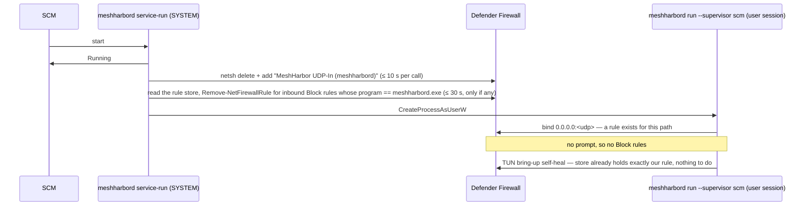

# Overlay WFP firewall override (Windows)

> Cross-ref: the L3 overlay mesh is part of the remote-control / tunnel
> subsystem ([`docs/remote-control.md`](./remote-control.md)). This doc
> covers one Windows-specific, security-sensitive piece: how the agent
> makes the overlay survive a Group-Policy-locked Windows Defender
> Firewall by programming the Windows Filtering Platform (WFP) directly.

## The problem

The Tailscale-style L3 overlay (feature `overlay-l3`, default-OFF) brings up
a Wintun virtual NIC named **`meshharbor`** and routes per-tenant overlay IPs
(`100.64.0.0/10`) over WireGuard, relayed through coturn when direct
hole-punching fails. On a clean host this works both directions.

On a **corporate host whose Defender Firewall is controlled by Group
Policy**, unsolicited *inbound* packets to the `meshharbor` adapter are
dropped. The relay, the WireGuard handshake, and the routing are all fine —
the peer's packets reach the host's TUN — but the host won't *answer*
inbound, so the reverse direction fails. Worse, a local
`New-NetFirewallRule` has no effect: the GPO sets
`AllowLocalFirewallRules=False`, and the firewall can't be disabled.

Field-observed on WINHOST-A (2026-06-12): WINHOST-A→DEVBOX worked, DEVBOX→WINHOST-A
timed out, with relay/WG/routing all proven healthy.

## How Tailscale solves it (and so do we)

Defender Firewall rules — including GPO ones — are just **filters** in the
Windows Filtering Platform, living in the low-weight MPSSVC sublayers.
Tailscale survives locked-down hosts by **programming WFP directly** from
its LocalSystem service instead of adding Defender rules. The agent already
runs as a LocalSystem Windows service, which is exactly the privilege WFP
writes require, so it does the same.

On overlay bring-up (`overlay::tun::SystemTun::up`, after the `meshharbor`
adapter exists), the agent:

1. Opens a **dynamic** WFP engine session
   (`FWPM_SESSION_FLAG_DYNAMIC`) — every object it adds is auto-removed by
   the Base Filtering Engine when the handle closes or the process exits.
   No persistent/boot-time rules, robust to a crash.
2. Adds a provider + a **sublayer at weight `0xFFFE`** — above the MPSSVC
   firewall sublayer (~weight 2), so it's arbitrated first.
3. Adds four **hard-permit** filters (one per ALE layer:
   `ALE_AUTH_RECV_ACCEPT_V4/V6`, `ALE_AUTH_CONNECT_V4/V6`), each scoped by a
   single condition `FWPM_CONDITION_IP_LOCAL_INTERFACE == <meshharbor LUID>`.

The **hard permit** is the key: the filters carry
`FWPM_FILTER_FLAG_CLEAR_ACTION_RIGHT`, which clears the action-write right.
A hard permit in a higher-weight sublayer overrides a (hard) filter block in
a lower-weight sublayer — so it beats the GPO firewall's inbound drop. (A
plain *soft* permit, which is the WFP default and what Tailscale's published
demo uses, would lose to a GPO hard block — so we go further than the demo.)

This is **additive permit only** — no shields-up, no discard filters, never
touches any interface other than `meshharbor`.

### Identity (greppable in `netsh wfp show filters`)

| Object | Name | GUID |
|---|---|---|
| Provider | `MeshHarbor Overlay` | `524f4f4d-4c45-5200-5052-4f5649444552` |
| Sublayer | `MeshHarbor Overlay Permit (LUID-scoped)` | `524f4f4d-4c45-5200-5355-424c41594552` |
| Filters | `MeshHarbor Overlay Inbound/Outbound Permit` | (auto-assigned per layer) |

## Limits — when this still won't work

A hard permit overrides a *filter* block, but **cannot** override:

- a **callout-driver veto** (some EDR / DLP / ZTNA agents enforce network
  policy via a kernel callout), or
- an **IPsec connection-security rule** (authenticated-inbound GPOs).

Nor can it run if the GPO has hardened the BFE security descriptors so even
LocalSystem can't add filters. In those cases the install fails (or succeeds
but is still vetoed downstream), and the only recourse is an **IT-managed
exception**: a domain firewall allow-rule scoped to the `meshharbor` adapter /
`100.64.0.0/10`, or a connection-security exemption.

The install is **best-effort**: a failure logs a WARN and the overlay still
comes up — it only matters on hosts where the firewall is the blocker.
Verify the actual outcome in the field with `netsh wfp show filters` (look
for the sublayer above) and a reverse-direction ping/curl.

## Disabling it

Set `MESHHARBORD_WFP_PERMIT=0` (or `false`/`no`/`off`) to skip WFP
programming entirely — e.g. on a host where IT installed a managed
exception, or to silence an AV "firewall tampering" alert. Default is **ON**
whenever `overlay-l3` is active.

## Security note (for reviewers)

A high-weight, hard-permit sublayer from a non-Microsoft provider that
overrides a GPO firewall block is exactly the pattern some EDRs flag as
"WFP tampering". Mitigating properties:

- **LUID-scoped to `meshharbor`** — it cannot open the host's other
  interfaces; it only permits traffic on the overlay NIC the agent itself
  created.
- **Additive permit only** — never shields-up, never a discard/block.
- Runs as **LocalSystem** (the service privilege that makes BFE writable).
- **Break-glass disable** via `MESHHARBORD_WFP_PERMIT=0` — an IT/security
  team can neutralize it without rebuilding.

Implementation: `crates/tunnel-core/src/overlay/wfp.rs` (raw `windows-sys`
0.61 FFI, gated `#[cfg(all(feature = "overlay-l3", windows))]`).

## The other Windows firewall rule: the daemon's own inbound UDP (#1698)

WFP above covers the **`meshharbor` adapter**. The daemon's WireGuard, disco/STUN
and WebRTC sockets bind on the **physical** adapters too, and for those the
ordinary Defender rule set applies: with no rule for `meshharbord.exe`, an
unsolicited inbound UDP packet (a LAN-direct dial, a srflx punch) dies at the
Public profile's default-deny. Since P9 (field-hit 2026-07-28) the daemon
writes itself an allow rule at every TUN bring-up:

| | |
|---|---|
| Name | `MeshHarbor UDP-In (meshharbord)` — the exe stem, so the `meshharbor` tunnel client gets its own (`MeshHarbor UDP-In (meshharbor)`) |
| Shape | `dir=in action=allow protocol=udp program=<full path of meshharbord.exe>`, all profiles, every port |
| Definition | `crates/tunnel-core/src/winfw.rs` — `UdpInAllowRule` is the ONE definition; both writers build their `netsh` calls from it |
| Kill switch | `MESHHARBORD_TUN_HYGIENE=0` — skips both writers (and the adapter's Private-profile set) |

### Who writes it, and when — the attended-install prompt

P9's premise was that a Windows *service* never sees the interactive
"Allow access?" prompt. True for a SYSTEM worker; false for the **attended**
perMachine flavour, whose worker the SCM host spawns in the signed-in user's
session. Measured on a 0.4.104 vmtest guest (#1698): the worker bound its UDP
sockets before the detached hygiene thread had added the rule, Windows raised
the prompt (`PickerHost.exe`, "Windows Security", over the companion's
Welcome), and the prompt wrote two `MeshHarbor Daemon` **Block** rules (TCP + UDP,
profile Public) for the exe. In Defender an explicit Block beats an Allow, so
on every Public-profile network — home, hotel — unsolicited inbound UDP to the
daemon stayed blocked until someone clicked Allow. Cancel, the cautious click,
was the harmful one.



Since #1698 the **service host** writes the rule **before its first worker
spawn** — `agents/meshharbord/src/win_service/firewall.rs`
(`prepare_before_first_spawn`), driven by the `run_startup_sequence` seam in
`win_service/mod.rs`, whose recorder test locks the order. Synchronous,
bounded, best-effort: a refused or timed-out `netsh` is logged at WARN and the
worker spawns anyway. The same run removes, once, the Block rules an earlier
install's prompt left behind.

| Flavour | Who writes the rule first | Prompt? |
|---|---|---|
| perMachine, SystemContext (worker = SYSTEM) | service host, before the spawn | never (SYSTEM was never prompted) |
| perMachine, attended (worker = signed-in user) | service host, before the spawn | **no longer** — yes before #1698 |
| perUser (Scheduled Task, cannot elevate) | the worker's own hygiene pass, only if the user is an admin | unchanged — may still prompt |
| `meshharbor` tunnel client | its own hygiene pass (`MeshHarbor UDP-In (meshharbor)`), only if elevated | unchanged |

### The cleanup's predicate — exact, and never by name

A rule is removed iff **direction inbound ∧ action Block ∧ program path equal
to our `meshharbord.exe`** (case-insensitive, `%VAR%` expanded, `/`→`\`, `\\?\`
stripped) **∧ its store id starts with `TCP Query User{` or
`UDP Query User{`** — the notification prompt's own id signature, matched
case-sensitively. `prompt_block_rules_for_program` in `winfw.rs` is the whole
decision; its table test holds every neighbour it must not touch.

- ⚠️ **A deliberate Block is left alone.** The id condition is what keeps
  this from being tampering: a Block an administrator placed on
  `meshharbord.exe` through `netsh`, `wf.msc` or `New-NetFirewallRule` has a
  `{GUID}` or the caller's own id, never the prompt's shape, and stays exactly
  where it is at every start. The device owner's local setting is a floor
  (compare `consent::strictest_of`); only the prompt's leftovers are ours.
- ⚠️ **Never by display name.** The prompt names its rules after the exe's
  FileDescription (`MeshHarbor Daemon`); any program can carry that name, and a
  same-named `meshharbord.exe` in another directory is a different program.
- ⚠️ **Allow rules are never touched** — not the prompt's own `MeshHarbor Daemon`
  Allow pair (someone clicked Allow), not ours. That is why the removal goes
  through PowerShell (`Remove-NetFirewallRule -Name <store id>`) and not
  `netsh delete`: netsh selects by name + dir + program and cannot filter on
  action, so it would take an Allow of the same name along with the Blocks.
- Rules are **read** from the local persistent store
  (`HKLM\SYSTEM\CurrentControlSet\Services\SharedAccess\Parameters\FirewallPolicy\FirewallRules`,
  the `v2.NN|Key=Value|…` grammar [MS-FASP] documents) and **removed by their
  store id** — the value name, PowerShell's `Name`, distinct from
  `DisplayName`. Reading costs a registry walk; PowerShell is spawned only when
  there is something to remove, so the steady state spawns nothing. The store
  is never written: the firewall service owns writes.
- GPO-delivered rules live under `SOFTWARE\Policies\…` and are neither read
  nor removable. The daemon-side switch for the whole pass is
  `MESHHARBORD_TUN_HYGIENE=0`.

### The self-heal, without the gap

The per-bring-up pass in `overlay/tun.rs` (`spawn_windows_net_hygiene`) stays:
it is what refreshes a stale program path after a moved install. It now heals
only when the store does not already hold exactly our rule
(`winfw::rule_is_current`: present once, Allow, In, UDP, our path, Active, all
profiles, no clause netsh did not write). netsh's delete+add is not atomic, and
in the gap between the two a session worker's next off-loopback bind has no
rule for its path — the prompt again. Anything unexpected reads as "not
current" and heals, so a wrong guess costs a netsh spawn, never a rule.

### GPO-locked hosts

Where `AllowLocalFirewallRules=False`, `netsh add` still returns success and
the rule is inert; the host logs it as installed and moves on. Nothing on this
path fails loudly, and nothing here replaces the WFP permit above for the
adapter.

### Field verification (attended Win11 guest)

```powershell
# 1. No prompt: no "Windows Security" window in the console session.
Get-Process PickerHost -ErrorAction SilentlyContinue | Select-Object Id, MainWindowTitle
# 2. Our Allow rule exists, and no Block rule names our exe.
Get-NetFirewallRule -Direction Inbound | Where-Object {
  ($_ | Get-NetFirewallApplicationFilter).Program -ieq "$env:ProgramFiles\MeshHarbor\meshharbord.exe"
} | Select-Object Name, DisplayName, Action, Enabled, Profile
# 3. Order: the host's line is logged before the worker's first bind.
Select-String -Path "$env:ProgramData\meshharbor\meshharbor\service-logs\meshharbord-service.log.*" `
  -Pattern 'installed for the worker BEFORE its first bind'
```

On an upgrade over a guest that already holds the `MeshHarbor Daemon` Block pair,
the service log carries `removed inbound Block rules for this binary` once and
step 2 then lists only the Allow rule.
