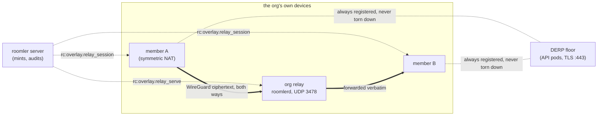
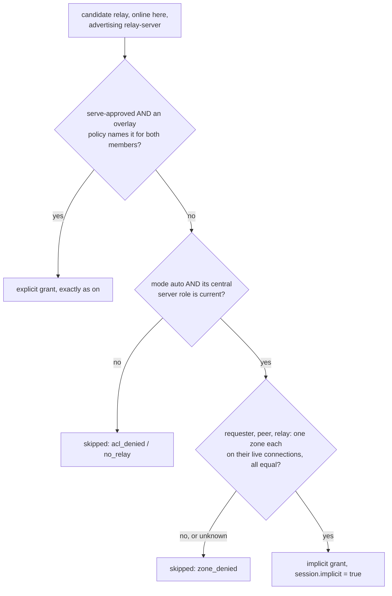
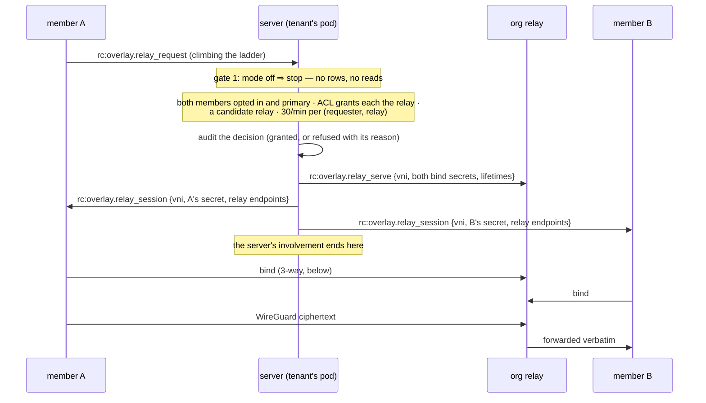
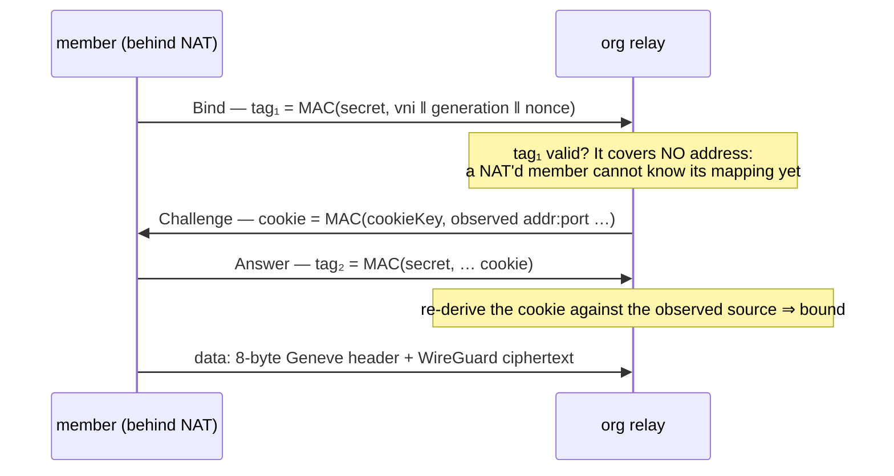

# Peer relays — the org relay

When two of an organization's devices cannot reach each other directly, their
WireGuard ciphertext has to cross a relay. Before FR-19 that relay was always
ours, either coturn or DERP on the API pods, which put roomler's control plane on
the data path for exactly the pairs that need help most. A **peer relay** (or *org
relay*) is one of the org's own enrolled devices, typically a well-connected box at
headquarters, forwarding that ciphertext between the org's other devices over UDP.

The server still decides everything and **carries nothing**. It mints a session,
pushes it to three devices, and its involvement ends. The relay forwards bytes it
cannot decrypt, exactly as DERP does.

> Design record, security review and full field log:
> [`fr/FR-19-peer-relays.md`](fr/FR-19-peer-relays.md) (#805). This page describes
> what shipped.



## Where it sits in the carrier ladder

The org relay is a **third kind of relay, not a new tier**. The ladder is still LAN
→ public → srflx hole-punch → relay. A relay carrier is now one of three `RelayKind`s,
`Turn`, `Derp` or `Org`
([`relay_link.rs:160`](../crates/tunnel-core/src/overlay/relay_link.rs#L160)), and
DERP over TLS :443 stays the floor under all of them. The org relay shows in the CONN
column as `relay:org/udp`.

⚠️ **A new tier would have been read as DIRECT everywhere, without an error.**
`is_direct()` is `!matches!(self, Relay)`, so any new tier variant takes the direct
path's staleness deadline and handshake behaviour. `is_sticky` and
`suppression_half_life` have `_ =>` catch-alls that would silently give it LAN
behaviour too. Adding a transport behind the existing `RelayConn` seam (`OrgRelayConn`,
[`orgrelay/client.rs:239`](../crates/tunnel-core/src/overlay/orgrelay/client.rs#L239))
changed none of the send path, the router or the carrier plane.

Which relay a pair uses is decided in this order
([`relay_link.rs:1052`](../crates/tunnel-core/src/overlay/relay_link.rs#L1052)):

| priority | source | why it sits there |
|---|---|---|
| 1 | a live server force-DERP pin | an escalation the server made on purpose; nothing may thrash the pair back off it |
| 2 | a **live org-relay session** for this pair | both ends hold the same session, so this is symmetric without waiting for the next netmap |
| 3 | the server's verdict stamped on the netmap | measured `CapVector`s, never assumed |
| 4 | the node's own derivation | only when the server said nothing |

🔑 **The org relay engages on a LADDER CLIMB, not on the org switch.** The mint hangs
off `rc:overlay.relay_request`, the frame a member sends while climbing toward a
relay. A pair already settled on a healthy DERP floor sends none, so flipping
`peer_relay_mode` to `on` moves **nothing** until a member re-establishes. To see it
engage, restart a member. The first field run lost an hour to this.

## Five gates, five owners

Every gate defaults to **deny**, and each is owned by a different party, so no single
actor can turn one device into the org's traffic chokepoint.

| # | gate | owner | default | where |
|---|---|---|---|---|
| 1 | org switch `peer_relay_mode` — `off` · `warn` · `on` · `auto` (MeshHarbor, [below](#auto--a-central-server-role-inside-one-business-zone-meshharbor)) | the org owner (`MANAGE_TENANT`) | `off` | [`models.rs:2636`](../crates/remote_control/src/models.rs#L2636) |
| 2 | overlay ACL grants **each** member the relay node | the policy author | no grant | [`org_relay.rs:377`](../crates/modules/network/src/org_relay.rs#L377) |
| 3 | per-device approval `peer_relay_policy.serve` | the fleet admin (`MANAGE_AGENTS` **and** `EXEC_DEVICE`) | `false` | [`routes/peer_relay.rs:53`](../crates/modules/network/src/routes/peer_relay.rs#L53) |
| 4 | the relay device's own `relay_server_enabled` | the relay host's owner, **locally** | off | [`orgrelay/mod.rs:36`](../crates/tunnel-core/src/overlay/orgrelay/mod.rs#L36) |
| 5 | each member's own `overlay_org_relay` | each member's owner | **on** in MeshHarbor ([below](#members-ride-by-default)) | [`direct.rs:897`](../crates/tunnel-core/src/overlay/direct.rs#L897) |

⚠️ **Gate 2 is evaluated regardless of `acl_mode`.** The overlay ACL's own default is
`off`, which permits everything, and nothing has yet run under `enforce` in the field.
A mode-conditioned relay grant would therefore have been inert on every tenant. It is
an affirmative capability instead, like Tailscale's `cap/relay`: a policy must name
the relay node for the member.

⚠️ **An unreadable policy set is a refusal, never a grant.** The mint reads policies
through `try_load_acl`
([`overlay.rs:2076`](../crates/modules/network/src/overlay.rs#L2076)), which returns
`Result`. The netmap loader `load_acl` instead keeps the tenant's last good ACL on a read
failure (and fails closed, `enforce` with no policies, when it has none), but a stale
answer is still not a grant decision. `PolicyUnreadable` is its
own deny reason, so a blip is never mistaken for a policy decision.

⚠️ **Approval needs `EXEC_DEVICE` because there is no permission bit left.** The UI
checks masks with JavaScript's signed 32-bit operators, and bit 30 is the ceiling
(#888). The coupling grants nothing new: an `EXEC_DEVICE` holder can already run
`roomler config set relay_server_enabled true` as root on any exec-enabled device. Clearing an
approval needs `MANAGE_AGENTS` alone: revoking is not a grant, and the admin who can
approve must not be the only one who can revoke.

⚠️ **Gate 4 is device-local and cannot be pushed.** A relay host is often a box the
admin does not have hands on, and that is the point: the device owner's consent
survives a compromised server. Someone with local access sets it.

**Serving and use are primary-org only.** A UDP listener is host-global, so a
secondary org's admin must not be able to mint sessions onto the device owner's
listener. The server refuses (`SecondaryOrg`), and the device independently drops all
three relay frames when they arrive on a secondary org's socket
([`agents/roomlerd/src/overlay.rs:1026`](../agents/roomlerd/src/overlay.rs#L1026)).

## `auto` — a central Server role inside one business zone (MeshHarbor)

FR-19 makes an org relay an explicit decision twice over: an admin approves the device
(gate 3) and a policy author names it for every member (gate 2). MeshHarbor wants the
opposite default for the devices its central owner has already classified as
**servers**: a deployed server relays for the clients near it with no further step, and
never across the mainland / non-mainland line, which is a hard isolation boundary that
fails closed.

`peer_relay_mode = auto` ([`models.rs:3665`](../crates/remote_control/src/models.rs#L3665)) is that, a fourth mode the org
owner sets like the other three. It is `on` plus ONE implicit grant:

| gate | `on` | `auto`, for a relay whose central role is `server` |
|---|---|---|
| 1 org switch | `on` | `auto` |
| 2 per-member grant | an overlay policy names the relay for each member | requester, peer **and** relay each observed in **one** business zone, on their live connections |
| 3 device approval | `peer_relay_policy.serve` (`MANAGE_AGENTS` + `EXEC_DEVICE`) | the central account-approval owner's `server` role, still current |
| 4 local serving switch | `relay_server_enabled` | unchanged: still the device's own |
| 5 member's switch | `overlay_org_relay` | unchanged |



- **The role, not a tag or a capability.** Candidates come from
  `current_server_agents` ([`business_authority.rs:590`](../crates/core/src/business_authority.rs#L590)): role approvals the
  *current* central owner wrote, each re-checked against the live registration
  (identity and token generation, quarantine, the owner's admission). Serving as a relay
  never makes a device a server; this reads the other direction only.
- **Zone evidence belongs to one connection.** The zone a connection was observed in
  when it opened is held per connection on the process that holds it (`LiveZones`,
  [`business_authority.rs:242`](../crates/core/src/business_authority.rs#L242)), written only after the observation row
  persists and dropped when that connection's observation closes. The network module
  binds each agent's live connection at `hello` and unbinds it at `closing`
  ([`org_relay.rs:198`](../crates/modules/network/src/org_relay.rs#L198)), and the mint reads a party's zone through that
  binding ([`agent_zone`/`node_zone`, `org_relay.rs:461`](../crates/modules/network/src/org_relay.rs#L461)).
- ⚠️ **Never read the observation row at mint time.** It is TTL-deleted 60 s after
  capture (`index_ttl(expires_at, 0)`, declared by both `fleet` and `network`), and
  `is_current_for` calls it stale after 60 s too, so a grant that read it would refuse
  every pair connected for more than a minute. A transport connection cannot change its
  source address, so what its opening observation saw stays true for its life.
  `auto_zone_evidence_outlives_the_expiring_observation_row` deletes the rows and still
  mints.
- ⚠️ **Unknown is a refusal.** A connection with no trusted proxy chain, a tunnel-client
  node, a GeoIP dataset past the 120-day rule, an unreadable role list: none of them
  grants anything. An unreadable role list adds no candidate but does not refuse the
  explicit ones.
- **Ranking is unchanged.** Explicit and implicit candidates are ranked together by
  member-measured RTT.
- **Explicit grants and zones.** `auto` checks zones only for its implicit grant. The
  hard isolation of every grant, explicit included, is `app.business_isolation`; see
  [business-isolation.md](business-isolation.md).

### An implicit session ends with what vouched for it

| trigger | where | audit reason |
|---|---|---|
| the relay's role is set to anything but `server` | [`routes/business_authority.rs:99`](../crates/modules/network/src/routes/business_authority.rs#L99) | `role_revoked` |
| the org leaves `auto` (to `on`/`warn`; `off` revokes everything) | [`routes/peer_relay.rs:180`](../crates/modules/network/src/routes/peer_relay.rs#L180) | `mode_not_auto` |
| a newer connection displaces a party's live one | [`agent_socket.rs:264`](../crates/modules/network/src/agent_socket.rs#L264) | `connection_displaced` |
| a party's connection closes | [`agent_socket.rs:327`](../crates/modules/network/src/agent_socket.rs#L327) | `connection_closed` |
| the ORG-only fallback re-query no longer authorizes it | `maybe_mint_fallback` | `org-fallback-reauthorization` |

⚠️ **Displacement is the case that needed its own trigger.** A closing connection
whose Hub removal was its own runs the overlay leave, which already revokes everything
the node is in (`device_left`). A displaced connection does not, so without the `hello`
revoke a session vouched for by a Shanghai connection would have survived the device
reconnecting from Hong Kong. `a_displacing_connection_revokes_and_brings_its_own_zone`
locks it.

- `reconcile_acl` skips implicit sessions ([`org_relay.rs:1569`](../crates/modules/network/src/org_relay.rs#L1569)): a policy
  edit neither granted nor can revoke them.
- An implicit plan mints under the eligibility fence
  ([`org_relay.rs:1133`](../crates/modules/network/src/org_relay.rs#L1133)), so a close that lands mid-mint cannot be
  outlived. Every `hello`, `closing` and role change bumps the fence.
- ⚠️ **Path trials stay `on`-only**
  ([`trial.rs:335`](../crates/modules/network/src/org_relay/trial.rs#L335)). Under
  `auto` a pair gets the ranked mint, not a trial.

### Members ride by default

In MeshHarbor gate 5 defaults **on**
([`direct.rs:897`](../crates/tunnel-core/src/overlay/direct.rs#L897)). A member rides
only a session the server minted under its org's own mode and gates 1–4, through a
relay that sees ciphertext only, so riding is not where the consent lives. Serving is:
gate 4 stays opt-in, and only `0|false|no|off` opts a member out.

## The mint — what the server decides

`maybe_mint` ([`org_relay.rs:544`](../crates/modules/network/src/org_relay.rs#L544))
runs on every `rc:overlay.relay_request` and never delays the TURN grant that frame
also asks for.



- **Candidates** are devices that are approved, advertised `relay-server` on their
  last hello, are online on this pod, joined from their primary org, have at least one
  public endpoint and hold fewer than 64 sessions.
- **Ranking**: a relay both members measured reachable wins, by summed RTT. One never
  measured comes next. One a member measured *unreachable* comes **last, not
  excluded**, because a stale negative must not starve the only relay.
- **Where the RTT comes from (MeshHarbor #5)**: every member measures its RTT to the
  relays it may use **before any session exists**. Its full netmap lists them
  (`network.relay_probe_targets`, at most 16 relays with 4 endpoints each: the member's
  half of the gates above, so it learns only endpoints it could be minted onto), and
  the runtime sends each endpoint three of the relay's unauthenticated probe echoes
  ([`orgrelay/prober.rs`](../crates/tunnel-core/src/overlay/orgrelay/prober.rs)), on
  receipt and every 240 s, reporting the minimum as an ordinary `rc:overlay.relay_probe`
  row. The center accepts a row only about a relay it offered that member or minted
  for it. Before this, the only RTT on file came from binding a relay already minted,
  so a pair's first session went to an unmeasured relay (ties fell to load, then
  approval order). A node without UDP measures every relay unreachable, which ranks
  them all alike for its pairs.
- **A pair minted before its measurements moves once they land.** A member that needs
  a relay right after its join asks before its first round is back (field: the mint
  came 100 ms ahead of the round), and the mint handlers run inline on its WebSocket,
  so waiting there would also hold back the very reports it waits for. Instead, each
  accepted report re-ranks the reporter's pairs whose session is still inside its
  30-s bind window, and moves a pair when both members measured the new relay and it
  is at least 20% and 10 ms faster, or the current relay was measured unreachable
  (`rerank_young`, audited as `org_relay_rerank`). A bound session is never moved.
  Field (rig `b7a851fbd306`, relays Hyonix HK and Tokyo, members Isvoro and po0 HK):
  a blind mint on Tokyo (summed RTT 90 ms) moved to HK (48 ms) 160 ms later, and with
  direct blocked the pair's fallback was minted on HK directly.
- **Endpoints**: the relay's srflx, LAN and trickled addresses, each only if globally
  routable, paired with its relay port (default **3478**), then the admin's
  `static_endpoints`
  ([`org_relay.rs:333`](../crates/modules/network/src/org_relay.rs#L333)).
- **The session**: a 24-bit VNI unique **per relay node**, never 0 and never the STUN
  magic cookie `0x2112A4`, so a STUN packet can never alias a session; a Lamport
  `generation`; and two independent random 32-byte bind secrets, one per member.
- **The relay is pushed first**, so it can verify the binds by the time the members
  arrive. Each member receives only its own secret.
- **A re-request is idempotent**: the live session is re-pushed to the asker only, and
  no row is written, because nothing was decided.
- **`warn` decides and audits exactly as `on` would, and pushes nothing.** Use it to
  see what a tenant *would* relay before turning it on.

⚠️ **`static_endpoints` are public `ip:port` literals, checked when approved and again
at mint time.** A name is refused, because it can resolve to something else by the
time the mint re-checks it. A server-pushed probe target is a port scanner run by
every device in the tenant as SYSTEM/root, so `169.254.169.254:80` must never get
through. `valid_static_endpoint`
([`org_relay.rs:369`](../crates/modules/network/src/org_relay.rs#L369)) is the same
`is_global_unicast` rule push subscriptions use. A mint that finds a bad entry refuses
outright (`NonRoutableEndpoint`) rather than silently dropping it.

**Sessions, VNI cursors and probe reports are pod-local**, which is correct because
tenant affinity puts the requester, the peer and the relay on one pod. After a pod
restart the relay's own table is the truth: its sessions run out their one-hour
lifetime, the members re-request, and a fresh mint issues a fresh VNI.

### Every decision is audited

`peer_relay_audit` (90-day TTL) holds one row shape for all three actions: `approve`,
`mint` (granted or refused) and `revoke`. That makes the question an incident review
asks, "who made this device a relay, and what has gone through it since?", a single
query on `agent_id`.

| deny reason | means |
|---|---|
| `RequesterUnsupported` / `PeerUnsupported` | that end did not opt in with `overlay_org_relay` (gate 5) |
| `SecondaryOrg` | an end, or the relay, joined from a secondary org |
| `AclDenied` | no policy grants a member the relay node (gate 2) |
| `PolicyUnreadable` | the policies could not be read — refused rather than guessed |
| `NoRelay` | no device is approved, serving and online, or every one is full |
| `NonRoutableEndpoint` | an admin-declared endpoint is not a public address |
| `RateLimited` | more than 30 mints a minute for this (requester, relay) pair |
| `NotDeviceAdmin` / `CannotGrantRelay` | approval: missing `MANAGE_AGENTS` / `EXEC_DEVICE` |

⚠️ A mint row records the **decision, not the session**. The server never sees a byte
of what the members exchange. With the org switch `off` there are **zero rows**: the
mode is the first read, and `OrgDisabled` is deliberately never written.

## The bind — two keys, two jobs

A member proves two things to the relay before anything is forwarded, and each proof
needs its own key ([`orgrelay/bind.rs`](../crates/tunnel-core/src/overlay/orgrelay/bind.rs)):

| key | held by | proves |
|---|---|---|
| `BindSecret` ([`bind.rs:93`](../crates/tunnel-core/src/overlay/orgrelay/bind.rs#L93)) | the member **and** the relay, per session | *you are the node this session was minted for* |
| `CookieKey` ([`bind.rs:100`](../crates/tunnel-core/src/overlay/orgrelay/bind.rs#L100)) | the relay **only**, rotating | *you can receive at the address you claim* |



⚠️ **The first design proved only return-routability, and that would have been a hijack.**
Its client only had to echo a value the relay had just sent in the clear. The VNI is
24 bits and not secret, and the peer key is public netmap data. So anyone sharing the
victim's egress `addr:port` could take the slot, and that includes a co-worker behind
the same corporate NAT, the exact population this feature serves. A stolen bind
black-holes the pair, receives its ciphertext, and injects UDP at its WireGuard socket.

🔑 **Why the address is bound at the challenge, not in `tag₁`**: an earlier version put
it in `tag₁`, and eleven unit tests passed because each supplied the address from
outside. The first loopback test, where the client had to actually *be* a client,
showed it could never have computed that value. For any handshake, write the test in
which the client is a real client before trusting the unit tests.

**Control frames are one fixed size** (probe, bind, challenge and answer share a
64-byte shape with a kind byte), so a response is never larger than its request: the
relay cannot be used to amplify. **Data frames** are an 8-byte header plus the payload,
forwarded verbatim ([`wire.rs:44`](../crates/tunnel-core/src/overlay/orgrelay/wire.rs#L44)).
The shape is disjoint from WireGuard, STUN and disco on every first byte, which a test
proves exhaustively rather than by example.

## What the relay does, and refuses

One pure function, `SessionTable::decide`
([`session.rs:195`](../crates/tunnel-core/src/overlay/orgrelay/session.rs#L195)),
decides the fate of every inbound datagram, so each property below is tested without a
socket or a clock:

- **It forwards only between the two bound addresses.** A datagram on a known VNI from
  anywhere else is dropped and counted. Without this the relay is an open UDP proxy
  that rewrites the source to the org's own address. That is IP laundering, and it
  ends with the customer's address on a blocklist.
- **Sessions die on their own.** The idle deadline (300 s) is refreshed by traffic,
  so under a 25 s WireGuard keepalive it never fires. The absolute lifetime (3600 s)
  is what actually expires a busy session. The relay re-clamps every lifetime the
  server sends it, so nothing in a push is trusted.
- **Re-bind is authenticated, and it is required.** Symmetric NATs change mappings, and
  recovery must not need a control-plane round trip. An unauthenticated re-bind would
  be a hijack primitive.
- **The table has a ceiling and refuses rather than grows**: 64 sessions
  ([`session.rs:45`](../crates/tunnel-core/src/overlay/orgrelay/session.rs#L45)). An
  org must not be able to cost its HQ box its own remote access.
- **A parser bug degrades the relay, not the node.** `roomlerd` runs as SYSTEM/root
  and this is a parser for attacker-controlled bytes on a public UDP port. The
  decoders are fuzzed over arbitrary bytes, and the handler runs under `catch_unwind`
  ([`orgrelay/server.rs`](../crates/tunnel-core/src/overlay/orgrelay/server.rs)), so
  one bad datagram cannot take remote desktop, tunnels and SSH down with it.

⚠️ **`roomler status` shows the relay's address and its PROBE counters only.** The
forwarding and drop counters (`forwarded`, `bound`, and one per refusal reason, such as
`drop_unbound_source` or `drop_bad_cookie`) are summarised into the daemon log every
300 s ([`relay_server.rs:143`](../agents/roomlerd/src/relay_server.rs#L143)). A relay
forwarding perfectly well reads `probes_answered=0`, and the first field run
misread that. A nonzero `drop_unbound_source` means someone is *trying*.

## Revocation is a push

Because the idle deadline never fires under keepalive, an expiry would never end a
session. Every revocation is therefore a push, `rc:overlay.relay_revoke {vni}`, sent to
the relay and both members, and each one writes a `revoke` row:

| trigger | reason | code |
|---|---|---|
| the org switched peer relays off | `mode_off` | `revoke_tenant` |
| a policy edit no longer grants a member the relay | `acl_revoked` | `reconcile_acl` ([`org_relay.rs:815`](../crates/modules/network/src/org_relay.rs#L815)) |
| the relay's approval was cleared | `policy_revoked` | `revoke_relay_agent` |
| a party was removed from the overlay | `device_removed` / `device_left` | `revoke_node` |
| a member measured the session losing ≥ 5% (below) | `org_relay_lossy` | `handle_org_relay_loss` ([`overlay.rs:1698`](../crates/modules/network/src/overlay.rs#L1698)) |

⚠️ **`reconcile_acl` does NOTHING on a read failure.** Refusing a *new* mint on a blip
costs one session. Tearing down every *live* session on a blip is exactly the
"a spurious deny takes the mesh down" failure `load_acl`'s last-good fallback avoids.

## Never self-wedge, never remove the floor

- **The DERP floor is unconditional.** A relay coming up never tears down a DERP
  registration: through every org-relay cycle the pod's `derp_registrations` stayed at
  its floor value, and the floor-control laptop (CORPLAP-2) never moved off DERP.
- **Failure is a downgrade, never a black hole.** Measured on 0.4.20 with the relay
  daemon hard-killed mid-session: the member's carrier read `blocked` after **14 s** and
  was on `relay:derp/tcp` after **26 s**, connected throughout.
- **Never ratchet.** When the relay came back, the pair **re-upgraded** to
  `relay:org/udp` on the next ladder climb.

## A lossy relay moves the pair to another relay, else to DERP

An org relay can be up and still be the worst carrier the pair has. Field, 2026-10-26
(HK ↔ Tokyo through the Isvoro relay): 7–10% of the data packets and ~2.8% of the ACKs
were lost on the way **into** the relay host, in multi-second blackouts, while the relay
itself dropped nothing. One TCP stream carried **2.0–2.5 Mbit/s**. DERP through the same
host carried **23–33 Mbit/s**, because its kernel TCP recovers the loss on the ~3 ms
node ↔ relay-host leg, where the org relay leaves recovery to the end-to-end TCP over
~50 ms. Nothing measured a carrier's loss, so the ladder kept the pair on the org relay.

Now each member measures the stream its peer sends over the session, from the WireGuard
transport counters it already authenticates (`PeerStats::note_rx_counter`, `wg.rs`).
Every closed window that lost at least 1% is reported, and the **server** decides. A
window closes after ~30 s once it holds 1000 packets; a light stream keeps it open until
it does, up to 10 minutes (`MAX_WINDOW_SWEEPS`), so ~5 packets/s is judged in ~3.3 min.
A run of the window's latest sweeps (≥ 30 s) whose loss is **clearly** over 5% closes it
early, judged on that run alone (`tunnel_core::loss::loss_clearly_at_least`: the Wilson
lower bound at z = 3, from 100 packets). Field 2026-10-27 (rf-a728a26325a1): at ~2.4
packets/s a 1000-packet window took ~7 min and reached back to before a relay started
losing 10%, so it read 4.6%; a 10% relay is now judged at ~200 packets, at its own loss.
It first marks that relay lossy **for that pair** for 10 minutes (`mark_lossy`; other
pairs keep the relay) and revokes the session, audited `org_relay_lossy`. If the planner
still finds a relay for the pair (granted, live, in its zone), the pair is minted there
at once, with no DERP pin. Only when no relay is left is the pair pinned to DERP:

```mermaid
sequenceDiagram
    participant A as member A
    participant S as server (tenant's pod)
    participant R as org relay
    participant B as member B

    Note over B: a 30 s window of A's stream:<br/>8% of 3000 packets lost
    B->>S: rc:overlay.org_relay_loss {peer A, vni, packets, lost}
    Note over S: only B's own live session, matched by VNI ·<br/>≥ 5% of ≥ 1000 packets, or clearly over 5% · mode on or auto ·<br/>both ends support DERP and the pin
    S->>S: pin the pair to DERP for 10 min (the P7 pin)
    S->>A: rc:overlay.force_derp {peer B, ttl_ms, region}
    S->>B: rc:overlay.force_derp {peer A, ttl_ms, region}
    S->>R: rc:overlay.relay_revoke {vni}
    S->>A: rc:overlay.relay_revoke {vni}
    S->>B: rc:overlay.relay_revoke {vni}
    S->>S: audit: revoke, reason org_relay_lossy
    Note over A,B: both ride DERP; every ORG mint path refuses the pair while pinned
    Note over A,B: the pin lapses · the ladder climbs back to the org relay · the next windows measure it again
```

- **It reuses the TURN-churn pin** (P7, `relay_pair_churn`). That pin already reaches
  both ends with the pair's sticky DERP region, is re-pushed on rejoin, makes
  `maybe_mint_fallback` and `mint_plan` refuse the pair, and is cleared by a member that
  reports its `/derp` mux failed. A loss pin is 10 minutes (`ORG_LOSS_PIN_TTL`); it
  never shortens a longer churn pin.
- **Only a died TURN carrier counts toward the churn pin.** A relay request that names
  the ORG carrier it replaces (`current_kind = "org"`) counts no cycle: the server ended
  that session itself or its relay left, and this section already judged it. A node
  that rejoins under a new process `instance` (a restart, not a reconnect) has its
  pairs' armed grants and counted cycles forgotten, keeping any standing pin. Field
  2026-10-27: both had pinned pairs to DERP for 30 min with no TURN carrier dying.
- **One member's report is enough.** Its inbound is the peer's direction, and one
  crippled direction cripples the pair's TCP both ways, through its ACKs. A member can
  fail only its own pair's org-relay tier, which it could already do by dropping
  packets. A report about any other session, or under the threshold, is dropped.
- **The threshold is the server's** (`org_loss_fails`,
  [`overlay.rs:1653`](../crates/modules/network/src/overlay.rs#L1653)): 5% of at least
  1000 packets, or a smaller window (from 100) whose loss is clearly over 5%. Loss-based
  TCP over 50 ms is held near 1.4 Mbit/s at 3% and 0.7 at 8%.
  The client reports from 1% (`REPORT_PCT`), so the server's threshold can move without
  a client roll.
- **Old peers are safe.** A client reports only when the netmap carries
  `org_relay_loss_v1`, and the server pins only a pair whose ends both advertised
  `supports_forced_derp` and `supports_derp`; otherwise it logs the verdict and keeps
  the carrier.
- **Direct is untouched.** The pin governs the relay tier only, so a pair that can go
  direct still re-upgrades.
- **Kill switches:** `ROOMLER__OVERLAY__ORG_LOSS_PIN=0` on the server keeps every org
  carrier (reports are logged only), and `OVERLAY_ORG_LOSS_REPORT=0` on a member stops
  its reports.

## A cross-border line is two org sessions and a bridge (MeshHarbor #21)

Business isolation never lets a mainland and a non-mainland node share a relay. The one
exception is a line an administrator approves between two of the tenant's relays, one
in each zone (a backbone edge flagged `cross_border`, e.g. the po0 GZ → HK private
interconnect). The server mints it as **one org-relay session per side**: the mainland
member binds the mainland relay, the other member the other relay, and the mainland
relay's bridge (`OverlayRelayBridgeServe`) carries the ciphertext between the two
sessions over the private line, rewriting only the VNI. Each member sees an ordinary
one-hop session and is never told the private endpoint.

- It is stored as one `OrgRelaySession` with a `line` leg, so every revocation,
  VNI allocation, session count, probe, ACL reconcile and loss report sees both relays.
- A pair on a line has no other carrier by rule, so a lossy line is **kept**: the loss
  verdict above neither moves it nor pins it to DERP.
- Rules, gates, the mint sequence and what ends a line:
  [business-isolation.md](business-isolation.md#the-one-exception-an-approved-cross-border-line).
- **The fastest line wins** (#5 step B). Where several lines could carry a pair, each
  is ranked by the path a packet rides: the member in the ingress relay's zone to that
  relay, the line itself, and the exit relay to the other member. The members' legs come
  from their relay probes (above). The line's own RTT is measured by the ingress relay:
  its full netmap names the lines it may carry (`network.backbone_probe_targets`: each
  exit relay at the edge's private endpoint), and it probes those only on its backbone
  interface, from a socket pinned to it, where its local backbone policy
  (`RELAY_BACKBONE_*`) permits the endpoint. Without that policy it measures none, so a
  line is never timed over the public path. A report is filed as the line's RTT only for
  a line that relay was offered. Ranking classes as for one relay: all three legs
  measured first, then partly measured, then any measured unreachable (last, never
  excluded); then summed RTT; then both relays' load. An older relay ignores the field.

## A slow direct path moves to a relay: path trials

A pair that is direct but slow can move onto an org relay that is faster, and back once
direct is no slower. This is latency-first routing (EasyTier's `--latency-first`);
Tailscale never leaves a working direct path. It is **off by default**: the member
needs `ROOMLERD_PATH_TRIAL=1`, and the tenant's peer-relay mode must be `on` (an
`auto` tenant gets the ranked mint, not trials).

1. A member with a direct peer asks the server for a trial on a relay that discovery
   offers ([`path_trial.rs`](../crates/tunnel-core/src/overlay/runtime/path_trial.rs),
   at most one request a minute). The server re-runs every mint gate and starts the
   trial on **both** members ([`trial.rs`](../crates/modules/network/src/org_relay/trial.rs)).
2. Each member binds the relay and sends paired authenticated echoes, one over direct
   and one over the relay, every 0.5 s.
3. A member is ready when three consecutive windows of three rounds each show the
   relay at most 0.75× direct **and** at least 20 ms faster. The server commits only
   when both are ready; both ends switch in the same instant, and direct stays warm.
4. Once direct is again within 1.10× of the relay, the pair returns the same way.

The gap between 0.75× and 1.10× is the hysteresis: a pair does not flap between two
paths of about the same RTT.

**Lab, 2026-10-27 (houston, `ptlab`).** The lab used real `roomlerd`,
`roomler-ai-api`, mongod and redis, each in its own network namespace. netem added
60 ms each way to m1↔m2 only, and the relay was next to both. The pair went direct
first (public tier). Its trial was requested 0.3 s later. 8 s later it was ready
(direct 120.2 ms, relay 0.26 ms), and both ends committed in the same millisecond.
After netem was removed, both returned to direct 7.4 s later, in the same millisecond
(direct 0.21 ms, relay 0.22 ms). Nothing else moved the pair while it was committed.

**Not shown yet:** a field pair; the business stall during a switch (make-before-break,
not measured); a trial over a two-relay path; and chains of more than two relays, which
need a wire change.

## What the relay operator can see — tell customers this

The relay cannot read the traffic. That is true and incomplete, and the missing half
matters most in the main deployment, where the relay belongs to an **employer's IT
department** and the traffic is often **an employee's remote-desktop session**.

| the relay operator **cannot** see | the relay operator **can** see |
|---|---|
| packet contents: pixels, keystrokes, files, SSH bytes | both members' **WireGuard public keys** (they arrive in the mint) |
| anything recoverable later from recorded ciphertext (WireGuard rekeys) | both members' **real `addr:port`**: a home IP, hotel Wi-Fi, a mobile carrier's NAT |
| | when each session starts and stops, and how long it lasts |
| | **per-flow volume and timing**, with the host's own tools (`tcpdump`, conntrack) |

`roomlerd` itself keeps only **aggregate** counters, with no per-session byte counts.
The host's operating system sees every packet regardless. Remote-desktop traffic has a
distinctive bitrate profile, so that metadata reveals **when a person is at their
machine, and for how long**. Moving the relay in-house moves *content* into the
customer's jurisdiction, and it **newly exposes connection metadata about employees'
personal networks to their employer**. A relay operator can also degrade one session
selectively.

That is why gate 5 exists: `overlay_org_relay = false` on a member is that device's own
last word, whatever the org decides.

⚠️ **MeshHarbor turns gate 5 on by default**, where the relay operator is the network
owner itself rather than an employer. The table above still holds for its servers, so it
belongs in the MeshHarbor customer documentation as written.

## Measured on the fleet

| what | result | build · date |
|---|---|---|
| carrier flip | CORPLAP-3 ↔ mars on `relay:org/udp` at ~84 ms via the relay host; every other pair, including the DERP-floor control, stayed where it was | 0.4.20 · 2026-08-29 |
| **API-pod offload** | the same 12.5 MB blast put **5.99 MB** through the pod on DERP and **81 KB** on the org relay, the idle background: **~74× lower** | 2026-08-30 |
| raw UDP throughput | org **102.8** vs DERP **32.3** Mbps delivered (**3.18×**); org lossless, DERP saturated at 29 % loss | 0.4.23 · 2026-08-30 |
| one TCP stream (SSH `dd`) | org **10.1–19.7** Mbps at 86 ms · DERP **41.6** at 50 ms · direct 44.4 | 0.4.41 · 2026-09-01 |
| relay killed mid-session | `blocked` +14 s, on DERP +26 s, never disconnected; re-upgraded after restore | 0.4.20 · 2026-08-29 |
| port | 3478 is the **only** port the symmetric-NAT corporate laptop could reach (41641 and the coturn band failed) | 2026-08-28 |
| relay socket census | flat for 24 h once [FR-48](fr/FR-48-roomlerd-ice-socket-leak.md) fixed the TURN client's socket leak (was ~9 sockets/h) | 0.4.100 · 2026-09-24 |

🔑 **The org relay's value is pod offload and raw headroom, not universal speed.** Both
throughput rows are correct. The UDP blaster has no congestion control, so it measures
raw forwarding capacity, where the org relay wins. One SSH session is a single reliable
TCP stream bounded by window/RTT and sensitive to loss, and the extra hop cost more than
the capacity gained: the relay was in France and the members in Austria and Germany.
**Placement dominates that number.** A relay near its members would likely flip it.

## Operating it

**Checklist**, in the order that avoids surprises:

1. **A reachable UDP port**, 3478 by default (`relay_server_port`). ⚠️ Check for DNAT
   before believing the port is free: on a cluster node, coturn's DNAT rules consume
   udp/3478 in `PREROUTING`, upstream of any local socket, while `ss -ulnp` shows the
   port unused. `scripts/peer-relay-port-audit.sh` exits 0 (scoped accept), 1 (closed),
   2 (only a blanket policy), 3 (no firewall backend) or **4 (consumed by DNAT)**, and a
   weekly cron (`scripts/peer-relay-port-audit-cron.sh`) runs it over Fleet RPC.
2. **A static endpoint** if the relay sits behind NAT or port-forwarding (a public
   `ip:port` literal).
3. **Approval**: `PUT /api/tenant/{tid}/agent/{agent_id}/peer-relay-policy`
   `{"serve": true, "static_endpoints": [...]}`.
4. **An ACL grant** for each member, naming the relay node in `via` with a destination
   covering the relay's overlay address.
5. **Locally on the relay**: `roomler config set relay_server_enabled true`, then
   restart the daemon. Config keys are read at startup.
6. **On each member**: `overlay_org_relay = true`, then a restart.
7. **The org switch**: `warn` first, read the audit, then `on`.

**MeshHarbor `auto`**, instead of steps 3, 4 and 6:

1. The central owner approves the relay's role:
   `PUT /api/admin/business-authority/agent/{tid}/{agent_id}` `{"role": "server",
   "reason": "..."}`. Account approval must be enabled with an `owner_user_id`.
2. Locally on the relay, gate 4 (never pushed). Either install the server with
   `install.sh --role daemon --system --relay-server` (Linux; implies `--overlay`), or
   enroll it with `roomlerd enroll … --relay-server`. Both write `relay_server_enabled =
   true` with the enrolled config, so the first start already serves. On a device that is
   already enrolled, set `relay_server_enabled = true` and restart. `--relay-server`
   applies to the PRIMARY enrollment only: the listener is host-global
   ([`org_join.rs`](../agents/roomlerd/src/org_join.rs), `apply_relay_server_flag`).
3. The org switch: `{"mode": "auto"}`. A `zone_denied` row means a party had no zone, or
   the three were not in one zone. The fleet's agents must reach the server through the
   configured `business_trusted_proxy_cidrs` chain, or no connection has a zone at all.

| route | permission |
|---|---|
| `GET /api/tenant/{tid}/peer-relay` — mode + approved relays, each with `serving` | `MANAGE_AGENTS` |
| `PUT /api/tenant/{tid}/peer-relay` `{"mode": "off" \| "warn" \| "on" \| "auto"}` | `MANAGE_TENANT` |
| `PUT /api/admin/business-authority/agent/{tid}/{agent_id}` `{"role", "reason"}` | the central account-approval owner only |
| `PUT /api/tenant/{tid}/agent/{agent_id}/peer-relay-policy` | `MANAGE_AGENTS`, plus `EXEC_DEVICE` to turn `serve` on |
| `GET /api/tenant/{tid}/peer-relay-audit` | `VIEW_EXEC_AUDIT` |

**Diagnosing "nothing is relayed":**

- `GET …/peer-relay` shows `serving: false` on an approved device. This is the most
  common answer: gate 4 was never set locally, so the device never advertised
  `relay-server`.
- **The audit names the gate.** Every refusal carries its reason, and a pair that never
  appears there never asked. That means the pair was settled on the DERP floor, so
  restart a member to make it climb.
- `roomler peers` CONN reads `relay:org/udp` once a pair is on it, and
  `roomler why <peer>` names the carrier and the relay.
- ⚠️ After heavy enable/disable churn, a member can back off from re-requesting for a
  while. Nothing on the client forces it; wait, or restart it.

## Code map

| piece | where |
|---|---|
| the mint: gates, ranking, session, push | [`crates/modules/network/src/org_relay.rs`](../crates/modules/network/src/org_relay.rs) — `plan_mint` `:377`, `maybe_mint` `:544`, revoke `:742`–`:815` |
| admin routes + approval policy | [`crates/modules/network/src/routes/peer_relay.rs`](../crates/modules/network/src/routes/peer_relay.rs) |
| modes, policy, limits, deny reasons, audit row | [`crates/remote_control/src/models.rs`](../crates/remote_control/src/models.rs) `:2134`–`:2310` |
| wire framing and shape rules | [`orgrelay/wire.rs`](../crates/tunnel-core/src/overlay/orgrelay/wire.rs) |
| the authenticated bind | [`orgrelay/bind.rs`](../crates/tunnel-core/src/overlay/orgrelay/bind.rs) |
| the relay's session table (pure) | [`orgrelay/session.rs`](../crates/tunnel-core/src/overlay/orgrelay/session.rs) |
| the relay server + counters | [`orgrelay/server.rs`](../crates/tunnel-core/src/overlay/orgrelay/server.rs), [`agents/roomlerd/src/relay_server.rs`](../agents/roomlerd/src/relay_server.rs) |
| the member: bind + `OrgRelayConn` | [`orgrelay/client.rs`](../crates/tunnel-core/src/overlay/orgrelay/client.rs) |
| the member's coordinator | [`relay_link.rs`](../crates/tunnel-core/src/overlay/relay_link.rs) — `relay_strategy` `:1052`, `org_request_bind` `:1946`, `commit_org_bind` `:1972` |
| loss: the member's measure and report | [`runtime/rx_loss.rs`](../crates/tunnel-core/src/overlay/runtime/rx_loss.rs) (windows, `take_reports` `:154`), [`relay_link.rs:1446`](../crates/tunnel-core/src/overlay/relay_link.rs#L1446) `report_org_loss` |
| loss: the server's verdict and pin | [`overlay.rs`](../crates/modules/network/src/overlay.rs) — `push_pair_pin` `:1578`, `org_loss_fails` `:1653`, `handle_org_relay_loss` `:1698`; `reported_session` [`org_relay.rs:1706`](../crates/modules/network/src/org_relay.rs#L1706) |
| `auto`: role listing, per-connection zone | [`business_authority.rs`](../crates/core/src/business_authority.rs) — `LiveZones` `:242`, `connection_zone` `:487`, `current_server_agents` `:590` |
| `auto`: the implicit grant and its revocations | [`org_relay.rs`](../crates/modules/network/src/org_relay.rs) — candidates `:504`, the zone check `:631`, `revoke_implicit_for_agent` `:1530` |
| `auto`: TestApp tests | [`crates/tests/src/peer_relay_auto_tests.rs`](../crates/tests/src/peer_relay_auto_tests.rs) |
| the cross-border line: plan, mint, push, audit | [`org_relay.rs`](../crates/modules/network/src/org_relay.rs) — `LineLeg` `:147`, `plan_line` `:1116`, `maybe_mint_line` `:1198`, `mint_line` `:1238`, `push_member` `:2063` |
| the relays' two-leg bridge | [`orgrelay/backbone.rs:223`](../crates/tunnel-core/src/overlay/orgrelay/backbone.rs#L223) `start_authorized_bridge`, [`relay_server.rs:338`](../agents/roomlerd/src/relay_server.rs#L338) `install_bridge_from_wire` |
| pod-offload metric | `derp_bytes_relayed_total`, [`crates/api/src/cluster/metrics.rs:62`](../crates/api/src/cluster/metrics.rs#L62) |

## Not built

- **A dedicated `RELAY_DEVICE` permission bit.** It waits on the 64-bit mask migration
  (#888). Until then, an org cannot have relay approvers who may not also run root
  commands.
- **MeshHarbor: latency-chosen multi-hop beyond lines.** A cross-border pair's line is
  chosen by measured latency (above). A same-zone pair still rides one relay; a
  two-relay path for it only comes from a member's path trial, and chains of more than
  two relays need a wire change (one exit field, one bridge leg).
- **A per-session bitrate cap** on the relay. The session count is capped; per-session
  bandwidth is not.
- **A separate tier for the org relay.** If measurement ever shows the selector
  mis-ranking an org relay against TURN or DERP, the tier surgery above is the
  follow-up, opened with that evidence. The first such evidence (2026-10-26, DERP 10×
  the org relay on a lossy relay host) is answered by the loss pin above, not by a tier.
- **Measuring DERP's goodput too.** The pin compares the org relay's measured loss with
  a threshold, not with DERP's measured performance.
