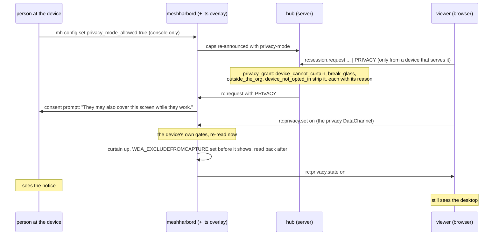
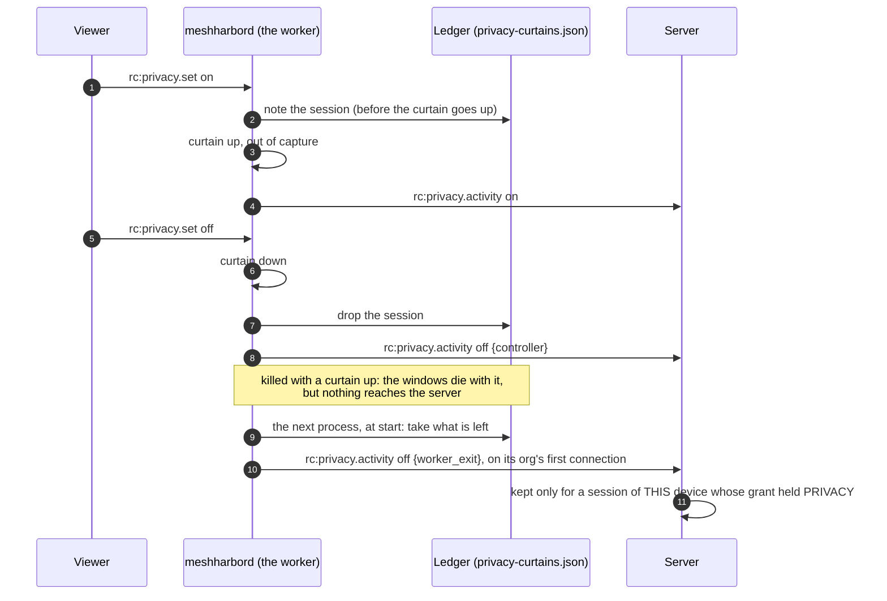
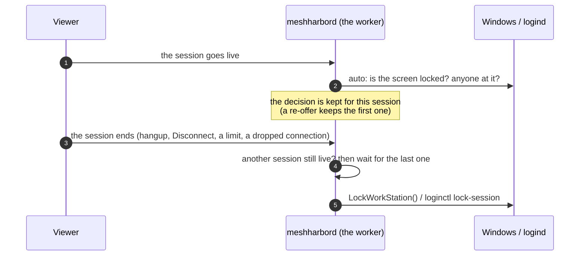
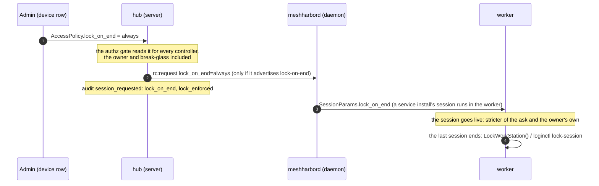
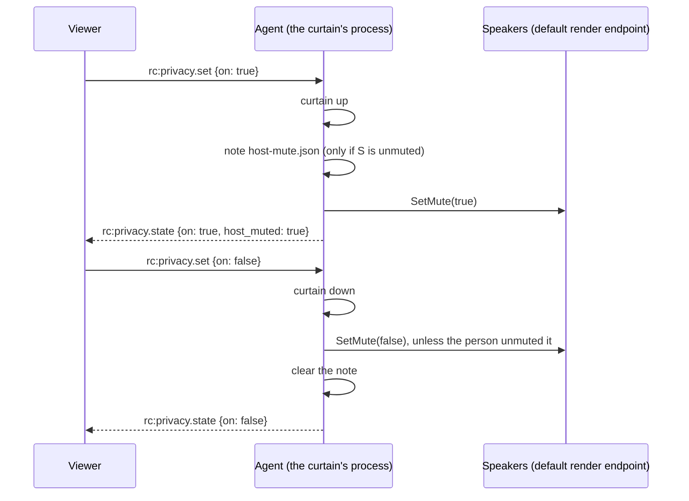

# Privacy mode

> **FR-99** ([#2091](https://github.com/jk-zhang-meta/MeshHarbor/issues/2091),
> [spec](fr/FR-99-privacy-mode.md)).
>
> **Status: the curtain is released (agent 0.4.136, Windows 10 2004 and later) and
> field-verified end to end** through the production viewer: the host's own screen shows
> the curtain while the stream keeps showing the desktop ([spec §8](fr/FR-99-privacy-mode.md#8-field-verification-log)
> rows 9–10).
>
> | Part | What | State |
> |---|---|---|
> | P1a | the server's gate: the `PRIVACY` bit, the two capability words, the strip with its reason | shipped |
> | P1b | the device: the owner's switch, the curtain, the `privacy` channel, the device's own refusals | shipped (0.4.136) |
> | P1c | the viewer: the toggle, the refusal reasons | shipped |
> | P1d | the device's account: every curtain up, down (and why) and refused, in `privacy_activity`, including the curtain a killed process could not report | shipped (0.4.139); a killed worker's `worker_exit` field-verified |
> | P2 | blocking the person's keyboard and mouse (`BlockInput`, Ctrl+Alt+Del to take the computer back) | not built |
> | P3a | lock the computer when the last session ends: the device's own `lock_on_end` (Windows, Linux) | shipped (0.4.139); field-verified on Windows |
> | P3b | an admin asking a device's sessions for a stricter lock | shipped (0.4.139, server deployed); field-verified on Windows |
> | P3c | a new Windows service install starts at `lock_on_end = auto` | shipped (0.4.140); field-verified: a new service install reads `auto`, a new per-user install `never` |
> | P4a | mute the host's speakers while the curtain is up (Windows), the controller keeping the audio | shipped (0.4.140); field-verified on Windows (all four AC10 phases) |

While a privacy-mode session runs, **the person at the computer sees a notice instead of the
desktop**: "This computer is being used remotely, by …". The controller keeps seeing the real
desktop, because the notice is kept out of screen capture. Nothing of it outlives the session.

An admin working on an unattended office PC uses it so as not to show the room what they are doing.

## Turning it on

Two parties have to agree, and the device's owner speaks first.

1. **The device's owner allows it.** `privacy_mode_allowed = true` in the device's config. It is
   off by default, takes effect at once, and is **never pushable**: it is absent from
   `DesiredConfig`, so no server can switch it on. Over the LocalAPI only the person at the
   console may change it, because it is their screen:
   ```
   mh config set privacy_mode_allowed true
   ```
2. **The controller covers the screen.** On a device that allows it, the viewer's toolbar has an
   eye-off toggle ("Cover the device screen"). The session's consent prompt has already told
   the person "They may also cover this screen while they work."
   ([`privacy.rs:151`](../agents/meshharbord/src/privacy.rs#L151)).



The viewer asks for `PRIVACY` only from a device that advertises `privacy-mode`
([`withPrivacyAsked`, `usePrivacyMode.ts:81`](../ui/src/composables/usePrivacyMode.ts#L81)).
A device that could curtain but whose owner has not allowed it advertises only
`privacy-available`; the viewer then asks for nothing and shows no control.

## Who can say no, and what the viewer says

The server strips `PRIVACY` before the device ever sees it
([`privacy_grant`, `hub.rs:416`](../crates/modules/fleet/src/hub.rs#L416)). The first reason
that applies wins, and it reaches the viewer (`rc:session.created.privacy_refused`) and the
session's `session_requested` audit row (`privacy_stripped`):

| Reason | When | The viewer |
|---|---|---|
| `device_cannot_curtain` | an agent before FR-99, or a platform with no curtain (macOS, Linux) | no control: there is nothing anyone could switch on |
| `break_glass` | the session skipped consent (an ADMINISTRATOR force) | a disabled control with the reason |
| `outside_the_org` | the controller is from outside the device's organization ([FR-52](fr/FR-52-cross-org-remote-access.md), decision 13) | none in practice: an outsider's page never asks for it |
| `device_not_opted_in` | the owner has not allowed it | a disabled control with the reason |

> ⚠️ **An outsider never covers the screen.** The person at the device let a stranger in on a
> password and a name the stranger chose, and is the only one placed to see what that stranger
> then does. A curtain would hide it from them, the same reason break-glass is refused. The
> device strips `PRIVACY` again when it admits an outsider's session
> ([`admit_session`, `extauth.rs:463`](../agents/meshharbord/src/extauth.rs#L463)), together with
> `RECORD`, so the server's strip is not the only one. No `external_max_permissions` an owner sets
> lets either back in.

The device decides again at every "on", whatever the server sent
([`set`, `privacy.rs:541`](../agents/meshharbord/src/privacy.rs#L541)):

| # | Gate | Refusal |
|---|---|---|
| 1 | the session's grant holds `PRIVACY` | `not_granted` |
| 2 | the owner's `privacy_mode_allowed`, read now: the gate a compromised server cannot pass | `disabled_on_device` |
| 3 | a curtain is possible here | `unavailable` |
| 4 | the overlay put it up, verified out of capture | `no_curtain` |

Turning it off is never refused. The curtain comes down when the controller turns it off, when
the session ends, and when **the owner switches privacy mode off mid-session**. The viewer is
then told unasked ("Privacy mode is off: this device's owner hasn't allowed privacy mode").
Every reason is said in words ([`describePrivacyReason`, `usePrivacyMode.ts:47`](../ui/src/composables/usePrivacyMode.ts#L47)).

## How the curtain works

One window over the whole virtual desktop, drawn by the overlay that already paints the "being
viewed" border and badge ([`set_privacy`, `indicator/win.rs:344`](../agents/meshharbord/src/indicator/win.rs#L344)):

- topmost, click-through and never activated, so the controller's injected clicks reach the
  applications underneath;
- `SetWindowDisplayAffinity(WDA_EXCLUDEFROMCAPTURE)` is set **before** it is shown and read back
  after. A curtain the capture could see would hide the desktop from the controller too, so an
  affinity that does not read back is a refusal (`no_curtain`). Both capture paths see through
  it: SystemContext's DXGI duplication and the attended worker's WGC;
- every half second it retakes the top, then puts the border, the badge and any consent panel
  back above it, so the person's way out and a consent question are never behind it.

## What is recorded

Two records, written by two parties, as for recordings and transfers
([security-baseline.md](security-baseline.md) §4):

| Record | Written by | Says | Where |
|---|---|---|---|
| `session_requested` in `remote_audit` | the server, from its own decision | whether `PRIVACY` was granted, and if not why (`privacy_stripped`) | P1a |
| `privacy_activity` | the device, reporting (FR-99 P1d) | what it then did: each curtain up, each take-down and why, each "on" it refused | `rc:privacy.activity` ([`agent_socket.rs:203`](../crates/modules/remote/src/agent_socket.rs#L203)) |



| `kind` | `reason` | When |
|---|---|---|
| `on` | — | the curtain went up, verified out of capture |
| `off` | `controller` | the viewer turned it off |
| `off` | `session_end` | the session ended (the channel closed, or the overlay dropped the session) |
| `off` | `disabled_on_device` | the owner switched privacy mode off mid-session |
| `off` | `worker_exit` | the process that drew it died with it up, reported by the next one to start ([`collect_leftovers`, `privacy.rs:384`](../agents/meshharbord/src/privacy.rs#L384)) |
| `refused` | `disabled_on_device` · `unavailable` · `no_curtain` | the device's gates 2–4 above |

- **The ledger** is a small file in the worker's own local data dir: SYSTEM's profile for a
  service's worker, the person's for a per-user install. Each curtain is written there *before*
  it goes up, so a process killed in between leaves an entry rather than a curtain with none
  ([`Ledger`, `privacy.rs:276`](../agents/meshharbord/src/privacy.rs#L276)). A leftover is reported on
  the connection of the org its session belonged to, because the server looks the session up within
  that org.
- **The server keeps a report only for a session of that device whose grant held `PRIVACY`**,
  the live session first and the stored row after it ended. That is how a `worker_exit` from the
  next process is checked. A reason that is not a short code (`a-z`, `0-9`, `_`) is dropped and
  the row kept.
- The trail is read at `GET /api/tenant/{tid}/privacy-activity/{agent_id}` under
  `VIEW_REMOTE_AUDIT`, newest first. A removed device's trail still resolves. Rows expire after
  90 days, like the audit beside them.

## Locking when the session ends

A remote admin who unlocks a computer to work on it should not leave it unlocked behind them. On agent
0.4.137 that is exactly what happened (spec §8 row 12). `lock_on_end` is the owner's answer, set at the
console:

```
mh config set lock_on_end auto      # never | auto | always
```

| `lock_on_end` | When the last remote session ends |
|---|---|
| `never` | the screen is left as it is |
| `auto` | locked if the session **began** on a locked screen, or with nobody at the computer (no input for 5 minutes on Windows; logind's idle hint on Linux) |
| `always` | locked |



- **The decision is taken at the session's start**, because that is what `auto` restores
  ([`lock_on_end.rs`](../agents/meshharbord/src/lock_on_end.rs)). Changing the key mid-session affects the
  next session, not the one already live.
- **Only the last session's end locks.** Locking under a second controller who is still working would be a
  fault. A session whose answer never reached the viewer has no say.
- **Windows** locks with `LockWorkStation()` from the process that runs the session. On a service install
  that process is SYSTEM in the console session, and the spec's P0 measured the call locking from there
  (§8 row 11). **Linux** locks seat0's active session with `loginctl lock-session`. **macOS** has no
  mechanism yet: an end that should lock logs that it could not.
- The key is the device's own. It is set over the LocalAPI only by the person at the console, whose screen
  it locks, and no server can push it. An admin can ask for stricter (below).
- **The default is `never`, except on a new Windows service install, which starts at `auto`** (P3c, the
  spec's decision 3; [`apply_service_install_defaults`](../crates/agent-core/src/enrollment.rs#L721)). Its
  worker reaches the secure desktop, so the next controller can unlock what `auto` locked. Per-user installs
  keep `never`, since nothing could unlock them remotely. So does the Linux root daemon, until a field cell
  shows a remote unlock there. An install already in the field keeps its value when it is re-enrolled.
- ⚠️ **`auto` also locks an unlocked computer nobody had touched for 5 minutes.** A kiosk that signs itself
  in ends each session at a padlock; set `never` there.
- ⚠️ **`auto` restores what was found at the start.** A person who unlocked the computer during the session
  signs in again after it. Telling their input from the controller's would need the input hooks FR-92 bans.
- ⚠️ **On a per-user install, `always` cannot be undone remotely.** That worker cannot reach the secure
  desktop, so the next session sees a padlock until someone signs in at the computer.

### An admin can ask for stricter (P3b)

A `MANAGE_AGENTS` admin can ask a device's sessions to lock at their end: **Lock when sessions end** on the
device's row in the device list (`AccessPolicy.lock_on_end`: `auto` or `always`; `never` asks nothing).
The device runs each session under the **stricter** of the ask and its owner's own `lock_on_end`
([`effective_policy`](../agents/meshharbord/src/lock_on_end.rs)), so an ask can tighten the owner's setting and
never loosen it:

| owner's `lock_on_end` | admin's ask | the session runs under |
|---|---|---|
| `never` | none, or `never` | `never` |
| `never` | `auto` | `auto` |
| `auto` | `always` | `always` |
| `always` | `auto` | `always` |



- **Only an install that can lift the lock remotely takes an ask**: the Windows service (its worker is SYSTEM
  in the console session and reaches the secure desktop) and the Linux root daemon. Only they advertise
  `lock-on-end` ([`can_honour_ask`](../agents/meshharbord/src/lock_on_end.rs)). A per-user install never
  receives one, because a lock an admin asked for there would leave every later session at a padlock no
  session can lift. The owner's own setting stays theirs on any install.
- The hub sends the ask on `rc:request` only to an agent that advertises `lock-on-end`. The
  `session_requested` audit row records the ask and `lock_enforced`; `false` is an ask this session's end
  will not take (a per-user install, a macOS device, or an agent older than P3b).
- The ask binds every controller, the owner and break-glass included: it describes the device, not who is
  asking. It crosses the cross-pod relay with the rest of the gate's decision, and a service install's
  daemon hands it to the worker in `SessionParams`, because the worker is where the session goes live and
  ends.
- ⚠️ **An unknown value reads as `always`**, the stricter side, as everywhere `LockOnEnd` is read: an API
  caller's typo locks rather than silently asking nothing.

## The host's speakers (P4)

While a curtain is up, the host's speakers are muted, so the person at the device neither sees nor
hears the session. The controller keeps the audio: the agent captures it by WASAPI loopback, and P0
measured the loopback carrying the same audio with the endpoint muted as unmuted
([FR-99](fr/FR-99-privacy-mode.md) §8 row 13). StarDesk's help says its mute silences the client
too; this one does not.



| Case | What happens |
|---|---|
| The endpoint was unmuted | muted at the first curtain, unmuted at the last one down |
| The endpoint was muted already | left muted; it is the person's, never unmuted by us |
| The person unmutes during the session | left unmuted at the end: it is not a lock |
| The process dies while muted | the next process of the same install finds the note and unmutes |
| No endpoint (or not Windows) | the curtain goes up without a mute, and the answer carries no `host_muted` |
| Muting fails | `host_muted: false`; the viewer's title says the speakers couldn't be muted |

## Platforms

| Platform | Curtain | Why |
|---|---|---|
| **Windows 10 2004+** (build ≥ 19041) | ✅ | `WDA_EXCLUDEFROMCAPTURE` |
| Windows before 2004 | ❌ | no capture exclusion |
| **macOS** | ❌ | since macOS 15 there is no public API that keeps a window out of capture; `NSWindow.sharingType = .none` is ignored by ScreenCaptureKit |
| Linux X11 | ❌ (later, perhaps DPMS-off) | injected input wakes the display, so it would have to be re-asserted |
| Linux Wayland | ❌ | — |

The host mute follows the curtain: Windows only, and only where a render endpoint exists.

## Honest limits

- ⚠️ **The curtain hides the screen; it does not stop the person at the keyboard.** It must be
  click-through for the controller's input to land, so the person's own mouse passes through it
  too. Blocking local input is P2 (`BlockInput`, which only the blocking thread can inject past,
  and which Ctrl+Alt+Del lifts). It is not built.
- ⚠️ **The shell draws over every topmost window.** The Start menu, notifications and Alt+Tab's
  thumbnails show above the curtain.
- **The secure desktop carries no curtain.** On the lock screen, a UAC prompt or Ctrl+Alt+Del the
  person sees that screen, which shows no user content, and the session keeps streaming it.
- **The person's way out** today is the badge at the top edge of the screen: "To end the
  session, move the pointer to the top edge of the screen and choose Disconnect." With P2's block
  it becomes Ctrl+Alt+Del (the operator's decision 4).
- The notice is English only for now.
- ⚠️ **The host mute is not a lock.** The person can unmute from the volume flyout, and stays
  unmuted. It was measured on a VM's HD Audio endpoint, whose volume is in software; AC10's field
  cell re-checks a real endpoint with hardware volume.
- ⚠️ **`privacy_activity` is the device's claim.** A compromised host can stay silent, so an empty
  trail is not proof that no curtain went up. The `PRIVACY` grant in `remote_audit` is what survives
  it. A report queued as the connection dies is lost, and a `worker_exit` arrives only when the next
  process starts: on a per-user install, at the person's next sign-in.

## Related

- [FR-99 spec](fr/FR-99-privacy-mode.md): the design, P0's `BlockInput` probes, the decisions, the
  field log.
- [remote-control.md](remote-control.md) §11.2: consent, whose prompt carries the privacy line.
- [keep-busy.md](keep-busy.md): FR-92's no-hooks rule, which is why the block will use
  `BlockInput` and never a keyboard hook.
