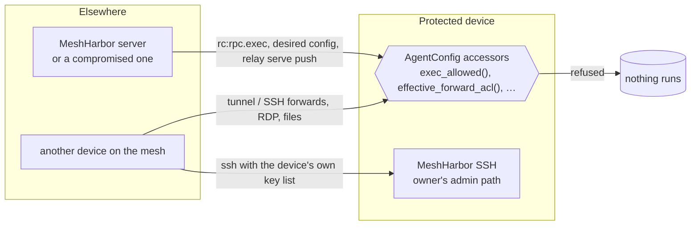

# A protected device

> **FR-127** ([spec](fr/FR-127-a-protected-device.md)). Status: P1 built (the switch and every
> refusal site); not yet released to the fleet.

A high-value host (a multi-GPU server holding weeks of model weights, a box that runs other people's
jobs) is most likely to be hurt by **one of the owner's own machines**: an infected laptop with an
SSH key for it, a lab peer on the same LAN or mesh, a management plane someone else controls. One
device-local switch closes every way in that the device itself did not allow:

```toml
# /etc/meshharbor/config.toml (root daemon) or the per-user config
protected = true
```

or `mh config set protected true`, then restart the service. The daemon logs the posture at start:
`this device is PROTECTED: … are refused`, with the planes it left open.



## What it refuses

| Plane | Under `protected` | Where it is decided |
|---|---|---|
| Fleet exec (`mh exec`) | refused | `RemoteConfigServices::exec_enabled` (`agents/meshharbord/src/remote_config.rs:248`), read per request |
| Remote configuration | refused: no pushed config is applied | `remote_config_enabled`, same place |
| Remote desktop | never auto-granted: a person at the device approves every session | `main.rs:5264` (consent mode) |
| File browse | off | `main.rs` (`browse_enabled`) |
| RC clipboard, files, audio | `Off` | `session_policy.rs:47` |
| RDP over the mesh | off | `rdp_mesh.rs:115, 128` |
| Tunnel exits | only to an explicit `forward_acl` allowlist; an empty list refuses all | `signaling.rs:3062, 3178` |
| SSH `-L` / `-D` / `-J` | the same allowlist | `ssh.rs:857` |
| Serving as an org relay | never: no listener is bound, even on the control plane's serve push | `relay_server.rs:177`, `orgrelay::relay_server_enabled` (`crates/tunnel-core/src/overlay/orgrelay/mod.rs:65`) |
| Exit node, subnet routes | off | `AgentConfig::effective_overlay_advertised_routes`, `subnet_detect.rs:26` |
| Cross-org access | off | `remote_config.rs` (`external_access_allowed`) |
| Agent sessions (hive), vault leases | off | `hive/gates.rs:64`, `signaling.rs:1807, 1900, 1978, 2599` |

**MeshHarbor SSH stays as configured.** It is the owner's way in: give it its own key list
(`ssh_authorized_keys`), a named account, and keep `ssh_max_privilege` on a root daemon. Before
turning protection on, prove a way in that does not depend on anything this switch closes.

## The design rules

- **Held whatever the server says.** `protected` is absent from `DesiredConfig`, and a test fails
  the build if it is added (`the_device_owned_refusals_are_not_pushable`,
  `crates/remote_control/src/models.rs:9872`). A switch the server could clear would protect against
  nothing a server can be made to do.
- **An effective view, never a rewrite.** The gates read accessors
  (`crates/agent-core/src/config.rs:2657` onward); the stored keys keep the owner's values. The
  daemon saves its config back (key rotation, enrollment updates), so forcing the stored values
  would have destroyed them at the first save. Turning protection off restores exactly what was
  there (`a_protected_device_refuses_every_way_in_and_keeps_the_owners_settings`).
- **At the decision, not at the read.** Each plane is refused where its request is decided, so a
  path that skips a UI check still meets it. The relay is refused at the one function that binds a
  listener.
- **It names what it left open.** `protected_open_planes` (`config.rs:2726`): the admin SSH with its
  key count, and an explicit forward allowlist.

## What it does not cover yet

| Gap | Phase |
|---|---|
| `mh status`, the device report and the web console showing the posture | P2 |
| A sign-in / `install.sh --protected` that closes a server from its first minute | P3 |
| A device-owned inbound allowlist for the overlay; SSH and exec bound to an origin device | P4 |
| Operator-signed SSH grants and node-key signing, so a compromised server can relay but not mint | P5 |
| Alerts on denied inbound, session revocation, a reversible isolate | P6 |

Host controls that need no product change — model APIs on loopback behind an auth proxy,
hardware-backed SSH keys, append-only backups of weights, a firewall with an automatic revert —
belong to the host's owner; the defense study behind this FR lists them in priority order.
