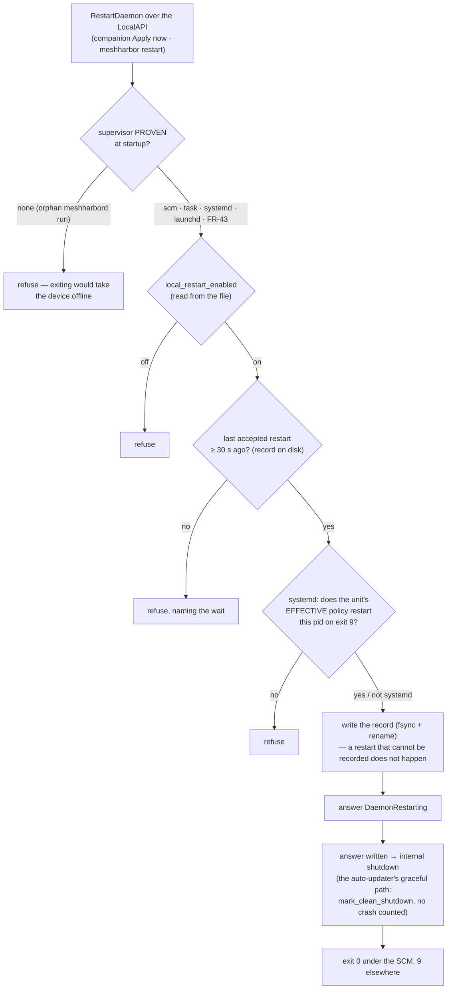

# Remote configuration — enabling exec / SSH from the dashboard

**Status: steps 1–6 SHIPPED** (#626, #630, #640, #645, #668). Step 4 took
option **C** from the fork in §7b — `exec_enabled` is live, `ssh_*` are
persisted and honestly reported as needing a restart. Option **A**
(supervisor-detected exit-to-restart) now exists **for the LOCAL path only**
(FR-84 D3: the LocalAPI's `RestartDaemon`, the companion's "Apply now",
`meshharbor restart`); remote configuration still never restarts a daemon, and
§7b records why both halves of that are deliberate.

This documents a design and the reasoning that constrains it. Claims about
behaviour were checked against the code at `5b60dacc` unless noted; the file
says where a check would need repeating.

## 1. The problem

Turning on `meshharbor exec` or meshharbor SSH for a device today means editing
`config.toml` on that host by hand and restarting the daemon. For one machine
that is fine. For a fleet it is the reason both features are still off nearly
everywhere: the last gate is the one nobody can reach.

The ask is to flip those keys — and other device-owned config — from the web
dashboard, by the device's owner or an org admin, with offline devices picking
up the change when they next connect.

## 2. The tension this design exists to resolve

`exec_enabled` and `ssh_enabled` are gate 4 of four, and gate 4 is documented as
**"the only refusal that survives a compromised server"**. It has that property
for exactly one reason: the server cannot write it.

A naive remote-config feature deletes that property. If the server can set
`exec_enabled`, then an attacker holding the server can set it too, and the
four-gate chain becomes a three-gate chain with a longer description. That is
not a hypothetical distinction — it is the whole reason the key is on disk.

So the design constraint is not "add a config-push message". It is:

> **Make the device remotely configurable without making it server-configurable.**

### The resolution: a device-local opt-in

A new device-owned key, `remote_config_enabled`, **default OFF and never
settable by the server**. The device opts in to accepting pushed config.

This preserves gate 4's meaning rather than eroding it. A device that has not
opted in cannot be opened by any server, compromised or not — the opt-in *is*
the refusal that survives. What changes is that opting in becomes a one-time
local decision instead of a per-key local decision, which is a real reduction in
safety and should be stated plainly rather than glossed: **a host with
`remote_config_enabled = true` has delegated gate 4 to its control plane.** The
default is OFF so that delegation is always a deliberate act.

## 3. Rejected: server-derived state (Design B)

The first plan had the agent derive `exec_enabled` / `ssh_enabled` from server
state at connect, with no local key at all. It was rejected on review for two
independent reasons, both worth recording so it is not re-proposed.

**It breaks break-glass.** Key-list SSH is the documented path for when the
control plane is the broken thing. It works during an outage *because*
`ssh_enabled` is on disk. Server-derived means "server unreachable at boot ⇒ no
SSH", which removes the capability precisely when it is needed.

**It would not have worked anyway.** `overlay.rs`'s `RuntimeFingerprint` — the
guard that decides whether a respawned overlay runtime re-attaches or rebuilds —
contains **no SSH field**. Flipping `ssh_enabled` and respawning re-attaches and
returns early, so `crate::ssh::maybe_intercept` never re-runs and the `SplitTun`
splice never happens. A live flip needed more than the plan accounted for. (This
is why the design below restarts the daemon rather than reconfiguring in place.)

## 4. Multi-org: primary-only

**Verified at `5b60dacc`:** `AgentConfig::for_org` scopes `server_url`, `ws_url`,
tokens, ids, overlay keys, routes and the netstack port — and **none** of
`exec_enabled`, `ssh_enabled`, `ssh_authorized_keys`, `ssh_account_mode`,
`ssh_port`, `ssh_host_key`. A derived org config inherits the primary's by
`clone()`.

So those keys are **host-global** while the server models exec/SSH policy
**per-org**. Left alone, org B's admin flipping a switch would change org A's
access to the same host.

The codebase already answers this shape for `rc:agent.update`:

```rust
// Multi-org P1: the self-updater is machine-wide, so only the PRIMARY
// enrollment may drive it — a secondary org's admin must not force-update
// a binary shared with every other org.
if !ctx.is_primary { /* counter + warn, then ignore */ }
```

Config push takes the same rule: **honored only on the primary org's WS**,
ignored-and-surfaced on secondaries via an `OrgStatus` counter, never silently
swallowed. A machine-wide key may only be driven by the machine's primary
enrollment.

⚠️ This means an org that is a *secondary* on a host cannot enable exec/SSH
there from its dashboard. That is a real limitation and the UI must say so
rather than showing a switch that does nothing.

## 5. Who may flip it

Not just `MANAGE_AGENTS`. Enabling exec on a device is granting a power, and the
role work in #600/#605 established the rule that governs this:

> **You cannot grant a permission you do not hold.**

Enabling `exec_enabled` on a device opens a door; a caller who cannot walk
through that door should not be able to open it for others. So:

| action | requires |
|---|---|
| enable exec on a device | `MANAGE_AGENTS` **and** `EXEC_DEVICE` |
| enable SSH on a device | `MANAGE_AGENTS` **and** `SSH_DEVICE` |
| other device config | `MANAGE_AGENTS` |

Device owners (`owner_user_id`) are subject to the same rule. Both bits are
deliberately absent from `DEFAULT_ADMIN`, which is what makes this meaningful.

## 6. Shape

**Desired state on the agent row.** A `desired_config` sub-document on `agents`:
the keys an operator has asked for, plus who asked and when. This is the
offline story — nothing is "pushed" so much as *reconciled*, and a device that
was offline for a week converges on connect by the same path as one that was
online.

**Reconcile on connect, not just on change.** The agent compares its live config
against `desired_config` after hello. A change while connected is a nudge to
re-run that comparison, not a separate code path. One path means the
offline case is exercised on every single connect rather than only in the case
nobody tests.

**Wire.** A new `ServerMsg` variant carrying the desired keys.

⚠️ It must be gated on a hello capability flag. An older agent does not break on
an unknown frame — the parse-error arm logs at `debug!` and continues, which I
verified — but the frame **vanishes silently**, and the dashboard would show a
change that never landed. The server must know whether the agent understands it,
and the UI must show "device too old" rather than a spinner.

**Apply → persist → restart.** `config::save` already does atomic + fsync +
`.prev` + 0600/ACL, and is already called at runtime by `localapi_state.rs`
(the desktop companion's settings path). ⚠️ It needs the daemon's privilege —
`main.rs` records that a non-elevated `config::save` fails ACCESS_DENIED — which
is satisfied because the daemon is SYSTEM/root.

**Restart, staggered 0–120 s.** `config_surface`'s own doc says every key but the
two live gate-4 flags (§7b) is read at daemon startup, so the surface is
`restart_required = true` for everything else — and since FR-84 D2 each
`ConfigEntry` says which. A fleet-wide push without jitter restarts every device
at once. The jitter is
per-device and derived from the machine id, so it is stable across retries
rather than re-rolled.

**The device reports back** (`rc:agent.config_status`). Every outcome, refusals
included. This is not telemetry — it is what makes the dashboard capable of
being honest, and it was promised by `ConfigPush::revision`'s own doc long
before it existed.

Without it, four situations are one situation on screen:

| what actually happened | what an operator must do |
|---|---|
| applied, in force | nothing |
| applied, waiting on a restart | restart the daemon |
| refused — not opted in | set `remote_config_enabled` **on the host** |
| refused — secondary org | ask the primary org's admin (§4) |
| never arrived — agent too old | update the device |

All five look like "nothing happened" from the server alone, and every one has
a different fix.

⚠️ **A report is a CLAIM BY THE DEVICE**, in the same sense as `ssh_activity`
and the opposite sense to `config_audit`. The audit collection holds the
server's own decision and is authoritative; this is what a host — possibly
compromised, possibly lying, possibly just old — says happened afterwards.
Stored on the agent row rather than folded into the audit trail so a reader can
always tell which is which.

⚠️ **`config-report` is a SEPARATE capability verb from `config`**, and this is
the `ssh` / `ssh-consent` split recurring exactly as that doc predicted it
would. Agents rc.457 and rc.458 shipped `config`: they apply a pushed config
and say nothing. Reading "reports back" out of `config` would make the
dashboard wait forever for an answer from most of the fleet. ⚠️ `config` is a
PREFIX of `config-report` — matching must stay equality.

⚠️ **Compare revisions, not just outcomes.** A report about revision 3 says
nothing about revision 4. Reading only `outcome` shows a stale "applied" over a
change that never landed; reading only "there is a report" shows success for
the same reason. `RemoteConfigState` does that comparison once, server-side,
rather than in every client.

**Audit.** Every change and every refusal, in the same shape as `exec_audit` /
`ssh_audit`: who asked, which device, which keys, what the outcome was. The
refusals are the load-bearing rows — as in `agent_ssh.rs::dispatch`, the
decision function should return `Result<Applied, Reason>` and one call site
should record both arms, so "a new refusal that forgets to audit itself" stays
unrepresentable.


**A non-security key on the same surface (FR-77 P3).** `encoder_cells_deny`
— the cell matrix's denylist, comma-separated `name:chroma` entries or `none`
— is pushable through the same `desired_config` document, reported the same
way (`needs_restart`: the probe runs once per process), and audited the same
way. It needs only `MANAGE_AGENTS`: unlike every other key here it is NOT a
gate — it only ever *removes* encoder cells a device would otherwise open, so
pushing it cannot grant anything. The device's opt-in (`remote_config_enabled`)
still applies, because the opt-in is about accepting pushed config at all, not
about any one key. ⚠️ A blank value from the dialog is "not managed"; a pushed
empty string CLEARS the device's key back to the built-in list.

**A second one (FR-119 P2b).** `fps_deny`, the frame-rate denylist
(comma-separated `name:fps` entries, `*` for every encoder, or `none`), rides
the same document on the same terms: `MANAGE_AGENTS` alone, because it only
ever *removes* rates above 60 a device would otherwise grant;
`needs_restart`, because the pump reads it through the config fallbacks,
registered once per process; audited like the rest. Unset on the device denies
nothing, so `none` is how a push says the same thing while a blank box hands the
key back to the device. A pushed value is not validated by the server, as with
`encoder_cells_deny`: an entry the device cannot parse is skipped, never widened
into a match, and `meshharbor config set fps_deny` refuses it locally.

## 7. What this does not do

- **No bootstrapping problem.** Enabling `exec_enabled` remotely does not
  require exec: the control WS is the channel. Stated because it is the first
  thing that looks circular.
- **No secondary-org control** (§4).
- **No in-place SSH flip** (§3) — enabling SSH restarts the daemon.
- **`remote_config_enabled` is never itself remotely settable.** If it were,
  the whole design would be one push away from meaningless.

## 7b. The restart problem — found building step 4, changes the plan

Step 4 said "apply, persist, staggered restart". Building it turned up four
facts that make the restart the hard part of this whole feature rather than a
detail at the end of it. All verified at `09ada123`.

**A persisted change is inert until restart.** `signaling::run(cfg: AgentConfig)`
takes an OWNED snapshot at startup and passes it down by reference;
`exec_enabled` is read as `agent_cfg.exec_enabled` per request from that
snapshot, never re-read from disk. So writing config.toml changes nothing about
the running daemon. `config_surface`'s `restart_required = true` for every key
but the two live flags is exactly right.

**There is no self-restart primitive.** `restart-service` is Windows-only,
external (an admin runs it), and does an SCM Stop+Start — which a process cannot
perform on itself. The auto-updater's restart is a *side effect of the package
install* (the `.deb` postinst, the MSI), not something callable.

**"Exit and let the supervisor restart me" is the standard mechanism on all
three platforms** — systemd `Restart=always`, the Windows supervisor's
`ExitReaction::Respawn`, launchd `KeepAlive` — **and the daemon cannot currently
tell whether it is supervised.** Nothing in the tree checks `INVOCATION_ID` or
equivalent. Orphan `meshharbord run` processes demonstrably exist in the field (the
pre-rc.435 hosts). A fleet-wide config push that exits them would take every one
**permanently offline**, which is a far worse outcome than the manual edit this
feature exists to remove.

**The Windows respawn path has an open bug** (`decide_exit_reaction` maps exit 0
to `Respawn` with zero backoff — see CLAUDE.md's known issues). Anything built on
exit-to-restart inherits it.

### The fork

- **A — supervisor-detected exit-to-restart.** The real fix. Needs a
  "am I supervised?" probe per platform, and the Windows supervisor bug closed
  first. Highest value, highest blast radius; a mistake takes hosts offline.
- **B — apply + persist now, restart stays manual.** Safe and small, but the
  change does nothing until someone restarts the device — which for `exec_enabled`
  is circular, since remote restart is what exec is for.
- **C — make the keys live instead of restart-required.** Put the config behind
  a watch/`ArcSwap` so a push updates the running value. For `exec_enabled` this
  looks tractable: it is a bool read per request. For `ssh_enabled` it is not —
  `RuntimeFingerprint` has no SSH field (§3), so the `SplitTun` splice would not
  re-run without more work. C avoids the restart entirely for the key that
  matters most, and is independent of A.

### ⚠️ C creates an asymmetry, and the asymmetry has to be fixed with it

Making a key live for the SERVER while the owner's own edit still waits for a
restart inverts the property gate 4 exists for. `exec_enabled` is documented as
*"the only refusal that survives a compromised server"* — a refusal that takes
effect on the next service restart, while the compromise's assertion takes
effect on the next command, is a much weaker claim than that sentence makes.

So the LocalAPI's `ConfigSet` re-seeds the live flags after its save
(`RemoteConfigServices::adopt_local`), and `remote_config_enabled` is live too.
The second one matters more than the first: it is how the owner REVOKES the
delegation, and a revocation that waits for a restart leaves the server pushing
over a decision already made.

⚠️ This does not stop the next reconnect from re-applying a standing
`desired_config`, and it must not — a device with `remote_config_enabled = true`
has delegated the key, which is the bargain in §2. Turning the OPT-IN off is
the owner's actual remedy, which is precisely why that one is live.

**C then A** looks right: it removes the restart from the common case, and
leaves the dangerous mechanism to be built deliberately rather than because
step 4 needed it. But this is a real decision with real trade-offs, not a
detail to settle by momentum — hence written down here rather than chosen
silently.

### A, built — for the local path only (FR-84 D3, 2026-09-25)

Option A now exists, as the LocalAPI verb `RestartDaemon`: the desktop
companion's **Apply now** and `meshharbor restart` ask the daemon to exit so its
supervisor relaunches it. Every objection above got an answer rather than a
waiver, and one did not — which is why remote configuration still does not use
it.



| objection (§7b, above) | answer in D3 |
|---|---|
| **The daemon cannot tell whether it is supervised.** | `supervision::detect` decides once at startup, from evidence only a supervisor leaves: the SCM host and the Scheduled Task pass a hidden `run --supervisor scm\|task`; the FR-43 root daemon passes `--supervised`; launchd sets `XPC_SERVICE_NAME` to one of our `fans.itachi.meshharbor.*` labels; systemd sets `INVOCATION_ID` **and** the process sits in one of our units' cgroups (the id alone is inherited by every shell under GNOME Terminal). Never the config file. Anything else is `none`. |
| **Orphan `meshharbord run` processes exist.** | `none` always refuses. A pre-rc.435 root daemon, a hand-run process, a container's PID 1 — none of them is ever asked to exit. |
| **systemd: what if the unit does not restart?** | Before accepting, the daemon asks systemd itself (`systemctl show`: `MainPID`, `Restart`, `RestartPreventExitStatus`, `RestartForceExitStatus`, `SuccessExitStatus`) and mirrors `service_shall_restart`: this pid must be the unit's main process, and the effective policy — drop-ins included — must restart exit status 9. Any failure to get that answer is a refusal. |
| **The Windows respawn has zero backoff** (`decide_exit_reaction` maps 0 to `Respawn`). | Exactly what ONE deliberate restart wants, so an SCM worker exits **0**. A loop is impossible because the verb refuses a second request within 30 s of the last *accepted* one, and that record lives on disk beside the config — it binds the relaunched process too. At most one restart per 30 s, whatever a client does. |
| **A restart must not look like a crash.** | It rides the internal-shutdown path the auto-updater already uses: `mark_clean_shutdown`, the runtime torn down as for an update, then the exit code. The SCM supervisor also maps the sentinel 9 to `Respawn` and records no crash for it. |
| **launchd relaunches only a non-zero exit.** | Everything but the SCM exits `RESTART_REQUESTED_EXIT_CODE = 9` — outside the Linux units' `RestartPreventExitStatus=7 8`, and nothing else in the tree exits 9. Tests assert both packaged units and both packaged plists. |

**A second caller: the daemon itself (FR-96 P2b, 2026-10-13).** A per-user Linux
daemon whose binary was replaced restarts through the same door once nothing it
serves would be cut (`RestartHandle::arm_from_within`, `localapi_state.rs:326-385`).
It runs the same supervisor proof, record and systemd read-back, but not
`local_restart_enabled`, because no local client is asking. It is not a server
lever: what sets it off is a file replaced ON the device, by the root update
helper's verified install or an admin's `apt upgrade`. And an install restarting
the daemon is what every other install flavour has always done.

**Why the remote path still does not restart anything.** The objection that
survives is the fleet. A config push lands on every device an admin selects,
and the ones that cannot come back are precisely the ones D3 refuses — the
orphans — so a push would either restart the healthy majority and silently skip
the rest (the dashboard then shows "applied" beside devices still running the
old value), or need its own reporting for a state that has no local person to
read it. And a server able to restart daemons holds every device's uptime on a
button, which is the same compromise this document exists to refuse for
`exec_enabled`. So a pushed key stays `applied-pending-restart` until someone at
the device applies it — or an operator runs `meshharbor exec … -- meshharbor restart`,
which needs every one of exec's four gates, the device's own `exec_enabled`
included (exec already runs anything as root, so it grants nothing new), and
which the daemon still refuses on the same terms as a local request.
`DesiredConfig` carries no restart and no `local_restart_enabled`, and
`the_device_owned_refusals_are_not_pushable` fails the build if either appears.

## 8. Order

1. `remote_config_enabled` key + config-surface entry, default OFF. Inert alone.
2. `desired_config` on `agents` + the authz rule in §5 + audit collection.
3. Hello capability flag + the `ServerMsg` variant + reconcile-on-connect.
4. Apply + persist on the agent, primary-only. ⚠️ The restart half is NOT
   settled — see §7b. A persisted change is inert until the daemon restarts;
   the safe self-restart that now exists (FR-84 D3) is deliberately LOCAL, so
   a pushed restart-required key still waits for a person at the device.
4b. `rc:agent.config_status` — the device reports what it did, behind its own
   `config-report` verb, resolved server-side into `RemoteConfigState`. Found
   while starting step 5, which cannot render "secondary org" at all without
   it: only the DEVICE knows it is a secondary, so the server has no way to
   report that state on its own.
5. Dashboard UI, including the "secondary org" and "agent too old" states.
   `RemoteConfigDialog` (a device menu entry + a row chip). Three things it
   does that are not decoration:
   - **Tri-state per key** (`ManagedSwitch`): *leave alone* / *off* / *on*. The
     wire has three states and a switch has two — `undefined` means the device
     keeps what it has, and an operator toggling exec must not silently assert
     a value for every other key.
   - **Combination warnings.** `ssh_enabled` alone grants nothing: without
     `ssh_authorized_keys` nobody can connect, and with an unset
     `ssh_account_mode` a key-list session authenticates and then runs nothing.
     Both produce a device that is "on" and unreachable — the same
     silent-nothing this whole feature exists to remove, so the dialog says so
     before you save rather than leaving you to find out by `ssh`ing at it.
   - **Grant bits mirrored** (`canGrantDeviceExec` / `canGrantDeviceSsh`), so a
     caller without `EXEC_DEVICE` sees a disabled control and the reason,
     rather than a 403 they cannot attribute to themselves or to the device.

   ⚠️ It writes an INTENT and says so at the top. Every other device dialog in
   the admin UI writes a server-side policy that takes effect on save; a reader
   who assumes this one does too will misread every status on it.
6. Desktop companion — **no code needed, verified rather than assumed.** Its
   settings pane is built entirely from `cmd_config_entries`, which is
   `config_surface::SURFACE`, which has carried `remote_config_enabled` with
   its full description since step 1. The generic pane picked it up the day it
   landed.

   What DID need code is the other half: a `ConfigSet` through that pane now
   re-seeds the live flags (`adopt_local`), so an owner's edit takes effect at
   the same moment a pushed one would. See §7b — option C created that
   asymmetry, and leaving it would have made gate 4 the slower of the two.

## 9. Not built, on purpose

- **Option A on the remote path** (§7b). Supervisor-detected exit-to-restart
  exists since FR-84 D3, but only behind the LocalAPI; a push never restarts a
  daemon. The `ssh_*` keys are therefore still restart-required after a push,
  reported as such rather than pretended into effect.
- **A server-side restart verb.** A server able to restart daemons would hold
  every device's uptime on a button, and the devices that could not come back
  (orphan `meshharbord run` hosts) are exactly the ones it could not see. The
  local verb refuses those; there is nothing for a server to send.
- **Secondary-org control** (§4). A borrowed device is not yours to
  reconfigure; the UI says so instead of showing a switch that does nothing.
