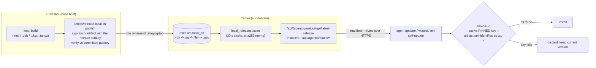

# Self-hosted releases — updates from our own domain

> **Status:** shipped on branch `feat/upgrade-own-domain-20261111` (item 17).
> **Policy it serves:** no CI ([deployment.md](deployment.md)), artifacts unsigned
> by code-signing certificates ([local-build.md](local-build.md#packaging-and-signing)),
> and every update is still anchored by a key compiled into the agent.

The center serves releases from **its own directory**. Agents on Windows, Linux and
macOS fetch the manifest and the bytes from the enrolled center (for the test center,
`https://www.itachi.fans/meshharbor`), and nothing in the path contacts github.com.

## Why this exists

Before this change, no artifact this project can build could pass the update path:

| Platform | Inherited anchor | Why it always refused our builds |
|---|---|---|
| Windows | Authenticode + signer name `G ROX LTD` | our MSIs are unsigned by policy |
| Linux / macOS | `.asc` against an inherited pinned GPG subkey | we do not hold that key's secret |
| Server | GitHub Releases of the configured repo, `.asc` paired | the repo has tags but no releases (the `GitHub returned 404` log) |

So the requirement had two halves. The bytes must come from our server, and an
anchor must exist that we can actually sign with. That anchor has to stay compiled
into the agent, because a digest from the same server is not a tamper anchor.

## Design



| Piece | Where | What it does |
|---|---|---|
| Setting | `crates/config/src/settings.rs` `ReleasesSettings::local_dir` | `MESHHARBOR__RELEASES__LOCAL_DIR`. Set ⇒ this directory is the **only** source (no GitHub call, no fallback). Unset ⇒ the GitHub path, unchanged |
| Source switch | `crates/modules/fleet/src/releases.rs` `cached()` | the one branch every release route goes through |
| Scan | `crates/modules/fleet/src/local_releases.rs` | `<dir>/<tag>/<file>` → the same `AgentRelease` list GitHub produced; symlinks skipped, dot-entries skipped, tag/name token rules shared with the GitHub path |
| Delivery | `crates/modules/fleet/src/release_delivery.rs` `Source::Local` + `local_response` | streams from disk under the GitHub path's bounds: the `.asc` must be paired, the scanned size must still hold, and a symlink swapped in after the scan is refused |
| Anchor | `crates/tunnel-core/src/pgp_verify.rs` `PINNED_RELEASE_SIGNING_KEY` | our release signing subkey `A323047747FA652D8D74BB709482E0B7193780A1`, certified by primary `38442E987FDC5492F8C722D43A8B20AA3BC5C4B4` |
| Updater | `agents/meshharbord/src/updater.rs` `download_asset` | the pinned `.asc` check on **every** platform (Windows previously used Authenticode) |
| Publish | `scripts/release-local.sh` | signs, verifies against `scripts/signing/gpg/meshharbor-release-pubkey.asc`, then makes the tag visible in one atomic rename |

> ⚠️ **The local path cannot be injected.** `AgentReleaseAsset::local_path` is
> `#[serde(skip)]` in both directions. Nothing parsed from JSON can name a file for
> the server to stream, and the path never reaches a client. The asset URL a
> client sees is always the center's own `/api/agent/artifacts/<tag>/<name>`
> (`release_delivery::own_urls`).

> ⚠️ **The directory is a delivery channel, not a trust anchor.** The digest the
> scan computes comes from the same server that serves the bytes. The agent checks
> it, but only as a transport check. The anchor is the `.asc` against the key
> compiled into the agent, so a compromised center can withhold updates but
> cannot install anything.

## Publishing a release

```bash
export MESHHARBOR_RELEASE_GNUPGHOME=/path/to/private/gnupg        # never in the repo
export MESHHARBOR_RELEASE_PASSPHRASE_FILE=/path/to/passphrase.txt
scripts/release-local.sh publish /srv/meshharbor-releases agent-v0.4.152 \
    meshharbord-0.4.152-x86_64-unknown-linux-gnu.deb \
    meshharbor-0.4.152-x86_64-pc-windows-msvc.msi \
    meshharbor-0.4.152-aarch64-apple-darwin.pkg
```

- **Tags** follow the families the routes serve: `agent-v*`, `tunnel-v*`, `setup-v*`.
  A published tag is immutable; the script refuses to overwrite one.
- **Names** must carry the tag's version. The updater refuses an artifact that does
  not self-identify as the release it was offered as (`artifact_version.rs`), so the
  script catches the obvious mismatch before the field does.
- **Visibility:** agents see the release within one scan TTL (30 s) and their next
  check (`CHECK_INTERVAL` 4 h, or a pushed `rc:agent.update`). No refresh call is needed.

On the server, mount the directory read-only into the container and set
`MESHHARBOR__RELEASES__LOCAL_DIR` to the mount point.

## The one-time key move

> ⚠️ Agents built **before** this change pin the inherited key and refuse every
> release signed by ours. They move by **one manual install** of a build from this
> branch. From then on, updates flow from the center. A rotation with an overlap
> window would need the old key's secret, which this project does not hold.

The signing subkey's secret and its passphrase live only on the build host's
private runtime directory, never in the repository, OneDrive or a log. Losing them
means every agent needs one more manual install to a new pin, so keep a backup.

## Verification record

| Check | Result |
|---|---|
| `pgp_verify` committed vector signed by the pinned key | verifies; a flipped byte and a foreign key are refused |
| `local_releases` scan rules (hidden, family, symlink, re-hash, serde) | unit tests |
| `release_delivery` local mode (own URLs, `.asc` pairing, exact bytes, changed file, symlink swap) | unit tests |
| End-to-end Linux upgrade (old `.deb` → new through a center on its own directory, plus a tampered release refused) | see the item 17 field record |
