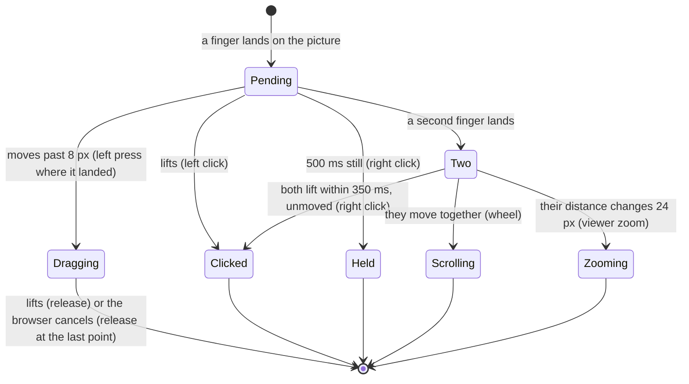
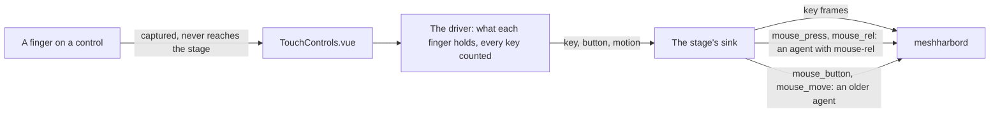
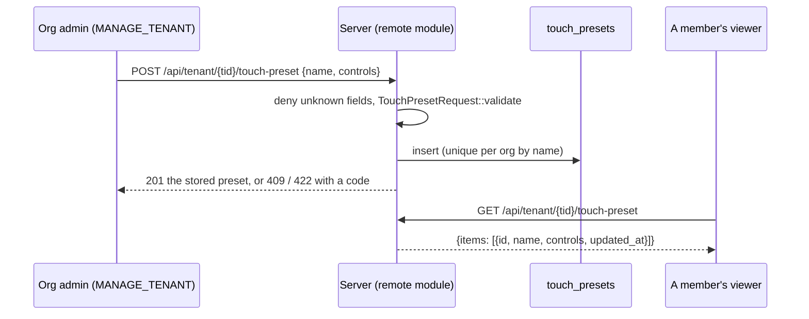
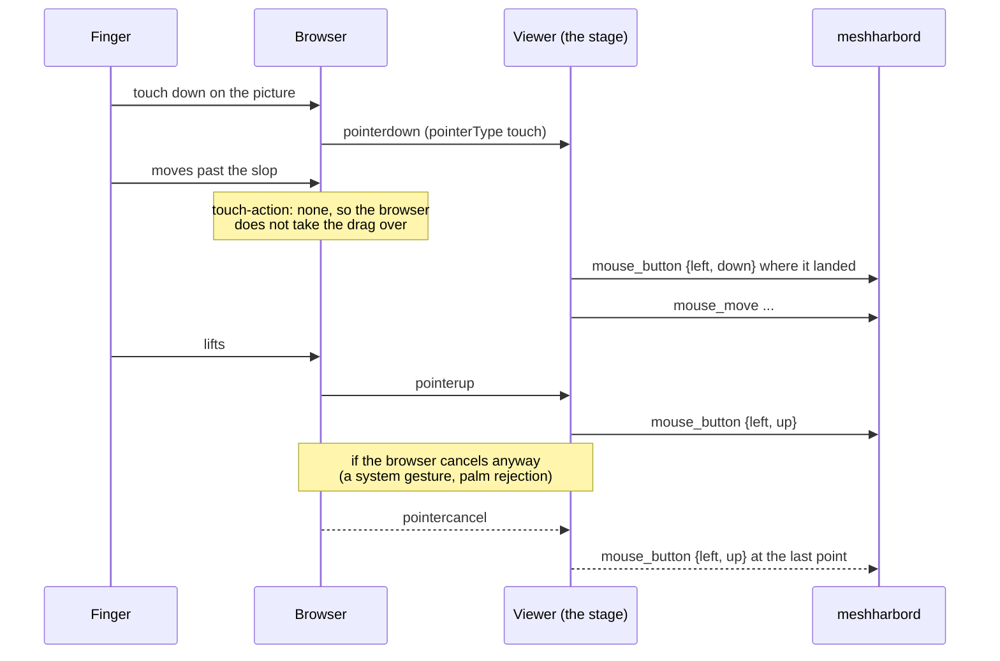

# Touch controls — a phone or tablet as a real controller

> **Status** (FR-111, [#2359](https://github.com/jk-zhang-meta/MeshHarbor/issues/2359); spec:
> [`docs/fr/FR-111-touch-controls.md`](fr/FR-111-touch-controls.md))
>
> | Phase | What | State |
> |---|---|---|
> | P1 | touch on the stage: it keeps every touch (`touch-action: none`), a cancelled pointer still lets go, and the gestures of direct mode (the right button, two-finger scroll, pinch zooming only the viewer) | built (viewer only) |
> | P2 | a trackpad mode: the finger moves the host's pointer, a tap clicks where it is | built (viewer only). With nothing remembered, a phone-sized screen starts in trackpad mode and a larger one in direct mode (the operator's decision 1, 2026-10-17) |
> | P3 | on-screen controls: rows of keys, a d-pad, a mouse stick, in three built-in presets remembered per device | built (viewer only); the presets follow the recommendation until the operator decides |
> | P4 | an editor, macros, tenant presets | **P4a built**: the org's presets on the server (four routes, strict validation, macros in the schema). **P4b-1 built**: the viewer offers them and plays macros. **P4b-2 built**: the editor, for a member's own layouts in the browser and, with the right, the org's |

## Why it exists

The controller is the browser, so a phone or a tablet is a controller with nothing to install. Until FR-111,
the viewer treated a finger as a mouse: a touch moved the host's pointer to that point and pressed the left
button there. It offered nothing else a touch screen needs, and it got one thing wrong:

**A drag the browser took over left the host's button down.** A touch browser decides for itself whether a
moving finger is a pan or a zoom. When it decides so, it ends the pointer with `pointercancel` and never
sends `pointerup`. The viewer had already forwarded the press, had no `pointercancel` handler, and so never
sent the release. On a vmtest Win11 host the left button stayed down until a later tap let go, and in the
meantime every touch moved into a drag. FR-111's P0 measured it: the browser cancelled 69 ms into the drag,
and the host's raw input read the press and then no release (the spec's §8 row 1).

## The gestures (direct mode)

The finger is still the mouse: a tap clicks where it lands, and a drag drags from where it landed. What is new
is that the viewer **waits for the finger to say what it is** before it presses anything. So a long press
never starts as a left press, and a second finger never drags along with the first
([`touchGestures.ts:168`](../ui/src/composables/touchGestures.ts#L168) `createDirectGestures`, a pure state
machine with its own tests).

| Gesture | Reaches the host as |
|---|---|
| a tap | a left click where the finger landed (a lifting finger jitters, so not where it lifted) |
| a finger that moves more than 8 px | a left press where it landed, the moves, a release where it lifted ([`touchGestures.ts:37`](../ui/src/composables/touchGestures.ts#L37) `SLOP_PX`) |
| a finger held still for 500 ms | a right click where it is ([`touchGestures.ts:39`](../ui/src/composables/touchGestures.ts#L39) `LONG_PRESS_MS`) |
| two fingers lifted within 350 ms, unmoved | a right click between them ([`touchGestures.ts:42`](../ui/src/composables/touchGestures.ts#L42)) |
| two fingers moving together | the wheel, one notch per 100 px the fingers travel. The picture follows the fingers, so fingers moving up scroll down. **While the picture is zoomed past the stage**, they pan the picture instead and a one-line hint says so; the host scrolls only once the picture fits (the operator's decision 4, 2026-10-17; [`RemoteControl.vue:3501`](../ui/src/views/remote/RemoteControl.vue#L3501) `onTwoFingerScroll`, [`touchInput.ts:104`](../ui/src/composables/touchInput.ts#L104) `pictureOverflows`) |
| two fingers spreading or pinching | **nothing**: the viewer zooms its own picture around the point between the fingers |

- **The zoom** switches the viewer to Custom zoom, starting from the size the picture is shown at, and scrolls
  the stage so the point between the fingers stays under them
  ([`RemoteControl.vue:3473`](../ui/src/views/remote/RemoteControl.vue#L3473) `onPinchZoom`). Zooming
  out and back in somewhere else is how a phone moves around a zoomed picture today (open decision 4 in the
  spec).
- ⚠️ **The scroll goes out in whole steps.** The agent turns a `mouse_wheel` in pixels into wheel steps at
  100 px a step and rounds every frame on its own (`enigo_backend.rs` `wheel_to_steps`), so a frame under
  50 px scrolls nothing, and a finger's scroll arrives a few pixels at a time. The viewer gathers the
  gesture's pixels and sends only whole steps, carrying the rest
  ([`touchGestures.ts:147`](../ui/src/composables/touchGestures.ts#L147) `createWheelSteps`). On the
  field run that turned 21 frames of about 6 px, which the host never saw, into one step it did.
- A mouse and a pen keep their own paths. Only a pointer whose `pointerType` is `touch` goes through the
  gestures ([`useRemoteControl.ts:11029`](../ui/src/composables/useRemoteControl.ts#L11029)).
- Every gesture is made of frames a mouse already sends (`mouse_button`, `mouse_move`, `mouse_wheel`), so
  it works with every deployed agent.

## Trackpad mode

On a phone the finger covers what it points at. In trackpad mode the screen is a laptop's trackpad instead.
The finger **moves** the host's pointer, which stays where it is between touches, and a tap clicks where the
pointer is, not under the finger. A toolbar control switches between direct and trackpad, shown only on a
device with touch and remembered per browser (`localStorage['meshharbor-rc-touch-mode']`,
[`touchInput.ts:90`](../ui/src/composables/touchInput.ts#L90) `readTouchMode`). **With nothing remembered, a
phone-sized screen starts in trackpad mode** and a larger one in direct mode, the operator's decision 1
(2026-10-17). A phone is a screen whose shorter side is under 600 CSS px, read from the screen and not the
window, so a small desktop window is not a phone ([`touchInput.ts:80`](../ui/src/composables/touchInput.ts#L80)
`phoneSized`). The toolbar's choice is remembered as the exact word and wins on any screen.

| Gesture (trackpad) | Reaches the host as |
|---|---|
| a finger that moves | the pointer moves by the same share of the screen as the finger moved across the picture |
| a tap | a left click where the pointer is |
| a finger held 500 ms, then moved | a left drag, let go when the finger lifts |
| two fingers | a quick tap is the right button and a pinch zooms the viewer, as in direct mode. Moving together is always the wheel, as on a laptop's trackpad: decision 4's pan of a zoomed picture is direct mode's |

([`touchGestures.ts:333`](../ui/src/composables/touchGestures.ts#L333) `createTrackpadGestures`, the same
two-finger handling as direct mode.)

- **Two ways to move the pointer**, picked by what the agent advertises
  ([`useRemoteControl.ts:11150`](../ui/src/composables/useRemoteControl.ts#L11150) `runTrackpad`):
  - **An agent that advertises `mouse-rel`** gets the travel as FR-109's `mouse_rel` and presses with
    `mouse_press` / `mouse_release`, which act where its pointer is.
  - **An older agent** gets absolute moves. The viewer starts from where the host's pointer is (its last
    `cursor:pos`, divided by the picture's size), adds the finger's travel, and presses at that point
    ([`useRemoteControl.ts:11134`](../ui/src/composables/useRemoteControl.ts#L11134) `hostPointerNorm`).
    It re-reads `cursor:pos` at the start of each gesture, so it follows a pointer that someone else moved.
- **The travel** is measured in the picture's own normalised space, the same mapping the stage's clicks use,
  so letterbox and zoom are already accounted for
  ([`useRemoteControl.ts:11142`](../ui/src/composables/useRemoteControl.ts#L11142) `padTravel`).
- The whole stage is the pad: in trackpad mode a finger may land on the letterbox too.

## On-screen controls

A phone has no keys for Esc, Tab, the arrows or a chord, and a game wants WASD under one thumb and the
mouse under the other. The **On-screen controls** menu in the toolbar, shown on a device with touch, lays
a preset over the stage: rows of keys, a d-pad, a mouse stick
([`TouchControls.vue`](../ui/src/components/remote/TouchControls.vue)). Every control sends frames every
deployed agent already takes: `key` for a key, and the mouse frames for a mouse button and for the stick.

| Preset | Controls |
|---|---|
| **Office keys** | one row along the bottom: Esc, Tab, Alt+Tab, Ctrl+C, Ctrl+V, Ctrl+Z |
| **Arrows** | an arrow d-pad bottom left; PgUp, PgDn, Space, Enter and Esc bottom right |
| **WASD + mouse look** | a W/A/S/D d-pad bottom left; a mouse stick bottom right, with Fire (the left button), Aim (the right button) and Jump (Space) above it; Esc, E, R, Shift and Ctrl along the top |

([`touchControls.ts:128`](../ui/src/composables/touchControls.ts#L128) `BUILTIN_PRESETS`. They follow the
spec's recommendation for open decision 2 until the operator settles it.)

- **A touch on a control stays with it.** The control captures its pointer and stops its events, so the
  stage's gestures never see it. A touch anywhere else reaches the stage as before
  ([`TouchControls.vue:32`](../ui/src/components/remote/TouchControls.vue#L32)).
- **A button holds its keys** while the finger is down: a chord presses in order and lets go in reverse.
  **Every key and button is counted**, so two fingers holding one key send one press and one release
  ([`touchControls.ts:409`](../ui/src/composables/touchControls.ts#L409) `createControlsDriver`).
- **The d-pad** has eight sectors. Each direction covers 135° around its axis, so a diagonal holds two keys,
  and a finger near the centre holds none
  ([`touchControls.ts:325`](../ui/src/composables/touchControls.ts#L325) `dpadKeys`). A finger sliding
  round it lets go of a key it left before it presses one it reached.
- **The stick** moves the pointer while it is pushed, at a share of the picture's width a second. The speed
  grows with the square of the push past a deadzone, so a small push is precise
  ([`touchControls.ts:343`](../ui/src/composables/touchControls.ts#L343) `stickVelocity`). An agent that
  advertises `mouse-rel` gets the motion as `mouse_rel`, so a game camera turns. An older agent gets
  absolute moves from where its pointer is, as in trackpad mode. Fire and Aim press the same two ways.
- **Nothing stays held.** The overlay lets go of everything when the preset changes, the window blurs, the
  tab is hidden or the overlay closes
  ([`TouchControls.vue:241`](../ui/src/components/remote/TouchControls.vue#L241) `releaseAll`). The stage's
  own release on a blur or a detach covers the controls' presses too, and a release for something already
  let go is dropped ([`useRemoteControl.ts:11188`](../ui/src/composables/useRemoteControl.ts#L11188)
  `stageControls`).
- **Ctrl on a Mac host** goes out as the keyboard's would (FR-13): with the viewer turning Ctrl into Cmd,
  Ctrl+C reaches the Mac as Cmd+C, and the button says ⌘C
  ([`touchControls.ts:312`](../ui/src/composables/touchControls.ts#L312) `controlLabel`).
- **Per device, in this browser.** The choice is kept under
  `localStorage['meshharbor-rc-touch-controls:<device id>']`, so a host that runs a game keeps its WASD and a
  work laptop its office row
  ([`touchControls.ts:263`](../ui/src/composables/touchControls.ts#L263) `readControlsPreset`). The
  default is off.
- **In fullscreen and in a zoomed picture.** The overlay lives inside the stage, which is the fullscreen
  element, and follows the stage's scroll, so it stays over the part of the picture on screen
  ([`RemoteControl.vue:3457`](../ui/src/views/remote/RemoteControl.vue#L3457) `onStageScroll`).
- ⚠️ **Alt+Tab is the host's own chord.** On a Windows host it opens the task switcher and moves the focus,
  as the physical keys do. On a Mac host it is Option+Tab, not the app switcher (Cmd+Tab). A preset binds
  the same keys whatever the host, so a Mac host gets a layout of its own from the editor (P4b-2), chosen
  for that device: with the viewer turning Ctrl into Cmd, a button bound to Ctrl+Tab reaches the Mac as
  Cmd+Tab ([`useRemoteControl.ts:11193`](../ui/src/composables/useRemoteControl.ts#L11193)).

## The org's presets (P4)

An org can keep presets of its own beside the three built-ins: an admin saves one, and every member's
viewer offers it. **P4a (the server half), P4b-1 (the viewer offering them, and playing macros) and
P4b-2 (the editor) are built.**

- **The data is the viewer's own preset**, stored as it is: rows of buttons, d-pads and sticks
  ([`models.rs:5660`](../crates/remote_control/src/models.rs#L5660) `TouchPreset`). P4 adds one action
  beside a chord of keys and a mouse button: a **macro**, a list of steps, each a key or a mouse button
  pressed, released or tapped, then a wait
  ([`models.rs:5778`](../crates/remote_control/src/models.rs#L5778) `MacroStep`).
- **Who:** any member reads them, since every viewer in the org offers them. Writing takes `MANAGE_TENANT`,
  like the org's session policy, because a stored preset runs on every member's viewer
  ([`touch_presets.rs:88`](../crates/modules/remote/src/touch_presets.rs#L88) `list`,
  [`touch_presets.rs:109`](../crates/modules/remote/src/touch_presets.rs#L109) `create`). That is open
  decision 5, settled as recommended by the operator on 2026-10-18.
- **Resolved within the org.** A change or a delete looks the preset up in the org it names, so a foreign id
  is a 404 that leaks nothing
  ([`touch_presets.rs:152`](../crates/modules/remote/src/touch_presets.rs#L152) `update`,
  [`touch_presets.rs:185`](../crates/modules/remote/src/touch_presets.rs#L185) `delete`).
- **Read strictly** ([`models.rs:5832`](../crates/remote_control/src/models.rs#L5832) `validate`). Each
  refusal is a 422 with a code, and nothing is stored:

  | Refused | Code |
  |---|---|
  | an unknown field at any level, a key past a byte, a malformed body | `invalid_json` |
  | a key the keyboard path cannot send: only the Keyboard/Keypad page's keys and its eight modifiers ([`models.rs:5807`](../crates/remote_control/src/models.rs#L5807) `touch_key_ok`) | `key_invalid` |
  | a name empty, over 48 characters or with a control character | `name_empty`, `name_invalid` |
  | a label over 16 characters, an id over 32 or repeated within the preset | `label_invalid`, `id_invalid`, `id_duplicate` |
  | no controls or more than 24, an empty row or one of more than 12 buttons, a chord of more than 4 keys | `no_controls`, `too_many_controls`, `row_buttons`, `chord_keys` |
  | a size outside 48 to 400 px, a stick speed outside 0.05 to 5, an edge past 4000 px, both edges of one axis | `size_invalid`, `speed_invalid`, `place_invalid`, `place_both_edges` |
  | a macro with no step or more than 32, a step with both or neither of a key and a button, a wait over 5 s, the whole over 30 s | `macro_steps`, `step_key_or_button`, `step_wait`, `macro_too_long` |

  A body over 32 KiB is a 413. A name the org already has is a 409 `name_taken`, on a create and on a rename
  alike, decided by the unique `(tenant_id, name)` index. An org keeps at most 50 presets, and a 51st is a
  409 `too_many_presets`.
- **A member's own layout stays in the browser**, and needs no permission (decision 6, settled as
  recommended on 2026-10-18). The server holds only what the org shares.

### In the viewer (P4b-1)

- **Offered under "Your organization"** in the on-screen controls menu, below the built-ins, once the
  session connects on a device that offers the controls
  ([`RemoteControl.vue:3375`](../ui/src/views/remote/RemoteControl.vue#L3375) `orgTouchList`). Any member's
  viewer fetches them
  ([`agents.ts:1462`](../ui/src/stores/agents.ts#L1462) `fetchOrgTouchPresets`). An older server without
  the route, or any error, means none, and the built-ins are offered as before.
- **Under their own ids.** An org preset is `org:<its server id>`
  ([`touchControls.ts:230`](../ui/src/composables/touchControls.ts#L230) `ORG_PRESET_PREFIX`), so it can
  never take a built-in's id; a built-in id always means the built-in. A row that is not a preset (a newer
  server's shape) is left out rather than drawn wrong
  ([`touchControls.ts:244`](../ui/src/composables/touchControls.ts#L244) `orgPresets`).
- **Remembered per device like a built-in.** The choice is kept as `org:<id>` until the org's list arrives
  after the page loads, and is resolved then. A preset since deleted reads as off
  ([`touchControls.ts:263`](../ui/src/composables/touchControls.ts#L263) `readControlsPreset`).
- **A macro plays once per press**, through the same counted presses as a held button
  ([`touchControls.ts:469`](../ui/src/composables/touchControls.ts#L469) `playMacro`):
  - It plays to its end once started. Lifting the finger does not stop it, since a quick tap would otherwise
    cut a short macro in half. A second press while it plays is ignored, and the button stays lit until it
    ends ([`TouchControls.vue:181`](../ui/src/components/remote/TouchControls.vue#L181) `watchMacro`).
  - The preset changing, a blur, a hidden tab or the overlay closing stop it, and it lets go of whatever it
    holds ([`touchControls.ts:517`](../ui/src/composables/touchControls.ts#L517) `stopMacros`).
  - A step releases only what the macro itself pressed, so it never takes a key from another finger.
    Whatever it still holds at the end is let go, so a press with no release never sticks.
  - No wait is longer than 5 s, whatever a stored row says
    ([`touchControls.ts:621`](../ui/src/composables/touchControls.ts#L621) `MACRO_STEP_MAX_MS`).

```mermaid
stateDiagram-v2
    [*] --> Idle
    Idle --> Playing: press (step 1 now)
    Playing --> Playing: the next step after its wait; a second press is ignored; the finger lifting changes nothing
    Playing --> Idle: the last step, then whatever it still holds is let go
    Playing --> Idle: preset change, blur, hidden tab, overlay closed: stop and let go
```

### The editor (P4b-2)

**Edit layouts…** at the bottom of the on-screen controls menu opens the editor
([`TouchPresetEditor.vue`](../ui/src/components/remote/TouchPresetEditor.vue)). It lists three kinds of
layout:

| Kind | Changed by | Where it is kept |
|---|---|---|
| **Built-in** | nobody: **Copy** makes it a draft of the member's own | the build |
| **This browser** | the member, with no permission (decision 6, settled as recommended on 2026-10-18) | `localStorage['meshharbor-rc-touch-presets:<user id>']`, per user ([`touchPresetEdit.ts:251`](../ui/src/composables/touchPresetEdit.ts#L251) `readMyPresets`) |
| **Your organization** | an org admin (`MANAGE_TENANT`); anyone else sees it read-only and may copy it ([`TouchPresetEditor.vue:399`](../ui/src/components/remote/TouchPresetEditor.vue#L399) `readOnly`) | the server, P4a's routes ([`agents.ts:1481`](../ui/src/stores/agents.ts#L1481) `saveOrgTouchPreset`) |

- **A draft is checked against the server's own rules before it is saved anywhere**
  ([`touchPresetEdit.ts:104`](../ui/src/composables/touchPresetEdit.ts#L104) `validatePreset`), with the
  same limits and the same codes, and the editor says what each means
  ([`touchPresetEdit.ts:140`](../ui/src/composables/touchPresetEdit.ts#L140) `describeRefusal`). Saving stays
  off while a draft would be refused. A refusal the server still answers (`name_taken` from another admin's
  save) is shown the same way. A test holds every built-in to the rules, so a copied built-in can always be
  published.
- **Keys are captured from the keyboard**, not typed as names
  ([`TouchPresetEditor.vue:557`](../ui/src/components/remote/TouchPresetEditor.vue#L557) `onCaptureKey`): up to
  four, in the order pressed, for a key button, one for a d-pad arm or a macro step. A key the keyboard path
  cannot send is ignored.
- ⚠️ **While the editor is open, the keyboard does not reach the host.** The viewer forwards every key from
  a window-level listener, whatever has focus, so a layout's name would otherwise be typed into the remote
  machine too. Opening the editor sets `keyboardPaused`
  ([`useRemoteControl.ts:6252`](../ui/src/composables/useRemoteControl.ts#L6252)). The listener then leaves
  every event to the page
  ([`useRemoteControl.ts:11389`](../ui/src/composables/useRemoteControl.ts#L11389)), and pausing first lets go
  of whatever the keyboard held on the host
  ([`useRemoteControl.ts:11740`](../ui/src/composables/useRemoteControl.ts#L11740)).
- **A live preview** runs the draft through the real overlay on a sink that sends nothing, so a button can
  be tried, a macro included, without pressing anything on the host.

## The stage keeps every touch

- The stage sets `touch-action: none`
  ([`RemoteControl.vue:1123`](../ui/src/views/remote/RemoteControl.vue#L1123), decided by
  [`touchInput.ts:17`](../ui/src/composables/touchInput.ts#L17) `stageTouchAction`). The browser no longer
  pans or zooms the page under a finger on the picture, and the page around the stage still scrolls as usual.
- **A cancelled pointer still lets go.** A cancelled drag is released at its last point; a press the gestures
  had not made yet is dropped. A mouse or pen pointer the browser cancels releases exactly the button it
  pressed ([`touchInput.ts:36`](../ui/src/composables/touchInput.ts#L36) `createPointerPressTracker`,
  [`useRemoteControl.ts:10939`](../ui/src/composables/useRemoteControl.ts#L10939) `onPointerCancel`). In
  relative mode (FR-109) the release is `mouse_release`, which lets go wherever the host's pointer is
  ([`touchInput.ts:57`](../ui/src/composables/touchInput.ts#L57) `releaseForCancelledPointer`).

## Switching it off

| Where | How |
|---|---|
| One browser | `localStorage['meshharbor-rc-touch'] = 'legacy'` gives the stage back to the browser's own pan and zoom, and sends a finger down the mouse's path as before FR-111 ([`touchInput.ts:10`](../ui/src/composables/touchInput.ts#L10)). A cancelled pointer is released either way: that is a fix, not a mode |
| One device, in one browser | The on-screen controls are off until a preset is chosen. The menu's **Off** removes them and remembers that (`'off'`). Under the `legacy` switch the menu is not offered and no overlay shows |

## What it does not do yet

- The editor places a control by an edge and a distance from it, not by dragging it on the picture.
- A member's own layouts stay in the browser they were made in. They follow nobody to another device; a
  layout the whole org should have is published to it, which takes the right.
- In trackpad mode two fingers moving together still scroll the host, so a zoomed picture is moved around
  in direct mode, or by zooming out and in again.
- No native touch on the host: `InputMsg::Touch` is still dropped by every injector (P5, optional).

## Related

- [FR-111](fr/FR-111-touch-controls.md): the spec, the phases, the field log.
- [`relative-mouse.md`](relative-mouse.md): `mouse_rel` and `mouse_press`, which the trackpad mode and the
  mouse stick use on an agent that advertises them.
- [`remote-control.md` §6](remote-control.md): the input plane this rides on.
