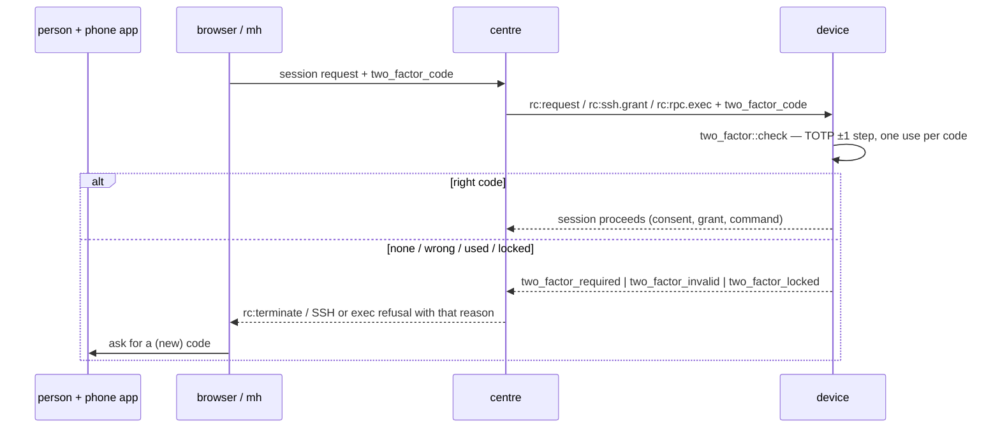
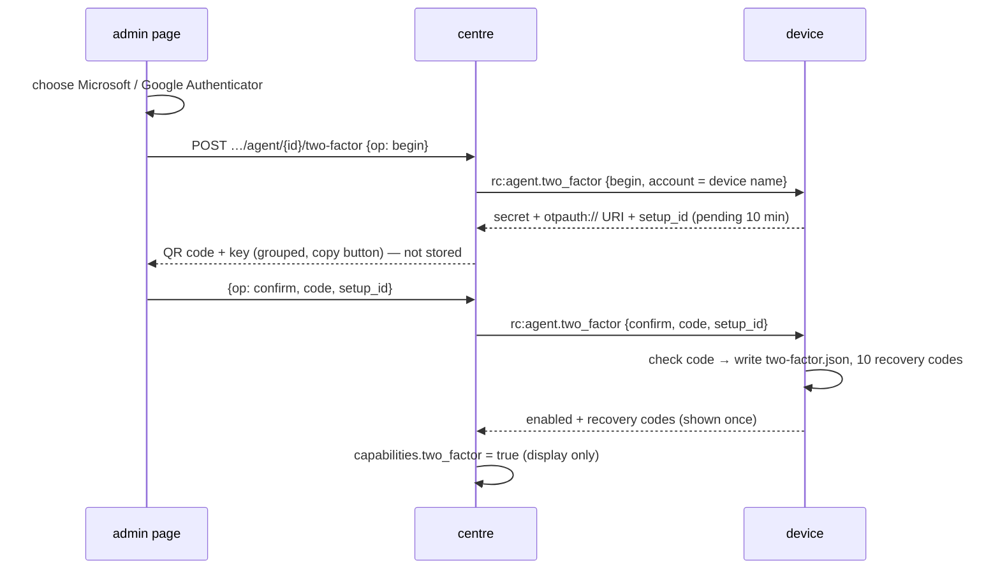

# Two-factor on a device (FR-129)

A device can have **two-factor** switched on from the admin page. From then on, every session a
person opens into it — remote desktop, `mh ssh` / `scp` / `sftp`, `mh exec` and the web console —
must carry a **6-digit code from an authenticator app** (Microsoft Authenticator or Google
Authenticator: standard TOTP, RFC 6238). Off by default on every device.

> [!IMPORTANT]
> **The device keeps the secret and checks the code itself.** The centre relays a code and never
> checks or keeps one. So a stolen admin session (a browser token is valid for seven days and
> cannot be revoked yet, `docs/security-baseline.md` §1) can neither get into a two-factor device
> nor switch two-factor off: it holds no code.

> [!WARNING]
> **What a compromised centre can still do.** A code is six digits and travels through the centre,
> so it is not bound to the action it was typed for (a key exchange keyed by the code would be;
> not in P1). A centre that is itself compromised, and **sees a person's code** on its way to the
> device, can use that one code once, within its minute, for a different action on that device —
> including switching two-factor off. Without a person's fresh code it gets nothing: it cannot
> compute one, a used code is refused, and the device refuses a remote-desktop offer for any
> session it did not admit itself. The guarantee against a stolen admin session holds in full.

## Switching it on and off

| Step | Device does | Refused when |
|---|---|---|
| `begin` | makes a 20-byte secret, pending 10 min | already on (`already_on`) |
| `confirm {code, setup_id}` | checks the code against the pending secret; writes the state; answers 10 recovery codes | no pending secret, or a `begin` from anyone else replaced it (`no_pending`: the page that started first sees it fail); wrong code |
| `disable {code}` | checks a code or a recovery code like any way in; removes the state | already off; no / wrong code; locked |

- The route is `POST /api/tenant/{tid}/agent/{aid}/two-factor`
  (`crates/modules/fleet/src/two_factor.rs`), `MANAGE_AGENTS`. It awaits the device's answer
  (15 s) like exec. A device's refusal is a 200 with `refused`; transport problems are HTTP errors
  (409 device not connected or too old, 503 no answer, 403 switched off / no permission).
- **Primary org only**: two-factor is machine-wide, so a secondary org's admin is refused
  (`not_primary`).
- A stolen admin session can switch it on only where it was off (where it could already get in),
  never replace the secret (`begin` on an enabled device is refused) or switch it off (needs a
  code the device checks).
- The device reports `two_factor` in its caps at every hello and heartbeat; the admin page reads
  that. The route also sets it at once (`AgentDao::set_two_factor_reported`).

## What the device keeps

`crates/agent-core/src/two_factor.rs`, in `two-factor.json` **beside the daemon's config**
(`/etc/meshharbor/` for a root install), owner-only (`0600`):

| Field | What |
|---|---|
| `secret` | the TOTP secret (hex) |
| `last_step` | the last accepted 30 s step: a code at or before it is refused (**one use per code**) |
| `recovery` | SHA-256 of each unused recovery code (`xxxx-xxxx`, no look-alike characters) |

> [!WARNING]
> It is **not** part of `AgentConfig`: never in `DesiredConfig`, a config report, `mh config` or a
> log line. On the wire the secret, the URI, the recovery codes and every code are
> `models::Confidential`, whose `Debug` prints `<redacted>`, so a frame logged at debug level does
> not carry one.

- Accepted: the current step and one step either side (clock skew), strictly after `last_step`.
- **Five wrong codes lock checking for 1 min**, doubling to 15 min. A locked device refuses even a
  right code (`two_factor_locked`). The count and the lock are **in the file**, so a restart (an
  update) does not reset them, and mirrored in memory, so a failed write (a full disk) does not
  either.
- **100 wrong codes in a row** and 6-digit codes are refused until a **recovery code** is used
  (or a local reset): without a cap, a patient guesser at 5 codes per 15 min would win about once
  in three years per device. A recovery code is accepted even while locked (it is high-entropy),
  and resets the count.
- **The file's presence is the switch.** A file that exists but cannot be read refuses every code
  (`two_factor_unavailable`), never falls back to "off".
- **Local break-glass:** `meshharbord two-factor status | reset`, as the user the daemon runs as.
  `reset` removes the file; the running daemon reads it at every check, so it takes effect at
  once. Whoever is root on the device is already past every gate this adds.

## Every way in

| Way in | On a two-factor device | Where |
|---|---|---|
| Remote desktop (`rc:request`) | code required, checked before consent; refusal `rc:consent{granted:false, reason}` → `rc:terminate{reason: two_factor_*}` | `agents/meshharbord/src/signaling.rs` (`ServerMsg::Request` arm), `crates/modules/fleet/src/hub.rs` (`ConsentOutcome::TwoFactor*`) |
| `mh ssh` / `scp` / `sftp` (`rc:ssh.grant`) | code required (when SSH is on); refusal `SshGrantRefusal::TwoFactor*` → `SshDenyReason::TwoFactor*`, `two_factor` on the answer | `signaling.rs` (`SshGrant` arm), `crates/modules/network/src/routes/agent_ssh.rs` |
| `mh exec` / web console (`rc:rpc.exec`) | code required, after gate 4; refusal in `RpcResult.error` starting with the reason word | `signaling.rs` (`RpcExec` arm) |
| Share links (desktop `shared_lease`, `rc:share.ssh.setup`) | refused: nobody with the phone is asked | `signaling.rs` |
| External access login (FR-52) | refused (`unavailable`, the one answer for "not here") | `agents/meshharbord/src/extauth.rs` |
| Remote configuration push | refused (`not_opted_in`, with the reason): a pushed key must not weaken the device | `signaling.rs` (`ConfigPush` arm) |
| Hive start | refused | `agents/meshharbord/src/hive/supervisor.rs` |
| Tunnel forwards | only to the device's own `forward_acl` allowlist (empty = none) | `agents/meshharbord/src/tunnel/acceptor.rs` |
| A remote-desktop offer (`rc:sdp.offer`) | only for a session this device admitted on its own check (a right code in its `rc:request`); checked ahead of the GUI-worker delegation, so a centre that skips the request gets no peer | `signaling.rs` (dispatcher prologue), `two_factor::admit` / `admitted` |
| SSH with a key from the device's own `ssh_authorized_keys` | refused: such a key opens a session with no grant, so no code | `agents/meshharbord/src/ssh.rs` |
| Pushed forwards (`rc:forward.set`) | refused; one running when two-factor went on stops within a second | `agents/meshharbord/src/managed_forward.rs` |
| Creating a login account (`rc:accounts.request` create) | refused (listing still answers) | `signaling.rs` |
| Driving a running agent session (`rc:hive.view.grant` with `may_prompt`) | watched, never driven | `signaling.rs` |
| Bulk exec | carries no code (one code is for one device), so a two-factor device in the sweep refuses | `crates/modules/fleet/src/agent_exec.rs` |

> [!NOTE]
> **Already open when two-factor goes on:** a share-link session or a remote-desktop session that
> was admitted before keeps running to its end; every new one follows the table.
>
> **A rollback below this release** cannot read a stored remote session that a two-factor refusal
> ended (`end_reason` `two_factor_*` is a new spelling for an older server).
>
> **Not covered:** raw overlay traffic. A peer on the mesh that reaches one of the device's own
> services over its overlay address opens no MeshHarbor session and carries no code. That is
> FR-129 P3 (a two-factor device takes overlay traffic only to ports it lists); until then, keep
> the device's services bound to loopback or behind its own firewall.

## Controllers

| Controller | How it gets a code |
|---|---|
| Remote-desktop viewer | asks before connecting when the device reports `two_factor`; asks again on `two_factor_required` / `_invalid` (a code is single-use: never resent); `two_factor_locked` is shown, not retried |
| Web console | a code field when the device reports `two_factor` |
| Remote-desktop reconnect | a request the hub replays to the device after its control socket reconnected is not checked again (its code is used; the device admitted that session already) |
| `mh ssh` / `scp` / `sftp` / `exec` | `MH_2FA_CODE` for a script, then one prompt per refusal on a terminal (`agents/meshharbor-cli/src/localclient.rs`, `next_two_factor_code`) |

## Kill switches

| Switch | Effect |
|---|---|
| Per device (default **off**) | nothing changes on a device until an admin switches it on there |
| Centre `app.device_two_factor = false` (`MESHHARBOR__APP__DEVICE_TWO_FACTOR`) | refuses `begin` / `confirm`; cannot switch off a device that has it (by design) |
| Device `meshharbord two-factor reset` | switches it off on that device |

## Wire

| Frame | Direction | Owner |
|---|---|---|
| `rc:agent.two_factor {request_id, op: begin{account} \| confirm{code, setup_id} \| disable{code}}` | centre → device | fleet |
| `rc:agent.two_factor_result {request_id, refused?, retry_after_secs?, enabled, secret?, otpauth_uri?, setup_id?, recovery_codes}` | device → centre | fleet |
| `two_factor_code?` on `rc:session.request`, `rc:request`, `rc:ssh.request`, `rc:ssh.grant`, `rc:rpc.request`, `rc:rpc.exec` | both | — |
| `AgentCaps.two_factor`, verb `two-factor` (`RpcCap::TwoFactor`) | device → centre | — |

Every new field is optional, so an older peer ignores it. An older server decodes a two-factor
SSH refusal as `other` (`grant_refusal_lenient`).
