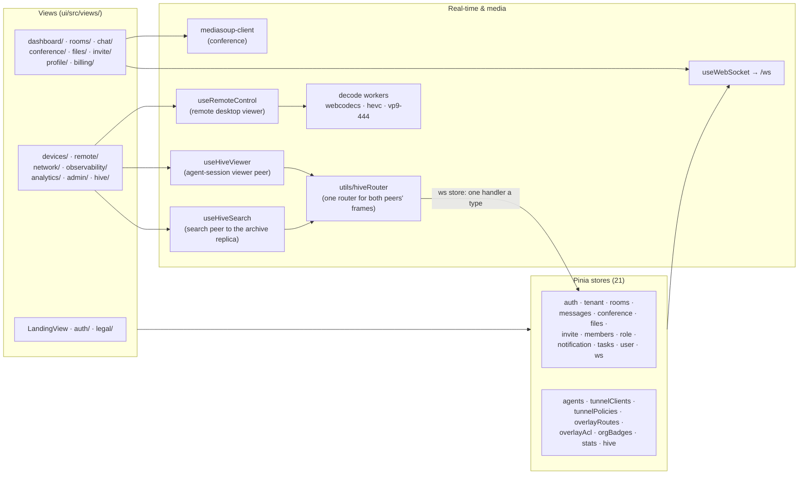
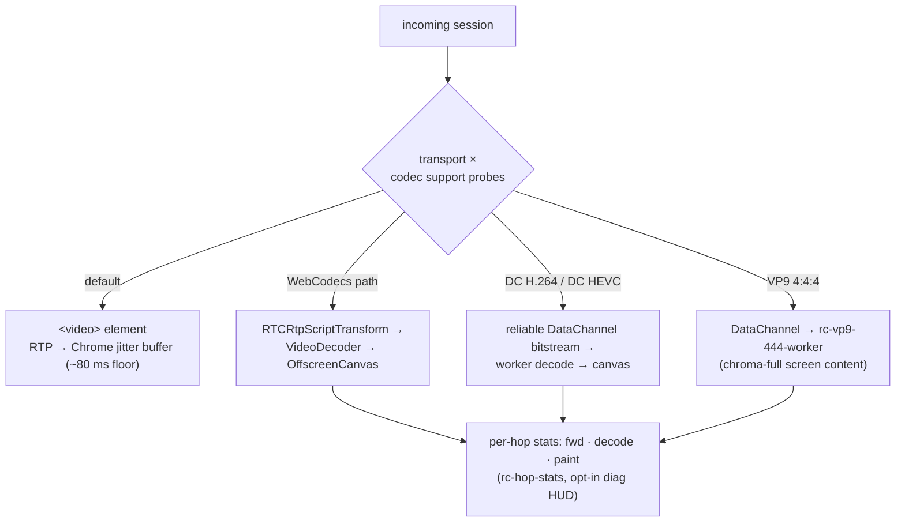
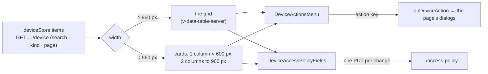
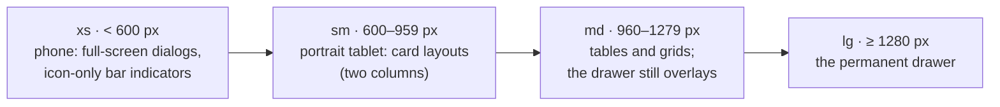
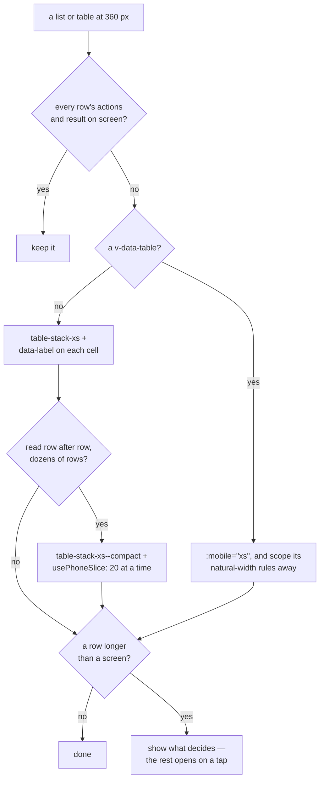
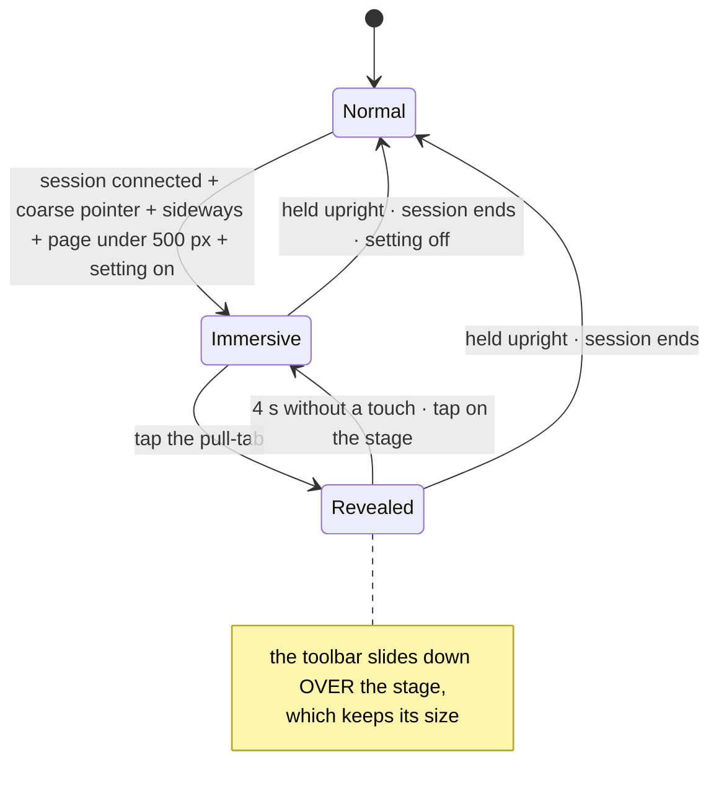
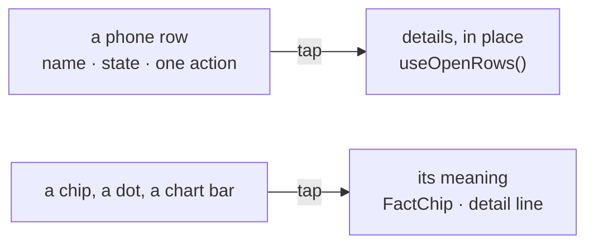

# Frontend

Vue 3 + Vuetify 3 SPA — Vite 7, TypeScript, Pinia (setup-store pattern),
vue-router, vue-i18n (English and Chinese: `locales/en.json`, `locales/zh-CN.json`, key parity
held by `__tests__/plugins/i18n.spec.ts`). *As of 0.3.0-rc.381.*
Plugin order in `main.ts`: i18n → vuetify → pinia → router.



## Views

| Area | Views | Notes |
|---|---|---|
| Marketing / auth | `LandingView`, `auth/{Login,Register,OAuthCallback}View`, `legal/{Terms,PrivacyPolicy}View` | |
| Collaboration | `dashboard/{DashboardView,TenantDashboard}`, `rooms/{RoomList,ExploreView}`, `chat/ChatView`, `conference/ConferenceView`, `files/FilesBrowser`, `invite/{InviteLanding,InviteManage}View`, `profile/{Profile,ProfileEdit}View`, `billing/BillingView` | `ChatView`/`ConferenceView` own their layout (no `v-container`) |
| Fleet | `devices/DevicesView` (enrolled machines), `remote/RemoteControl` (the viewer), `remote/ConsentView`, `network/NetworkPanel` (overlay mesh & zone backbone), `network/NetworkGlobeView` (dedicated full-page / desktop-companion `?embed=1&lang=&theme=` 3D device globe), `observability/ObservabilityView`, `analytics/AnalyticsView`, `admin/AdminPanel` | `NetworkGlobeView` hides `AppLayout` chrome when opened with `?embed=1` (`meta.allowEmbed`) |
| Agent sessions (FR-90, module `hive`) | `hive/HiveSessionsView` (your sessions, start dialog, stop; P2j-3: where sessions are copied, each of your own rows' **Delete for good** (never on a session of someone else's the list holds from its room or a hit), `components/hive/HivePurgeDialog`: the session's title typed to confirm, then the purge followed device by device, read again every 5 s until each answered; P2i-3: a **search box**, shown only where the organization's copies can be searched, `search` in `GET …/hive`, asked again at each visit; a query is asked 300 ms after the last keystroke, over `useHiveSearch`, and its hits replace the list while it stands: each with its session's title from your list, else "A session you can read", its snippet's `[` `]` drawn as `<mark>` from text, never `v-html`, and a click opening the session's room), `hive/HiveMemoryView` (P1e — **Agent memory**: the facts kept for the org's sessions by scope — organization, yours, a chosen device — each with its character budget; add, edit at the version read, archive; a refusal, `409 over_budget` or a 403 on a scope you may not write, shows in the server's words with the draft kept), `hive/HiveCopiesView` (P2h-2 — **Agent copies**: the org's replica policy read back, and its archive replicas: every device that offers itself as one (its `hive-archive` word, matched by equality) or is designated, with a **Designated** switch for administrators that writes the whole policy from the revision read (a stale write is read again and said so); P2j-4: an administrator edits the rules in place on the policy card (at least and at most, archive replicas, then the owner's own devices, the restricted tags with the org's device tags offered, the days kept), the whole policy written from the revision the form was opened on with everything it does not edit as read, the switches locked meanwhile; a stale write is read again and shown as stored now, any other refusal in the server's words with the draft kept; **Add an archive replica** mints an enrollment token and shows `docker run` and compose for the archive replica image, the token gone when the dialog closes; shown, and in the nav, only where the server copies sessions at all, `replicaset` in `GET …/hive`) | a session's own page is its chat room: `ChatView` opens `components/hive/HiveTranscript` as a side panel when the room's `binding.module` is `hive`. Its header's **People** button is `components/hive/HiveParticipants` (P1c): who takes part — the owner adds people as readers or drivers, changes their part, takes them out; everyone else sees the list. Its **Copies** button, only for a record that carries a replicaset, is `components/hive/HiveCopies` (P2j-1): each device that holds a copy, its role and state, and how far behind the primary's its copy is, by the server's own count (`holds`, read through `utils/hiveCopies.ts`); a move in flight; and the owner's **Move**, to the copy that holds the most, preselected, the answer in the server's words. Beside it (P2j-2), **Move elsewhere**, a teleport to an online device that holds no copy, and **Fork**, a new session from its conversation in a folder of its own, its room offered once made; both read the organization's devices once, matching each device's words by equality. Beside them (P2j-5), `components/hive/HiveManage`: an ended terminal session's owner makes it a managed one, offered where sessions are copied on an adopted session its terminal ended (`mayBecomeManaged`), its folder sent only when it is not its terminal's, the answer in the server's words, the word its device refused the last asking with said, and the asking in flight shown to anyone in the room (`isBecomingManaged`). The transcript's "ask the agent" composer is a driver's; the room's own composer is ordinary chat, which never reaches the agent. P1f: a tool call is drawn by its tool — `components/hive/HiveToolCall` and `HiveToolInput` over `utils/toolView.ts`: a command line, an edit as a diff (`utils/lineDiff.ts`), a new file's first lines, a file range, a search, a to-do list; its result (`HiveToolResult`) folded under it. A call that waited for an approval is drawn by its approval card, with the same input view, and its result after the answer. P1f-2: following the newest, the transcript keeps at most 1,000 events (`keep`; the oldest a "load earlier" away, never trimmed while someone reads further up). Output is coloured from SGR by `HiveAnsi` (`utils/ansi.ts`), as text: no `v-html` but assistant markdown. P1j: an adopted session (`origin: adopted`, a terminal's, `isAdopted`) is marked **Adopted** in the list, its Stop reads **Stop mirroring**, its transcript says it runs in a terminal and is read-only (the server's grant gives no composer), and its People dialog offers readers only; `ChatView` reads the record (`fetchSession`) to tell. P3-4e-3: a message the vault binds to an approval (`binding.module` `vault`, its `ref` the approval's id) carries `components/vault/VaultApprovalCard` under its text, through `MessageBubble`: where the approval stands, and **Approve** / **Deny** for a driver who may answer it now, **Approve** only where the policy would take their yes (`may_approve` in `GET …/vault/approval/{id}`, else off with why); a refusal in the server's words, and the approval read again whenever the vault edits its card (a new `updated_at` on the message) |
| Fallback | `NotFoundView` | |

## Stores (21)

`auth` · `tenant` · `user` · `rooms` · `messages` · `conference` · `files` ·
`invite` · `members` · `role` · `notification` · `tasks` · `ws` — the
collaboration core — plus the fleet set: `agents`, `tunnelClients`,
`tunnelPolicies`, `overlayRoutes`, `overlayAcl`, `orgBadges` (multi-org
indicators), `stats` (observability series) — and `hive` (FR-90: the
server's RECORD of your agent sessions, never their content; and the
facts kept for them, `fetchBrain`/`keepFact`/`editFact`/`archiveFact`; P2h-2: whether sessions are copied there, `copied`, and the replica policy, `fetchPolicy`/`putPolicy`, with its bounds since P2j-4, `HIVE_MAX_MEMBERS`/`HIVE_MAX_RETENTION_DAYS`; P2i-3: whether they can be searched there now, `searchable`, from the same answer, which `checkSearchable` asks again at every call; P2j-1: a session's `replicaset` and `promotion` typed, and `promote`, a move to a copy; P2j-2: `teleport` and `fork`; P2j-3: `purge`, which takes a purged session out of the list, and `fetchPurge`; P2j-5: `manage`, which keeps the answer's record, and the record's `from_terminal`).

⚠️ `hive` is the one module the server switches OFF by default, so the
capability gate (`stores/capabilities.ts`) fails **closed** for it while
`/api/capabilities` is unknown (`modules/registry.ts` `DEFAULT_OFF`), where every other
module fails open.

## Composables

| Composable | Purpose |
|---|---|
| `useAuth` | Session + token lifecycle |
| `useWebSocket` | The `/ws` connection + event dispatch into stores |
| `useRemoteControl` | The entire remote-desktop viewer engine (below) |
| `useRemoteRecording` | The viewer's half of the session's `record` channel: start/stop, the device's list, a checked, resumable download ([recording.md](recording.md) §10) |
| `useHiveViewer` | FR-90 — the browser's half of the agent-session viewer peer: `hive:view.*` signalling on the user socket, a data-only `RTCPeerConnection` dialled only after the device confirmed the grant, the `hive` DataChannel in `utils/hiveFraming.ts` frames (SCTP drops a message over 64 KiB), history + live follow + "ask the agent". A grant ended `role_changed` (the owner changed our part, P1c) is asked for again at once, and so is every grant at a redial, taken from the socket's drop: the store clears its connection id at a close, so a new id never follows an old one (P2i-3); `drivingRefused` carries the device's words when it keeps a driver the server named read only (P1c-2). ⚠️ The peer is `close()`d on every way out — a dropped peer frees nothing. Its frames come through `utils/hiveRouter.ts` (Everything else, below) |
| `useHiveSearch` | FR-90 P2i-3 — a search's peer to the archive replica that holds the organization's copies: `hive:search.open` at the first search, then a viewer's handshake by the grant; over the `hive` channel `hello`, then `search {id, q, limit: 20}`, the query and its hits never through the server (P2i-1, P2i-2). `run(tenantId, q)` lands only the latest query's answer, waits out one `too_soon`, and asks once more on a fresh grant when the grant ends mid-search; a refusal (`status`, `reason`, `detail`) is not asked again for 10 s. `snippetParts` splits a hit's snippet at the device's `[` `]` marks, as text. ⚠️ The peer is `close()`d on every way out, after two minutes with no search included: a device serves 8 searches || `useConferenceLayout` / `useActiveSpeaker` / `useAudioPlayback` / `usePictureInPicture` | Conference UX |
| `useMarkdown` | markdown-it + DOMPurify rendering |
| `usePush` | Web-push subscribe/unsubscribe |
| `usePageViews` | SPA route-change beacon (`/api/stats/pageview`) |
| `usePolling` | Shared polling helper |
| `useSnackbar` / `useValidation` | UX utilities |

## The remote-desktop viewer (`useRemoteControl.ts`)

The largest module in the frontend — the browser side of the pipeline documented in
[encoders.md](encoders.md).

**Render paths** (user-switchable, persisted, feature-probed):



- **Decode workers** (`ui/src/workers/`): `rc-webcodecs-worker`, `rc-hevc-worker`,
  `rc-vp9-444-worker`, with `rc-hop-stats` shared hop-timing instrumentation.
- **Support probes** per codec (H.264/HEVC/AV1/VP9): software + hardware decode
  detection; HEVC-over-DC is offered only when *agent hardware encode × viewer
  hardware decode* both hold.
- **Transport control**: auto-pick, priority dial (balanced / sharper / smoother),
  keyframe requests, decoder-stats feedback to the agent (`rc:decodestat` — drives
  its frame-skip rate control), agent-local loopback-TURN probe for fast relayed
  paths on the same LAN.
- **Input**: HID-mapped keyboard (keyboard-lock, Ctrl-Alt-Del / SAS chord),
  letterboxed + direct coordinate normalization, multi-monitor layout + display
  match, resolution/scale control.
- **Clipboard bridge**: text / HTML / image / native formats, chunked over a DC,
  hash + echo-gate dedupe, auto-sync on focus; optional local-agent loopback
  bridge for full-fidelity RTF.
- **File transfer**: chunked uploads/downloads, folder download (streamed zip),
  resumable, cancellable.
- **Recording** (FR-85): Record, the REC chip and the device's recordings,
  over a `record` channel opened only when the grant kept `RECORD`; a stripped
  grant shows a disabled control that says why
  ([recording.md](recording.md) §10).
- **Remote apps**: list / focus / launch on the controlled host — and, on a
  host that cannot, the reason ([`remote-apps.md`](remote-apps.md)).
- **Diagnostics**: stats polling, jank detector, long-task observer, inbound-RTP
  diagnostics, agent-log fetch — surfaced in an opt-in HUD.
- **Resilience**: reconnect with backoff, decode-pressure shedding.

## Observability components

`ui/src/components/stats/`: `MeshGraph` (FR-136 interactive 3D WebGL2 mesh globe backed by the shared
MapLibre GL JS v6 + self-hosted PMTiles globe module, with the preserved d3 radial ring SVG as its
automatic WebGL2 fallback and 2D toggle), `TimeSeriesChart`, `UptimeStrip`, `UsagePanel`,
`UsageTable`, `UsageTimeline`, `RangePicker` — fed by the `stats` store from
`/api/tenant/{tid}/stats/*` and `/api/admin/stats/*`.

### Shared 3D globe (`ui/src/components/globe/` & `ui/src/components/globe-v2/`, FR-136 & FR-137)

One lazily-loaded **MapLibre GL JS `6.19.0` + self-hosted PMTiles `4.5.0`** globe engine (no
Three.js, no `world-atlas`, zero third-party CDN requests) powers the organization mesh dashboard
(`MeshGraph.vue`, FR-136), the live read-only zone backbone view (`ServerTopologySection.vue`,
FR-137, consuming `GET /api/tenant/{tid}/network-zones/backbone`), and the dedicated full-page /
desktop-companion embed route (`views/network/NetworkGlobeView.vue`, `/tenant/:tenantId/network/globe`,
`plugins/router.ts:309-314`):

- **Wrapper & zero main-entry growth (`components/globe/`)**: `MeshGlobe.vue` probes
  `isWebGL2Supported()` (`webgl.ts:9`), loads `components/globe-v2/MeshGlobeMap.vue` via
  `defineAsyncComponent` (`MeshGlobe.vue:197`) so MapLibre, PMTiles, and the gazetteer never enter
  the main entry chunk, syncs Vuetify theme & vue-i18n locale live, and renders `#fallback`
  automatically whenever WebGL2 is unavailable or `forceFallback` is set (2D radial ring SVG in
  `MeshGraph.vue`, structured Gateways/Links tables in `ServerTopologySection.vue`). Public data
  contracts (`GlobeNode`, `GlobeArc`, `GlobeCenter`) live in `components/globe/types.ts`.
- **Self-hosted boundaries & worker (`style.ts`, `scripts/globe/`)**: `buildGlobeStyle`
  (`style.ts:154`) targets same-origin `/geo/mh-boundaries-v1.pmtiles` (built locally by
  `scripts/globe/build-boundaries.sh`, untracked in git, SHA-256 pinned in
  `scripts/globe/SHA256SUMS`), carrying global 3-level boundaries (Natural Earth de facto admin-0
  with dashed disputed/LoC lines + global geoBoundaries CGAZ ADM1/ADM2 + NE HK/MO patch) plus
  full-resolution China 4-level boundaries (province / prefecture `admin2_pref` / district `admin2`
  and `label_admin2`). Style omits `glyphs` so all Latin/CJK labels use local system fonts; Vite
  emits the MapLibre module worker as `.js` (`vite.config.ts`, 0 `.mjs` assets). `applyThemeToMap`
  (`style.ts:803`) and `applyLangToMap` (`style.ts:916`) switch themes and languages in place with
  zero `setStyle()` reloads.
- **Honest location & one-city-one-point grouping (`locationResolver.ts`, `gazetteer.ts`,
  `grouping.ts`, `spiderfy.ts`)**: `resolveV2Location` (`locationResolver.ts:368`) consumes P6 MMDB
  `lat`/`lon`/`accuracy_radius_km`/`geo_level` (drawing a 67% confidence 64-gon accuracy circle at
  `z ≥ 3`), then falls back to the lazy offline `gazetteer-v1.json` (`gazetteer.ts`, 121.37 kB gz)
  for city → region (`≈`) → country (`≈`) → off-globe `Unknown location N` chip, never using
  `relay_home` for placement. Co-located devices share exact coordinates (`groupNodesByLocation`,
  `grouping.ts:100`) and expand in screen space via circle (`n = 2–8`) or Archimedean spiral
  (`n = 9–20`) spiderfy (`SpiderfyOverlay.vue`) or a paginated list (`n > 20`).
- **Aggregated links & Zone Backbone (`links.ts`, `backbone.ts`)**: `aggregateLinks`
  (`links.ts:129`) suppresses intra-city lines and caps resting overview lines at 60 majority-carrier
  links (with overflow count and mixed-carrier `◆` mark); hovering/selecting reveals the full
  carrier-patterned ego network (`buildEgoNetwork`, `links.ts:310`) with asymmetric midpoint split
  and problem/RTT filters. In `backbone` mode (`resolveBackboneNodes`, `backbone.ts:123`), the same
  Map instance switches layers in place to show WCAG-checked zone colors, centre diamond, gateway
  halos, FR-134 management paths, directional 120 px arrows, and an optional 3 px Devices overlay
  (OFF by default).
- **Full-page UX, per-viewer max-zoom, adaptive DPR & accessibility**: `useFullPage`
  (`useFullPage.ts:26`) mounts a `<Teleport to="body">` `100dvh` overlay (plus optional Fullscreen
  API) with `?g_full=1` history Back/Esc exit, desktop side panel, and mobile 3-snap (`30%`/`60%`/
  `92%` dvh) bottom sheet. `maxZoomSetting.ts:46` persists per-viewer max zoom (`z6–z14`, default
  `z11`, live ground-span hint) in `localStorage`. `createAdaptiveDprController` (`adaptiveDpr.ts:52`)
  degrades pixel ratio monotonically `2 → 1.5 → 1` if interactive p95 frame time exceeds 24 ms over
  120 frames, while keeping 0 idle WebGL frames, `prefers-reduced-motion: reduce` compliance,
  `webglcontextlost`/`restored` recovery, and keyboard navigation (`Arrows`/`+/-`/`Esc` + arrow-key
  list focus preview).

## Admin components (`ui/src/components/admin/`)

`AgentsSection` (device management: caps chips, exec policy, join-org, update) ·
`AgentCrashesDialog` · `AgentLogsDialog` · `DeviceConsoleDialog` (fleet-RPC exec) ·
`ExecAuditSection` · `ExecPolicyDialog` · `AclSection` + `OverlayAclSection`
(overlay L3 ACL + mode) · `OverlaySubnetRoutesSection` (approved routes / exit
nodes) · `MagicDnsSection` · `TunnelPoliciesSection` · `MembersSection` ·
`RolesSection` · `SettingsSection`.

### The devices list's "needs a person" chips

`AgentsSection` shows these in both its table and its cards. Each appears only when someone has to act, and
stays silent when the data is missing:

| chip | when | rule |
|---|---|---|
| `credential expires in N d` · `credential expired` | the agent token is within 60 days of expiry, so it is not renewing (FR-103) | `ui/src/utils/credentialExpiry.ts` |
| `not updating` | the device is online, and the **oldest** release it has not installed has been out for 24 h (FR-106). The tooltip names that release and the remedy for the OS. On Linux, a per-user install made before 0.4.138 needs one install by a person. A failed release fetch, or a version that does not parse, shows nothing | `ui/src/utils/updateStall.ts`; the list comes from `useAgentStore().fetchReleases()` (`/api/agent/latest-release`, cached 30 min) |

⚠️ The age is the oldest missed release's, not the newest's. Releases can come 12 h apart: measured from the
newest, a device stalled for weeks would lose its chip at every release.

### The Devices page at every width (FR-116 P1)

One feed, one menu, one set of policy controls; only the presentation changes with the width.



| piece | role |
|---|---|
| `components/admin/DeviceActionsMenu.vue` | the only action menu for a device row. It emits an action key and opens nothing itself, so the grid and the cards cannot offer different things (the cards' own copy had lost "Edit name & tags", and its overlay links the tenant id) |
| `components/admin/DeviceAccessPolicyFields.vue` | the six access-policy controls: `variant="plain"` in the grid's Consent cell, `outlined` and labelled in a card's **Access** panel, where the hints that live in `title=` (never shown on touch) are spelled out on demand |
| `components/admin/devicePolicy.ts` | the choices, the hints, and `policySummary()` — the collapsed **Access** panel's one line: the consent mode always, then only what differs from the defaults |
| a card | the device's identity (`deviceLabel()`, then the machine name unless hidden, OS, version, last seen), its status, every "needs a person" chip, its tags; **Access** and **Details** (overlay addresses, MagicDNS, keys, ids, codecs) open on demand; Connect and the menu |

Tunnel clients are rows of the same feed (the kind filter), never a separate table. The grid did not change:
master and P1 screenshot to the same pixels at 1300 and 2400 px.

⚠️ **A device is named by `deviceLabel()`** (`composables/useHideDeviceName.ts`): its display name when one is
set, else the machine name — in every list, card, dialog title and notice a person reads. The technical `name`
stays wherever a machine reads it back: a MagicDNS label, an `overlay_exit_node = "…"` line, a CLI selector.

## Everything else

- **Chat**: TipTap v3 editor (markdown, mentions, emoji via emoji-mart, Giphy
  picker), threads, reactions, pins.
- **Conference**: mediasoup-client composables + `VideoTile`, layout modes,
  active-speaker tracking, PiP.
- **Theming**: Vuetify light/dark with localStorage persistence.
- **API client**: `ui/src/api/client.ts` — token injection + refresh handling.
- **Dev proxy**: Vite proxies `/api` + `/ws` to `http://localhost:5001`.
- **Agent-session peers' frames** (FR-90): `utils/hiveRouter.ts` routes the `hive:*` frames of
  every peer in the tab, a viewer's and a search's: an open's answer (`hive:view.ready`/`refused`,
  `hive:search.ready`/`refused`) by the `ref` it was asked with, the rest of a handshake by its
  grant. ⚠️ The ws store holds ONE handler per frame type (`onMediaMessage` is a `Map.set`), so a
  peer that registered a type itself would take every other peer's frames of that type away.

## Conventions

**Plugin order** (`main.ts`): i18n → vuetify → pinia → router.

**A view that owns per-subject state remounts when its subject changes.** Vue Router
reuses the mounted component when only a param changes, so a view that resolves its
subject once in `onMounted` kept showing the previous subject under the new URL (#1631:
the remote viewer stayed on device A after the nav picked B, and Connect dialled A).
The fix is route meta, not per-view watchers: `meta.remountOn: '<param>'`
(`plugins/router.ts`), read by `components/layout/KeyedRouterView.vue`, keys the view by
that one param. Every other route stays unkeyed on purpose — several views rewrite
`route.query` in place and must not remount — so never key by `fullPath`.

**Stores** use the Pinia setup pattern: `defineStore('name', () => { … })`.

**Every word a person reads goes through vue-i18n, in both languages.** The remote viewer
holds no prose of its own (FR-131 P3): its templates, its components under
`components/remote/`, and the helpers whose sentences it shows (`keepBusy.ts`, `frameRate.ts`,
`useSessionFeatures.ts`, `displayMatch.ts`, `usePrivacyMode.ts`, `useRemoteRecording.ts`,
`rcConnectTiming.ts`, `touchPresetEdit.ts`, `utils/peerAuth.ts`, `utils/rdpFallback.ts`, and the
pure helpers at the top of `useRemoteControl.ts`) read `remote.viewer.*` / `keepBusy.*`. A helper
outside a component calls `i18n.global.t` (as `utils/twoFactor.ts` does), so a test in English still
reads English. Codec names, fps and key legends stay as written.
⚠️ The few sentences `useRemoteControl`'s session machinery sets itself are translated where they are
shown, by `rcSays` (`composables/rcSays.ts:74`); `rcSays.spec.ts` fails if one of its literals drifts
from the composable's. The server's and the device's own words are shown as they came.
Locked by `__tests__/views/remoteViewerI18n.spec.ts`: no English word in any viewer template, and
every viewer key has Chinese in its Chinese reading.

**A disabled control says why, as text** (FR-120 P1b, ported in FR-131 P3). A disabled `v-btn`
takes no pointer events, so a reason kept only in its `title` reaches a mouse that hovers, never a
finger. In the viewer each disabled Settings toggle is followed by a caption with its reason
(`RemoteControl.vue:1814`, the first), a refused toolbar control sits in a span that takes the tap
and shows the reason in the snackbar (`explainRefusal`, `RemoteControl.vue:2696`), and an icon
button is named by `aria-label`, not only `title`.

**Vuetify** runs light + dark themes with auto-import tree-shaking via
`vite-plugin-vuetify`.

### Responsive page padding

| Surface | Class |
|---|---|
| Top-level view | `<v-container fluid class="pa-2 pa-md-4 pa-xl-6">` — 8 px mobile / 16 px tablet+ / 24 px ≥1920 px |
| Empty-state block | `pa-4 pa-md-6 pa-lg-8` |
| Heading | `text-h5 text-md-h4` — shrinks one step on phone |
| Section CTA | `size="large"` — **not** `x-large`, which overflows narrow viewports |
| Marketing / legal (`LandingView`, `Terms`, `Privacy`) | `py-6 py-md-12` / `py-8 py-md-16` in place of fixed `py-12` / `py-16` |

Hide secondary toolbar items below `sm` with `d-none d-sm-inline-flex`, and
surface a phone fallback alongside.

### Phones and tablets (FR-116)

Three widths matter, and each has its own job. Vuetify's own `mobile` means **narrower than 1280 px**
here (`plugins/vuetify.ts` sets no `mobileBreakpoint`), so it is the drawer's switch and nothing else's:



| rule | where | why |
|---|---|---|
| **The page never scrolls sideways.** `v-main` clips horizontal overflow; a wide table scrolls inside its own box | `AppLayout.vue` `.app-main-no-scroll` | the house `pa-2` (8 px) is narrower than a `v-row`'s 12 px gutters, so every page with a row swayed 4 px under a finger |
| **A new page opens at its top.** A path change scrolls `v-main` to 0; a query or hash change keeps the place | `AppLayout.vue`, the `route.path` watcher | `v-main` is the scroller, not the window, so `window.scrollTo` and a router `scrollBehavior` do nothing |
| **The bar's phone budget** (&lt; 600 px): ☰ · title · your call · other calls · unread · search · bell · avatar. The tutorial `?` and the theme toggle move into the avatar menu, and the call and unread indicators become icons with a badge | `AppLayout.vue` `<v-app-bar>` | past ~344 px the avatar menu — and Logout with it — was pushed off-screen |
| **What the drawer signals reaches the bar** when the drawer is closed: a dot on ☰ for another org's activity, and your call's controls (Return · Mute · Camera · Hang up) as a menu off the call page | `AppLayout.vue`; `composables/useCallControls.ts`, shared with `MiniConference` | the drawer is temporary below 1280 px, so a call kept a live mic with nothing on screen saying so |
| **A dialog of any substance is full screen below 600 px** and carries its own close control | `composables/useResponsiveDialog.ts` | a centred dialog leaves 264 px of content at 360 px; a full-screen one has no scrim to tap |
| **A plain `v-table` with actions or results on its right is a card per row below 600 px**: `class="table-stack-xs"` on the table and `data-label="…"` on each cell. One template for both widths; above 600 px nothing changes. A `v-data-table` uses Vuetify's own mobile rows instead (next row) | `styles/responsive.css` (imported in `main.ts`); the ACL lists, Overlay routes, the audit lists, Roles, enrollment keys | the rightmost columns — Save, Edit/Delete, Result, the command — sat off-screen behind a sideways scroll nobody finds |
| **A list read row after row is compact on a phone, a screenful at a time**: `table-stack-xs--compact` puts a short cell's label beside its value (`stack-block` keeps a long cell's label above it), `usePhoneSlice()` shows 20 rows and then **Show N more**, and a long command or detail shows three lines until **Show all** | `ExecAuditSection.vue`, `SshAuditSection.vue`, `SshActivitySection.vue` (FR-116 P3d) | 100 audit rows as full cards were 43,398 px at 360 px on production; one script alone took 1,936 px. Now 20 cards of ~205–270 px |
| **A `v-data-table(-server)` takes `:mobile="xs"`**, and any natural-width rule on it (`width: max-content`, `white-space: nowrap`) is scoped to `:not(.<table>--stacked)`, with `overflow-wrap: anywhere` on a stacked value | `MembersSection.vue`, `InviteManageView.vue`, `FilesBrowser.vue` | with the desktop rules left on, every stacked value sat past the right edge — the rows showed their titles and nothing else — and one unbroken email widened a row past the screen |
| **A page of independent settings is one expansion panel per setting below 600 px, titled with its current state** ("On", "Allowed", "Files: ask · Audio: off"); an unknown state shows nothing, never a guess | `components/admin/SettingsGate.vue`, used by `SettingsSection.vue` | Settings was ~4 screens of warnings and captions before its last switch; now one screen of decisions, each opening on demand. From 600 px up the gate renders the card it always was |
| **Nothing is hover-only on a touch screen** (`(hover: none)`): what a tooltip or a hover reveals is reachable by a tap, or shown as a persistent hint — and a control hidden until hover takes no taps while hidden (`pointer-events: none`) | `RolesSection.vue` (grants on tap; descriptions as hints) · `MessageBubble.vue` (a ⋮ menu) · `VideoTile.vue` (a tap shows the tile's actions) · the viewer's files drawer (a › into a folder, "Upload here") | a permission's description was a tooltip on its label, so the tap meant to read it toggled the permission; a message's invisible hover buttons pinned it for the whole room; a tap on a face in a call hit an invisible picture-in-picture button |
| **On a phone, show what decides and open the rest on a tap**: a row shows its name, its state, its total; access, details, grants and breakdowns open on demand | the Devices cards' Access / Details panels (`AgentsSection.vue`) · `SettingsGate.vue` · `UsageTable.vue` (User · Total; a row opens the breakdown) · a role's grants | the Devices page was ~11,900 px of open selects and checkboxes at 390 px; Settings was ~3,600 px before its last switch |
| **A device is named by its display name everywhere a person reads one**: `deviceLabel()` (`composables/useHideDeviceName.ts`) and `useNodeLabel()` on the client, and the server sends the friendly name beside the machine's (`display_name`, `agent_display_name`; additive, `null` when none) | the Devices page and its dialogs, the audit and overlay pages, the Tunnel ACL, `crates/api/src/routes/stats.rs` (uptime), `crates/api/src/routes/usage.rs` (D4), the agent-session rows and dialogs (`HiveSessionsView.vue`, `HiveManage.vue`, `HiveCopies.vue`: the session's kept `device_name` only for a device the org no longer lists) | the device list said "Reception PC" while the dialogs, the audit lists, the uptime strip, the usage timeline and each agent session said `DESKTOP-…` |
| **A side panel that would squeeze the main view overlays it below 960 px**, one at a time, with a close button | `ConferenceView.vue` (chat, files) | a 320 px chat column left the call ~70 px wide and cut off the pre-join pickers; the chat now starts closed there, with a dot on its button when someone writes |
| **A drawer that can cover a phone takes the full width and carries its own close button** | `GrowthView.vue` (org timeline), the viewer's files drawer | a 440 px temporary drawer on a 390 px screen leaves no scrim to tap — no way out |
| **A tab window over wide content takes `:touch="false"`; a tab row that can overflow takes `show-arrows`** | `GrowthView.vue`, `AnalyticsView.vue`, the viewer's Settings tabs | a sideways swipe across a wide table switched the **tab**; and below 1280 px Vuetify hides the arrows unless asked, so tabs past the edge gave no sign of themselves |
| **A number or caption that must be read never sits at the end of a card title** on a phone — it moves into the card's text | `GrowthView.vue` (the weekly-active-orgs north star) | a title never wraps: at 360 px the caption pushed the number off the card |
| **On a phone held sideways, a running session takes the whole screen** (FR-131 P1, a port of roomler-ai FR-125): with a coarse pointer, a page wider than tall and under 500 px tall (`isPhoneSideways`, `composables/useImmersiveViewer.ts:31`), the app bar hides (`AppLayout.vue:446`), the viewer's toolbar becomes an overlay out of view, and the stage card loses its margin, border and corners. A pull-tab at the stage's top edge slides the toolbar back down **over** the stage; it hides again after 4 s without a touch (an open menu or dialog keeps it up), or on a tap on the stage. A per-browser setting in Settings → Display turns the mode off; where the browser can fullscreen the stage, a one-time chip offers it | `useImmersiveViewer.ts`, `RemoteControl.vue` (`immersive`, `:2729`; the pull-tab, `:934`; `.rc-immersive`, `:5785`); `fitControls` (`touchControls.ts:291`) fits a touch preset to the short stage | upstream measured the bars taking 149 of a 340–412 px page, leaving the remote desktop 146–254 px, and every built-in touch preset ran off the stage's top |
| **The remote viewer's toolbar keeps the device's name, its state and Disconnect first** below 960 px (flex `order`; the rest scrolls), and the stage's alerts overlay the stage | `RemoteControl.vue` (`rc-tb-*`, `.rc-stage-alerts`) | the title went to 0 px and Disconnect started off-screen; each alert's coming and going resized the frame, re-sent `rc:resolution` and rebuilt the agent's encoder |
| **Text that cannot break still wraps** (`overflow-wrap: anywhere`) | message content (`MessageBubble.vue`), stacked table values | one long URL or email widened a whole list past the screen |
| **Sign-in fields say what they are**: `autocapitalize="none"`, `autocorrect="off"`, `spellcheck="false"` on the username, `autocomplete` on every credential | `LoginView.vue`, `RegisterView.vue` | iOS capitalised the username, and the server matches it exactly |
| **The public landing page's sections are a ☰ menu below 960 px**, and its wordmark never shrinks (`flex-0-0` on the title) | `LandingView.vue` | the links were hidden below 600 px with no other way to them, and the wordmark was clipped to "Roo" |
| **A toolbar's search takes a row of its own below 600 px** (`order-*` and `flex: 1 1 100%`); the buttons take the next | Members, Invites, Files | beside the title and the buttons it was left ~100 px ("Searc") |
| **A title row with buttons wraps** (`flex-wrap ga-2`), and its caption is a `v-card-subtitle class="text-wrap"`, never text inside the title | e.g. `OverlayAclSection.vue` | `v-card-title` and `v-card-subtitle` never wrap: Overlay ACL's caption pushed **New rule** off the card below ~800 px |
| **A row of form fields wraps**: `flex-wrap` on the row and a `flex: 1 1 <basis>` on each field | the ACL editors | without wrap a Vuetify field shrinks instead — the Tunnel ACL host field rendered 0 px wide |
| **An overlay node, or an audit row's device, is named by `useNodeLabel()`** — joined on the wire's `agent_id` / `tunnel_client_id`, never on the node's name | `composables/useNodeLabel.ts` | `OverlayNode.name` is a lossy DNS label, and audit rows carry the stored machine name: the device a person had just tapped on Devices came back under another name |

A list or a table on a phone goes through one decision:



The remote viewer on a phone held sideways (FR-131 P1) moves between three states. Revealing the
toolbar never resizes the stage, because a resized stage re-sends `rc:resolution` (in the mode the
toolbar is `position: absolute`, and revealing it changes only `transform` and `visibility`; locked by
`useImmersiveViewer.spec.ts`):



⚠️ Entering or leaving the mode does resize the stage once (the app bar and the toolbar leave the
flow); only showing and hiding the toolbar inside it does not. Phone portrait, tablets (taller than
500 px) and anything with a fine pointer never enter it.

⚠️ **A phone-only line never sits between a `v-if` and its `v-else`.** Vue pairs
`v-else` with the nearest `v-if` sibling. P3a put the refusal's reason line (a
`d-sm-none` element with its own `v-if`) between the SSH audit's refusal chip and
its "granted" chip, so a refusal without a message read **granted** as well, on
every width. Wrap the branch and its phone-only extras in one `<template v-if>`
(fixed in P3d; `auditPhoneLists.spec.ts` fails on the old template).

⚠️ **Prove "the desktop is unchanged" with pixels, against the branch's own
base served beside it** — and grep each dev server's served module for a
marker only its branch has before any screenshot: a dev server that lost its
port to another one dies silently, and a before/after pair from ONE server
diffs at 0 px while proving nothing (FR-116 P3c, recorded in its PR).

⚠️ `ChatView` and `ConferenceView` own their own custom-flex layout and
**intentionally do not use `<v-container>`** — do not "fix" them to match.

### Phone parity, the rest (FR-132)

Ports of upstream FR-120 P1a, P3, P4a, P4b and P5 onto the flat theme. Same split of work as above: a phone
row shows what decides, and everything else opens on a tap.



| rule | where | why |
|---|---|---|
| **What a chip, dot or chart bar means is a tap away.** `FactChip` opens `explain` in a menu on a tap and keeps it as the hover `title`; `plain` renders the flat theme's presence word (dot + label) instead of a chip. A chip whose tap already acts (zone, relay, Device configuration) stays a `v-chip` | `components/common/FactChip.vue:14`, `AgentsSection.vue` (`fr120P1Facts.spec.ts` fails any titled `v-chip` without a tap of its own) | a `title` reaches a mouse only |
| **A chart reads a datum on a tap, a mouse point or the arrow keys, into a line below it** | `UptimeStrip.vue:198`, `UsageTimeline.vue:259`, `MeshGraph.vue` (a 14 px hit line per carrier; a tap pins it) | 498 uptime segments explained by `title` alone |
| **A phone list row is one line and opens in place**: `useOpenRows()` keeps which rows are open; a `table-stack-xs` row puts a `stack-toggle` summary cell first and marks the rest `stack-detail`; a `v-data-table` row is one `stack-row` cell | `composables/useOpenRows.ts:15`, `responsive.css:121`; Devices `AgentsSection.vue:622`; keys `EnrollKeysSection.vue:260`; audits `ExecAuditSection.vue:61`, `SshAuditSection.vue:70`; Members `:98`, Invites `:87`, Files `:79`; Billing `:155` | stacked rows made a page 2.2-3.7x its desktop height |
| **A dialog that names a device or a member is full screen on a phone, wraps its question and has a named close** | Evict, update-all, delete, join-org, routes and roles dialogs; `GiphyPicker.vue:5` | the name clipped and a centred dialog left no way out |
| **The tutorial scrolls `v-main`, not the window**; a page outside `AppLayout` carries `page-no-sideways` (`overflow-x: clip`) | `TutorialView.vue:318`, `responsive.css:169`, `AuthShell.vue:10` | `window.scrollTo` moved nothing; a `v-row`'s gutters overhung `pa-2` by 4 px |
| **A long log or list pages**: 200 log lines at a time; a room search replaces the tree while it has text | `AgentLogsDialog.vue:213`, `RoomList.vue:127` | one scroll through every line / dozens of rooms |

Every string these add is a vue-i18n key in both locales (`mh.phone.*`, `mh.ek.mintedLabel`,
`mh.audit.col.ranAs` / `why`), and the rest reuse existing keys. Not ported: the viewer's own
changes (`RemoteControl.vue`, `components/remote/KeepBusyMenu.vue`), which belong to the viewer's work.

## Build & test

```bash
cd ui
bun run dev            # Vite dev server :5000
bun run build          # vue-tsc --noEmit + production build
bun run test:unit      # Vitest (jsdom)
bun run e2e            # Playwright (32 spec files)
```

Test layout: unit specs in `ui/src/__tests__/` (stores, composables — including
the `rc:*` ws channel and `useRemoteControl` HID/button-mapping locks), E2E specs
in `ui/e2e/` with fixtures in `ui/e2e/fixtures/test-helpers.ts` — see
[testing.md](testing.md).
