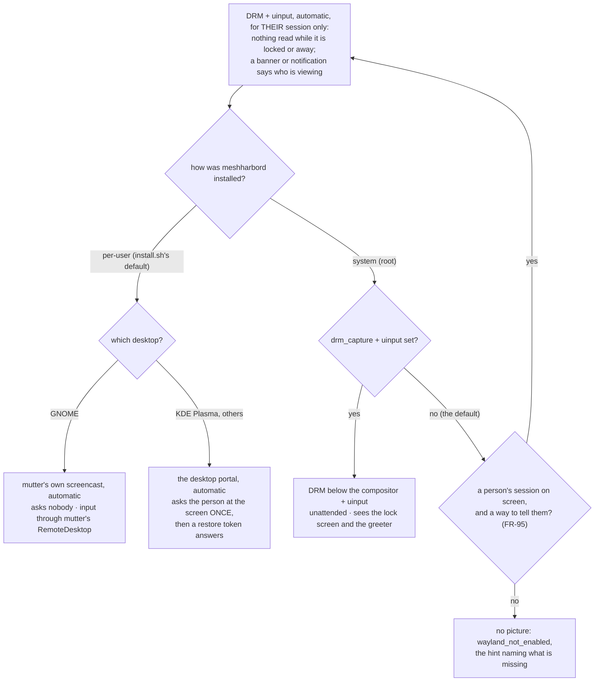
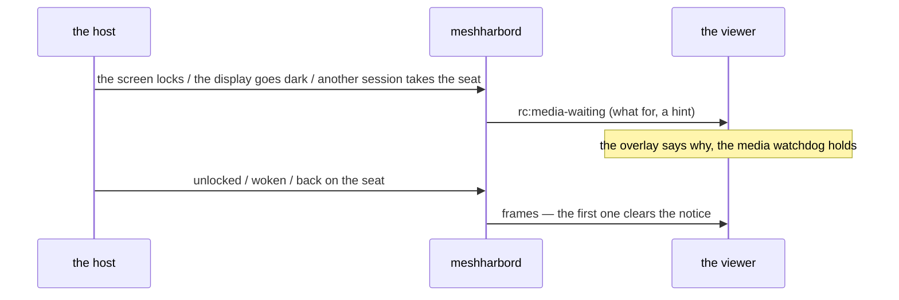

# Wayland — what works out of the box, and what the viewer says when it cannot

The support matrix for Linux Wayland desktops: for each desktop and install
type, whether a controller gets a picture, input and a cursor, whether anyone
at the screen is asked, what each session state does to the picture, and which
release carries each piece. This page is FR-93's
([spec](fr/FR-93-wayland-out-of-the-box.md), #1972). The mechanics behind
every row (the capture cascade, the helper, the PipeWire consumer, the DRM
worker) are in [`linux-capture.md`](linux-capture.md); this page links into it
rather than repeating it.

The shape of the problem, in one line: Wayland gives no process a readable
screen. Each way to get pixels sees something the others cannot, so **which
one a host uses depends on the desktop and on who runs the daemon**, and a
stock install picks for itself where it safely can.

## 1. The short answer

- **Per-user installs capture by themselves** (FR-93 P2, decision D1). The
  daemon runs inside the user's own Wayland session, so it can use the
  session's own screencast: mutter on GNOME, which asks nobody, else the
  desktop portal, which asks the person at the screen once.
- **System installs capture a person who can be told** ([FR-95](fr/FR-95-system-installs-on-by-default-on-wayland.md),
  #2041). A root daemon sits in no session. Its arms (DRM for the picture,
  `uinput` for input) work below the compositor, see the lock screen and the
  greeter, and inject into whatever has focus. So with no key set it switches
  them on by itself only for a **person's** session on screen, and only where
  that person is told they are being viewed and can end it (the companion's
  banner, else a notification with **Disconnect**). It then reads the screen
  only while that session is on screen and unlocked
  ([`linux-capture.md`](linux-capture.md) §1.2.1). Otherwise, or with the keys
  set to off, the viewer is told `wayland_not_enabled` and what is missing.
- **Every refusal names itself.** A Wayland desktop that no arm may capture
  says so, never a black stream and never "headless"
  ([`linux-capture.md`](linux-capture.md) §1.1).

## 2. The matrix

| Desktop | Install | Picture | Input | Cursor | Asks the person at the screen | Lock screen / greeter | Verified on |
|---|---|---|---|---|---|---|---|
| GNOME (mutter) | per-user, stock | ✅ mutter's ScreenCast, automatic ([`linux-capture.md`](linux-capture.md) §5) | ✅ mutter's RemoteDesktop, native windows included | ✅ drawn into the frames | **no** | ❌ GNOME shares no locked screen: the viewer waits for the unlock (§3 below) | 0.4.132 (picture, input, cursor) |
| KDE Plasma 6 | per-user, stock | ✅ the desktop portal, automatic ([`linux-capture.md`](linux-capture.md) §4) | ✅ the portal's RemoteDesktop (KDE's *Remote Control* dialog) | ✅ drawn into the frames | **once**: one dialog, then the restore token | ✅ KDE's portal streams the lock screen | picture 0.4.132 · input and cursor 0.4.133 |
| GNOME, KDE | system, stock, a person on screen who can be told | ✅ DRM, automatic, bound to their session (FR-95) | ✅ `uinput`, automatic, only while their session is on screen, unlocked | ✅ the cursor plane | **no**; the companion's banner or a notification says who is viewing, with Disconnect | 🔒 nothing read: the viewer waits (`screen_unlock`, `session_away`) | FR-95 candidate (lab, 2026-10-15) |
| GNOME, KDE | system, stock, the greeter on screen or nobody to tell | ❌ `wayland_not_enabled`, naming what is missing | — | — | — | — | 0.4.130 |
| GNOME, KDE | system, `drm_capture` + `uinput` | ✅ DRM: the scanout plane, below the compositor | ✅ `uinput`: host-global, it types into whatever has focus | ✅ the cursor plane, on the cursor channel | **no** | ✅ both are pixels on the scanout | picture 0.4.130 · input 0.4.128 · cursor 0.4.134 · idle cost 0.4.135 |
| wlroots (sway and others) | per-user, `portal_capture` | ⚠️ the portal through `xdg-desktop-portal-wlr`: proven only to the handshake (no GPU on the host measured) | ❌ the wlr portal has no RemoteDesktop | — | — | — | unproven |
| any | either, `MESHHARBORD_VIRTUAL_DESKTOP=1` | ✅ the daemon's own Xvfb, which it captures over X11 | ✅ | ✅ | no | — | (X11, not Wayland) |

"Verified on" names the released build each cell was measured on in the lab.
An idle DRM session costs **6.3 % of a core** on 0.4.135 (FR-93 AC8), where
0.4.133 spent 57.9 %: a frame nothing changed in is skipped
([`linux-capture.md`](linux-capture.md) §3.2).

⚠️ **The system arms are host-global by construction.** `uinput` injects below
the compositor into whatever has focus, the greeter included, and the DRM arm
shows whoever is at the screen. That is exactly why a system install switches
them on by itself only bound to one person's session, and reads and injects
nothing while that session is not on screen, unlocked (FR-95).

## 3. Session states

What each event does to a session in progress, measured with the lab's
lifecycle oracle (the viewer sampled every 500 ms; the spec's §4.6 and field
log). Each cell names the release it was measured on.

| Event | DRM (system, opt-in) | mutter (per-user GNOME) | portal (per-user KDE) |
|---|---|---|---|
| **lock → unlock** | keeps streaming: the lock screen is pixels | *"Waiting for this computer's screen to be unlocked"* within ~1.5 s, the desktop ~2 s after the unlock (0.4.135) | keeps streaming |
| **display switched off** (the idle blank) → wake | *"This computer's display is asleep"*, a picture ~1 s after the viewer's own mouse wakes it (0.4.135) | GNOME's idle blank also locks: as the lock | — |
| **resolution change** | follows in ~1.1 s | re-records the monitor at its new size in ~4.5 s (0.4.135) | renegotiates in place in ~1.5 s |
| **user switch** | follows the seat: the login screen in 3.3 s, back in 0.4 s | *"This computer is showing another session"* ~4 s in; the picture 0.5 s after the switch back (0.4.136) | watched the same way (0.4.136); not measured |
| **a viewer that connects during a user switch** | not measured | waits with the same notice, then the picture ~2 s after the switch back; through GNOME's *Switch User*, the unlock notice in turn (0.4.136) | the same wait (0.4.136); not measured |
| **logout → login** | follows the seat to the greeter and back | *Reconnecting* during the logout; the daemon starts with the next login, a picture ~5 s after it (0.4.135) | the same, a picture ~12 s after the login (0.4.135) |
| **compositor crash** | not measured | GNOME's shell crash ends the session like a logout, then as the login: a picture ~3.5 s after it (0.4.136) | KWin restarts, and the portal reopens from its token: a new picture ~4 s after the crash (0.4.136) |
| **suspend → resume** | not measured | *"This computer is going to sleep"* 1.5 s before the computer sleeps; after the wake, the lock's notice (GNOME locks as it sleeps), then the desktop after the unlock (P5h, lab) | the same notice 1.9 s before; after the wake KDE asks again for the screen share, so the picture waits for the person (P5h, lab) |

Before P5h a sleeping computer said nothing: on 0.4.136 the GNOME viewer dropped
5.6 s into the suspend with no reason, and KDE's read *Reconnecting* 8 s in
([`linux-capture.md`](linux-capture.md) §5.8). The lab's guests are virtual, so
a wake on real hardware is still owed (FR-93 AC12, Asahi).

⚠️ On 0.4.135 a running DRM session's *display asleep* notice can be lost to its own last
frame: the notice travels on the control channel and the last frame on the video one, and the viewer clears a
notice at the first frame it counts. The viewer then reconnects once, and the new session's notice holds.
0.4.136 tells the viewer only after 2 s with nothing sent, and the viewer counts only frames after the notice
([`linux-capture.md`](linux-capture.md) §5.6, P5f).

## 4. What the viewer tells you

When a session has no picture, the overlay says why, in the agent's words.
Two messages carry it (`useRemoteControl.ts`, `mediaWaitingCopy`).

| Message | `code` / `for` | Means | What to do |
|---|---|---|---|
| `rc:media-unavailable` | `wayland_not_enabled` | a Wayland desktop that no arm may capture; the hint names the keys **this install** can use | per-user: `portal_capture` (+ `mutter_capture` on GNOME) if the automatic arm is off; system: `drm_capture` + `uinput` |
| `rc:media-unavailable` | `backend_error` | an arm that was on, or that switched itself on, failed; the detail is its own error | read the detail: it names the arm and the cause |
| `rc:media-unavailable` | `backend_error`: *"…the person at the screen declined the request"* (0.4.136; before it, *"…exited before announcing a stream"*) | the person at the screen said no to remote control and then to a screen share | ask them; the next session asks again |
| `rc:media-unavailable` | `backend_error`: *"…the portal ended the request on its own…"* (the same release) | the portal refused without a dialog: its backend for this desktop is stopped or missing | restart the backend the detail names, then `xdg-desktop-portal` (`systemctl --user restart …`) |
| `rc:media-unavailable` | `backend_error`: *"…reading the scanout needs CAP_SYS_ADMIN (root)…"* (the same release; before it, the session re-created itself with no reason) | `drm_capture` is set on a per-user install, which cannot read the scanout | `meshharbor config clear drm_capture`: the desktop's own screencast takes over |
| `rc:media-waiting` | `person_at_screen` | the desktop portal is asking the person at the screen to share it (or to allow remote control) | someone at the computer answers; the viewer waits for the dialog's deadline instead of reconnecting |
| `rc:media-waiting` | `screen_unlock` | GNOME's screen is locked, and GNOME shares no locked screen | unlock it at the computer; the picture comes back by itself |
| `rc:media-waiting` | `display_wake` | the display is off, so DRM has no scanout to read | move the viewer's mouse, or any input at the computer |
| `rc:media-waiting` | `session_away` (0.4.136) | the computer shows the login screen or another user's session, and a per-user install shares only its own user's | switch back to that session at the computer |
| `rc:media-waiting` | `host_sleep` (FR-93 P5h) | the computer is going to sleep; the viewer then loses the connection | wake the computer; the viewer reconnects by itself, and the new session names what still holds the picture back (often the lock) |

An older viewer shows an unknown `for` under the dialog's title, with the
agent's hint below it, so a newer agent's words still read.

### 4.1 What the person at the screen sees (FR-93 AC10)

A device with `auto_grant_session = false` asks before every session. The
prompt surfaces are FR-27's chain ([`remote-control.md`](remote-control.md)
§11.2, "Prompt surfaces"). Measured on the FR-93 lab, on 0.4.135:

| | the prompt | while viewed |
|---|---|---|
| GNOME, per-user | the daemon's own panel, through Xwayland. Until P6a (0.4.137) it stayed on screen after the answer | GNOME's screen-sharing pill in the top bar; the companion's banner if it runs |
| KDE, per-user | the same panel, through KWin's Xwayland | KDE's tray indicator; the companion's banner if it runs |
| GNOME, system | the companion's window; with no companion, GNOME's own notification banner with **Approve** and **Deny** (P6f) | the companion's *Being viewed by …* banner, with **Disconnect** (a centred window: Wayland lets no client place itself) |
| KDE, system | the companion's window, from its `.rpm` (P6d, the lab); with no companion, KDE's own notification with **Approve** and **Deny** (P6f, the lab). Before them **none**: Fedora had no companion package, and the viewer waited | the companion's *Being viewed by …* banner, with **Disconnect**, which a DRM session starts by itself; with no companion, a notification with **Disconnect** (P6g). Before P6g **nothing** with DRM capture, which reads below the compositor |

A per-user daemon whose own panel cannot open (no Xwayland) starts the
companion for the prompt from P6b, through the user's own systemd manager. On
0.4.135 that launch waited on polkit and failed after 25 s.

Where neither a panel nor the companion can show the question, the daemon posts
it as the desktop's own notification (P6f), from inside the person's session, at
critical urgency. Approve and Deny answer it; closing it is a Deny; a click on its
body brings it back; and it leaves the screen when the question ends any other
way ([`remote-control.md`](remote-control.md), "Prompt surfaces").
`MESHHARBORD_NOTIFY_CONSENT=0` switches it off.

⚠️ **The desktop's own stop control did not end a session** on 0.4.135. The
square in GNOME's screen-sharing pill closed mutter's screencast, and a per-user
install opened a new one half a second later. KDE's **End** in its tray menu
froze the viewer instead, and P5d's reopen then undid it from the restore token
3 s later. From P6c (0.4.137), either one ends the session as the companion's
**Disconnect** does:
the viewer is told the person at the device ended it, and does not reconnect
([`linux-capture.md`](linux-capture.md) §5.7). `MESHHARBORD_SCREEN_STOP=0` puts
the reopen back.

## 5. Choosing an install

| | per-user | system + `drm_capture` + `uinput` |
|---|---|---|
| who must be signed in | the user whose install it is, on screen | nobody: the greeter is captured too |
| the lock screen | GNOME: waits for the unlock; KDE: streams | streams, and the viewer can unlock it |
| consent | GNOME: none (mutter asks nobody); KDE: one dialog, remembered | none |
| input reach | that user's session | the whole host, the greeter included |
| idle cost | the compositor sends a frame only when something changes (not measured the way AC8 was) | ~6 % of a core idle (0.4.135) |
| typical host | a workstation someone uses | an unattended machine, a kiosk, a server with a display |

A per-user install follows its user: a user switch, a logout or the login
screen leaves it without a picture until that user is back (§3 says what the
viewer shows meanwhile). A system install sees the seat, whoever is on it.

## 6. Where it has been proven

Every row above was measured on the FR-93 lab: persistent GNOME 50 and Plasma
6.7.5 guests, per-user and system installs, driven from outside the guest so
the harness, not the product, plays the person at the screen (the spec's §3.2;
how to run it: [`vmtest.md`](vmtest.md#the-wayland-lab-fr-93)).
Release builds were checked against their published digest and signature. The
arm-by-arm field record is [`linux-capture.md`](linux-capture.md) §6, and every
run, including the wrong turns, is in the spec's field-verification log.

Still owed (FR-93's open acceptance criteria): suspend and resume on a release
and on real hardware; KDE's
lifecycle on a release; a real GPU and Asahi on a release (AC12); the indicator
and consent prompt on every desktop (AC10, with FR-27); and X11, Windows and
macOS unchanged (AC11).

## 7. Configuration

The keys and kill switches are [`linux-capture.md`](linux-capture.md) §7. The
ones that decide this page:

| Key | Env | Default | Effect |
|---|---|---|---|
| `wayland_auto` | `MESHHARBORD_WAYLAND_AUTO` | **on** | a per-user daemon in its own Wayland session switches capture on by itself; off = everything opt-in, as before FR-93 P2 |
| `wayland_auto_system` | `MESHHARBORD_WAYLAND_AUTO_SYSTEM` | **on** | a system daemon switches DRM + `uinput` on by itself for a person's session it can tell (FR-95); off = the system half before FR-95 |
| `x11_auto_system` | `MESHHARBORD_X11_AUTO_SYSTEM` | **on** | the same for a person's **X11** session, where the desktop reports its lock (GNOME, KDE) (FR-113, [`linux-capture.md`](linux-capture.md) §1.2.2); off = 0.4.143: no picture of an X11 desktop by default |
| `wayland_aware` | `MESHHARBORD_WAYLAND_AWARE` | **on** | a Wayland desktop no arm may capture says `wayland_not_enabled`; off = the behaviour before FR-93, with no input-reach warning either (P1a) |
| `drm_capture`, `uinput` | `MESHHARBORD_DRM_CAPTURE`, `MESHHARBORD_UINPUT` | off | the system arms (§1) |
| `portal_capture`, `mutter_capture` | `MESHHARBORD_PORTAL_CAPTURE`, `MESHHARBORD_MUTTER_CAPTURE` | off | the per-user arms, explicitly; any capture key hands the choice back to the operator |
| — | `MESHHARBORD_MEDIA_WAITING` | on | the `rc:media-waiting` notices (§4); off = the viewer is told nothing and reconnects as before |
| — | `MESHHARBORD_SESSION_WATCH` | on | the user-switch notice (`session_away`); off = the last frame stays, with no reason |
| — | `MESHHARBORD_SLEEP_NOTICE` | on | the sleep notice (`host_sleep`) and the logind delay inhibitor that gives it time; off = a sleeping computer says nothing, as before P5h |
| — | `MESHHARBORD_NOTIFY_CONSENT` | on | a consent question no panel or companion can show goes to the desktop's notification (P6f); off = `no_prompt_surface` there, as before |
| — | `MESHHARBORD_VIEWING_NOTICE` | on | a session on the DRM arm, which no compositor indicator shows, starts the companion, else posts a being-viewed notification with Disconnect (P6g); off = nothing at the screen, as before |
